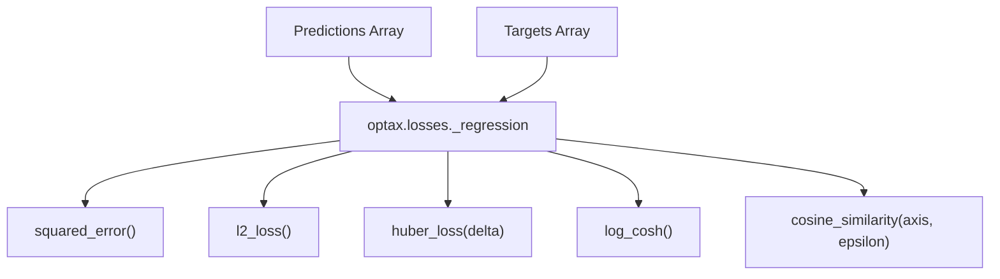
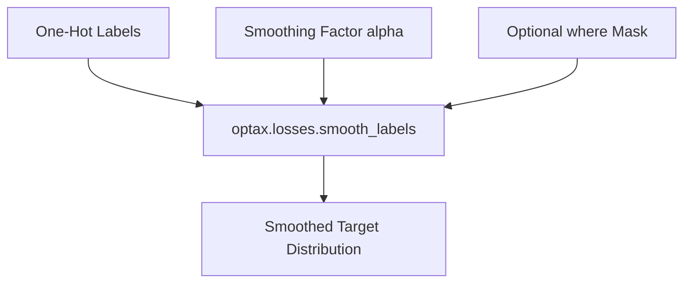
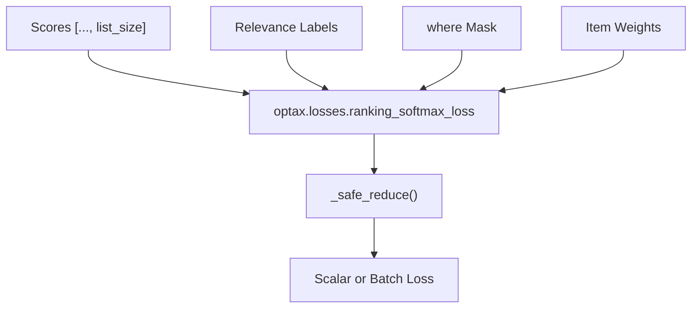
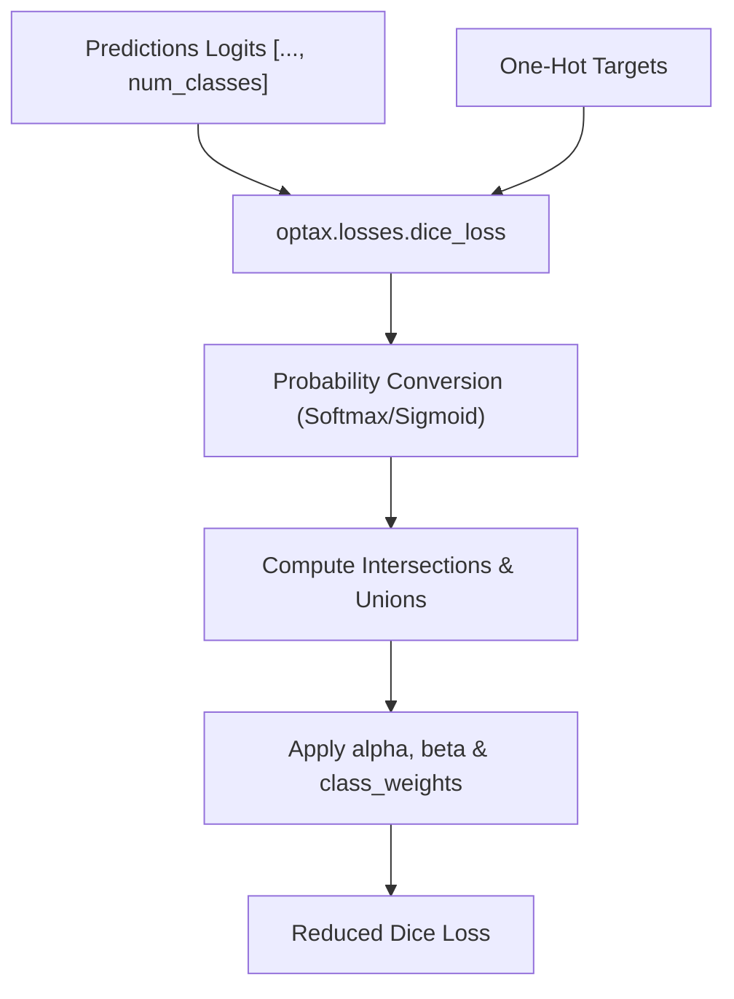
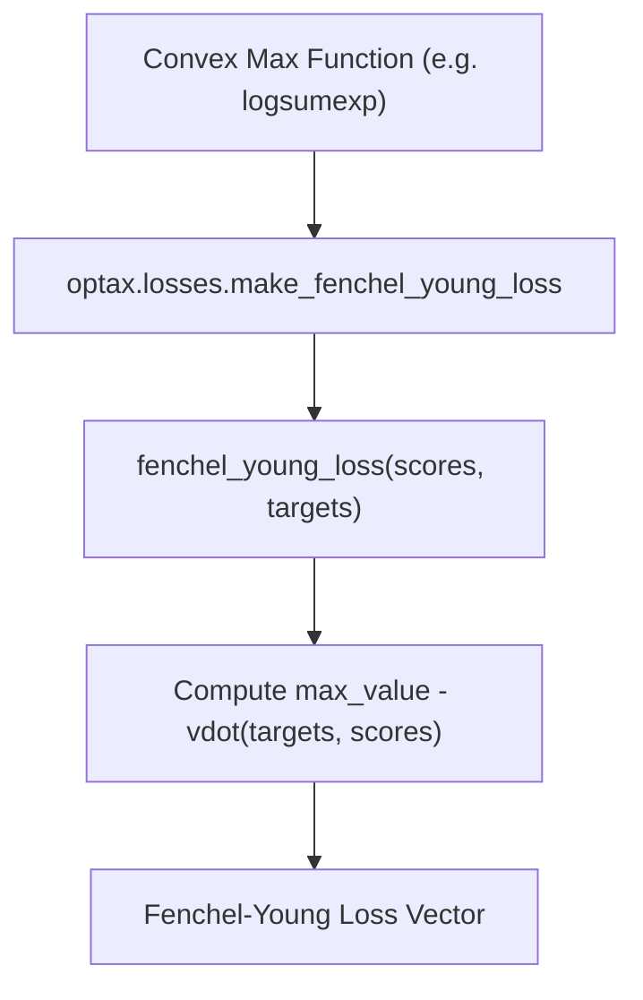

<!-- source: DeepWiki mcp.deepwiki.com · repo google-deepmind/optax · page 5.3 Regression, Ranking, Segmentation and Fenchel-Young Losses · fetched 2026-10-26 -->

# Regression, Ranking, Segmentation and Fenchel-Young Losses

Relevant source files

The following files were used as context for generating this wiki page:

- [optax/_src/lbfgs_test.py](optax/_src/lbfgs_test.py)
- [optax/losses/_fenchel_young.py](optax/losses/_fenchel_young.py)
- [optax/losses/_fenchel_young_test.py](optax/losses/_fenchel_young_test.py)
- [optax/losses/_ranking.py](optax/losses/_ranking.py)
- [optax/losses/_ranking_test.py](optax/losses/_ranking_test.py)
- [optax/losses/_regression.py](optax/losses/_regression.py)
- [optax/losses/_regression_test.py](optax/losses/_regression_test.py)
- [optax/losses/_segmentation.py](optax/losses/_segmentation.py)
- [optax/losses/_segmentation_test.py](optax/losses/_segmentation_test.py)
- [optax/losses/_smoothing.py](optax/losses/_smoothing.py)
- [optax/losses/_smoothing_test.py](optax/losses/_smoothing_test.py)

This page documents the non-classification loss functions and utility modules provided by Optax under `optax.losses`. These losses cater to continuous regression tasks, probability smoothing, item ranking, image/tensor segmentation, and convex optimization via the Fenchel-Young duality framework.

---

## 1. Regression Losses

Optax provides standard metrics for continuous target prediction in `optax/losses/_regression.py`. These functions operate elementwise or along specified dimensions, handling broadcasting between predictions and targets.

### Key Functions
*   **`squared_error`**: Computes elementwise squared differences between `predictions` and `targets` [optax/losses/_regression.py:24-53](). If targets are omitted, they default to zeros.
*   **`l2_loss`**: Scaled variant where `l2_loss = 0.5 * squared_error` [optax/losses/_regression.py:55-75]().
*   **`huber_loss`**: Combines L2 behavior near zero and L1 behavior for larger errors, controlled by a `delta` parameter [optax/losses/_regression.py:77-110]().
*   **`log_cosh`**: Computes $\log(\cosh(\text{error}))$, offering a twice-differentiable smooth approximation to absolute error [optax/losses/_regression.py:112-139]().
*   **`cosine_similarity`**: Computes the inner product of normalized vector representations along a designated `axis` [optax/losses/_regression.py:141-182]().

*Sources: [optax/losses/_regression.py:24-182]*

---

## 2. Label Smoothing

Label smoothing replaces hard one-hot targets with a mixture of the original label and a uniform distribution across categories, improving model calibration and preventing overconfidence.

### Implementation
The smoothing transformation is defined in `optax/losses/_smoothing.py`:
*   **`smooth_labels`**: Computes `(1.0 - alpha) * labels + alpha / num_categories` [optax/losses/_smoothing.py:24-56](). Supports custom masking via the `where` parameter and reduction over specific axes.

*Sources: [optax/losses/_smoothing.py:24-56]*

---

## 3. Ranking Losses

Ranking losses measure the cost of item orderings induced by model scores versus relevance labels. They are implemented in `optax/losses/_ranking.py`.

### Key Functions
*   **`ranking_softmax_loss`**: Computes the cross-entropy loss over softmax-normalized scores across a list dimension [optax/losses/_ranking.py:110-168]().
*   **`_safe_reduce`**: Internal helper that avoids `NaN` outputs during masked mean reductions when all items in a list are masked out [optax/losses/_ranking.py:58-107]().

*Sources: [optax/losses/_ranking.py:58-169]*

---

## 4. Segmentation Losses

Segmentation losses evaluate pixel-wise or voxel-wise classifications for image and tensor segmentation tasks.

### Key Functions
*   **`dice_loss`**: Computes the Soft Dice Loss (and Tversky loss via `alpha` and `beta` parameters) for binary and multi-class segmentation [optax/losses/_segmentation.py:37-144](). Supports class weighting, background exclusion, and automatic probability conversion via softmax/sigmoid.

*Sources: [optax/losses/_segmentation.py:37-144]*

---

## 5. Fenchel-Young Loss Framework

The Fenchel-Young loss framework provides a principled way to construct convex losses from any convex max-like function (such as `logsumexp` or max operators).

### Key Functions
*   **`make_fenchel_young_loss`**: Higher-order function taking a `max_fun` callable and returning a custom loss function matching the signature `fenchel_young_loss(scores, targets, *args, **kwargs)` [optax/losses/_fenchel_young.py:29-62](). The loss is computed as $\Omega^*(targets) - \langle targets, scores \rangle + \Omega(scores)$ via Fenchel-Bragg duality.

*Sources: [optax/losses/_fenchel_young.py:23-62]*

---

