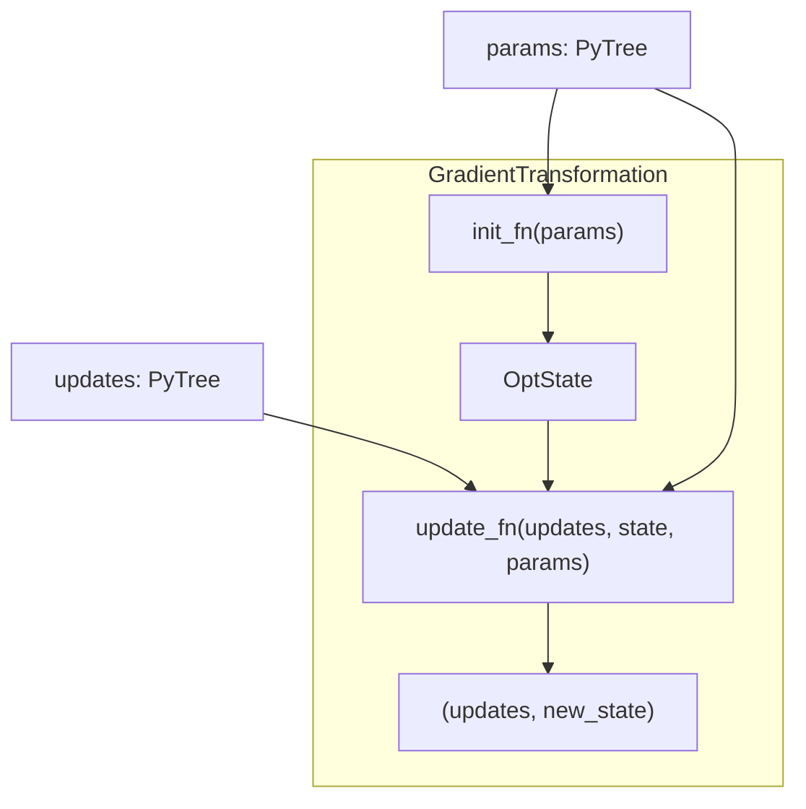
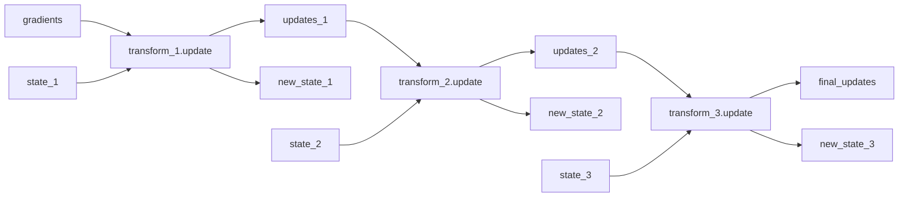

<!-- source: DeepWiki mcp.deepwiki.com · repo google-deepmind/optax · page 6 Gradient Transformations · fetched 2026-10-26 -->

# Gradient Transformations

Relevant source files

The following files were used as context for generating this wiki page:

- [docs/api/optimizers.rst](docs/api/optimizers.rst)
- [docs/api/transformations.rst](docs/api/transformations.rst)
- [optax/_src/alias.py](optax/_src/alias.py)
- [optax/_src/transform.py](optax/_src/transform.py)

Gradient transformations form the foundation of Optax's modular optimization architecture. A gradient transformation is a functional unit that processes gradients and updates an internal state, enabling the composition of complex optimization algorithms from simple, reusable components [optax/_src/base.py:40-70](), [optax/_src/transform.py:15-30]().

This page provides a high-level architectural overview of the low-level gradient transformation system. For detailed specifications and implementations of individual transformations, wrappers, and accumulation utilities, see the child pages:
- [Core Transformations](#6.1) — Fundamental transformations like `scale_by_adam`, `scale_by_rms`, `trace`, `ema`, adding noise/weight decay, and clipping/constraining transforms
- [Transformation Wrappers](#6.2) — Conditional execution (`apply_if_finite`), masking, freezing, monitoring, layout flattening, and behavior-modifying wrappers
- [Gradient Accumulation and Microbatching](#6.3) — `MultiSteps` accumulation, microbatching, and experimental aggregating/sharding utilities for large-batch training

Sources: [optax/_src/base.py:40-70](), [optax/_src/transform.py:15-30]()

## The GradientTransformation Protocol

All gradient transformations adhere to the `GradientTransformation` protocol defined in [optax/_src/base.py:40-70](). This protocol consists of a `NamedTuple` containing two core functions: `init_fn` and `update_fn`.

Title: "GradientTransformation Protocol"

- **`init(params)`**: Inspects model parameters (`PyTree`) to initialize and return the internal optimizer state (`OptState`) [optax/_src/base.py:40-55]().
- **`update(updates, state, params=None)`**: Accepts incoming gradient updates and current state, returning modified updates and the updated state [optax/_src/base.py:56-70]().

Sources: [optax/_src/base.py:40-70]()

## Composing Transformations with chain

Optimizers in Optax are constructed by chaining multiple `GradientTransformation` objects using `combine.chain`. Each transformation sequentially processes the output updates of its predecessor [optax/_src/alias.py:143-157]().

Title: "Transformation Chaining Flow"

The composition mechanism maintains a tuple of states corresponding to each transformation in the chain, routing state updates appropriately during the optimization step.

Sources: [optax/_src/alias.py:143-157]()

## Core Transformations

Core transformations provide the mathematical operations required by modern optimization algorithms, such as moment tracking (`scale_by_adam`, `scale_by_rms`), momentum accumulation (`trace`), weight decay (`add_decayed_weights`), and gradient clipping (`clip_by_global_norm`) [optax/_src/transform.py:45-151](). These components can be mixed and matched to replicate standard optimizers like Adam, RMSProp, and SGD.

For detailed documentation, parameters, and mathematical definitions of these building blocks, see [Core Transformations](#6.1).

Sources: [optax/_src/transform.py:45-151]()

## Transformation Wrappers

Transformation wrappers modify the execution flow or behavior of underlying gradient transformations without altering their core logic. Examples include conditional execution via `apply_if_finite`, parameter masking (`masked`), freezing specific layers (`freeze`), and step-skipping (`apply_every`) [docs/api/transformations.rst:1-113]().

For detailed patterns on conditional application and stateful wrapping, see [Transformation Wrappers](#6.2).

Sources: [docs/api/transformations.rst:1-113]()

## Gradient Accumulation and Microbatching

To support large-batch training and memory-constrained environments, Optax provides gradient accumulation and microbatching mechanisms. These utilities aggregate gradients over multiple forward-backward passes before executing the primary optimizer update step [optax/_src/transform.py:26-26]().

For implementation details on `MultiSteps` and related batching utilities, see [Gradient Accumulation and Microbatching](#6.3).

Sources: [optax/_src/transform.py:26-26]()

---

