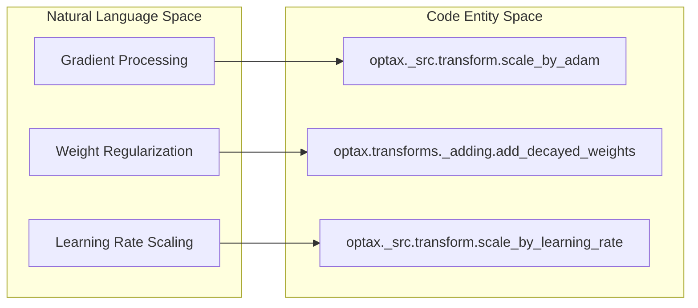
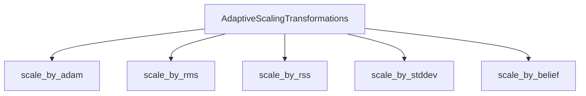
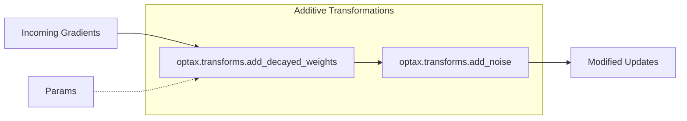

<!-- source: DeepWiki mcp.deepwiki.com · repo google-deepmind/optax · page 6.1 Core Transformations · fetched 2026-10-26 -->

# Core Transformations

<details>
<summary>Relevant source files</summary>

The following files were used as context for generating this wiki page:

- [optax/_src/alias.py](optax/_src/alias.py)
- [optax/_src/constrain.py](optax/_src/constrain.py)
- [optax/_src/float64_test.py](optax/_src/float64_test.py)
- [optax/_src/transform.py](optax/_src/transform.py)
- [optax/contrib/_privacy.py](optax/contrib/_privacy.py)
- [optax/contrib/_privacy_test.py](optax/contrib/_privacy_test.py)
- [optax/transforms/_adding.py](optax/transforms/_adding.py)
- [optax/transforms/_adding_test.py](optax/transforms/_adding_test.py)
- [optax/transforms/_clipping.py](optax/transforms/_clipping.py)
- [optax/transforms/_clipping_test.py](optax/transforms/_clipping_test.py)
- [optax/transforms/_combining_test.py](optax/transforms/_combining_test.py)

</details>


This page documents the fundamental gradient transformations in Optax that serve as building blocks for optimizers. These low-level transformations implement specific components of optimization algorithms (adaptive scaling, momentum, weight decay, noise addition, clipping) and can be composed using `optax.chain` to build complete optimizers. For information about optimizer composition patterns, see [Optimizer Composition](#2.3).

## Overview

Core transformations are atomic operations that transform gradients during optimization. Each transformation maintains internal state and implements a specific aspect of an optimization algorithm via the `base.GradientTransformation` protocol (`init` and `update` functions) [optax/_src/base.py:1-100]().


**Diagram: Mapping Optimization Concepts to `optax` Code Entities**

Sources: [optax/_src/transform.py:239-309](), [optax/transforms/_adding.py:35-90](), [optax/_src/transform.py:1434-1482]()

## Transformation Categories

Core transformations in Optax fall into several functional categories:

| Category | Purpose | Examples |
|----------|---------|----------|
| **Adaptive Scaling** | Scale gradients based on gradient statistics | `scale_by_adam`, `scale_by_rms`, `scale_by_rss` |
| **Momentum/Trace** | Accumulate gradient history | `trace`, `ema` |
| **Simple Scaling** | Apply fixed or scheduled scaling | `scale`, `scale_by_learning_rate` |
| **Additive & Regularization** | Inject noise or weight decay | `add_decayed_weights`, `add_noise` |
| **Clipping & Constraints** | Bound gradient or parameter magnitudes | `clip`, `clip_by_global_norm`, `clip_by_block_rms` |

Sources: [optax/_src/transform.py:40-1772](), [optax/transforms/_adding.py:35-179](), [optax/transforms/_clipping.py:31-112]()

## Adaptive Scaling Transformations

Adaptive scaling transformations adjust gradient magnitudes based on gradient statistics accumulated over time.


**Diagram: Adaptive Scaling Code Entities**

Sources: [optax/_src/transform.py:45-309](), [optax/_src/transform.py:662-717]()

### scale_by_adam

The `scale_by_adam` transformation maintains exponential moving averages of first and second moments of gradients.

**State**: `ScaleByAdamState(count, mu, nu)` [optax/_src/transform.py:235-245]
- `count`: Step counter for bias correction
- `mu`: First moment (exponential moving average of gradients)
- `nu`: Second moment (exponential moving average of squared gradients)

**Update rule**:
```
mu_t = b1 * mu_{t-1} + (1-b1) * g_t
nu_t = b2 * nu_{t-1} + (1-b2) * g_t^2
mu_hat = mu_t / (1 - b1^t)
nu_hat = nu_t / (1 - b2^t)
update = mu_hat / (sqrt(nu_hat + eps_root) + eps)
```

Sources: [optax/_src/transform.py:247-309]()

### scale_by_rms

The `scale_by_rms` transformation implements RMSProp-style scaling using only second moment statistics.

**State**: `ScaleByRmsState` or `ScaleByRmsWithCountState` [optax/_src/transform.py:80-94]
- `nu`: Exponential moving average of squared gradients

Sources: [optax/_src/transform.py:95-151]()

### scale_by_rss

The `scale_by_rss` transformation implements Adagrad-style scaling, accumulating all squared gradients from the beginning of training.

**State**: `ScaleByRssState(sum_of_squares)` [optax/_src/transform.py:39-44]

Sources: [optax/_src/transform.py:45-78]()

### scale_by_belief

The `scale_by_belief` transformation adapts step sizes based on the variance of prediction errors `(g_t - mu_t)^2`.

Sources: [optax/_src/transform.py:662-717]()

## Momentum and Trace Transformations

Momentum transformations accumulate gradient history to smooth optimization.

### trace

The `trace` transformation implements classical momentum by maintaining a weighted sum of past gradients.

**State**: `TraceState(trace)` [optax/transforms/_accumulation.py:31-36]

Sources: [optax/transforms/_accumulation.py:37-80]()

### ema

The `ema` transformation computes an exponential moving average of gradients, normalizing by `(1-decay)` in each step.

Sources: [optax/transforms/_accumulation.py:90-132]()

## Additive and Regularization Transformations

Additive transformations inject stochasticity or weight decay into the gradient stream.


**Diagram: Additive Transformations Data Flow**

Sources: [optax/transforms/_adding.py:35-179]()

### add_decayed_weights

The `add_decayed_weights` function adds parameter values scaled by `weight_decay` directly to the gradient updates [optax/transforms/_adding.py:35-90]().

**State**: `WeightDecaySchedule` if scheduled, else `EmptyState` [optax/transforms/_adding.py:30-58]

**Update rule**:
```
updates = g + weight_decay * params
```

Supports optional masking via `mask` or `weight_decay_mask` to exclude parameters like biases or batch normalization statistics [optax/transforms/_adding.py:80-87]().

Sources: [optax/transforms/_adding.py:35-90]()

### add_noise

The `add_noise` transformation adds Gaussian noise with an annealed schedule to the gradients [optax/transforms/_adding.py:99-179]().

**State**: `AddNoiseState(count, rng_key)` [optax/transforms/_adding.py:92-97]

**Update rule**:
```
standard_deviation = sqrt(eta / count^gamma)
noise = random_normal(rng_key)
updates = updates + standard_deviation * noise
```

Sources: [optax/transforms/_adding.py:99-179]()

## Clipping and Constraining Transformations

Clipping transformations bound update magnitudes to ensure numerical stability and prevent exploding gradients.

### clip

The `clip` function clips updates element-wise to `[-max_delta, +max_delta]` [optax/transforms/_clipping.py:31-47]().

Sources: [optax/transforms/_clipping.py:31-47]()

### clip_by_block_rms

The `clip_by_block_rms` function scales down update blocks (such as weight matrices or vectors) if their Root Mean Square (RMS) exceeds a given threshold [optax/transforms/_clipping.py:49-77]().

Sources: [optax/transforms/_clipping.py:49-77]()

### clip_by_global_norm

The `clip_by_global_norm` function scales all updates in a PyTree by the global L2 norm if it exceeds `max_norm` [optax/transforms/_clipping.py:79-112]().

**Update rule**:
```
g_norm = norm(updates)
scaling = minimum(1.0, max_norm / g_norm)
updates = updates * scaling
```

Sources: [optax/transforms/_clipping.py:79-112]()

### per_example_global_norm_clip

The `per_example_global_norm_clip` function clips per-example gradients along their batch dimension, commonly used in differential privacy pipelines [optax/transforms/_clipping.py:121-170]().

Sources: [optax/transforms/_clipping.py:121-170]()

## Best Practices

1. **Global Norm Clipping**: Use `clip_by_global_norm` as a default choice for deep models prone to exploding gradients.
2. **Weight Decay Ordering**: When chaining transformations, place `add_decayed_weights` correctly relative to adaptive scaling (e.g., decoupled weight decay in AdamW vs coupled in standard Adam).
3. **Differential Privacy**: Ensure `per_example_global_norm_clip` or `differentially_private_aggregate` receives batched inputs with the batch dimension at axis 0 [optax/contrib/_privacy.py:36-70]().

Sources: [optax/transforms/_clipping.py:79-112](), [optax/contrib/_privacy.py:36-70]()

## Related Pages

- [Optimizer Composition](#2.3)
- [Transformation Wrappers](#6.2)
- [Projections](#7.3)

Sources: [optax/_src/alias.py:1-166]()

---

