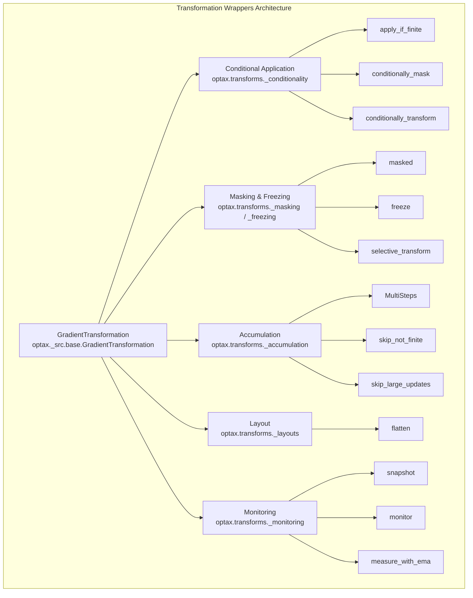
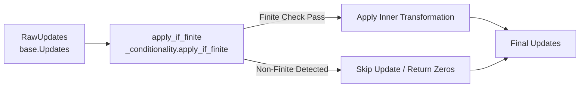
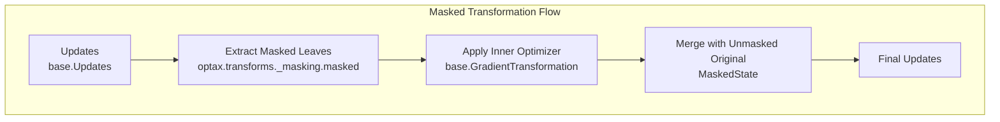
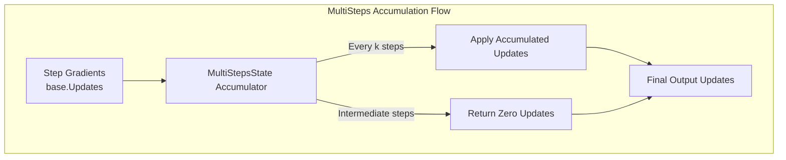
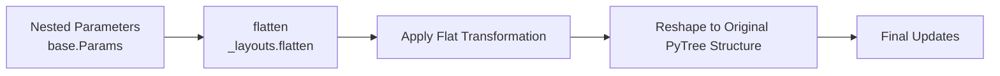
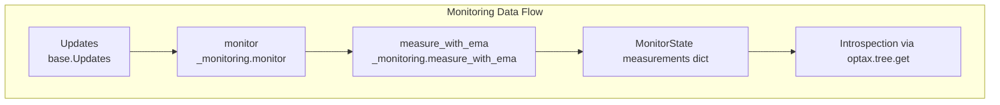
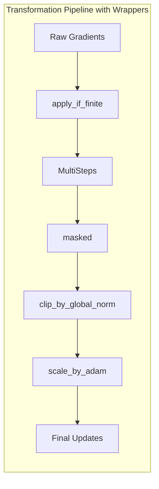
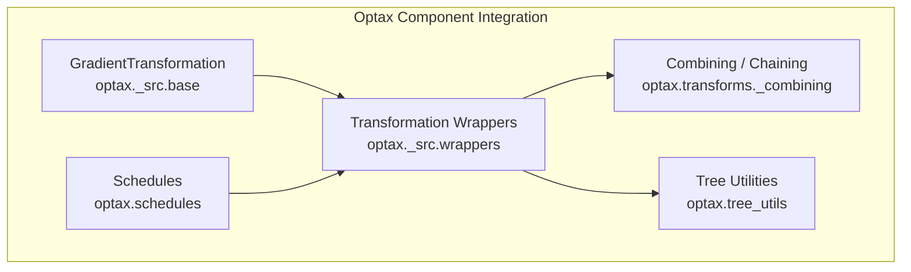

<!-- source: DeepWiki mcp.deepwiki.com · repo google-deepmind/optax · page 6.2 Transformation Wrappers · fetched 2026-10-26 -->

# Transformation Wrappers

<details>
<summary>Relevant source files</summary>

The following files were used as context for generating this wiki page:

- [docs/api/apply_updates.rst](docs/api/apply_updates.rst)
- [docs/api/combining_optimizers.rst](docs/api/combining_optimizers.rst)
- [docs/api/optimizer_schedules.rst](docs/api/optimizer_schedules.rst)
- [docs/api/optimizer_wrappers.rst](docs/api/optimizer_wrappers.rst)
- [optax/__init__.py](optax/__init__.py)
- [optax/_src/schedule.py](optax/_src/schedule.py)
- [optax/_src/transform_test.py](optax/_src/transform_test.py)
- [optax/_src/wrappers.py](optax/_src/wrappers.py)
- [optax/contrib/_acprop.py](optax/contrib/_acprop.py)
- [optax/optax_test.py](optax/optax_test.py)
- [optax/transforms/__init__.py](optax/transforms/__init__.py)
- [optax/transforms/_conditionality.py](optax/transforms/_conditionality.py)
- [optax/transforms/_conditionality_test.py](optax/transforms/_conditionality_test.py)
- [optax/transforms/_constraining.py](optax/transforms/_constraining.py)
- [optax/transforms/_freezing.py](optax/transforms/_freezing.py)
- [optax/transforms/_freezing_test.py](optax/transforms/_freezing_test.py)
- [optax/transforms/_layouts.py](optax/transforms/_layouts.py)
- [optax/transforms/_masking.py](optax/transforms/_masking.py)
- [optax/transforms/_masking_test.py](optax/transforms/_masking_test.py)
- [optax/transforms/_monitoring.py](optax/transforms/_monitoring.py)
- [optax/transforms/_monitoring_test.py](optax/transforms/_monitoring_test.py)

</details>


This document details the transformation wrappers in Optax, which provide higher-level functionality for controlling how gradient transformations are applied. Transformation wrappers modify the behavior of gradient transformations by adding capabilities like conditional application, masking, parameter freezing, gradient accumulation, layout manipulation, and monitoring. These wrappers build upon the core `GradientTransformation` abstraction [optax/_src/base.py:68-68]().

## Overview of Transformation Wrappers

Transformation wrappers enhance gradient transformations with additional control mechanisms without changing their fundamental operation. They act as decorators that add specific behaviors to existing transformations [optax/_src/wrappers.py:15-38]().



Sources: [optax/_src/base.py:68-68](), [optax/_src/wrappers.py:15-38]()

## Conditional Application Wrappers

Conditional application wrappers allow gradient transformations to be applied selectively based on specified conditions [optax/_src/wrappers.py:18]().

### apply_if_finite

The `apply_if_finite` wrapper applies a transformation only if all gradients are finite, skipping the update otherwise. This is useful for handling numerical instability [optax/_src/wrappers.py:23]().



### conditionally_transform and conditionally_mask

The `conditionally_transform` wrapper applies a transformation based on a user-defined condition function [optax/_src/wrappers.py:27](). Similarly, `conditionally_mask` combines conditional application with masking [optax/_src/wrappers.py:26]().

Sources: [optax/_src/wrappers.py:23-29](), [optax/_src/base.py:68-82]()

## Masking and Freezing Wrappers

Masking and freezing wrappers allow for selective application of transformations to different parts of the parameter tree, or holding specific parameters constant.

### masked

The `masked` wrapper applies a transformation only to selected parameters, identified by a boolean mask. Parameters not selected by the mask remain unchanged [optax/_src/wrappers.py:31]().



### freeze and selective_transform

The `freeze` wrapper zeroes out gradient updates for parameters where `mask=True`, effectively freezing them [optax/transforms/_freezing.py:29-61](). The `selective_transform` function partitions updates so that only un-frozen parameters are optimized by an inner optimizer [optax/transforms/_freezing.py:64-106]().

Sources: [optax/_src/wrappers.py:31-33](), [optax/transforms/_freezing.py:29-106]()

## Accumulation Wrappers

Accumulation wrappers modify how updates are accumulated over multiple steps, enabling techniques like gradient accumulation and skipping problematic updates [optax/_src/wrappers.py:17]().

### MultiSteps

The `MultiSteps` wrapper accumulates gradients over multiple steps before applying an update. This is useful for simulating larger batch sizes or dealing with memory constraints [optax/_src/wrappers.py:34]().



### skip_not_finite and skip_large_updates

The `skip_not_finite` function creates a condition function that returns `True` only when all elements in the update are finite [optax/_src/wrappers.py:37](). The `skip_large_updates` function checks if the update norm is below a specified threshold [optax/_src/wrappers.py:38]().

Sources: [optax/_src/wrappers.py:34-38](), [optax/transforms/_accumulation.py:19-27]()

## Layout Wrappers

Layout wrappers modify the structure of parameters or gradients to enable different processing patterns [optax/_src/wrappers.py:19]().

### flatten

The `flatten` wrapper flattens nested parameter structures before applying a transformation, then reshapes the results back to the original structure [optax/_src/wrappers.py:30]().



Sources: [optax/_src/wrappers.py:30](), [optax/transforms/_layouts.py:15-30]()

## Monitoring and Debugging Wrappers

Monitoring wrappers capture statistics and telemetry from gradients and updates during optimization chains [optax/transforms/_monitoring.py:15]().

### snapshot, monitor, and measure_with_ema

- `snapshot`: Captures intermediate update measurements and stores them in the state [optax/transforms/_monitoring.py:29-83]().
- `monitor`: Extends snapshotting to support stateful measurements such as moving averages [optax/transforms/_monitoring.py:90-182]().
- `measure_with_ema`: Takes a measurement and tracks it using an exponential moving average [optax/transforms/_monitoring.py:184-192]().



Sources: [optax/transforms/_monitoring.py:29-192]()

## Integration with Transformation Chains

Transformation wrappers are commonly used within transformation chains to compose complex optimization behaviors [optax/_src/transform_test.py:88-92]().



Sources: [optax/_src/wrappers.py:15-38](), [optax/_src/transform_test.py:88-92]()

## Example Usage Patterns

Here are common patterns for using transformation wrappers:

1. **Safe Optimization**: Wrapping optimizers with `apply_if_finite` to avoid NaN propagation [optax/_src/wrappers.py:23]()
   ```python
   safe_optimizer = apply_if_finite(sgd(learning_rate=0.1))
   ```

2. **Gradient Accumulation**: Using `MultiSteps` to simulate larger batch sizes [optax/_src/wrappers.py:34]()
   ```python
   accumulation_optimizer = MultiSteps(sgd(learning_rate=0.1), every_k_schedule=4)
   ```

3. **Parameter Freezing**: Using `freeze` or `masked` to update only specific parameters [optax/transforms/_freezing.py:29]()
   ```python
   freezer = freeze({'layer1': True, 'layer2': False})
   ```

4. **Monitoring Updates**: Capturing intermediate norms using `snapshot` [optax/transforms/_monitoring.py:29]()
   ```python
   monitored_opt = chain(sgd(0.1), snapshot('grad_norm', optax.tree.norm))
   ```

Sources: [optax/_src/wrappers.py:23-38](), [optax/transforms/_freezing.py:29-61](), [optax/transforms/_monitoring.py:29-83]()

## Relationship to Other Components

Transformation wrappers build directly on top of the `GradientTransformation` protocol and integrate with tree utilities and combining patterns [optax/_src/base.py:68-82]().



Sources: [optax/_src/base.py:68-82](), [optax/_src/wrappers.py:15-38]()

---

