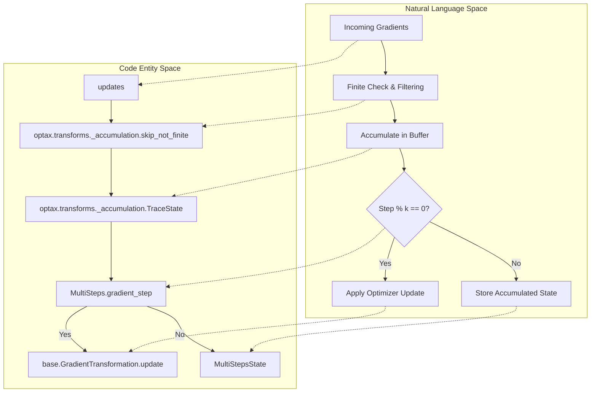
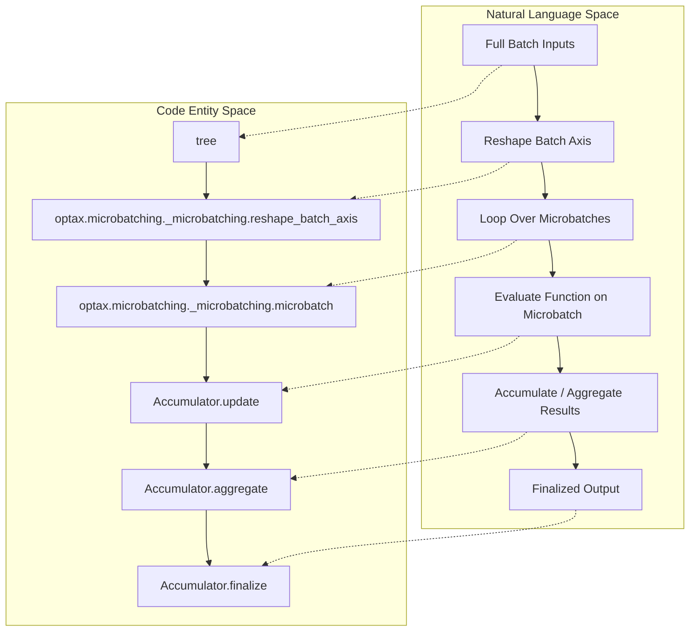

<!-- source: DeepWiki mcp.deepwiki.com · repo google-deepmind/optax · page 6.3 Gradient Accumulation and Microbatching · fetched 2026-10-26 -->

# Gradient Accumulation and Microbatching

Relevant source files

The following files were used as context for generating this wiki page:

- [docs/api/experimental.rst](docs/api/experimental.rst)
- [examples/gradient_accumulation_and_microbatching.ipynb](examples/gradient_accumulation_and_microbatching.ipynb)
- [optax/CHANGELOG.md](optax/CHANGELOG.md)
- [optax/_src/sharding_test.py](optax/_src/sharding_test.py)
- [optax/experimental/__init__.py](optax/experimental/__init__.py)
- [optax/experimental/_aggregating.py](optax/experimental/_aggregating.py)
- [optax/experimental/_aggregating_test.py](optax/experimental/_aggregating_test.py)
- [optax/microbatching/__init__.py](optax/microbatching/__init__.py)
- [optax/microbatching/_microbatching.py](optax/microbatching/_microbatching.py)
- [optax/microbatching/_microbatching_test.py](optax/microbatching/_microbatching_test.py)
- [optax/transforms/_accumulation.py](optax/transforms/_accumulation.py)
- [optax/transforms/_accumulation_test.py](optax/transforms/_accumulation_test.py)
- [optax/transforms/_constraining_test.py](optax/transforms/_constraining_test.py)

## Purpose and Scope

This page documents Optax's infrastructure for scaling training beyond hardware memory limits through gradient accumulation, microbatching, and experimental aggregation utilities. These components allow training with large effective batch sizes by splitting computation into memory-manageable chunks, accumulating intermediate gradients or updates, and orchestrating stateful pre- and post-processing pipelines.

Sources: `optax/microbatching/_microbatching.py:16-68` [optax/microbatching/_microbatching.py:1-68](), `optax/transforms/_accumulation.py:15-159` [optax/transforms/_accumulation.py:1-159](), `optax/experimental/_aggregating.py:15-78` [optax/experimental/_aggregating.py:1-78]()

---

## MultiSteps Gradient Accumulation

Gradient accumulation across multiple forward/backward passes without updating model parameters is implemented via the multi-step transformation infrastructure. This pattern enables larger effective batch sizes when physical memory cannot accommodate a single large batch.

The multi-step wrapper tracks internal counters and determines whether to apply the proposed updates or accumulate them based on a step modulus $k$. It supports custom update skipping functions such as `skip_not_finite` and `skip_large_updates` to reject corrupted gradient steps before they enter the accumulation buffer or optimizer state [optax/transforms/_accumulation.py:134-198]().

### Diagram: Multi-Step Gradient Accumulation Flow

Sources: `optax/transforms/_accumulation.py:134-198` [optax/transforms/_accumulation.py:134-198]()

---

## The Microbatching Module (`optax.microbatching`)

The `optax.microbatching` module provides a general-purpose function transformation (`microbatch`) that lifts a function operating over a full batch into one executing over smaller chunks (microbatches) while correctly aggregating outputs, losses, or gradients [optax/microbatching/_microbatching.py:16-68]().

### Core Components and Data Flow

1. **`Accumulator`**: Encapsulates the logic for initializing, updating, finalizing, and aggregating values across microbatches [optax/microbatching/_microbatching.py:39-68](). Built-in accumulators handle summation (`_sum`), averaging (`_mean`), running means, and concatenation (`CONCAT`) [optax/microbatching/_microbatching.py:176-194]().
2. **`reshape_batch_axis`**: Reshapes the batch axis of PyTree leaves into `(num_microbatches, microbatch_size)` using column-major order to preserve explicit XLA sharding configurations [optax/microbatching/_microbatching.py:84-129]().

### Diagram: Microbatching Execution Pipeline

Sources: `optax/microbatching/_microbatching.py:39-194` [optax/microbatching/_microbatching.py:39-194](), `optax/_src/sharding_test.py:113-144` [optax/_src/sharding_test.py:113-144]()

---

## Experimental Aggregating and Sharding Utilities (`optax.experimental.aggregating`)

For advanced large-batch training paradigms that require per-sample transformations (such as per-sample gradient clipping or differential privacy noise injection), Optax provides experimental aggregation wrappers in `optax.experimental.aggregating` [optax/experimental/_aggregating.py:15-78]().

### Pipeline Architecture

The `process` function chains three distinct stages into a unified `GradientTransformation` or `Aggregator`:
1. **Preprocessor**: Transforms per-example gradients into per-example updates (e.g., per-sample clipping via `optax.projections`) [optax/experimental/_aggregating.py:79-148]().
2. **Aggregator**: Reduces per-example updates into an aggregated update vector using stateful accumulation or averaging [optax/experimental/_aggregating.py:149-160]().
3. **Postprocessor**: Applies standard optimizer transformations (such as Adam or SGD updates) to the aggregated gradient [optax/experimental/_aggregating.py:161-175]().

Sources: `optax/experimental/_aggregating.py:79-178` [optax/experimental/_aggregating.py:79-178]()

---

