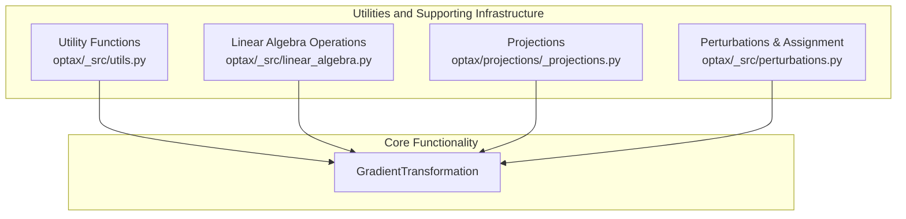
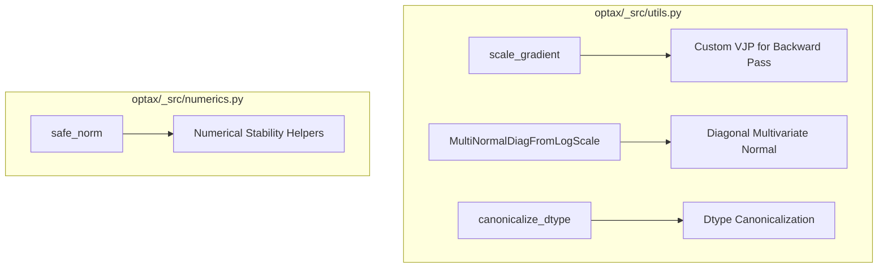
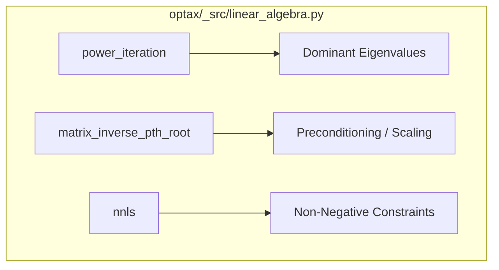
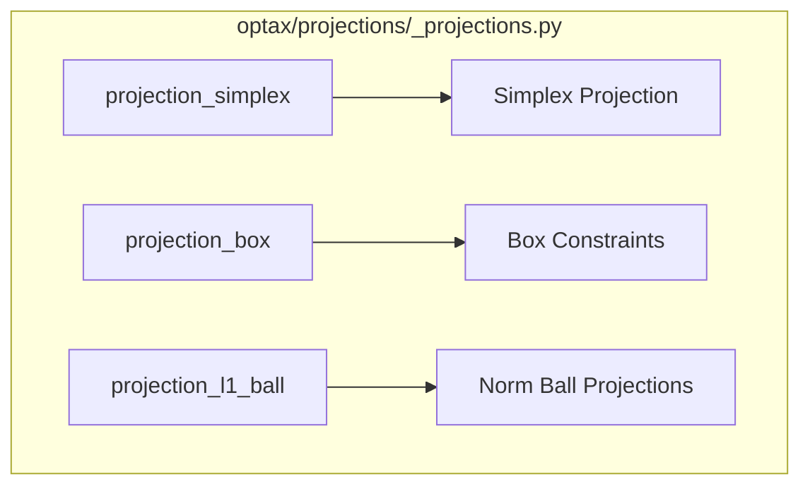
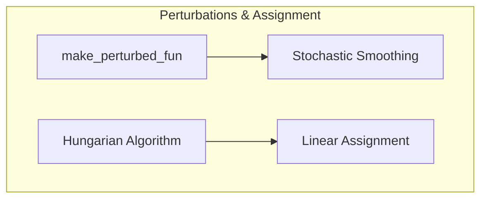

<!-- source: DeepWiki mcp.deepwiki.com · repo google-deepmind/optax · page 7 Utilities and Supporting Infrastructure · fetched 2026-10-26 -->

# Utilities and Supporting Infrastructure

Relevant source files

The following files were used as context for generating this wiki page:

- [optax/_src/utils.py](optax/_src/utils.py)
- [optax/_src/utils_test.py](optax/_src/utils_test.py)

This page provides an overview of the utility functions and supporting infrastructure that underpin Optax's optimization algorithms, data structures, and mathematical routines. These components provide necessary helpers for dtype canonicalization, gradient modification (`optax/_src/utils.py`), numerical stability, linear algebra routines, constrained projections, and stochastic relaxations.

For detailed information, refer to the respective child pages:
- [Utility Functions](#7.1) — Helper functions including gradient scaling, dtype handling, safe numerical operations (`numerics.py`), deprecation machinery, and the `MultiNormalDiagFromLogScale` distribution
- [Linear Algebra Operations](#7.2) — Matrix operations including power iteration, matrix inverse p-th root, non-negative least squares, and their use in optimization
- [Projections](#7.3) — `optax.projections`: projections onto simplex, L1/L2/inf balls, boxes and hyperplanes, and their role in constrained optimization
- [Perturbations and Assignment](#7.4) — `make_perturbed_fun` for stochastic smoothing of discrete operations, and the Hungarian algorithm module for linear assignment problems

Diagram: Overview of Supporting Infrastructure

Sources:
- [optax/_src/utils.py:15-200]()
- [optax/_src/linear_algebra.py:15-351]()
- [optax/projections/_projections.py:16-306]()

## Utility Functions

Optax includes various helper routines for gradient manipulation, shape and dtype checks, random distribution handling, and custom backward passes. Key components include `scale_gradient` for modifying backward gradients via custom VJPs [optax/_src/utils.py:162-200](), `MultiNormalDiagFromLogScale` for diagonal Gaussian distributions with log-scale parameters [optax/_src/utils.py:123-154](), and dtype/shape validation tools [optax/_src/utils.py:34-78]().

For a comprehensive guide on helper functions, gradient scaling, safe numerical operations (`numerics.py`), deprecation machinery, and distributions, see [Utility Functions](#7.1).

Diagram: Utility Functions Architecture

Sources:
- [optax/_src/utils.py:34-200]()

## Linear Algebra Operations

Specialized linear algebra operations support advanced optimizers and second-order methods. These include power iteration for dominant eigenvalues, matrix inverse p-th roots for preconditioners, and non-negative least squares (NNLS) solvers.

For details on power iteration, matrix inverse p-th roots, NNLS, and their application in optimization, see [Linear Algebra Operations](#7.2).

Diagram: Linear Algebra Module Structure

Sources:
- [optax/_src/linear_algebra.py:15-351]()

## Projections

Constrained optimization often requires projecting parameter updates onto feasible sets. The `optax.projections` module implements projections onto simplices, L1/L2/L∞ balls, hypercubes, and custom bounding boxes.

For a complete guide to constraint sets and projection routines, see [Projections](#7.3).

Diagram: Projections Module Structure

Sources:
- [optax/projections/_projections.py:16-306]()

## Perturbations and Assignment

Optax supports specialized operations like stochastic smoothing of discrete functions via `make_perturbed_fun` and linear assignment problems via the Hungarian algorithm module. These tools enable optimization over combinatorial or non-differentiable spaces.

For details on stochastic perturbations and assignment algorithms, see [Perturbations and Assignment](#7.4).

Diagram: Perturbations and Assignment Components

Sources:
- [optax/_src/perturbations.py:15-200]()

---

