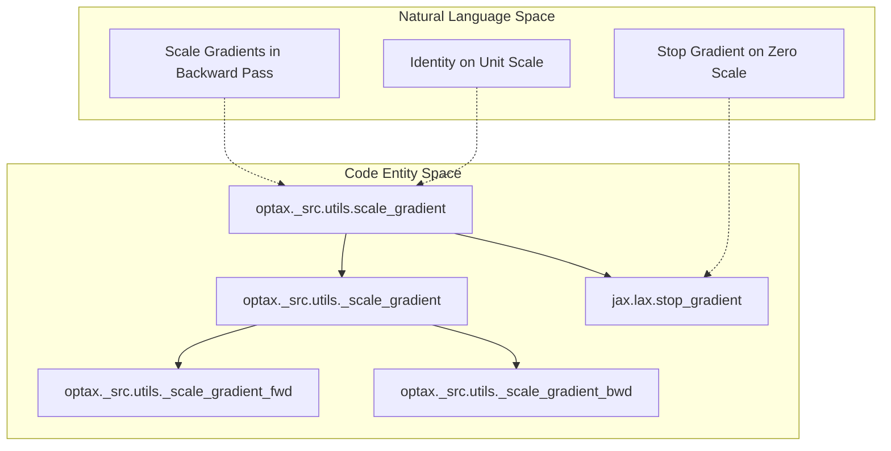
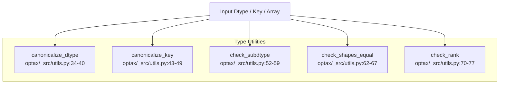
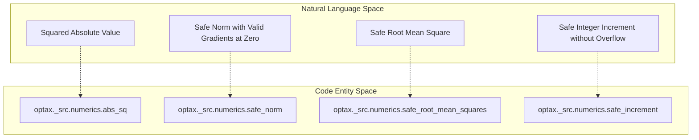
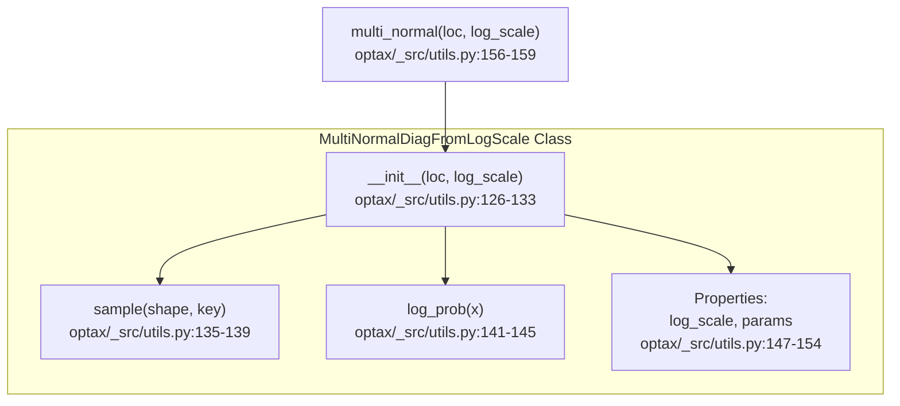

<!-- source: DeepWiki mcp.deepwiki.com · repo google-deepmind/optax · page 7.1 Utility Functions · fetched 2026-10-26 -->

# Utility Functions

Relevant source files

The following files were used as context for generating this wiki page:

- [optax/_src/deprecations.py](optax/_src/deprecations.py)
- [optax/_src/numerics.py](optax/_src/numerics.py)
- [optax/_src/numerics_test.py](optax/_src/numerics_test.py)
- [optax/_src/utils.py](optax/_src/utils.py)
- [optax/_src/utils_test.py](optax/_src/utils_test.py)

## Purpose and Scope

This page documents the helper functions and supporting infrastructure in Optax, covering gradient scaling (`optax/_src/utils.py`), dtype canonicalization and type validation (`optax/_src/utils.py`), safe numerical operations (`optax/_src/numerics.py`), deprecation machinery (`optax/_src/deprecations.py`), and the log-scale diagonal multivariate normal distribution (`MultiNormalDiagFromLogScale`). These components provide low-level primitives required for numerical stability, state management, and type safety across optimization algorithms.

---

## Gradient Scaling

Optax provides `scale_gradient` to scale gradients during the backward pass without altering the forward computation graph. This is implemented via JAX's custom VJP (Vector-Jacobian Product) mechanism.

**Diagram: Bridging Natural Language Gradient Scaling to Code Entities**

### Implementation Details

The implementation defines a custom VJP where the forward pass acts as an identity function while caching the scale factor, and the backward pass multiplies incoming gradients by that scale [optax/_src/utils.py:162-182]():

- **Forward Pass (`_scale_gradient_fwd`)**: Returns `inputs` unchanged alongside `scale` as a residual [optax/_src/utils.py:170-174]().
- **Backward Pass (`_scale_gradient_bwd`)**: Multiplies incoming cotangent `g` by `scale` using `jax.tree.map` [optax/_src/utils.py:176-180]().
- **Fast Paths (`scale_gradient`)**: 
  - If `scale == 1.0`, it returns `inputs` directly without wrapping [optax/_src/utils.py:197-198]().
  - If `scale == 0.0`, it returns `jax.lax.stop_gradient(inputs)` for maximum efficiency [optax/_src/utils.py:199-200]().

Sources: [optax/_src/utils.py:162-200](), [optax/_src/utils_test.py:31-48]()

---

## Dtype and Type Handling

Optax utilities include functions for canonicalizing dtypes and pseudo-random number generator (PRNG) keys, as well as runtime validation helpers.

**Diagram: Type Utility Functions and Code Locations**

### Key Functions
- `canonicalize_dtype(dtype)`: Normalizes a dtype via `jax.dtypes.canonicalize_dtype` if not `None` [optax/_src/utils.py:34-40]().
- `canonicalize_key(key_or_seed)`: Converts an integer seed or existing JAX PRNG key into a canonical JAX PRNG key array [optax/_src/utils.py:43-49]().
- Validation helpers (`check_subdtype`, `check_shapes_equal`, `check_rank`) raise descriptive `TypeError` or `ValueError` exceptions when constraints are violated [optax/_src/utils.py:52-77]().

Sources: [optax/_src/utils.py:34-78]()

---

## Safe Numerical Operations

Module `optax/_src/numerics.py` provides numerically stable implementations of mathematical operations, preventing `NaN` gradients and integer overflows.

**Diagram: Bridging Numerical Utilities to Code Entities**

### Core Functions in `numerics.py`
- `abs_sq(x)`: Computes `(x.conj() * x).real`, generating optimal HLO for complex numbers compared to standard squaring [optax/_src/numerics.py:31-45]().
- `safe_norm(x, min_norm, ...)`: Computes `jnp.maximum(jnp.linalg.norm(x), min_norm)` while ensuring correct gradients at zero instead of returning `NaN` [optax/_src/numerics.py:48-84]().
- `safe_root_mean_squares(x, min_rms)`: Computes root mean square with guarded zero-gradient handling [optax/_src/numerics.py:86-103]().
- `safe_increment(count)`: Increments integer or floating-point counters while capping at `max_val` to prevent overflow [optax/_src/numerics.py:106-144]().

Sources: [optax/_src/numerics.py:31-144](), [optax/_src/numerics_test.py:48-171]()

---

## Deprecation Machinery

Module `optax/_src/deprecations.py` provides infrastructure for managing deprecated module attributes and functions.

### Mechanisms
- `deprecation_getattr(module, deprecations)`: Factory for module-level `__getattr__` that issues a `DeprecationWarning` or raises an `AttributeError` if a deprecated attribute is accessed [optax/_src/deprecations.py:49-59]().
- `warn_deprecated_function(fun, replacement, version_removed)`: Function decorator that wraps callables to emit deprecation warnings detailing replacements and removal versions [optax/_src/deprecations.py:62-98]().

Sources: [optax/_src/deprecations.py:49-98]()

---

## Probabilistic Distribution: MultiNormalDiagFromLogScale

`MultiNormalDiagFromLogScale` represents a multivariate normal distribution with a diagonal covariance matrix, parameterized directly in log-scale for numerical stability in variational inference.

**Diagram: MultiNormalDiagFromLogScale Architecture**

### Implementation Details
- **Initialization**: Computes `_scale = jnp.exp(log_scale)` and determines the broadcasted parameter shape between `loc` and `scale` [optax/_src/utils.py:126-133]().
- **Sampling**: Generates samples via `jax.random.normal(key, sample_shape) * self._scale + self._mean` [optax/_src/utils.py:135-139]().
- **Log Probability**: Computes `multivariate_normal.logpdf` and sums over all broadcast parameter axes [optax/_src/utils.py:141-145]().

Sources: [optax/_src/utils.py:123-159](), [optax/_src/utils_test.py:51-110]()

---

## Array Manipulation Utilities

Additional helper functions support tensor transformations:
- `tile_second_to_last_dim(a)`: Expands and tiles an array along the second-to-last dimension [optax/_src/utils.py:28-31]().
- `set_diags(a, new_diags)`: Updates the diagonal entries of a batch of 3D matrices (`NxDxD`) using batched index assignment [optax/_src/utils.py:80-120]().

Sources: [optax/_src/utils.py:28-120](), [optax/_src/utils_test.py:120-200]()

---

