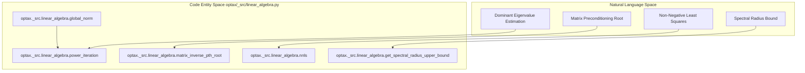
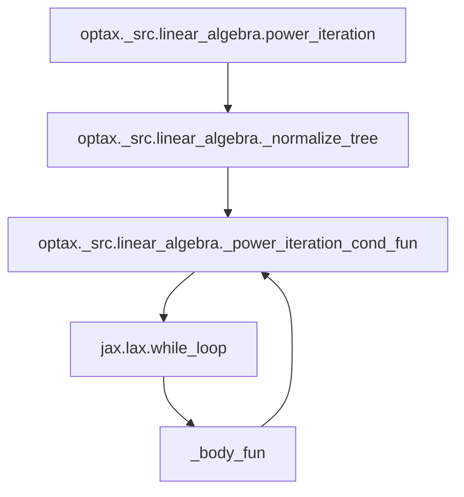
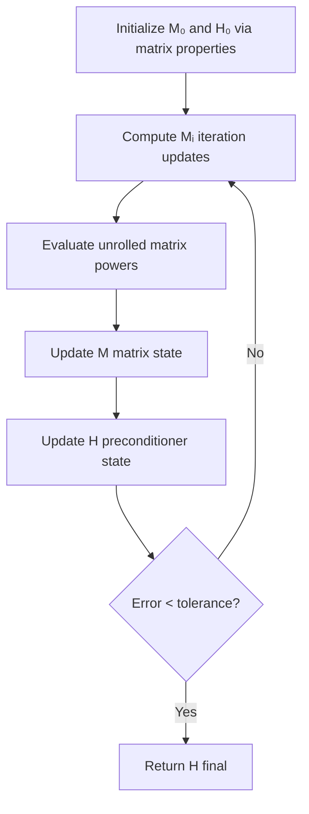

<!-- source: DeepWiki mcp.deepwiki.com · repo google-deepmind/optax · page 7.2 Linear Algebra Operations · fetched 2026-10-26 -->

# Linear Algebra Operations

Relevant source files

The following files were used as context for generating this wiki page:

- [optax/_src/linear_algebra.py](optax/_src/linear_algebra.py)
- [optax/_src/linear_algebra_test.py](optax/_src/linear_algebra_test.py)

## Purpose and Scope

This document describes the linear algebra operations provided by Optax in `optax/_src/linear_algebra.py`. These functions implement specialized matrix computations used internally by advanced optimizers and gradient transformations. The operations include eigenvalue computation via power iteration, matrix inverse roots for preconditioning, and non-negative least squares solvers.

For general tree-based mathematical operations on nested parameter structures, see [Tree Utilities](#2.2). For optimizer-specific transformations that use these operations, see [Gradient Transformations](#6).

**Sources:** [optax/_src/linear_algebra.py:1-363]()

---

## Overview of Linear Algebra Operations

The linear algebra module provides core operations that serve specific roles in optimization algorithms, mapping conceptual linear algebra requirements directly to JAX-backed implementations in the codebase.

**Sources:** [optax/_src/linear_algebra.py:1-363]()

---

## Power Iteration Algorithm

### Purpose

The `power_iteration()` function computes the dominant eigenvalue (spectral radius) and its corresponding eigenvector of a diagonalizable matrix [optax/_src/linear_algebra.py:61-75](). This is used to estimate the largest eigenvalue for adaptive step sizing and preconditioning computations.

**Sources:** [optax/_src/linear_algebra.py:61-153]()

### Function Signature and Parameters

| Parameter | Type | Default | Description |
|-----------|------|---------|-------------|
| `matrix` | `ArrayLike` or `Callable` | Required | Square matrix as array or callable implementing matrix-vector product [optax/_src/linear_algebra.py:61-63]() |
| `v0` | `ArrayTree` or `None` | `None` | Initial eigenvector estimate; if `None`, random vector is used [optax/_src/linear_algebra.py:65]() |
| `num_iters` | `ArrayLike` | `100` | Maximum number of iterations [optax/_src/linear_algebra.py:66]() |
| `error_tolerance` | `ArrayLike` | `1e-6` | Convergence threshold for relative error [optax/_src/linear_algebra.py:67]() |
| `precision` | `lax.Precision` | `HIGHEST` | XLA precision flag (`DEFAULT`, `HIGH`, or `HIGHEST`) [optax/_src/linear_algebra.py:68]() |
| `key` | `PRNGKey` or `None` | `None` | Random key for initialization when `v0=None` [optax/_src/linear_algebra.py:69]() |

**Returns:** A `(eigenvalue, eigenvector)` tuple where eigenvalue is the dominant eigenvalue and eigenvector is the associated normalized eigenvector [optax/_src/linear_algebra.py:97-99]().

**Sources:** [optax/_src/linear_algebra.py:61-113]()

### Algorithm Flow and Code Entities

**Sources:** [optax/_src/linear_algebra.py:29-59](), [optax/_src/linear_algebra.py:134-152]()

### Implementation Details

The power iteration algorithm iteratively applies the matrix to a vector and normalizes the result. The implementation uses:

- **Normalization via `_normalize_tree()`**: Divides by the L2 norm computed using `optax.tree.norm()` [optax/_src/linear_algebra.py:29-32]()
- **Convergence condition**: Stops via `_power_iteration_cond_fun()` when relative residual `||z - λv|| / λ < error_tolerance` [optax/_src/linear_algebra.py:51-58]()
- **JAX while loop**: Uses `jax.lax.while_loop` for efficient execution [optax/_src/linear_algebra.py:148-150]()

The function supports two modes:
1. **Array mode**: Matrix provided as `jnp.ndarray`, uses `jnp.matmul` with the specified `precision` [optax/_src/linear_algebra.py:118-120]()
2. **Callable mode**: Matrix provided as a function implementing a matrix-vector product [optax/_src/linear_algebra.py:113-117]()

**Sources:** [optax/_src/linear_algebra.py:29-153]()

### Usage Examples

The power iteration function is versatile and can work with:
- Standard matrices (tested in [optax/_src/linear_algebra_test.py:84-117]())
- PyTree-structured matrices via callable interface (tested in [optax/_src/linear_algebra_test.py:119-142]())
- Implicit matrices like Hessian-vector products (tested in [optax/_src/linear_algebra_test.py:144-183]())

**Sources:** [optax/_src/linear_algebra_test.py:84-183]()

---

## Matrix Inverse p-th Root

### Purpose

The `matrix_inverse_pth_root()` function computes `matrix^(-1/p)` where `p` is a positive integer power [optax/_src/linear_algebra.py:155-166](). This operation is critical for preconditioning in optimizers like Shampoo and Adafactor, where second-order information is used to adaptively scale gradients.

**Sources:** [optax/_src/linear_algebra.py:155-187]()

### Function Signature and Parameters

| Parameter | Type | Default | Description |
|-----------|------|---------|-------------|
| `matrix` | `ArrayLike` | Required | Symmetric positive semi-definite matrix [optax/_src/linear_algebra.py:156,169]() |
| `p` | `ArrayLike` | Required | Positive integer exponent [optax/_src/linear_algebra.py:157,170]() |
| `num_iters` | `ArrayLike` | `100` | Maximum number of coupled Newton iterations [optax/_src/linear_algebra.py:158,171]() |
| `ridge_epsilon` | `ArrayLike` | `1e-6` | Ridge term for positive definiteness [optax/_src/linear_algebra.py:159,172]() |
| `error_tolerance` | `ArrayLike` | `1e-6` | Early termination threshold [optax/_src/linear_algebra.py:160,173]() |
| `precision` | `lax.Precision` | `HIGHEST` | XLA precision setting [optax/_src/linear_algebra.py:161,174-177]() |

**Returns:** A `(result_matrix, error)` tuple where `result_matrix` is `matrix^(-1/p)` and `error` is the final convergence error.

**Sources:** [optax/_src/linear_algebra.py:155-187]()

### Coupled Newton Iterations Algorithm

The algorithm uses the Coupled Newton Iterations method for computing matrix inverse roots.

**Sources:** [optax/_src/linear_algebra.py:188-282]()

### Implementation Details

Key implementation aspects:
1. **Ridge regularization**: Adds `ridge_epsilon * max_eigenvalue * I` to ensure positive definiteness [optax/_src/linear_algebra.py:194-197]()
2. **Unrolled matrix powers**: Uses specialized functions for $p=1,2,4,8$ to avoid dynamic loops (`_unrolled_mat_pow_1`, `_unrolled_mat_pow_2`, `_unrolled_mat_pow_4`, `_unrolled_mat_pow_8`) [optax/_src/linear_algebra.py:199-238]()
3. **Early termination with safeguard**: Stops if error increases by more than 20% to handle non-monotonic convergence [optax/_src/linear_algebra.py:251-259]()
4. **Special case for 1×1 matrices**: Direct computation via scalar exponentiation [optax/_src/linear_algebra.py:262-264]()

**Sources:** [optax/_src/linear_algebra.py:155-282]()

---

## Non-Negative Least Squares (NNLS)

### Purpose

The `nnls()` function solves the constrained optimization problem minimizing `||Ax - b||₂` subject to `x ≥ 0` [optax/_src/linear_algebra.py:294-325](). This is useful for optimization problems requiring non-negative parameters or when enforcing box constraints.

**Sources:** [optax/_src/linear_algebra.py:294-331]()

### Function Signature and Parameters

| Parameter | Type | Default | Description |
|-----------|------|---------|-------------|
| `A` | `jax.Array` | Required | Input matrix of shape `(M, N)` [optax/_src/linear_algebra.py:296]() |
| `b` | `jax.Array` | Required | Input vector/matrix of shape `(M,)` or `(M, K)` [optax/_src/linear_algebra.py:297]() |
| `iters` | `int` | Required | Number of iterations to run [optax/_src/linear_algebra.py:298]() |
| `unroll` | `int` or `bool` | `1` | Unroll parameter for `lax.scan` [optax/_src/linear_algebra.py:299]() |
| `L` | `ArrayLike` or `None` | `None` | Upper bound on spectral radius of `A.T @ A` [optax/_src/linear_algebra.py:300]() |

**Returns:** Solution vector of shape `(N,)` or matrix of shape `(N, K)`.

**Sources:** [optax/_src/linear_algebra.py:294-331]()

### Fast Projected Gradient Algorithm

The implementation uses Polyak's Fast Projected Gradient (FPG) method with Nesterov acceleration via `lax.scan` [optax/_src/linear_algebra.py:336-361]().

**Sources:** [optax/_src/linear_algebra.py:294-362]()

---

## Utility Functions

### Spectral Radius Upper Bound

The `get_spectral_radius_upper_bound()` function computes an upper bound on the largest eigenvalue magnitude of a matrix using the Frobenius norm and 1-norm [optax/_src/linear_algebra.py:285-290](). This provides a computationally cheaper alternative to power iteration when an exact value is not required.

**Sources:** [optax/_src/linear_algebra.py:285-290]()

### Global Norm (Deprecated)

The `global_norm()` function computes the L2 norm across a nested structure of tensors [optax/_src/linear_algebra.py:34-48](). This function is deprecated in favor of `optax.tree.norm()` [optax/_src/linear_algebra.py:44-48](), issuing a `DeprecationWarning` before delegating directly to `optax.tree.norm()` [optax/_src/linear_algebra.py:45-49]().

**Sources:** [optax/_src/linear_algebra.py:34-49]()

---

## Testing Infrastructure

The linear algebra module includes comprehensive test suites in `optax/_src/linear_algebra_test.py` covering power iteration, matrix inverse p-th root, and NNLS solvers across diverse configurations, shapes, and dtypes [optax/_src/linear_algebra_test.py:46-240]().

**Sources:** [optax/_src/linear_algebra_test.py:46-240]()

---

