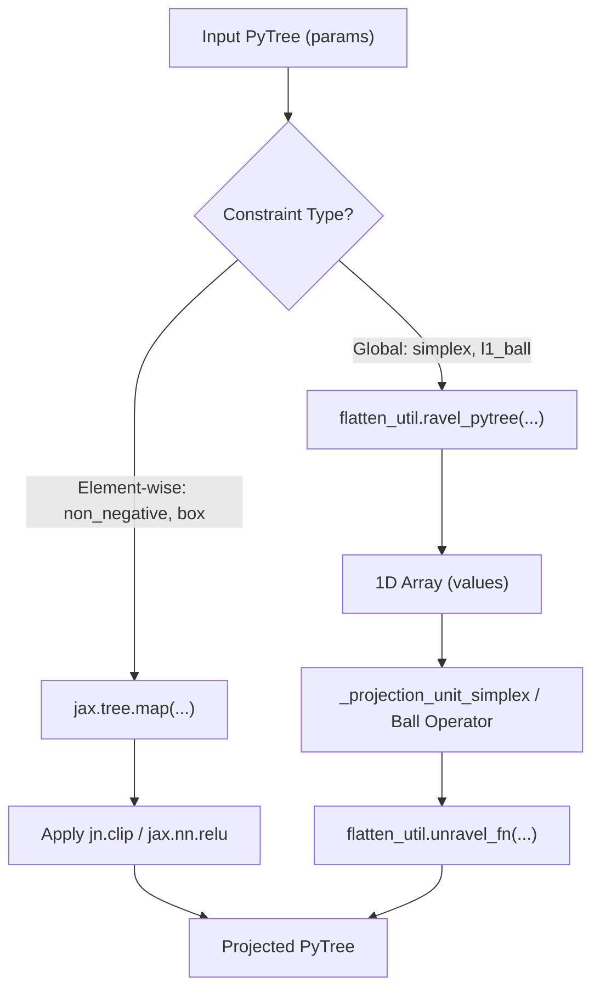
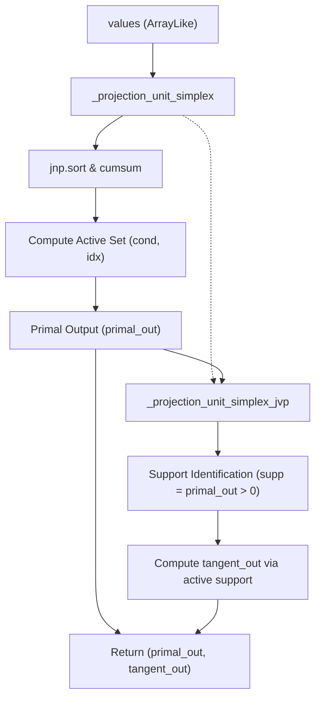

<!-- source: DeepWiki mcp.deepwiki.com · repo google-deepmind/optax · page 7.3 Projections · fetched 2026-10-26 -->

# Projections

<details>
<summary>Relevant source files</summary>

The following files were used as context for generating this wiki page:

- [docs/api/projections.rst](docs/api/projections.rst)
- [optax/projections/__init__.py](optax/projections/__init__.py)
- [optax/projections/_projections.py](optax/projections/_projections.py)
- [optax/projections/_projections_test.py](optax/projections/_projections_test.py)

</details>


## Overview and Scope

The `optax.projections` sub-package provides a comprehensive suite of Euclidean projection operators designed for constrained optimization within the JAX and Optax ecosystems [optax/projections/_projections.py:16](), [docs/api/projections.rst:6](). In constrained optimization, parameters or gradient updates must frequently remain within a specific convex set $\mathcal{C}$ (e.g., probability simplex, $L_p$ balls, or box constraints). 

The Euclidean projection of an input vector or PyTree $u$ onto a closed convex set $\mathcal{C}$ is defined as:

$$\text{proj}_{\mathcal{C}}(u) := \underset{v \in \mathcal{C}}{\text{argmin}} ~ \|u - v\|_2^2$$

Optax implements these operations to support arbitrary JAX PyTrees, ensuring seamless integration with neural network parameters and optimizer states [optax/projections/_projections.py:26]().

Sources: [optax/projections/_projections.py:16](), [docs/api/projections.rst:1-13]()

---

## PyTree Integration and Data Flow

Most projection functions in `optax.projections` natively support nested structures (PyTrees) such as dictionaries, tuples, and lists of parameter arrays. Depending on the geometric constraints, projections either use element-wise operations via `jax.tree.map` or flatten the PyTree using `flatten_util.ravel_pytree` for global operations like the simplex projection [optax/projections/_projections.py:26](), [optax/projections/_projections.py:155]().

### Diagram: PyTree Projection Architecture


Sources: [optax/projections/_projections.py:26](), [optax/projections/_projections.py:45](), [optax/projections/_projections.py:155]()

---

## Core Projection Functions

### Non-Negative Orthant and Boxes
* **`projection_non_negative(tree)`**: Projects inputs onto the non-negative orthant ($p \ge 0$) using element-wise Rectified Linear Unit activation (`jax.nn.relu`) [optax/projections/_projections.py:26-42]().
* **`projection_box(tree, lower, upper)`**: Projects onto box constraints ($\text{lower} \le p \le \text{upper}$) via element-wise clipping (`jnp.clip`) [optax/projections/_projections.py:45-65]().
* **`projection_hypercube(tree, scale)`**: Convenience wrapper around `projection_box` restricting values between $0$ and $\text{scale}$ [optax/projections/_projections.py:68-90]().

### Simplex Projections
* **`projection_simplex(tree, scale)`**: Solves the projection onto the simplex where $p \ge 0$ and $p^\top \mathbf{1} = \text{scale}$ [optax/projections/_projections.py:120-158](). It flattens the input PyTree into a 1D array, delegates to `_projection_unit_simplex`, and unravels the result back to the original PyTree structure [optax/projections/_projections.py:155-157]().

### $L_1$, $L_2$, and $L_\infty$ Balls and Spheres
* **`projection_l1_sphere(tree, scale)`** and **`projection_l1_ball(tree, scale)`**: Projects onto the $L_1$ sphere ($\|y\|_1 = \text{scale}$) and ball ($\|y\|_1 \le \text{scale}$) by decoupling the signs and magnitudes, leveraging `projection_simplex` on the absolute values [optax/projections/_projections.py:160-222]().
* Additional functions include `projection_l2_sphere`, `projection_l2_ball`, and `projection_linf_ball` [optax/projections/__init__.py:20-31]().

Sources: [optax/projections/_projections.py:26-222](), [optax/projections/__init__.py:20-31]()

---

## Automatic Differentiation and Custom JVP

To support gradient-based meta-learning or backpropagation through projection operators, `optax.projections` implements custom Jacobian-vector products (JVPs) using `@jax.custom_jvp` [optax/projections/_projections.py:93-118]().

### Diagram: Simplex Projection and Custom JVP Flow


Sources: [optax/projections/_projections.py:93-118]()

---

## Usage Example in Constrained Optimization

Projections are typically applied immediately after an optimizer step updates the model parameters [docs/api/projections.rst:14-30]():

```python
import optax
import jax
import jax.numpy as jnp

# Initialize optimizer and parameters
optimizer = optax.adam(learning_rate=1e-3)
params = {'w': jnp.zeros(2)}
opt_state = optimizer.init(params)

# Perform update and project onto non-negative orthant
# grads = jax.grad(loss)(params, xs, ys)
# updates, opt_state = optimizer.update(grads, opt_state)
# params = optax.apply_updates(params, updates)
# params = optax.projections.projection_non_negative(params)
```

Sources: [docs/api/projections.rst:14-30]()

---

