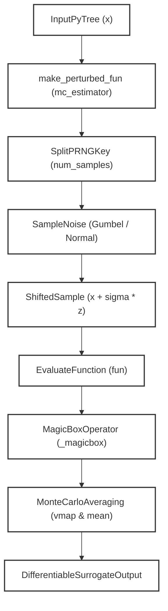
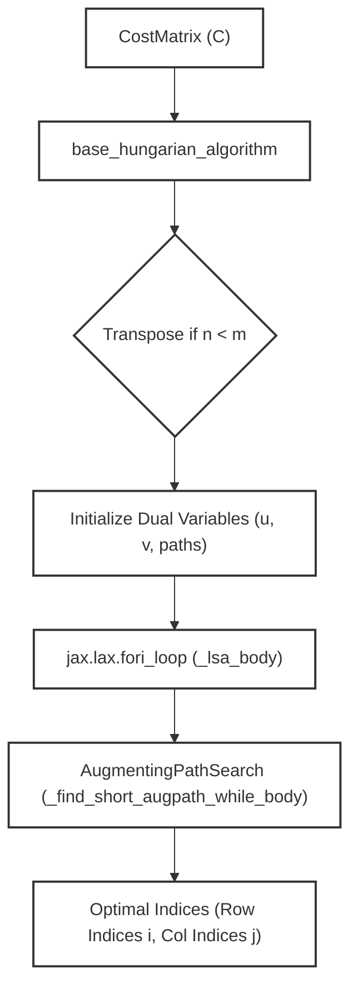

<!-- source: DeepWiki mcp.deepwiki.com · repo google-deepmind/optax · page 7.4 Perturbations and Assignment · fetched 2026-10-26 -->

# Perturbations and Assignment

Relevant source files

The following files were used as context for generating this wiki page:

- [docs/api/perturbations.rst](docs/api/perturbations.rst)
- [docs/images/examples/linear_assignment_problem.png](docs/images/examples/linear_assignment_problem.png)
- [examples/perturbations.ipynb](examples/perturbations.ipynb)
- [optax/assignment/__init__.py](optax/assignment/__init__.py)
- [optax/assignment/_hungarian_algorithm.py](optax/assignment/_hungarian_algorithm.py)
- [optax/assignment/_hungarian_algorithm_test.py](optax/assignment/_hungarian_algorithm_test.py)
- [optax/perturbations/_make_pert.py](optax/perturbations/_make_pert.py)
- [optax/perturbations/_make_pert_test.py](optax/perturbations/_make_pert_test.py)

## Purpose and Scope

This page covers two specialized utility modules in Optax: **Perturbations** (`optax.perturbations`) and **Assignment** (`optax.assignment`). 

The perturbations module provides tools for stochastic smoothing of non-differentiable functions using random noise distributions and score-function estimators, enabling automatic differentiation through discrete operations like argmax or ranking. The assignment module provides a JAX-native implementation of the Hungarian algorithm for solving linear assignment problems (minimum-cost bipartite matching), fully compatible with `jax.jit` and `jax.vmap`.

---

## 1. Perturbations and Stochastic Smoothing

Many operations in machine learning pipelines (such as argmax, sorting, or discrete combinatorial solvers) are non-differentiable, yielding zero or undefined gradients. Optax addresses this via randomized smoothing (Berthet et al., 2020), which defines a differentiable surrogate function by convolving the original function with a noise distribution.

### Mathematical Formulation

Given a function $f: X \to Y$, a noise scale $\sigma > 0$, and a noise distribution $\mu$ with density, the perturbed function $f_\sigma$ is defined as:

$$f_\sigma(x) = \mathbb{E}_{z \sim \mu}[f(x + \sigma z)]$$

Optax computes unbiased Monte Carlo estimates of $f_\sigma$ and its arbitrary-order derivatives using only evaluations of $f$ (not its derivatives) at perturbed inputs. This is achieved via the score function estimator (REINFORCE) implemented through the "magic box" operator (Foerster et al., 2018).

### Key Classes and Functions

*   `Normal`: Implements a standard normal noise distribution with `sample` and `log_prob` methods `[optax/perturbations/_make_pert.py:27-40]()`.
*   `Gumbel`: Implements a Gumbel noise distribution, commonly used for discrete choice and categorical perturbations `[optax/perturbations/_make_pert.py:42-55]()`.
*   `make_perturbed_fun`: Higher-order function that transforms any PyTree-to-PyTree function into its stochastically smoothed, differentiable counterpart `[optax/perturbations/_make_pert.py:57-170]()`.
*   `_magicbox`: Implements the `exp(x - stop_gradient(x))` operator used to compute score-function gradients through Monte Carlo samples `[optax/perturbations/_make_pert.py:173-175]()`.

### Implementation Details of `make_perturbed_fun`

The core estimator splits a PRNG key into `num_samples`, draws noise vectors using `optax.tree.random_like`, and applies the noise scaled by `sigma` `[optax/perturbations/_make_pert.py:141-168]`. If `use_baseline=True`, it evaluates an unperturbed baseline `fun(jax.lax.stop_gradient(x))` to reduce gradient variance `[optax/perturbations/_make_pert.py:160-163]()`.

*Title: Perturbation Engine Architecture*
*Sources: `optax/perturbations/_make_pert.py`*

---

## 2. Linear Assignment Problem (Hungarian Algorithm)

The `optax.assignment` sub-package provides a JAX-native implementation of the Hungarian algorithm (Kuhn-Munkres algorithm) for solving the linear assignment problem (Crouse, 2016) `[optax/assignment/_hungarian_algorithm.py:24-105]()`.

### Problem Statement

Given an $n \times m$ cost matrix $C \in \mathbb{R}^{n \times m}$, the Hungarian algorithm finds a binary assignment matrix $X \in \{0, 1\}^{n \times m}$ minimizing the total assignment cost:

$$\text{minimize} \sum_{i=1}^n \sum_{j=1}^m C_{ij} X_{ij}$$

subject to matching constraints ensuring at most one assignment per row and column, with a total cardinality of $\min(n, m)$ `[optax/assignment/_hungarian_algorithm.py:40-53]()`.

### Key Functions

*   `hungarian_algorithm` / `base_hungarian_algorithm`: Core entry points for computing optimal row and column index matches `[optax/assignment/_hungarian_algorithm.py:24-133]`, `[optax/assignment/__init__.py:19-20]()`.

### Execution Flow and JAX Integration

The algorithm automatically transposes non-square matrices where columns outnumber rows `[optax/assignment/_hungarian_algorithm.py:110-113]`, initializes dual variables `u` and `v` `[optax/assignment/_hungarian_algorithm.py:115-118]`, and executes the augmenting path search loop via `jax.lax.fori_loop` `[optax/assignment/_hungarian_algorithm.py:124-126]`. This structure ensures full compatibility with `jax.jit` and `jax.vmap` `[optax/assignment/_hungarian_algorithm_test.py:95-120]()`.

*Title: Hungarian Algorithm Execution Flow*
*Sources: `optax/assignment/_hungarian_algorithm.py`*

---

