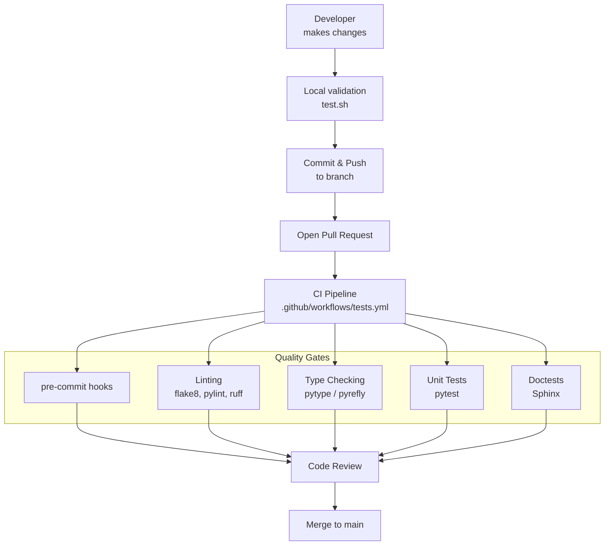

<!-- source: DeepWiki mcp.deepwiki.com · repo google-deepmind/optax · page 8 Development Guide · fetched 2026-10-26 -->

# Development Guide

<details>
<summary>Relevant source files</summary>

The following files were used as context for generating this wiki page:

- [.github/workflows/mlc_config.json](.github/workflows/mlc_config.json)
- [.github/workflows/tests.yml](.github/workflows/tests.yml)
- [CONTRIBUTING.md](CONTRIBUTING.md)
- [LICENSE](LICENSE)
- [pyproject.toml](pyproject.toml)
- [test.sh](test.sh)

</details>


This guide provides a high-level overview of the development workflow, testing infrastructure, and documentation build processes for contributors to Optax. Optax relies on automated validation, rigorous linting, and multi-version test matrices to ensure robustness across the JAX ecosystem.

As a parent page, this section introduces the core components of the development lifecycle. For detailed instructions regarding CI/CD pipelines and testing frameworks, see [Testing Infrastructure](#8.1). For comprehensive details on Sphinx-based documentation generation and release workflows, see [Documentation System](#8.2).

---

## Development Workflow Overview

The Optax development process follows a standard fork-and-pull-request model with strict automated quality gates. All contributions must successfully pass linting, type checking, unit tests, and doctests before they can be reviewed and merged into the main branch.



Sources: [.github/workflows/tests.yml:1-180](), [test.sh:1-87]()

---

## Local Development Setup

To set up a local workspace for developing Optax, clone the repository and install the package in editable mode along with its test and documentation dependencies using `flit_core` [pyproject.toml:1-4]().

```bash
# Create and activate a virtual environment
python3 -m venv optax_dev
source optax_dev/bin/activate

# Install package in editable mode with test and doc requirements
pip install -e ".[test,docs]"
```

For quick local verification that matches the continuous integration environment, run the provided test script [CONTRIBUTING.md:25-30]():

```bash
bash test.sh
```

Sources: [pyproject.toml:1-66](), [test.sh:1-87](), [CONTRIBUTING.md:25-30]()

---

## Testing Infrastructure Overview

Optax maintains a robust testing architecture comprising multi-version Pytest matrices, static analysis tools, and automated CI workflows running on GitHub Actions. 

For deep dives into the test runner configuration, pre-commit hooks, isolated virtual environments in `test.sh`, and the full CI test matrix across Python and JAX versions, see [Testing Infrastructure](#8.1).

Sources: [.github/workflows/tests.yml:1-180](), [test.sh:1-87]()

---

## Documentation System Overview

The documentation for Optax is built using Sphinx, incorporating interactive Jupyter notebooks via `myst-nb`, mathematical rendering via KaTeX, and automated API reference generation from docstrings.

For comprehensive guides on building HTML documentation locally, managing example galleries, configuring Sphinx extensions, and executing PyPI publishing or release workflows, see [Documentation System](#8.2).

Sources: [pyproject.toml:53-66](), [docs/conf.py:1-271]()

---

## Development Best Practices

Contributors should adhere to the following guidelines to maintain code quality:
- **Code Style**: Optax targets an 80-character line length limit [pyproject.toml:73]() and utilizes Ruff and Pylint for linting rules.
- **Pre-commit**: Install pre-commit hooks locally to catch formatting and linting discrepancies prior to committing code.
- **Test Coverage**: Ensure that any new gradient transformations, optimizers, or utilities include corresponding unit tests under `*_test.py` naming conventions.

Sources: [pyproject.toml:68-134](), [.github/workflows/tests.yml:22-106]()

---

