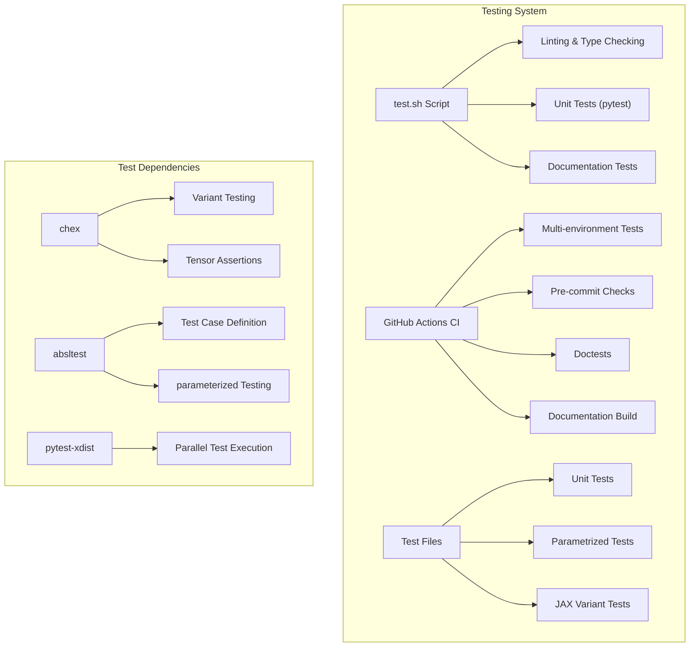
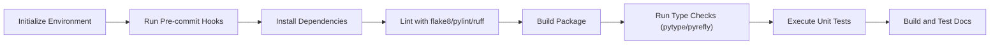
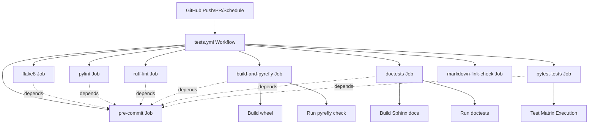
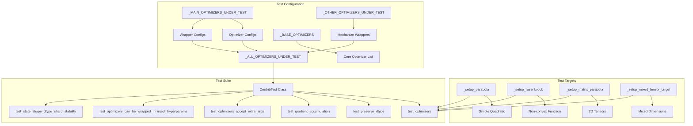

<!-- source: DeepWiki mcp.deepwiki.com · repo google-deepmind/optax · page 8.1 Testing Infrastructure · fetched 2026-10-26 -->

# Testing Infrastructure

<details>
<summary>Relevant source files</summary>

The following files were used as context for generating this wiki page:

- [.github/check_license_headers.py](.github/check_license_headers.py)
- [.github/workflows/mlc_config.json](.github/workflows/mlc_config.json)
- [.github/workflows/tests.yml](.github/workflows/tests.yml)
- [.pre-commit-config.yaml](.pre-commit-config.yaml)
- [docs/api/contrib.rst](docs/api/contrib.rst)
- [docs/ext/coverage_check.py](docs/ext/coverage_check.py)
- [docs/pyproject.toml](docs/pyproject.toml)
- [examples/pyproject.toml](examples/pyproject.toml)
- [optax/_src/test_utils.py](optax/_src/test_utils.py)
- [optax/contrib/__init__.py](optax/contrib/__init__.py)
- [optax/contrib/_common_test.py](optax/contrib/_common_test.py)
- [optax/contrib/_madgrad.py](optax/contrib/_madgrad.py)
- [optax/contrib/_sophia.py](optax/contrib/_sophia.py)
- [pyproject.toml](pyproject.toml)
- [test.sh](test.sh)

</details>


This page documents the testing infrastructure and practices used in the Optax codebase. It covers the local testing workflow, continuous integration pipeline, test matrix, the common test framework for contributed optimizers, and best practices for writing tests. For documentation system information, see page 8.2.

## Overview

Optax employs a comprehensive testing strategy to ensure code quality, correctness, and backward compatibility. The testing system consists of:

1. **Local testing scripts** - For developers to verify changes before committing using `test.sh`
2. **Continuous integration** - Automated testing on multiple environments via GitHub Actions (`.github/workflows/tests.yml`)
3. **Test suites** - Various test files covering different components of the library
4. **Test utilities** - Helper frameworks and tools like `optax/_src/test_utils.py` that facilitate testing



Sources: [.github/workflows/tests.yml:1-174](), [test.sh:1-87](), [pyproject.toml:1-144]()

## Local Testing Workflow

Developers can run the full test suite locally using the `test.sh` script, which performs the following steps:



The script creates a temporary virtual environment to isolate the testing process and ensures all tests run in a clean environment. It also handles installing the right version of JAX based on environment variables.

Key features of the local testing script:
- Enforces code style via pre-commit hooks (`.pre-commit-config.yaml:1-40]`)
- Runs comprehensive linting via `flake8`, `pylint`, and `ruff` (`test.sh:33-63]`)
- Checks types with `pytype` or `pyrefly` (`test.sh:71-73]`)
- Runs unit tests with `pytest`, parallelized for speed (`test.sh:75-79]`)
- Builds and tests documentation with Sphinx (`test.sh:82-85]`)

Example usage:
```bash
# Run with default JAX version
./test.sh

# Run with specific JAX version
JAX_VERSION=0.5.3 ./test.sh

# Run with newest JAX version
JAX_VERSION=newest ./test.sh

# Run with JAX nightly build
JAX_VERSION=nightly ./test.sh
```

Sources: [test.sh:16-87]()

## Continuous Integration Pipeline

Optax uses GitHub Actions for continuous integration, running tests on multiple Python versions and JAX combinations. The workflow is defined in `.github/workflows/tests.yml` and consists of multiple jobs that run in parallel.

### CI/CD Pipeline Architecture



Sources: [.github/workflows/tests.yml:1-174]()

### Test Matrix Configuration

The `pytest-tests` job runs tests across multiple combinations of Python and JAX versions to ensure broad compatibility:

| Python Version | JAX Version | OS | Purpose |
|---|---|---|---|
| 3.10 | 0.5.3 | ubuntu-latest | Minimum supported JAX version |
| 3.10 | newest | ubuntu-latest | Standard test configuration |
| 3.12 | newest | ubuntu-latest | Latest stable Python + JAX |
| 3.13 | newest | ubuntu-latest | Newest Python version |
| 3.12 | nightly | ubuntu-latest | Bleeding edge JAX testing |

This matrix is defined in the workflow file:

```yaml
strategy:
  matrix:
    python-version: ["3.10", "3.12", "3.13"]
    os: [ubuntu-latest]
    jax-version: [newest]
    include:
      - python-version: "3.10"
        os: "ubuntu-latest"
        jax-version: "0.5.3"  # Minimum supported version
      - python-version: "3.12"
        os: "ubuntu-latest"
        jax-version: "nightly"
```

Sources: [.github/workflows/tests.yml:124-140]()

## Common Test Framework for Contrib Optimizers

A key part of Optax's testing infrastructure is the common test framework for contributed optimizers, located in `optax/contrib/_common_test.py`. This framework ensures that all contrib optimizers meet quality standards and behave consistently.

### Test Framework Architecture



Sources: [optax/contrib/_common_test.py:42-146]()

### Optimizer Test Configuration

The framework defines test configurations for all contrib optimizers in `optax/contrib/_common_test.py`. Each configuration specifies the optimizer name, initialization kwargs, and optional wrapper:

```python
_MAIN_OPTIMIZERS_UNDER_TEST = [
    {'opt_name': 'ademamix', 'opt_kwargs': {'learning_rate': 1e-3}},
    {'opt_name': 'adopt', 'opt_kwargs': {'learning_rate': 1e-2}},
    {'opt_name': 'sophia', 'opt_kwargs': {'learning_rate': 1e-2}},
    # ... more optimizers
]
```

Sources: [optax/contrib/_common_test.py:42-73]()

### Standard Test Problems

The framework provides standard optimization problems such as `_setup_parabola` [optax/contrib/_common_test.py:165-174]() and `_setup_rosenbrock` [optax/contrib/_common_test.py:176-193]() to test optimizer convergence.

Sources: [optax/contrib/_common_test.py:165-193]()

## Test Assertions and Utilities

Optax uses several assertion utilities in `optax/_src/test_utils.py` to check numerical correctness across PyTrees:

- `assert_trees_all_close`: Asserts that two PyTrees of arrays are close within a tolerance [optax/_src/test_utils.py:55-65]().
- `assert_trees_all_equal`: Asserts that two PyTrees of arrays are equal [optax/_src/test_utils.py:67-77]().
- `assert_tree_all_finite`: Asserts that all arrays in a PyTree are finite [optax/_src/test_utils.py:88-93]().
- `log_compilations`: A context manager for programmatically capturing JAX compilation logs [optax/_src/test_utils.py:42-53]().

Sources: [optax/_src/test_utils.py:42-114]()

## Test Configuration

Optax configures testing tools in `pyproject.toml`, specifying optional test dependencies, linting rules for ruff and pylint, and type-checking options for pyrefly [pyproject.toml:46-144]().

Sources: [pyproject.toml:46-144]()

---

