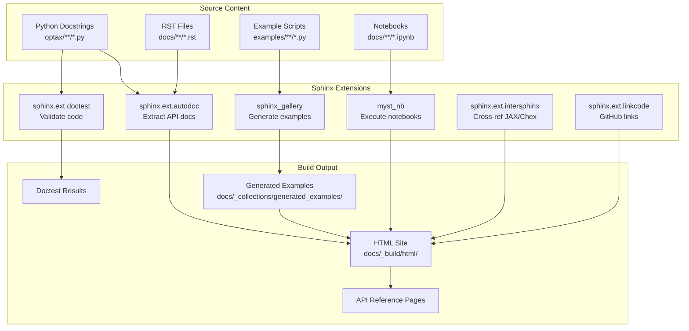
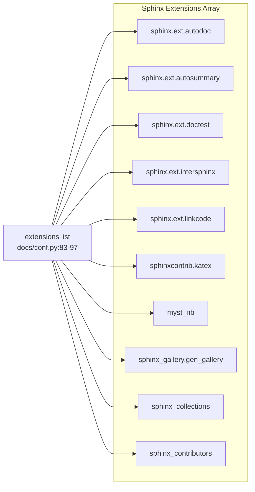
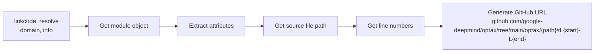
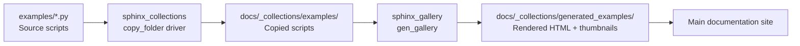
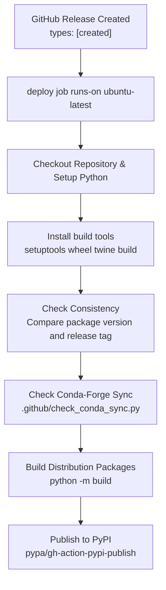

<!-- source: DeepWiki mcp.deepwiki.com · repo google-deepmind/optax · page 8.2 Documentation System · fetched 2026-10-26 -->

# Documentation System

<details>
<summary>Relevant source files</summary>

The following files were used as context for generating this wiki page:

- [.github/check_conda_sync.py](.github/check_conda_sync.py)
- [.github/workflows/pypi-publish.yml](.github/workflows/pypi-publish.yml)
- [.gitignore](.gitignore)
- [docs/.gitignore](docs/.gitignore)
- [docs/_templates/autosummary/base.rst](docs/_templates/autosummary/base.rst)
- [docs/_templates/autosummary/class.rst](docs/_templates/autosummary/class.rst)
- [docs/api/assignment.rst](docs/api/assignment.rst)
- [docs/api/microbatching.rst](docs/api/microbatching.rst)
- [docs/conf.py](docs/conf.py)
- [docs/gallery.rst](docs/gallery.rst)
- [examples/lbfgs.ipynb](examples/lbfgs.ipynb)
- [examples/linear_assignment_problem.ipynb](examples/linear_assignment_problem.ipynb)
- [readthedocs.yml](readthedocs.yml)

</details>


**Purpose:** This page documents Optax's Sphinx-based documentation infrastructure, including API reference generation, example galleries, doctests, PyPI publishing, and release processes. For information about the testing infrastructure that validates code quality, see [Testing Infrastructure](#8.1).

## Overview

Optax uses [Sphinx](https://www.sphinx-doc.org/) to generate comprehensive documentation hosted at https://optax.readthedocs.io/. The system combines multiple sources:

- **API Reference**: Auto-generated from docstrings using `sphinx.ext.autodoc`
- **Example Gallery**: Executable Python scripts and Jupyter notebooks rendered as tutorials via `sphinx-gallery` and `myst_nb`
- **Doctests**: Code examples in docstrings validated via `sphinx.ext.doctest`
- **Narrative Documentation**: Hand-written RST and Markdown files

Sources: [docs/conf.py:1-271](), [docs/gallery.rst:1-307](), [pyproject.toml:53-66]()

## Documentation Architecture



**Sphinx Configuration at `docs/conf.py`**

Sources: [docs/conf.py:1-271](), [docs/gallery.rst:1-307](), [pyproject.toml:53-66]()

## Sphinx Configuration System

The documentation build is controlled by [docs/conf.py:1-271](), which configures Sphinx and all extensions.

### Core Configuration

| Setting | Value | Purpose |
|---------|-------|---------|
| `project` | `'Optax'` | Project name |
| `copyright` | `'2021, DeepMind'` | Copyright notice |
| `master_doc` | `'index'` | Entry point RST file |
| `html_theme` | `'sphinx_book_theme'` | Theme for HTML output |
| `html_logo` | `'images/logo.svg'` | Logo in documentation |

Sources: [docs/conf.py:70-78](), [docs/conf.py:166-176]()

### Extension Configuration



**Key Extensions:**

- **autodoc**: Extracts API documentation from docstrings
- **autosummary**: Generates summary tables for modules
- **doctest**: Validates code examples in docstrings
- **intersphinx**: Links to external docs (JAX, Flax, Chex)
- **linkcode**: Creates "view source" links to GitHub
- **myst_nb**: Executes and renders Jupyter notebooks
- **sphinx_gallery**: Converts Python scripts to documentation
- **sphinxcontrib.katex**: Renders mathematical equations

Sources: [docs/conf.py:83-97]()

## API Reference Generation

### Autodoc Configuration

The `autodoc` extension automatically generates API documentation from Python docstrings.

**Type Alias Rewriting** [docs/conf.py:116-130]():

```python
autodoc_type_aliases = {
    '~optax._src.base.GradientTransformation': 'optax.GradientTransformation',
    '~optax._src.base.Params': 'Params',
    '~optax._src.base.Updates': 'Updates',
    '~optax._src.base.OptState': 'OptState',
    '~optax._src.base.PyTree': 'optax.PyTree',
    # ... additional aliases
}
```

This configuration ensures that internal implementation paths (e.g., `optax._src.base.GradientTransformation`) are displayed as user-facing public API names (e.g., `optax.GradientTransformation`) in the documentation.

**Member Ordering** [docs/conf.py:141-145]():

```python
autodoc_default_options = {
    'member-order': 'bysource',
    'special-members': True,
    'exclude-members': '__repr__, __str__, __weakref__',
}
```

Members are ordered as they appear in source code, special methods are included, but common magic methods are excluded.

Sources: [docs/conf.py:114-146]()

### Source Code Linking

The `linkcode_resolve` function generates GitHub URLs for each documented object:



**URL Format:**
`https://github.com/google-deepmind/optax/tree/main/optax/{relative_path}#L{lineno}-L{lineno+len-1}`

Sources: [docs/conf.py:1-279]()

## Example Gallery System

### Sphinx-Gallery Configuration

The `sphinx_gallery_conf` dictionary [docs/conf.py:158-168]() configures how example scripts are converted to documentation:

| Setting | Value | Purpose |
|---------|-------|---------|
| `examples_dirs` | `'_collections/examples'` | Source directory for examples |
| `gallery_dirs` | `'_collections/generated_examples/'` | Output directory for rendered examples |
| `ignore_pattern` | `r'_test\.py'` | Skip test files |
| `doc_module` | `'optax'` | Module for backreferences |
| `backreferences_dir` | `os.path.join('modules', 'generated')` | Directory for module references |

### Sphinx Collections

The `sphinx_collections` extension [docs/conf.py:147-155]() copies example files from the repository:

```python
collections = {
    'examples': {
        'driver': 'copy_folder',
        'source': '../examples/',
        'ignore': 'BUILD'
    }
}
```

This copies files from `examples/` to `docs/_collections/examples/` during the build, excluding Bazel `BUILD` files.



Sources: [docs/conf.py:147-168]()

## PyPI Publishing and Release Processes

Optax automates package publication to PyPI using GitHub Actions workflow `.github/workflows/pypi-publish.yml`. 



### Consistency Checks and Release Validation

1. **Version Verification**: The workflow checks that the package version defined in `optax.__version__` matches the GitHub release tag (`RELEASE_VER == PACKAGE_VER`) [.github/workflows/pypi-publish.yml:22-30]().
2. **Conda-Forge Dependency Sync**: It runs `.github/check_conda_sync.py` to ensure that `jax` dependency version pins in `pyproject.toml` match the `conda-forge` recipe on `optax-feedstock` [.github/workflows/pypi-publish.yml:31-34](), [.github/check_conda_sync.py:15-96]().

Sources: [.github/workflows/pypi-publish.yml:1-39](), [.github/check_conda_sync.py:1-100]()

## Summary

Optax's documentation and publishing system provides:

1. **Automated API Reference**: Extracted from docstrings with autodoc
2. **Validated Examples**: Doctests and gallery generation via Sphinx and `sphinx-gallery`
3. **Interactive Notebooks**: Handled via `myst_nb`
4. **Automated Releases**: CI-driven PyPI publishing with tag consistency checks and conda-forge sync validation
5. **CI Integration**: Builds validated on every commit

Sources: [docs/conf.py:1-271](), [.github/workflows/pypi-publish.yml:1-39](), [.github/check_conda_sync.py:1-100]()

---

