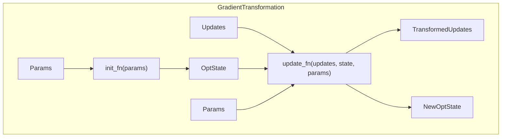
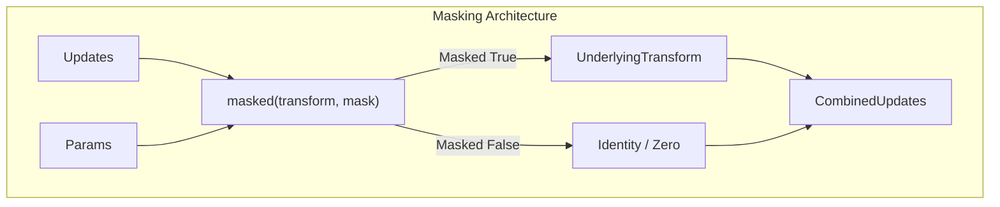

<!-- source: DeepWiki mcp.deepwiki.com · repo google-deepmind/optax · page 9 Glossary · fetched 2026-10-26 -->

# Glossary

Relevant source files

The following files were used as context for generating this wiki page:

- [docs/api/utilities.rst](docs/api/utilities.rst)
- [optax/__init__.py](optax/__init__.py)
- [optax/_src/base.py](optax/_src/base.py)
- [optax/_src/base_test.py](optax/_src/base_test.py)
- [optax/_src/lookahead.py](optax/_src/lookahead.py)
- [optax/_src/schedule.py](optax/_src/schedule.py)
- [optax/_src/transform_test.py](optax/_src/transform_test.py)
- [optax/_src/wrappers.py](optax/_src/wrappers.py)
- [optax/tree/__init__.py](optax/tree/__init__.py)
- [optax/tree_utils/__init__.py](optax/tree_utils/__init__.py)
- [optax/tree_utils/_tree_math.py](optax/tree_utils/_tree_math.py)
- [optax/tree_utils/_tree_math_test.py](optax/tree_utils/_tree_math_test.py)

## Purpose and Scope
This page defines codebase-specific terms, architectural patterns, and mathematical abstractions used across Optax. Each entry includes conceptual explanations, operational lifecycles, and code pointers to the relevant modules.

---

## Core Abstractions

### `GradientTransformation`
A `GradientTransformation` is a `NamedTuple` consisting of a pair of pure functions: an `init` function that constructs the initial optimizer state from model parameters, and an `update` function that processes gradient updates given the current state and parameters [optax/_src/base.py:153-179]().

*Diagram 1: Data flow and execution lifecycle of a `GradientTransformation`.*
Sources: `optax/_src/base.py:153-179()`

### `OptState`
`OptState` represents the internal state of a gradient transformation or composed optimizer. It is structured as an arbitrary nested JAX pytree (matching the model parameters or transformation requirements) containing arrays of statistics, step counts, or momentum buffers [optax/_src/base.py:35-38]().
Sources: `optax/_src/base.py:35-38()`

### `PyTree`
A `PyTree` (or `ArrayTree`) is a hierarchical data structure composed of container types (such as tuples, lists, and dicts) with JAX arrays or scalars at the leaves. Optax uses pytrees to represent model parameters (`Params`), gradient updates (`Updates`), and optimizer states (`OptState`) [optax/_src/base.py:32-36]().
Sources: `optax/_src/base.py:32-36()`

---

## Composition and Routing

### `chain`
`chain` combines multiple `GradientTransformation` objects sequentially into a single composite transformation. It threads the gradient updates through each transformation in order, accumulating state changes across the pipeline.
Sources: `optax/__init__.py()`

### `masking`
Masking allows selective application of gradient transformations to subsets of parameters (e.g., excluding biases or layer-norm parameters from weight decay). The `masked` wrapper applies an underlying transformation only where the mask tree evaluates to true [optax/_src/wrappers.py:31-33]().

*Diagram 2: Routing updates through a conditional masking wrapper.*
Sources: `optax/_src/wrappers.py:31-33()`

### `alias`
Aliases are convenience factory functions that bundle standard chains of transformations into recognizable optimizers (e.g., `optax.adam`, `optax.sgd`, `optax.adamw`) [optax/__init__.py:34-65]().
Sources: `optax/__init__.py:34-65()`

### `contrib`
The `optax.contrib` namespace houses experimental, cutting-edge, or specialized optimizers and algorithms that are not part of the stable core API [optax/__init__.py:23]().
Sources: `optax/__init__.py:23()`

---

## Momentum, Statistics, and Correction

### `EMA / moment`
Exponential Moving Average (EMA) or moment tracking maintains smoothed statistics of past gradients or updates (such as first and second moments in Adam). Optax provides tree utilities like `tree_update_moment` to compute these updates efficiently [optax/tree_utils/__init__.py:53]().
Sources: `optax/tree_utils/__init__.py:53()`

### `bias correction`
Bias correction scales exponential moving averages to compensate for their initialization at zero, particularly during early training steps. Functions such as `tree_bias_correction` implement this scaling factor [optax/tree_utils/__init__.py:38]().
Sources: `optax/tree_utils/__init__.py:38()`

### `inject_hyperparams`
`inject_hyperparams` is a wrapper that turns static hyperparameters (like learning rates or momentum decay factors) into dynamic, schedule-driven values that can be inspected and modified inside the optimizer state [optax/_src/schedule.py:30-31]().
Sources: `optax/_src/schedule.py:30-31()`

### `MultiSteps`
`MultiSteps` implements gradient accumulation and microbatching, allowing gradient updates to be accumulated across multiple steps before applying the optimizer update [optax/_src/wrappers.py:34-36]().
Sources: `optax/_src/wrappers.py:34-36()`

---

## Advanced Optimization and Numerics

### `linesearch`
Line search algorithms (such as backtracking or zoom linesearch) dynamically determine step sizes satisfying specific descent criteria [optax/__init__.py:90-95]().
Sources: `optax/__init__.py:90-95()`

### `Wolfe conditions`
The Wolfe conditions (sufficient decrease and curvature conditions) are standard criteria used in line searches to ensure numerical stability and sufficient progress during optimization.
Sources: `optax/__init__.py:90-95()`

### `Newton-Schulz`
Newton-Schulz iteration is an iterative matrix-approximation method used for computing matrix inverse roots or orthogonalization (utilized in specialized optimizers like Muon).
Sources: `optax/__init__.py()`

### `microbatching`
Microbatching divides large global batches into smaller memory-efficient chunks, accumulating gradients or statistics sequentially before executing optimizer steps [optax/__init__.py:26]().
Sources: `optax/__init__.py:26()`

### `projections`
Projections map updated parameters or gradients back onto feasible constraint sets, such as simplex, L1/L2/inf balls, or bounding boxes [optax/__init__.py:28]().
Sources: `optax/__init__.py:28()`

### `perturbations`
Perturbations provide stochastic smoothing and smoothing-based gradient estimation for non-differentiable or discrete operations via techniques like `make_perturbed_fun` [optax/__init__.py:27]().
Sources: `optax/__init__.py:27()`