# Page: Overview

# Overview

<details>
<summary>Relevant source files</summary>

The following files were used as context for generating this wiki page:

- [README.md](README.md)
- [docs/development.md](docs/development.md)
- [docs/getting_started.ipynb](docs/getting_started.ipynb)
- [docs/index.rst](docs/index.rst)
- [optax/__init__.py](optax/__init__.py)
- [optax/_src/schedule.py](optax/_src/schedule.py)
- [optax/_src/transform_test.py](optax/_src/transform_test.py)
- [optax/_src/wrappers.py](optax/_src/wrappers.py)

</details>


Optax is a gradient processing and optimization library for JAX that provides composable building blocks for constructing and customizing optimizers. It is designed to facilitate research by enabling users to combine low-level transformations into custom optimization algorithms for parametric models, particularly deep neural networks.

This page provides a high-level introduction to Optax's architecture, design philosophy, and core abstractions. For detailed information about specific subsystems:
- Getting started and installation: see [Getting Started](#1.1)
- Example gallery and notebooks: see [Example Gallery](#1.2)
- Core abstractions and patterns: see [Core Architecture](#2)
- Optimizer implementations: see [Optimizers](#3)
- Gradient transformations: see [Gradient Transformations](#6)
- Loss functions: see [Loss Functions](#5)

**Sources:** [optax/__init__.py:15](), [docs/index.rst:7-22]()

## Getting Started

Optax integrates smoothly into JAX training workflows. Getting started involves installing the library from PyPI or GitHub, setting up a model parameter structure, initializing an optimizer state, and executing an update loop. 

For a complete walkthrough on installation, writing your first training loop, and initial code snippets, see [Getting Started](#1.1).

**Sources:** [README.md:33-81](), [docs/getting_started.ipynb:1-178]()

## Example Gallery

Optax includes a rich collection of end-to-end example notebooks demonstrating how to train various architectures—ranging from simple MLPs on MNIST to ResNets on CIFAR-10, transformer-based language models (nanoLM), and advanced techniques like gradient accumulation, freezing parameters, meta-learning, and second-order optimization using LBFGS.

For detailed walkthroughs of these notebooks and contrib examples, see [Example Gallery](#1.2).

**Sources:** [README.md:1-150](), [docs/index.rst:42-50]()

## Design Philosophy

Optax follows three core principles:

1. **Composability**: Complex optimizers are built by chaining simple, reusable transformations
2. **Functional Programming**: All operations are pure functions with explicit state threading
3. **JAX Integration**: Built on JAX primitives for automatic differentiation and JIT compilation

The library favors small, well-tested building blocks over monolithic abstractions, prioritizing code readability and matching standard mathematical formulations over code reuse.

**Sources:** [docs/index.rst:12-22](), [optax/_src/base.py:152-191]()

## Core Abstraction: GradientTransformation

The fundamental abstraction in Optax is `GradientTransformation`, a named tuple containing two pure functions:

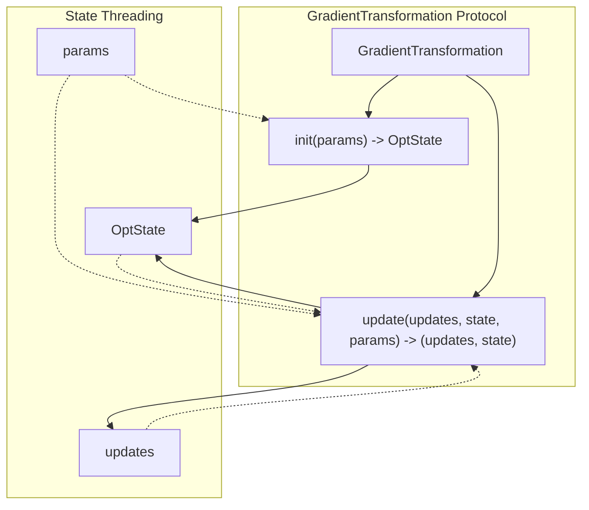
**Diagram: GradientTransformation Protocol**

- **`init`**: Takes initial parameters and returns initial optimizer state (e.g., momentum buffers, step counts)
- **`update`**: Takes gradient updates and current state, returns transformed updates and new state
- All state is immutable and explicitly threaded through each call

**Sources:** [optax/_src/base.py:65-110](), [optax/_src/base.py:152-195]()

## Architecture Layers

Optax is organized into distinct architectural layers, each with specific responsibilities:

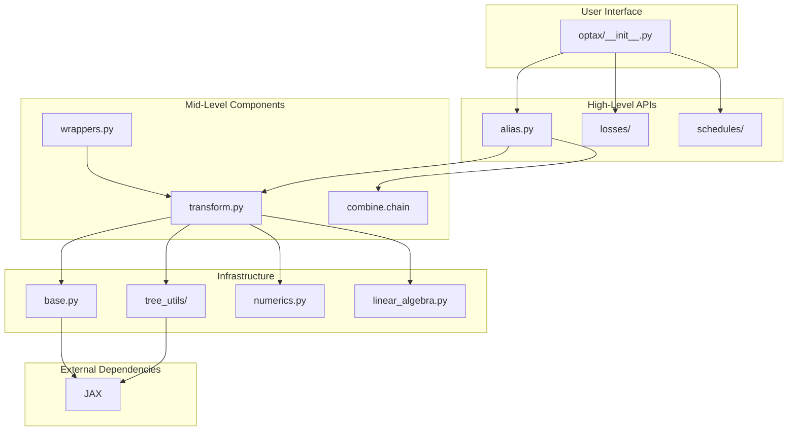
**Diagram: Optax Architecture Layers**

| Layer | Modules | Purpose |
|-------|---------|---------|
| **Public API** | `optax/__init__.py` | Exports all public symbols |
| **High-Level APIs** | `alias.py`, `losses/`, `schedules/` | User-facing optimizers and utilities |
| **Mid-Level** | `transform.py`, `combine.py`, `wrappers.py` | Composable transformation building blocks |
| **Infrastructure** | `base.py`, `tree_utils/`, `numerics.py` | Core abstractions and PyTree operations |
| **Foundation** | JAX | Array operations, autodiff, compilation |

**Sources:** [optax/__init__.py:1-156](), [optax/_src/alias.py:1-30](), [optax/_src/transform.py:1-30](), [optax/_src/base.py:1-341]()

## Optimizer Construction Pattern

Optimizers in Optax follow a factory pattern where high-level functions compose lower-level transformations:

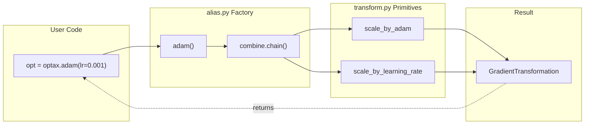
**Diagram: Optimizer Construction via Composition**

Example from `alias.py`:

```python
def adam(learning_rate, b1=0.9, b2=0.999, eps=1e-8):
    return combine.chain(
        transform.scale_by_adam(b1=b1, b2=b2, eps=eps),
        transform.scale_by_learning_rate(learning_rate),
    )
```

This pattern enables:
- **Modularity**: Transformations can be mixed and matched
- **Extensibility**: New optimizers composed from existing pieces
- **Transparency**: Clear mapping to mathematical formulations

**Sources:** [optax/_src/alias.py:1-65](), [optax/_src/transform.py:100-135]()

## Training Loop Integration

Optax optimizers integrate into standard JAX training loops using a functional state-threading pattern:

```mermaid
sequenceDiagram
    participant User as Training Loop
    participant Opt as GradientTransformation
    participant Loss as Loss Function
    
    User->>Loss: Define loss_fn(params, batch)
    User->>Opt: opt = optax.adam(lr=0.001)
    User->>Opt: state = opt.init(params)
    Opt-->>User: initial OptState
    
    loop Every Training Step
        User->>Loss: grads = jax.grad(loss_fn)(params, batch)
        User->>Opt: updates, state = opt.update(grads, state, params)
        Note over Opt: Applies transformations<br/>Updates state
        Opt-->>User: (updates, new_state)
        User->>User: params = optax.apply_updates(params, updates)
    end
```
**Diagram: Training Loop State Threading**

Key characteristics:
- **Immutable State**: Each `update` call returns new state; original is unchanged
- **Explicit Threading**: State must be explicitly passed and stored between calls
- **JIT Compatible**: All operations are pure functions that compile efficiently
- **No Hidden State**: All optimizer state is visible in `OptState` PyTree

**Sources:** [optax/_src/base.py:152-195](), [optax/_src/update.py:109]()

## PyTree Support

Optax operates on arbitrary nested parameter structures (PyTrees) using JAX's tree utilities:

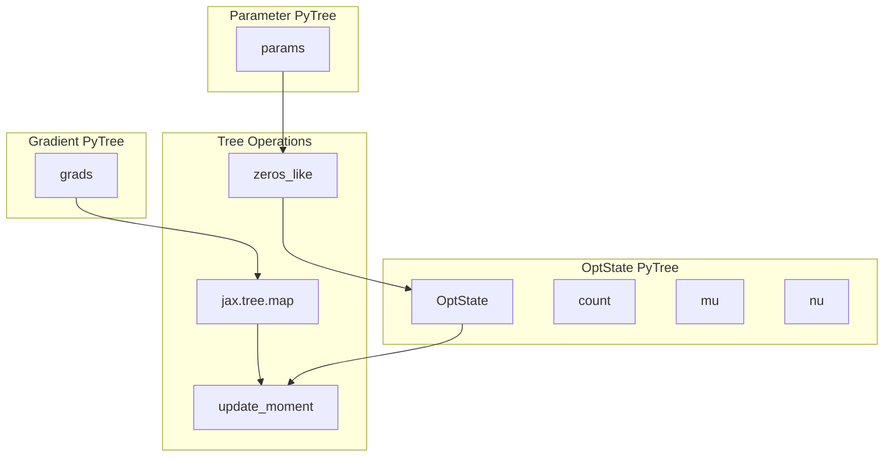
**Diagram: PyTree Operations in Optimizer State**

Tree utilities handle:
- **Structural Operations**: `zeros_like`, `full_like` create matching structures
- **Element-wise Math**: `tree` operations for nested structures
- **Moment Updates**: `update_moment`, `bias_correction` for optimizer statistics
- **Type Handling**: Automatic dtype casting and complex number support

**Sources:** [optax/tree/__init__.py:1-30](), [optax/_src/transform.py:278-280]()

## Extension Points

Optax provides multiple customization mechanisms:

| Extension Mechanism | Module | Purpose |
|-------------------|---------|---------|
| **Transformation Wrappers** | `wrappers.py` | Modify behavior (masking, conditional execution) |
| **Learning Rate Schedules** | `schedules/` | Dynamic hyperparameter control |
| **Contrib Optimizers** | `contrib/` | Experimental algorithms |
| **Custom Losses** | `losses/` | Training objectives |
| **Transformation Composition** | `combine.chain`, `combine.partition` | Build custom optimizers |

All extensions respect the `GradientTransformation` protocol, ensuring they compose correctly with existing components.

**Sources:** [optax/__init__.py:22-33](), [optax/_src/wrappers.py:15-38]()

## State Management

Optimizer state in Optax follows these principles:

1. **Named Tuples**: States are subclasses for type safety and introspection
2. **Nested Structure**: Complex optimizers have nested state tuples
3. **Immutability**: All state updates return new instances
4. **Explicit Counts**: Step counts are stored as arrays for JIT compatibility

Example state structures:

| Optimizer | State Type | Fields |
|-----------|------------|--------|
| `adam` | `ScaleByAdamState` | `count`, `mu`, `nu` |
| `sgd` with momentum | `TraceState` | `trace` |
| `adafactor` | `FactoredState` | Factored moment matrices, scale parameters |
| `chain` | Tuple of states | One state per chained transformation |

**Sources:** [optax/_src/transform.py:133-146](), [optax/_src/base.py:67-82]()

## Key Modules Summary

| Module | Primary Exports | Description |
|--------|----------------|-------------|
| `optax._src.base` | `GradientTransformation`, `OptState`, `Params`, `Updates` | Core types and protocols |
| `optax._src.alias` | `adam`, `sgd`, `adamw`, `rmsprop`, etc. | High-level optimizer factories |
| `optax._src.transform` | `scale_by_adam`, `scale_by_rms`, `scale`, `trace` | Low-level transformations |
| `optax._src.wrappers` | `apply_if_finite`, `masked`, `MultiSteps` | Behavior modifiers |
| `optax.losses` | `softmax_cross_entropy`, `l2_loss`, etc. | Loss functions |
| `optax.schedules` | `exponential_decay`, `warmup_cosine_decay_schedule` | Learning rate schedules |
| `optax.contrib` | Experimental optimizers | Experimental algorithms |

**Sources:** [optax/__init__.py:22-152]()

## Typical Usage Pattern

A minimal Optax training loop demonstrates the functional state-threading pattern:

```python
# 1. Define optimizer
optimizer = optax.adam(learning_rate=0.001)

# 2. Initialize state
opt_state = optimizer.init(params)

# 3. Training loop
for batch in dataset:
    # Compute gradients
    grads = jax.grad(loss_fn)(params, batch)
    
    # Transform gradients and update state
    updates, opt_state = optimizer.update(grads, opt_state, params)
    
    # Apply updates to parameters
    params = optax.apply_updates(params, updates)
```

This pattern is:
- **JIT-compilable**: All functions are pure and can be compiled
- **Explicit**: No hidden state or side effects
- **Composable**: Optimizers can be wrapped or chained
- **Inspectable**: State can be examined or modified between steps

**Sources:** [docs/getting_started.ipynb:105-148](), [optax/_src/base.py:152-195]()

---

# Page: Getting Started

# Getting Started

<details>
<summary>Relevant source files</summary>

The following files were used as context for generating this wiki page:

- [README.md](README.md)
- [docs/development.md](docs/development.md)
- [docs/gallery.rst](docs/gallery.rst)
- [docs/getting_started.ipynb](docs/getting_started.ipynb)
- [docs/index.rst](docs/index.rst)
- [examples/flax_example.ipynb](examples/flax_example.ipynb)
- [examples/lbfgs.ipynb](examples/lbfgs.ipynb)
- [examples/linear_assignment_problem.ipynb](examples/linear_assignment_problem.ipynb)
- [examples/lookahead_mnist.ipynb](examples/lookahead_mnist.ipynb)
- [examples/mlp_mnist.ipynb](examples/mlp_mnist.ipynb)

</details>


## Purpose and Scope

This page serves as the entry point for users integrating Optax into JAX-based machine learning pipelines [README.md:7-9](). It covers installation procedures [README.md:33-45](), core optimizer initialization and state management via the `GradientTransformation` protocol [docs/getting_started.ipynb:13-14](), a basic training loop implementation using `jax.grad` and `optax.apply_updates` [README.md:62-78](), and an exhaustive reference to the example gallery notebooks available in the documentation [docs/gallery.rst:4-222]().

Sources: [README.md:7-9](), [README.md:33-45](), [README.md:62-78](), [docs/getting_started.ipynb:13-14](), [docs/gallery.rst:4-222]()

---

## Installation

Optax can be installed as a pre-packaged release from the Python Package Index (PyPI) or directly fetched from the source repository for development purposes [README.md:33-45](). Because Optax relies fundamentally on JAX, a compatible JAX installation is required beforehand [docs/index.rst:37-39]().

To install the stable release from PyPI, execute:
```sh
pip install optax
```
*(See [README.md:37-39]())*

To install the latest development snapshot directly from the GitHub repository:
```sh
pip install git+https://github.com/google-deepmind/optax.git
```
*(See [README.md:43-45]())*

Sources: [README.md:33-45](), [docs/index.rst:37-39]()

---

## First Optimizer Usage and Core Abstractions

Optax centers around the `GradientTransformation` protocol [docs/getting_started.ipynb:13-14](), a stateless container of pure functions that processes gradients and updates internal optimizer states. An optimizer is defined by an initialization function (`init`) and an update function (`update`).

```
Optax Transformation Lifecycle
```
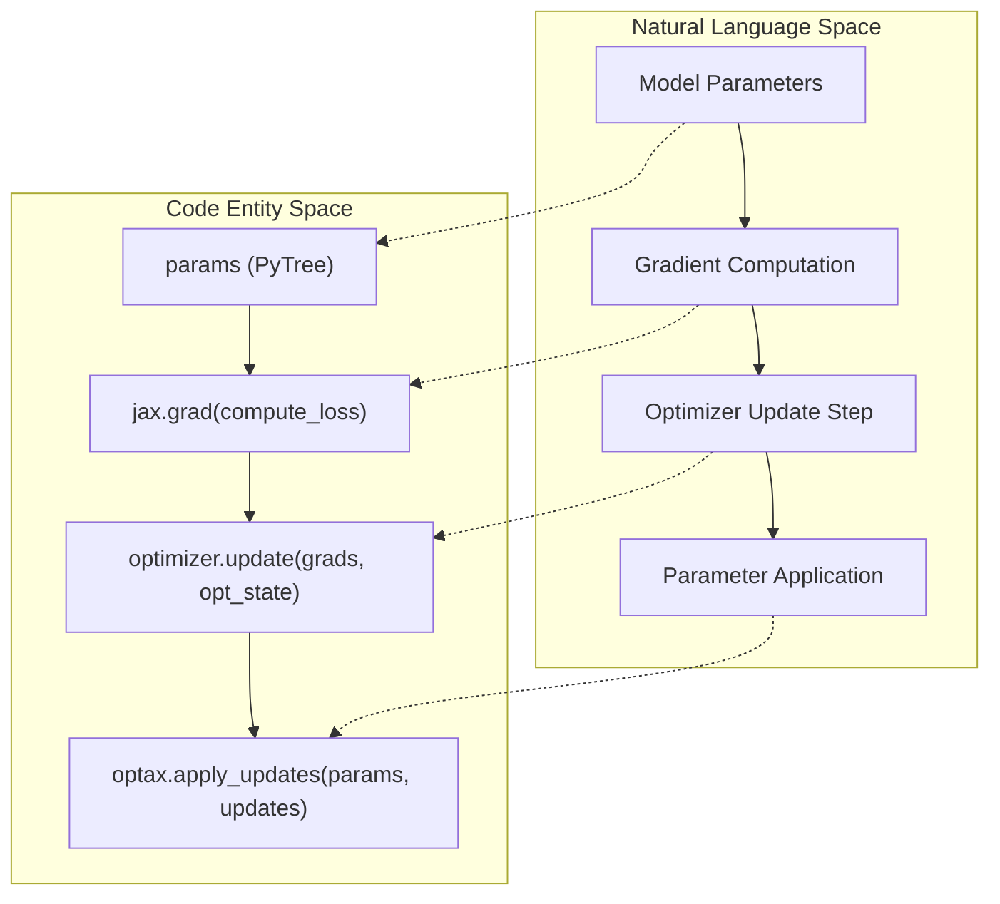
*(See [README.md:56-78](), [docs/getting_started.ipynb:112-147]())*

When utilizing an optimizer such as Adam [README.md:51-59](), the workflow requires instantiating the transformation function, initializing the optimizer state (`opt_state`) using model parameters (`params`), and transforming incoming gradients [README.md:56-78](). Custom optimizers can also be constructed by chaining multiple low-level gradient transformations using `optax.chain` [docs/getting_started.ipynb:155-178]().

Sources: [README.md:51-78](), [docs/getting_started.ipynb:13-178]()

---

## Basic Training Loop

The optimization loop in Optax combines JAX autodiff (`jax.grad` or `jax.value_and_grad`) with Optax's stateful gradient transformations and `optax.apply_updates` [README.md:62-78](). 

```
Training Loop Data Flow Architecture
```
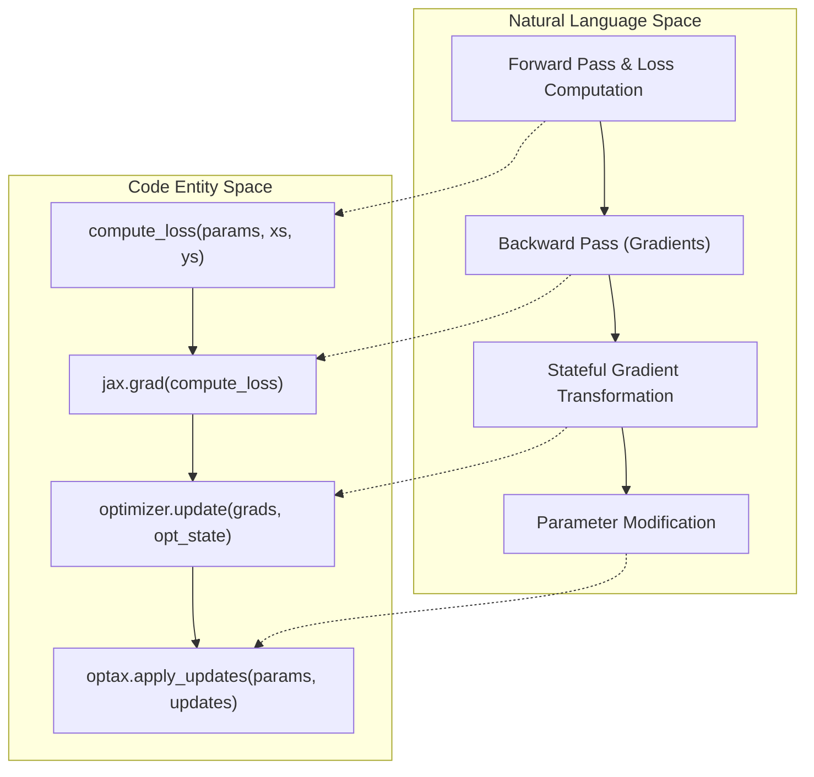
*(See [README.md:62-78](), [docs/getting_started.ipynb:139-148]())*

During each iteration, gradients of the loss function are computed with respect to model weights, passed into `optimizer.update()`, and applied back to the parameters via `optax.apply_updates()` [README.md:62-78]().

Sources: [README.md:62-78](), [docs/getting_started.ipynb:139-148]()

---

## Example Gallery Overview

Optax provides a comprehensive set of example notebooks in the documentation gallery illustrating real-world applications across various architectures and tasks [docs/gallery.rst:4-222](). 

| Example Category / Notebook | Target Architecture / Domain | Description & Key Optax Modules |
| :--- | :--- | :--- |
| `mlp_mnist.ipynb` | Multilayer Perceptron / MNIST | Trains a simple digit classifier using cross-entropy loss [docs/gallery.rst:123-135]() |
| `cifar10_resnet.ipynb` | ResNet / CIFAR10 | End-to-end convolutional residual network training with Flax and Optax [docs/gallery.rst:72-84]() |
| `nanolm.ipynb` | Character-level Transformer | Implements a language model on Tiny Shakespeare [docs/gallery.rst:156-168]() |
| `lbfgs.ipynb` | Numerical Optimization | Demonstrates L-BFGS gradient transformation and line searches [docs/gallery.rst:173-185]() |
| `gradient_accumulation.ipynb` | Large-batch Training | Shows how to accumulate gradients over multiple steps [docs/gallery.rst:21-33]() |
| `adversarial_training.ipynb` | Robustness / CNN | Adversarial training routines on MNIST datasets [docs/gallery.rst:139-151]() |
| `lookahead_mnist.ipynb` | Lookahead Wrapper | Combines fast optimizers with slow parameter updates [docs/gallery.rst:106-118]() |
| `meta_learning.ipynb` | Meta-Optimization | Higher-order optimization flows [docs/gallery.rst:38-50]() |
| `perturbations.ipynb` | Stochastic Smoothing | Differentiable discrete operations using perturbations [docs/gallery.rst:190-202]() |
| `linear_assignment_problem.ipynb` | Combinatorial Optimization | Solves linear assignment problems using the Hungarian algorithm [docs/gallery.rst:207-219]() |

Contrib examples also cover advanced techniques such as differential privacy (`differentially_private_sgd`), reduce-on-plateau schedulers, and Sharpness-Aware Minimization (`sam`) [docs/gallery.rst:227-290]().

Sources: [docs/gallery.rst:4-290]()

---

# Page: Example Gallery

# Example Gallery

<details>
<summary>Relevant source files</summary>

The following files were used as context for generating this wiki page:

- [docs/Makefile](docs/Makefile)
- [docs/images/examples/cifar10_resnet.png](docs/images/examples/cifar10_resnet.png)
- [docs/images/examples/contrib/sam.png](docs/images/examples/contrib/sam.png)
- [docs/images/examples/ogda.png](docs/images/examples/ogda.png)
- [docs/images/examples/tiny_shakespeare.png](docs/images/examples/tiny_shakespeare.png)
- [examples/README.md](examples/README.md)
- [examples/adversarial_training.ipynb](examples/adversarial_training.ipynb)
- [examples/cifar10_resnet.ipynb](examples/cifar10_resnet.ipynb)
- [examples/contrib/README.md](examples/contrib/README.md)
- [examples/contrib/differentially_private_sgd.ipynb](examples/contrib/differentially_private_sgd.ipynb)
- [examples/contrib/reduce_on_plateau.ipynb](examples/contrib/reduce_on_plateau.ipynb)
- [examples/contrib/sam.ipynb](examples/contrib/sam.ipynb)
- [examples/freezing_parameters.ipynb](examples/freezing_parameters.ipynb)
- [examples/gradient_accumulation.ipynb](examples/gradient_accumulation.ipynb)
- [examples/meta_learning.ipynb](examples/meta_learning.ipynb)
- [examples/nanolm.ipynb](examples/nanolm.ipynb)
- [examples/ogda_example.ipynb](examples/ogda_example.ipynb)

</details>


This section walks through the various example notebooks and tutorials provided in the `examples/` and `examples/contrib/` directories of the Optax repository. These notebooks demonstrate how to integrate Optax with deep learning frameworks like Flax (specifically `flax.nnx` and `flax.linen`), build high-performance data loaders with Grain and TensorFlow Datasets, and implement advanced training paradigms such as adversarial training, gradient accumulation, parameter freezing, meta-learning, and experimental optimization techniques.

---

## 1. Overview of Example Notebooks

The Optax example gallery covers end-to-end model training tasks across various domains—ranging from simple multilayer perceptrons (MLPs) to deep residual networks and character-level language models. 

| Example Notebook | Domain / Task | Key Optax & Framework Integration |
| :--- | :--- | :--- |
| **MNIST MLP** | Image Classification (Fashion-MNIST) | `flax.nnx`, `optax.softmax_cross_entropy_with_integer_labels`, `grain` data loaders |
| **CIFAR10 ResNet** | Deep Image Classification | `flax.nnx`, `albumentations` data augmentation, custom learning rate schedules |
| **Adversarial Training** | Robust Deep Learning (PGD) | Infinity-ball projection, `optax.tree_utils.tree_norm`, sign gradients |
| **nanoLM** | Character-level Language Modeling | `flax.linen`, `optax.adamw`, Tiny Shakespeare corpus via `tfds` |
| **Gradient Accumulation** | Large-Batch Simulation | `optax.MultiSteps`, microbatching, state splitting |
| **Freezing Parameters** | Parameter Constraint & Masking | `optax.transforms.freeze`, `optax.transforms.selective_transform`, masks |
| **Meta-Learning** | Bilevel Optimization / MAML | High-order automatic differentiation, custom inner/outer loops |
| **SAM (Contrib)** | Sharpness-Aware Minimization | `optax.contrib.sam`, synchronized adversarial and outer steps |
| **Reduce on Plateau (Contrib)** | Adaptive Learning Rate Schedulers | `optax.contrib.reduce_on_plateau`, metric-driven adjustments |
| **Differentially Private SGD (Contrib)**| Privacy-Preserving Training | Per-example gradient clipping, `dp_accounting`, `stax` |

Sources: `examples/README.md`, `examples/contrib/README.md`, `examples/cifar10_resnet.ipynb`, `examples/adversarial_training.ipynb`, `examples/freezing_parameters.ipynb`, `examples/gradient_accumulation.ipynb`, `examples/contrib/reduce_on_plateau.ipynb`, `examples/contrib/sam.ipynb`, `examples/contrib/differentially_private_sgd.ipynb`, `examples/nanolm.ipynb`

---

## 2. Vision and Classification Examples

### MNIST MLP & Fashion-MNIST Reduce on Plateau
The basic image classification examples demonstrate standard training pipelines using MLPs with `flax.nnx` [examples/contrib/reduce_on_plateau.ipynb:142-159] and data streaming via `grain` [examples/contrib/reduce_on_plateau.ipynb:105-124]. 

The Reduce on Plateau notebook introduces `optax.contrib.reduce_on_plateau`, which monitors validation metrics (such as loss or accuracy) and dynamically scales down the learning rate when progress stalls.

### CIFAR10 ResNet
The ResNet example (`cifar10_resnet.ipynb`) scales up the vision pipeline by implementing residual network architectures (`resnet18` through `resnet200`) using `flax.nnx` combined with data augmentation via `albumentations` [cifar10_resnet.ipynb:35-42, 139-148]. It demonstrates weight decay configuration (`L2_REG = 1e-4`) and tracking state across batched iterations [cifar10_resnet.ipynb:56-68].

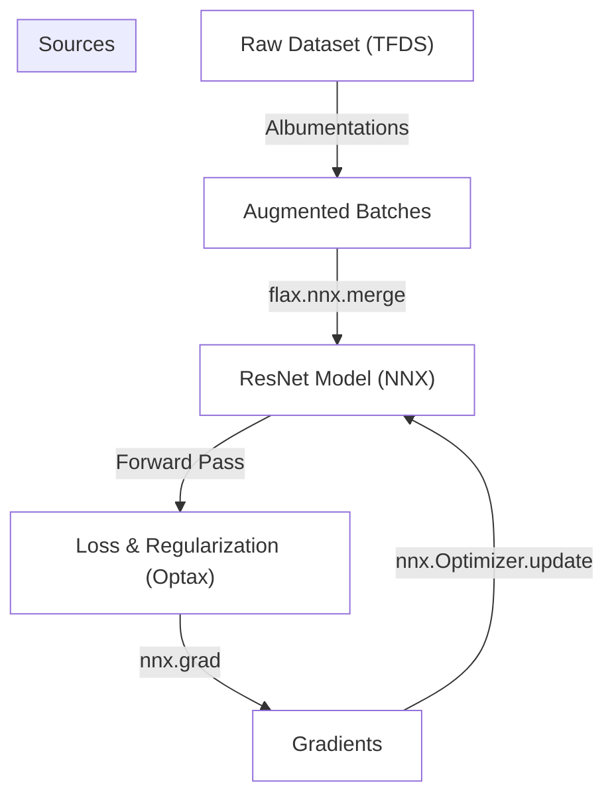

Sources: `examples/contrib/reduce_on_plateau.ipynb`, `examples/cifar10_resnet.ipynb`

---

## 3. Robustness and Advanced Training Paradigms

### Adversarial Training (PGD)
The adversarial training notebook (`adversarial_training.ipynb`) implements Projected Gradient Descent (PGD) to train robust CNNs against $\ell_\infty$-bounded perturbations [adversarial_training.ipynb:9-22]. It computes local adversarial perturbations by taking the sign of the input gradients and projecting them back onto an infinity-ball of radius `EPSILON`:

$$\tilde{x} = x + \epsilon \cdot \text{sign}(\nabla_x \mathcal{L}(\theta, x, y))$$

### Gradient Accumulation
The gradient accumulation notebook (`gradient_accumulation.ipynb`) shows how to simulate large batch sizes under memory constraints using `optax.MultiSteps` or manual accumulation loops [examples/gradient_accumulation.ipynb:20-24]. Gradients over sequential microbatches are summed without updating optimizer states until a predefined accumulation frequency is reached.

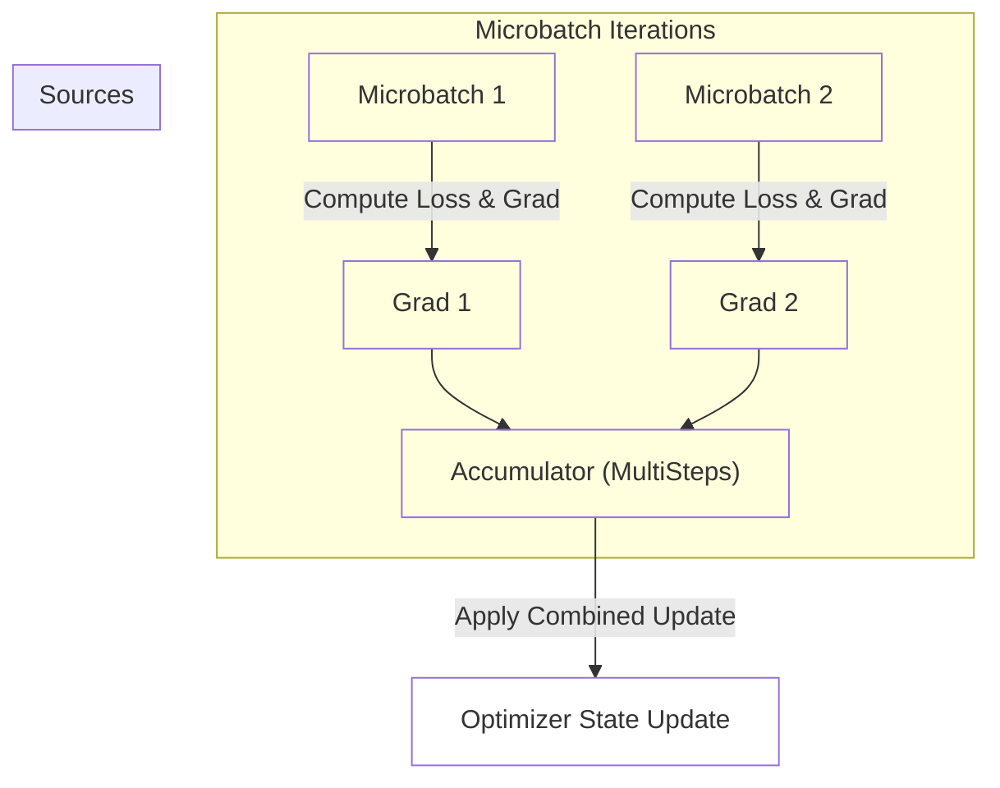

Sources: `examples/adversarial_training.ipynb`, `examples/gradient_accumulation.ipynb`

---

## 4. Parameter Control and Meta-Learning

### Freezing Parameters
The parameter freezing guide (`freezing_parameters.ipynb`) details multiple mechanisms for holding subsets of model parameters constant during optimization:
1. **`optax.transforms.freeze`**: Combines an optimizer with a boolean mask via `optax.chain(optax.adam(lr), freeze(mask))` [examples/freezing_parameters.ipynb:65-98].
2. **`optax.transforms.selective_transform`**: Applies specific transformations selectively to targeted subtrees.
3. **Manual Masking**: Using `optax.masked()` or `optax.set_to_zero()` to nullify updates for frozen parameters.

### Meta-Learning
The meta-learning notebook (`meta_learning.ipynb`) demonstrates higher-order automatic differentiation for bilevel optimization problems (such as Model-Agnostic Meta-Learning, MAML). It uses nested JAX gradient transformations to compute gradients through inner-loop optimization steps.

Sources: `examples/freezing_parameters.ipynb`, `examples/meta_learning.ipynb`

---

## 5. Contributed Optimizers and Wrappers

### Sharpness-Aware Minimization (SAM)
The SAM example (`contrib/sam.ipynb`) implements Sharpness-Aware Minimization using `optax.contrib.sam` [examples/contrib/sam.ipynb:9-15]. SAM optimizes both parameter value and loss landscape sharpness by finding perturbations that simultaneously maximize loss locally and minimize it globally:

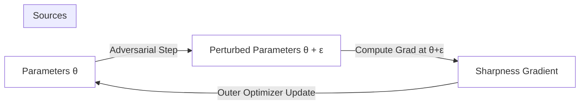

### Differentially Private SGD (DP-SGD)
The DP-SGD notebook (`contrib/differentially_private_sgd.ipynb`) showcases privacy-preserving machine learning on MNIST [examples/contrib/differentially_private_sgd.ipynb:9-25]. It relies on per-example gradient clipping (`L2_NORM_CLIP`) combined with Gaussian noise injection managed through `dp_accounting` [examples/contrib/differentially_private_sgd.ipynb:80-90, 168-177].

Sources: `examples/contrib/sam.ipynb`, `examples/contrib/differentially_private_sgd.ipynb`

---

# Page: Core Architecture

# Core Architecture

<details>
<summary>Relevant source files</summary>

The following files were used as context for generating this wiki page:

- [optax/__init__.py](optax/__init__.py)
- [optax/_src/base.py](optax/_src/base.py)
- [optax/_src/base_test.py](optax/_src/base_test.py)
- [optax/_src/lookahead.py](optax/_src/lookahead.py)
- [optax/_src/schedule.py](optax/_src/schedule.py)
- [optax/_src/transform_test.py](optax/_src/transform_test.py)
- [optax/_src/wrappers.py](optax/_src/wrappers.py)

</details>


## Purpose and Scope

This document explains the fundamental design and core abstractions of Optax. It covers the central `GradientTransformation` interface, state management, tree utilities, and optimization composition patterns that form the foundation of the optimization library. 

As this is a parent page, it provides a high-level overview. For deep technical details, refer to the following child pages:
- **Gradient Transformation Protocol**: See [GradientTransformation Protocol](#2.1) for details on the init/update lifecycle and the functional programming pattern.
- **Tree Utilities**: See [Tree Utilities](#2.2) for nested structure operations, dtype handling, and state introspection.
- **Optimizer Composition**: See [Optimizer Composition](#2.3) for chaining and partitioning strategies.

Sources: [optax/_src/base.py:1-42]()

## Overview

Optax is built around a functional design philosophy where optimizers are represented as pure, composable transformations. This approach allows for flexibility in constructing custom optimization algorithms while maintaining compatibility with JAX's pure transformation system (`jax.jit`, `jax.grad`, etc.).

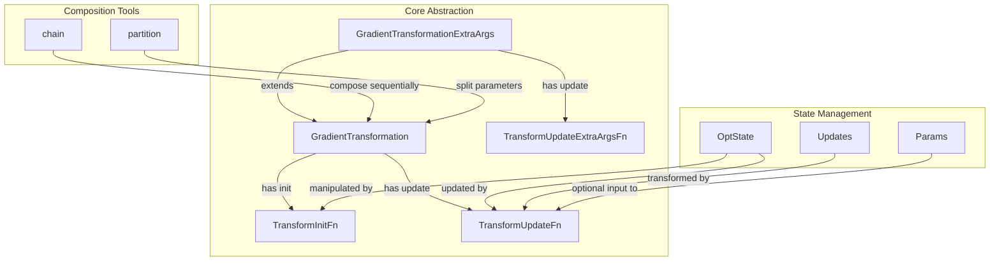

**Diagram: Core Architecture Overview of Optax**

Sources: [optax/_src/base.py:66-152]()

---

## 2.1 GradientTransformation Protocol

Optax optimizers are not objects with internal mutable state; instead, they are implemented as *gradient transformations*. A `GradientTransformation` is a `NamedTuple` containing two pure functions: `init` and `update` [optax/_src/base.py:153-162](). 

- **`init`**: Takes initial model parameters (`Params`) and returns the initial optimizer state (`OptState`) [optax/_src/base.py:66-82]().
- **`update`**: Takes gradient updates, current optimizer state, and optionally current parameters, returning transformed updates and a new optimizer state [optax/_src/base.py:85-110]().

For detailed documentation on the lifecycle, state management, and extended keyword argument support (`GradientTransformationExtraArgs`), see [GradientTransformation Protocol](#2.1).

Sources: [optax/_src/base.py:153-174]()

---

## 2.2 Tree Utilities

Because JAX models and optimizer states are represented as PyTrees (nested structures of arrays, tuples, lists, and dictionaries), Optax provides robust utilities for manipulating these nested structures. This includes mathematical operations, dtype conversions, random generation, and optimizer state introspection (`tree_utils/_state_utils.py`) for reading, filtering, and updating hyperparameters.

For detailed documentation on PyTree manipulation and state introspection, see [Tree Utilities](#2.2).

Sources: [optax/tree/__init__.py:1-15](), [optax/tree_utils/__init__.py:1-15]()

---

## 2.3 Optimizer Composition

Complex optimization algorithms in Optax are rarely monolithic; instead, they emerge from chaining and partitioning simple building blocks. 
- **Chaining (`combine.chain`)**: Sequentially applies multiple gradient transformations so that the output updates of one transform become the input to the next [optax/_src/combine.py:15-23]().
- **Partitioning (`combine.partition`)**: Directs different transformations to distinct subsets of parameters based on a partitioning rule or labeling function [optax/_src/combine.py:23]().

For detailed documentation on composition patterns, see [Optimizer Composition](#2.3).

Sources: [optax/_src/combine.py:1-23]()

---

## Stateless Transformations

Optax provides helper utilities to convert arbitrary stateless functions into standard `GradientTransformation` objects:

- **`stateless`**: Wraps a function operating on gradients and parameters, returning an `EmptyState` upon initialization [optax/_src/base.py:273-300]().
- **`stateless_with_tree_map`**: Automatically applies tree mapping over the inputs [optax/_src/base.py:302-341]().

Sources: [optax/_src/base.py:273-341]()

---

## Additive and Auxiliary Transformations

Beyond standard optimizers, Optax includes modular building blocks for specific gradient modifications:
- **Weight Decay**: `add_decayed_weights` adds scaled parameter values directly to the gradients [optax/transforms/_adding.py:29-65]().
- **Noise Injection**: `add_noise` introduces stochasticity to assist with generalization [optax/transforms/_adding.py:68-111]().

Sources: [optax/transforms/_adding.py:29-111]()

---

## Summary

The core architecture of Optax revolves around the `GradientTransformation` abstraction [optax/_src/base.py:153-162](), which provides a functional interface for implementing optimization algorithms. By composing these transformations via `chain` and `partition`, sophisticated optimization strategies can be cleanly constructed from reusable components. PyTree utilities and state management functions further empower users to inspect, modify, and distribute optimizer states across accelerators.

---

# Page: GradientTransformation Protocol

# GradientTransformation Protocol

<details>
<summary>Relevant source files</summary>

The following files were used as context for generating this wiki page:

- [optax/_src/base.py](optax/_src/base.py)
- [optax/_src/base_test.py](optax/_src/base_test.py)
- [optax/_src/lookahead.py](optax/_src/lookahead.py)
- [optax/_src/update.py](optax/_src/update.py)
- [optax/_src/update_test.py](optax/_src/update_test.py)

</details>


## Purpose and Scope

This page documents the `GradientTransformation` abstraction, which serves as the core architectural foundation for all optimization algorithms, gradient preconditioning, clipping, and parameter updates in Optax. It covers the functional programming lifecycle (`init` and `update`), optimization state management (`OptState`), extended argument support (`GradientTransformationExtraArgs`), and advanced stateful wrappers like `lookahead`.

Sources: [optax/_src/base.py:1-192](), [optax/_src/lookahead.py:1-155]()

---

## The GradientTransformation Abstraction

Optax implements all optimization components as pure functions packaged into a `GradientTransformation` `NamedTuple` [optax/_src/base.py:153-162](). Rather than bundling mutable state inside optimizer objects (as seen in traditional object-oriented frameworks), Optax passes an explicit optimization state (`OptState`) through every step [optax/_src/base.py:168-174]().

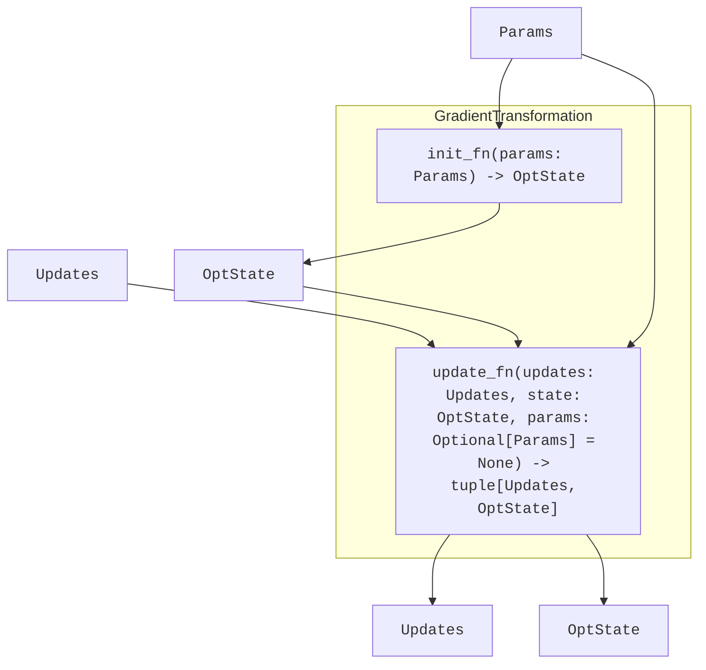
*Figure 1: Data flow through the `GradientTransformation` protocol lifecycle.*

Sources: [optax/_src/base.py:66-111](), [optax/_src/base.py:153-174]()

### Core Protocols

A transformation consists of two primary function types defined as protocols:

1. **`TransformInitFn`**: A callable that accepts model parameters (`Params`) and initializes the state (`OptState`) [optax/_src/base.py:66-83]().
2. **`TransformUpdateFn`**: A callable that accepts gradient updates (`Updates`), the current optimizer state (`OptState`), and optionally the current parameters (`Params`), returning transformed updates and the next state [optax/_src/base.py:85-111]().

Sources: [optax/_src/base.py:66-111]()

---

## State Management (`OptState`)

Because transformations are pure functions, all internal tracking statistics—such as step counts, momentum buffers, and exponential moving averages—reside entirely within `OptState` [optax/_src/base.py:168-174](). 

- `OptState` and `Params` are both aliases for `ArrayTree` (arbitrary nested structures, or PyTrees, of `jnp.ndarray` leaves) [optax/_src/base.py:32-36]().
- Stateless transformations return `EmptyState` or equivalent stateless PyTrees [optax/_src/base_test.py:56-61]().
- Mutating or inspecting optimizer parameters and hyperparameters between steps is performed by manipulating this PyTree directly (see [2.2.1 Optimizer State Introspection]()).

Sources: [optax/_src/base.py:32-38](), [optax/_src/base_test.py:56-61]()

---

## Extended Arguments Support

While standard update functions only take `updates`, `state`, and optional `params`, many modern workflows require dynamic scheduling parameters or callbacks that depend on loss values or metrics. Optax provides `GradientTransformationExtraArgs` and `TransformUpdateExtraArgsFn` to handle arbitrary keyword arguments (`**extra_args`) [optax/_src/base.py:113-152]().

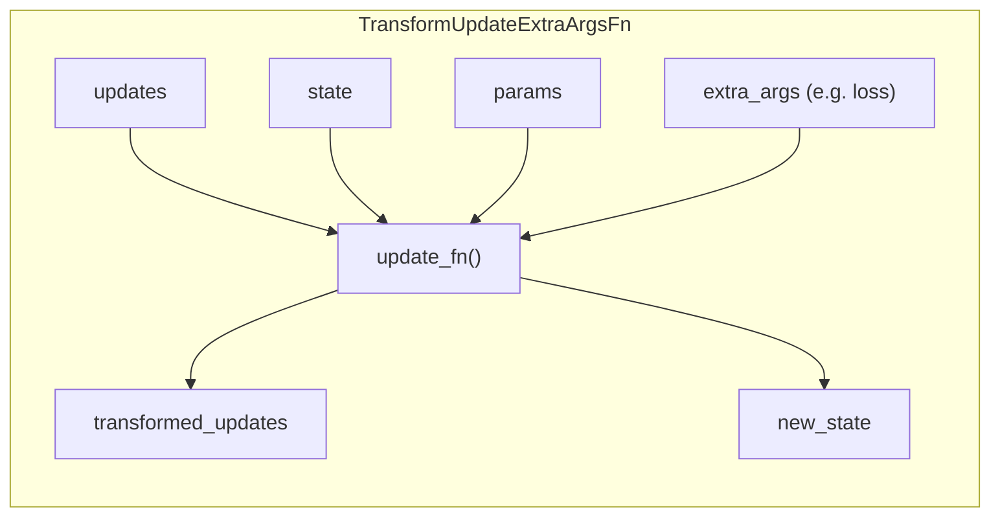
*Figure 2: Processing additional context via `TransformUpdateExtraArgsFn`.*

Sources: [optax/_src/base.py:113-152]()

---

## Complex Transformation Example: Lookahead

The `lookahead` wrapper [optax/_src/lookahead.py:63-155]() demonstrates a composite stateful transformation maintaining multi-tier state and parameters via `LookaheadState` and `LookaheadParams`.

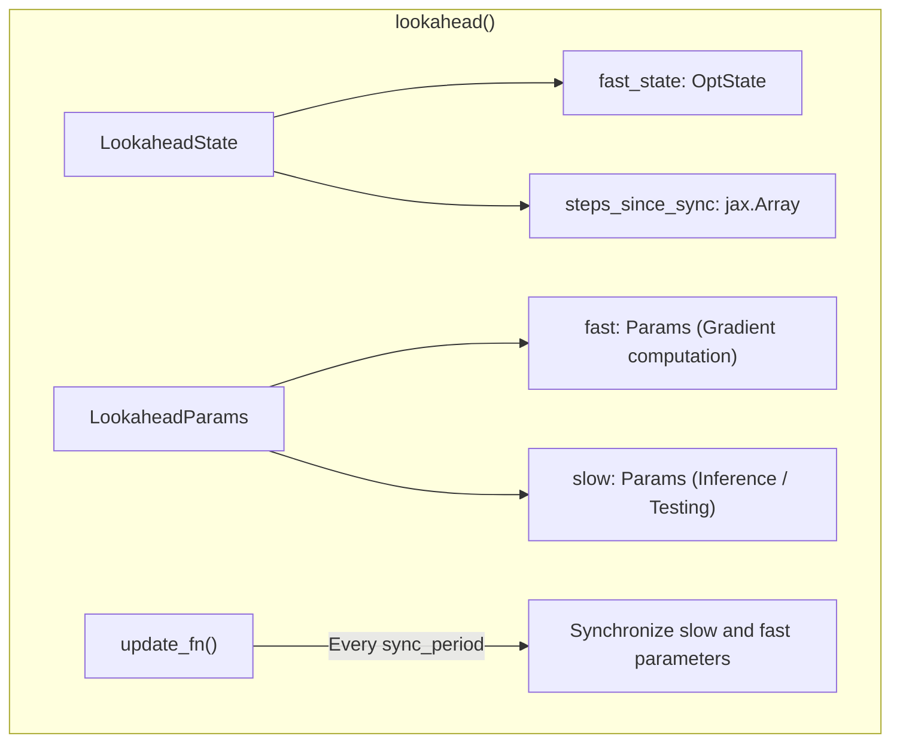
*Figure 3: Code entity association for the `lookahead` optimization wrapper.*

Sources: [optax/_src/lookahead.py:25-62](), [optax/_src/lookahead.py:63-155]()

---

# Page: Tree Utilities

# Tree Utilities

<details>
<summary>Relevant source files</summary>

The following files were used as context for generating this wiki page:

- [docs/api/utilities.rst](docs/api/utilities.rst)
- [optax/tree/__init__.py](optax/tree/__init__.py)
- [optax/tree_utils/__init__.py](optax/tree_utils/__init__.py)
- [optax/tree_utils/_casting.py](optax/tree_utils/_casting.py)
- [optax/tree_utils/_casting_test.py](optax/tree_utils/_casting_test.py)
- [optax/tree_utils/_random.py](optax/tree_utils/_random.py)
- [optax/tree_utils/_random_test.py](optax/tree_utils/_random_test.py)
- [optax/tree_utils/_tree_math.py](optax/tree_utils/_tree_math.py)
- [optax/tree_utils/_tree_math_test.py](optax/tree_utils/_tree_math_test.py)

</details>


This page documents the tree utilities system in Optax, which provides operations on PyTrees (nested parameter structures). Tree utilities are foundational infrastructure that enable mathematical operations, dtype handling, and random generation on arbitrary nested structures of JAX arrays.

**Scope**: This page covers functions in the `optax.tree_utils` and `optax.tree` modules for manipulating PyTrees. For information about the core `GradientTransformation` protocol that uses these utilities, see [GradientTransformation Protocol](#2.1). For optimizer composition patterns, see [Optimizer Composition](#2.3).

**Child Pages**:
- [Optimizer State Introspection](#2.2.1) — Document tree_utils/_state_utils.py: reading, filtering and updating hyperparameters and named state inside nested optimizer states.

## Overview

PyTrees are JAX's abstraction for nested data structures (dictionaries, tuples, lists, etc.) containing arrays. Tree utilities extend standard array operations to work element-wise across entire PyTree structures, maintaining the tree's structure while operating on each leaf.

**Tree Operations Architecture**

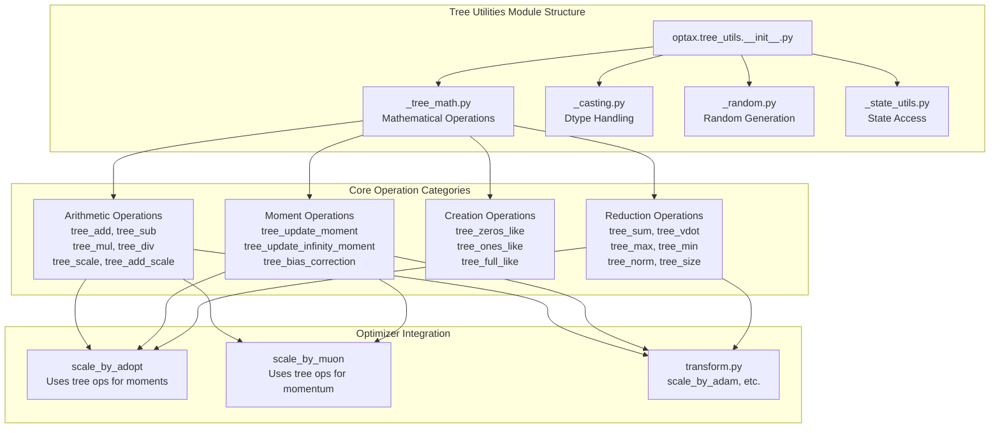

Sources: [optax/tree_utils/__init__.py:1-107](), [optax/tree_utils/_tree_math.py:1-235](), [optax/tree_utils/_casting.py:1-188](), [optax/tree_utils/_random.py:1-109]()

## Mathematical Operations

Tree utilities provide element-wise mathematical operations that preserve PyTree structure. Each operation applies a function to corresponding leaves in the input tree(s).

### Arithmetic Operations

| Function | Operation | Example |
|----------|-----------|---------|
| `tree_add(tree_x, tree_y, *others)` | Element-wise addition | `tree_x + tree_y + ...` |
| `tree_sub(tree_x, tree_y)` | Element-wise subtraction | `tree_x - tree_y` |
| `tree_mul(tree_x, tree_y)` | Element-wise multiplication | `tree_x * tree_y` |
| `tree_div(tree_x, tree_y)` | Element-wise division | `tree_x / tree_y` |
| `tree_scale(scalar, tree)` | Scalar multiplication | `scalar * tree` |
| `tree_add_scale(tree_x, scalar, tree_y)` | Scaled addition | `tree_x + scalar * tree_y` |

**Key Implementation Details**:
- `tree_add` uses `jax.tree.map(lambda *leaves: sum(leaves), *trees)` to sum corresponding leaves [optax/tree_utils/_tree_math.py:29-44]()
- `tree_add_scale` handles `None` leaves specially, preserving them in the output [optax/tree_utils/_tree_math.py:104-123]()
- All operations use `jax.tree.map` to maintain structure compatibility

### Reduction Operations

Reduction operations collapse a PyTree to a scalar or compute properties of the entire tree:

```python
# Example usage patterns
gradient_norm = tree_norm(gradients)  # Compute L2 norm
inner_product = tree_vdot(tree_a, tree_b)  # Dot product
total_params = tree_size(params)  # Count total elements
max_gradient = tree_max(gradients)  # Find maximum value
```

| Function | Returns | Description |
|----------|---------|-------------|
| `tree_sum(tree)` | Scalar | Sum of all elements |
| `tree_vdot(tree_x, tree_y)` | Scalar | Inner product (conjugate for complex) |
| `tree_norm(tree, ord=None, squared=False)` | Scalar | Vector norm (L1, L2, Linf) |
| `tree_max(tree)` | Scalar | Maximum element |
| `tree_min(tree)` | Scalar | Minimum element |
| `tree_size(tree)` | Integer | Total number of elements |

**Inner Product for Complex Arrays**:

The `tree_vdot` implementation handles complex conjugation and uses high-precision computation [optax/tree_utils/_tree_math.py:125-170]():
```python
def _vdot(a, b, precision=jax.lax.Precision.HIGHEST):
    if jax.dtypes.issubdtype(a.dtype, jnp.complexfloating):
        a = jnp.conj(a)  # Conjugate first argument
    return jnp.tensordot(a, b, a.ndim, precision=precision)
```

Sources: [optax/tree_utils/_tree_math.py:29-235](), [optax/tree_utils/_tree_math_test.py:56-178]()

## Tree Creation and Initialization

Tree utilities provide functions to create new trees with the same structure as existing ones:

| Function | Creates | Parameters |
|----------|---------|------------|
| `tree_zeros_like(tree, dtype=None)` | All zeros | Optional dtype override |
| `tree_ones_like(tree, dtype=None)` | All ones | Optional dtype override |
| `tree_full_like(tree, fill_value, dtype=None)` | Constant value | Required fill_value |
| `tree_clip(tree, min_value=None, max_value=None)` | Clipped values | Optional min/max bounds |
| `tree_batch_shape(tree, shape)` | Broadcasted tree | Leading batch dimensions |

Sources: [optax/tree_utils/_tree_math.py:29-57](), [docs/api/utilities.rst:55-93]()

## Dtype Handling

Tree utilities provide functions for casting and inspecting data types across entire PyTrees.

### Casting Operations

| Function | Purpose | Usage |
|----------|---------|-------|
| `tree_cast(tree, dtype)` | Cast entire tree to dtype | `tree_cast(params, jnp.float32)` |
| `tree_cast_like(tree, other_tree)` | Match dtypes of another tree | `tree_cast_like(grads, params)` |
| `tree_dtype(tree, mixed_dtype_handler=None)` | Fetch tree's dtype | `dtype = tree_dtype(state.mu)` |

**Mixed Dtype Handling**:

When a tree contains multiple dtypes, `tree_dtype` offers several strategies [optax/tree_utils/_casting.py:77-165]():

- `mixed_dtype_handler=None`: Raises error if dtypes differ (default)
- `mixed_dtype_handler='promote'`: Promotes to common dtype using `jnp.promote_types`
- `mixed_dtype_handler='highest'`: Returns highest dtype in promotion hierarchy
- `mixed_dtype_handler='lowest'`: Returns lowest dtype in promotion hierarchy

Sources: [optax/tree_utils/_casting.py:1-188](), [optax/tree_utils/_casting_test.py:25-124]()

## Random Tree Generation

Random tree utilities generate PyTrees of random values matching the structure and shapes of template trees.

### Random Key Splitting

`tree_split_key_like` creates a tree of PRNGKeys matching a target structure [optax/tree_utils/_random.py:25-40]():

```python
rng_key = jax.random.key(0)
params = {'w1': jnp.zeros((10, 5)), 'w2': jnp.zeros((5, 3))}
keys_tree = tree_split_key_like(rng_key, params)
```

### Random Value Generation

`tree_random_like` generates random arrays matching template shapes [optax/tree_utils/_random.py:42-91]():

```python
params = {'w': jnp.zeros((10, 5), dtype=jnp.float32), 'b': jnp.zeros(5)}
noise = tree_random_like(
    rng_key, 
    params, 
    sampler=jax.random.normal,
    dtype=jnp.bfloat16
)
```

Sources: [optax/tree_utils/_random.py:1-109](), [optax/tree_utils/_random_test.py:52-111]()

## Optimizer State Introspection

For reading, filtering, and updating hyperparameters and named state inside nested optimizer states (such as those wrapped by `inject_hyperparams`), see the dedicated child page:

For details, see [Optimizer State Introspection](#2.2.1).

Sources: [optax/tree_utils/_state_utils.py:1-100]()

---

# Page: Optimizer State Introspection

# Optimizer State Introspection

<details>
<summary>Relevant source files</summary>

The following files were used as context for generating this wiki page:

- [optax/tree_utils/_state_utils.py](optax/tree_utils/_state_utils.py)
- [optax/tree_utils/_state_utils_test.py](optax/tree_utils/_state_utils_test.py)

</details>


This page documents the technical implementation of optimizer state introspection utilities provided in `optax/tree_utils/_state_utils.py`. These tools enable reading, filtering, mapping, and updating hyperparameters, parameter-shaped states (such as moments or gradient statistics), and named attributes within nested JAX PyTrees representing Optax optimizer states (`OptState`).

---

## 1. Core Abstractions: Placeholders and Protocols

Optax optimizer states (`base.OptState`) are nested PyTrees whose structures mirror the parameter trees they optimize, combined with optimizer-specific metadata (e.g., update counters, moving average buffers, or injected hyperparameter dictionaries). To manipulate or inspect parts of these states relative to the parameters, `_state_utils.py` relies on structural placeholders and structural typing protocols.

### `_ParamsPlaceholder` and `Initable`
* **`_ParamsPlaceholder`**: A registered JAX PyTree node (`@jax.tree_util.register_pytree_node_class`) [optax/tree_utils/_state_utils.py:27] that flattens to an empty tuple `()` and `None` auxiliary data [optax/tree_utils/_state_utils.py:30-31]. It acts as a sentinel representing parameter leaves when evaluating an optimizer's initialization routine without concrete parameter arrays.
* **`Initable`**: A runtime-checkable protocol (`@typing.runtime_checkable`) [optax/tree_utils/_state_utils.py:82] defining any object or transformation that exposes an `init(params: base.Params) -> base.OptState` method [optax/tree_utils/_state_utils.py:83-88].

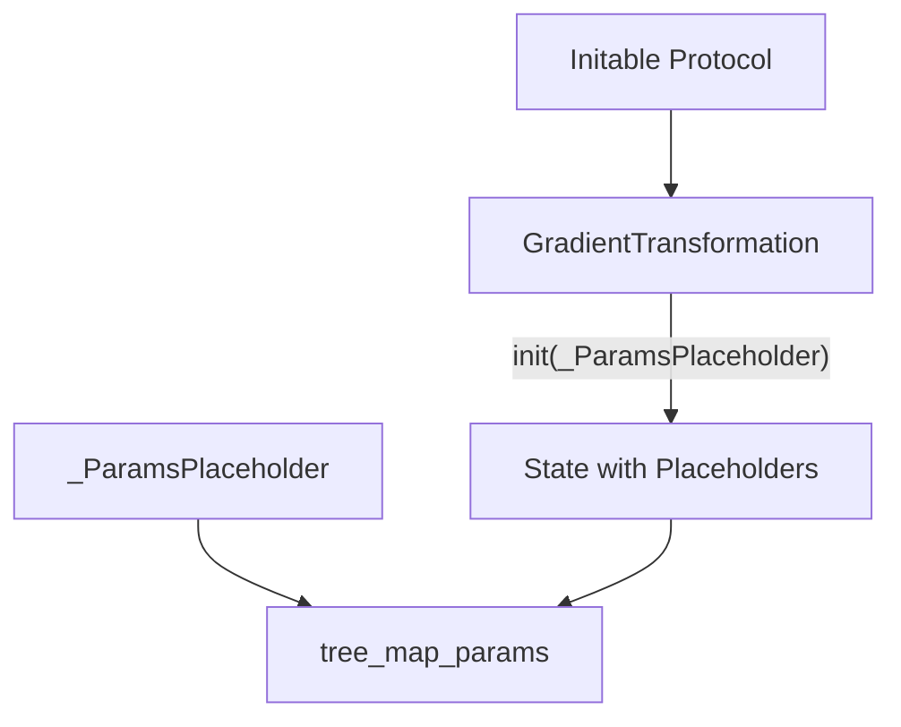
*Sources: [optax/tree_utils/_state_utils.py:27-37], [optax/tree_utils/_state_utils.py:82-88]*

---

## 2. Parameter State Mapping (`tree_map_params`)

The central workhorse for structural manipulation of optimizer states relative to parameters is `tree_map_params`. It allows callers to apply transformations specifically to parameter-shaped substructures (like moments $\mu$ and $\nu$ in Adam) while handling non-parameter fields separately.

### Implementation Details
`tree_map_params` accepts an `initable` (either a callable or an `Initable` object), a mapping function `f`, the optimizer `state`, optional rest arguments matching the parameter tree shape, and an optional `transform_non_params` callable [optax/tree_utils/_state_utils.py:90-141].

1. It initializes a dummy state using `_ParamsPlaceholder()` in place of actual model parameters [optax/tree_utils/_state_utils.py:144-150].
2. It traverses both the placeholder-initialized state and the actual `state` simultaneously using `jax.tree.map` [optax/tree_utils/_state_utils.py:159-164].
3. When it encounters a `_ParamsPlaceholder` node in the reference structure, it applies `f` to the corresponding leaves in the target state [optax/tree_utils/_state_utils.py:152-154].
4. For non-parameter fields, it invokes `transform_non_params(value)` if provided, otherwise returning the value unmodified [optax/tree_utils/_state_utils.py:155-157].

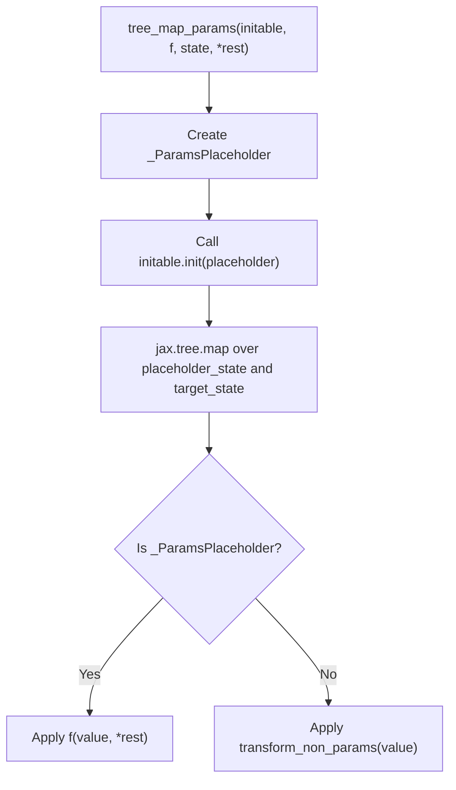
*Sources: [optax/tree_utils/_state_utils.py:90-164], [optax/tree_utils/_state_utils_test.py:91-97]*

---

## 3. Path Filtering and Key Types (`NamedTupleKey`)

When inspecting nested optimizer states or hyperparameter containers, navigating standard JAX `KeyPath` entries (`DictKey`, `GetAttrKey`, `SequenceKey`, `FlattenedIndexKey`) is often insufficient when dealing with `NamedTuple` structures.

### `NamedTupleKey`
`NamedTupleKey` represents a key entry specific to `NamedTuple` fields within a PyTree path [optax/tree_utils/_state_utils.py:40-68].

* **Attributes**:
  * `tuple_name` (`str`): The name of the `NamedTuple` container [optax/tree_utils/_state_utils.py:50].
  * `name` (`str`): The field name within the tuple [optax/tree_utils/_state_utils.py:51].
* **String Representation**: Formatted as `tuple_name.name` via `__str__` [optax/tree_utils/_state_utils.py:67-68].

This key type integrates directly into filtering callables (`filtering: Callable[[_KeyPath, Any], bool]`) passed to path extraction utilities like `tree_get_all_with_path`, `tree_get`, and `tree_set` [optax/tree_utils/_state_utils.py:43-47, 167-171].

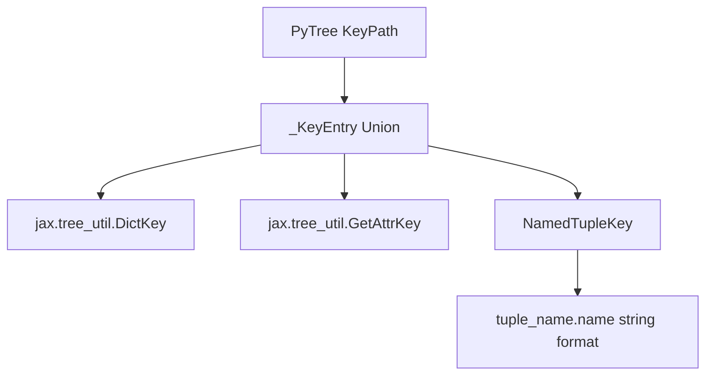
*Sources: [optax/tree_utils/_state_utils.py:40-79]*

---

## 4. Testing and Usage Patterns

As demonstrated in `_state_utils_test.py`, state introspection utilities are primarily used for:
1. **Sharding and Partition Specification**: Constructing sharding constraint trees matching optimizer states by replacing parameter leaves with partition specs and mapping non-parameter fields (like `count`) to default sharding values (`FakeShardSpec`) [optax/tree_utils/_state_utils.py:91-96, optax/tree_utils/_state_utils_test.py:91-97].
2. **Hyperparameter Inspection**: Extracting and verifying dynamic hyperparameters managed by wrappers like `inject_hyperparams` [optax/tree_utils/_state_utils_test.py:174-186].
3. **State Pruning**: Mapping parameter-shaped optimizer states to `None` for serialization or memory optimization [optax/tree_utils/_state_utils_test.py:187-199].

*Sources: [optax/tree_utils/_state_utils.py:90-141], [optax/tree_utils/_state_utils_test.py:78-209]*

---

# Page: Optimizer Composition

# Optimizer Composition

<details>
<summary>Relevant source files</summary>

The following files were used as context for generating this wiki page:

- [optax/_src/combine.py](optax/_src/combine.py)
- [optax/_src/combine_test.py](optax/_src/combine_test.py)
- [optax/transforms/_combining.py](optax/transforms/_combining.py)

</details>


## Purpose and Scope

This document explains how Optax optimizers are constructed through the composition of simple gradient transformations. It covers the `combine.chain`, `combine.named_chain`, and `combine.partition` (also aliased as `multi_transform`) patterns that enable building complex optimizers from modular building blocks, and describes how state and extra arguments are managed across composed transformations [optax/_src/combine.py:15-23](), [optax/transforms/_combining.py:26-177]().

For details on the `GradientTransformation` protocol itself, see [GradientTransformation Protocol](#2.1). For information on individual transformation components, see [Core Transformations](#6.1).

Sources: [optax/_src/combine.py:15-23](), [optax/transforms/_combining.py:26-177]()

---

## Core Composition Principle

Optax optimizers follow a compositional design where complex optimization algorithms are built by sequentially or conditionally combining simple gradient transformations. Each transformation implements the `GradientTransformation` protocol with `init` and `update` functions, and these can be composed to create more sophisticated optimizers [optax/transforms/_combining.py:26-99]().

The key insight is that operations like momentum tracking, adaptive learning rates, weight decay, and gradient scaling can be expressed as independent transformations that are chained together or partitioned across parameters to form complete optimizers.

Sources: [optax/_src/alias.py:1-141](), [optax/_src/base.py:152-216]()

---

## Sequential Composition with `chain` and `named_chain`

### How `chain` Works

The `chain` function composes multiple gradient transformations sequentially, applying them in order from first to last [optax/transforms/_combining.py:26-29](). Each transformation receives the output of the previous transformation as its input [optax/transforms/_combining.py:81-92]().

```mermaid
graph LR
    G["\"gradients\""] --> T1["\"transform.scale_by_adam()\""]
    T1 --> T2["\"transform.add_decayed_weights()\""]
    T2 --> T3["\"transform.scale_by_learning_rate()\""]
    T3 --> U["\"final updates\""]
    
    S1["\"state[0]: ScaleByAdamState\""] -.-> T1
    T1 -.-> S1_new["\"new_state[0]\""]
    
    S2["\"state[1]: EmptyState\""] -.-> T2
    T2 -.-> S2_new["\"new_state[1]\""]
    
    S3["\"state[2]: ScaleByScheduleState\""] -.-> T3
    T3 -.-> S3_new["\"new_state[2]\""]
```
**Diagram: Chain Transformation Flow and Code Entities (`combine.chain`)**

The `init` function of a chained transformation invokes the `init` functions of all component transformations, returning them as a `tuple` [optax/transforms/_combining.py:78-79](). The `update` function threads gradients and extra arguments through each transformation sequentially while updating each component's state independently [optax/transforms/_combining.py:81-92]().

Sources: [optax/transforms/_combining.py:26-99]()

### Named Chain Composition with `named_chain`

The `named_chain` function is a variant of `chain` that accepts a sequence of `(name, transformation)` pairs instead of positional transformations [optax/transforms/_combining.py:102-109](). This assigns a string identifier to each component transformation, storing individual states inside an ordered dictionary (`collections.OrderedDict`) rather than a anonymous tuple [optax/transforms/_combining.py:152-167]().

```python
import optax

chained_transform = optax.named_chain(
    ("adam", optax.scale_by_adam()),
    ("lr", optax.scale_by_learning_rate(1e-3))
)
state = chained_transform.init(params)
# Access individual states via keys
adam_state = state["adam"]
```

Sources: [optax/transforms/_combining.py:102-170]()

### Example: AdamW Optimizer

AdamW extends Adam by adding weight decay as a middle transformation within a chain [optax/_src/alias.py:598-635]():

```python
def adamw(learning_rate, b1=0.9, b2=0.999, eps=1e-8, eps_root=0.0, mu_dtype=None,
          weight_decay=1e-4, mask=None, *, nesterov=False):
    return combine.chain(
        transform.scale_by_adam(b1=b1, b2=b2, eps=eps, eps_root=eps_root, mu_dtype=mu_dtype, nesterov=nesterov),
        transform.add_decayed_weights(weight_decay, mask),
        transform.scale_by_learning_rate(learning_rate),
    )
```

Sources: [optax/_src/alias.py:598-727]()

---

## State Management in Composed Transformations

### State Structure

When transformations are chained using `combine.chain`, their states are aggregated into a Python `tuple` structure [optax/transforms/_combining.py:78-79](). When using `combine.named_chain`, states are aggregated into an `OrderedDict` [optax/transforms/_combining.py:152-159]().

```mermaid
graph TD
    CS["\"GradientTransformationExtraArgs (returned by combine.chain)\""] --> TUP["\"tuple of component states\""]
    TUP --> S1["\"State[0]: ScaleByAdamState<br/>(count, mu, nu)\""]
    TUP --> S2["\"State[1]: EmptyState<br/>(from add_decayed_weights)\""]
    TUP --> S3["\"State[2]: ScaleByScheduleState<br/>(from scale_by_learning_rate)\""]
```
**Diagram: State Tuple Architecture under `combine.chain`**

Sources: [optax/transforms/_combining.py:78-92](), [optax/transforms/_combining.py:152-167]()

---

## Parallel Composition with `partition`

The `partition` combinator (also aliased as `multi_transform`) applies different gradient transformations to distinct partitions of the parameter tree [optax/_src/combine.py:21-22](). This enables selective freezing, distinct learning rates per layer, or specialized regularizers.

```mermaid
graph TD
    P["\"params pytree\""] --> M["\"Partition Mapping / Function\""]
    G["\"incoming updates/gradients\""] --> M
    
    M --> P1["\"Partition key: 'trainable'\""]
    M --> P2["\"Partition key: 'frozen'\""]
    
    P1 --> T1["\"Transform 1: adam()\""]
    P2 --> T2["\"Transform 2: set_to_zero()\""]
    
    T1 --> U1["\"updates for partition 1\""]
    T2 --> U2["\"updates for partition 2\""]
    
    U1 --> C["\"jax.tree_util tree flattening/reassembly\""]
    U2 --> C
    C --> U["\"final reassembled updates\""]
```
**Diagram: Parameter Partitioning Flow via `combine.partition` (`MultiTransformState`)**

Sources: [optax/_src/combine.py:21-23](), [optax/transforms/_combining.py:172-289]()

---

## Common Composition Patterns

Optax relies on recurring structural motifs to build standard optimizers:

| Composition Pattern | Component Sequence | Examples |
|---------------------|--------------------|----------|
| **Adaptive + LR** | `scale_by_adam()` (or RMSprop/RSS) → `scale_by_learning_rate()` | `adam`, `rmsprop`, `adagrad` [optax/_src/alias.py:329-529]() |
| **Adaptive + Weight Decay + LR** | `scale_by_adam()` → `add_decayed_weights()` → `scale_by_learning_rate()` | `adamw` [optax/_src/alias.py:598-727]() |
| **Momentum + Scaling** | `trace()` (momentum) → `scale_by_learning_rate()` | `sgd` [optax/_src/alias.py:1317-1399]() |

Sources: [optax/_src/alias.py:329-727](), [optax/_src/alias.py:1317-1399]()

---

## Transformation Ordering Principles

The relative order of transformations in a chain is critical to algorithm correctness:

1. **Gradient Preprocessing & Clipping**: Global or element-wise norm clipping should occur early to prevent exploding updates [optax/_src/alias.py:224-326]().
2. **Adaptive Moment Estimation**: Second-moment scaling (e.g., Adam/RMSprop) standardizes update magnitudes [optax/_src/alias.py:414-529]().
3. **Weight Decay / Regularization**: Applied after scaling or decoupled directly to avoid scaling decay terms by historical adaptive moments [optax/_src/alias.py:598-727]().
4. **Learning Rate Scaling**: Scales updates by the global learning rate (or schedule step size) [optax/_src/alias.py:414-529]().
5. **Sign Flipping**: Multiplying by `-1` at the terminal stage converts ascent gradients into descent directions [optax/_src/alias.py:224-326]().

Sources: [optax/_src/alias.py:224-529](), [optax/_src/alias.py:598-727]()

---

# Page: Optimizers

# Optimizers

<details>
<summary>Relevant source files</summary>

The following files were used as context for generating this wiki page:

- [optax/_src/alias.py](optax/_src/alias.py)
- [optax/_src/transform.py](optax/_src/transform.py)

</details>


This page provides a high-level overview of the optimization algorithms available across the Optax library, ranging from standard first-order optimizers to advanced adaptive, second-order, and experimental methods. Optax implements optimizers as composable gradient transformations that consume parameter gradients and state, returning updated parameters and state.

For complete implementation details, specific hyperparameters, and practical use cases, refer to the child pages:
- [Standard Optimizers](#3.1)
- [Adaptive and Second-Order Optimizers](#3.2)
- [Contributed Optimizers](#3.3)

---

## 3.1. Standard Optimizers

Standard optimizers form the baseline for the vast majority of deep learning tasks. These include stochastic gradient descent (`sgd`), adaptive moment estimation (`adam`), decoupled weight decay variants (`adamw`), root mean square propagation (`rmsprop`), and cumulative gradient approaches (`adagrad`). In Optax, these algorithms are assembled by chaining foundational components such as momentum trackers, scaling transforms, and learning rate multipliers [optax/_src/alias.py:36-157]().

For detailed documentation on implementation specifics, parameter configurations, and concrete use cases, see [Standard Optimizers](#3.1).

Sources: [optax/_src/alias.py:36-157]()

---

## 3.2. Adaptive and Second-Order Optimizers

Beyond standard first-order methods, Optax provides sophisticated optimization algorithms designed for high-dimensional models, large batch sizes, or complex curvature. This category encompasses memory-efficient second-moment factorizations (`adafactor`), quasi-Newton second-order approaches (`lbfgs`), layer-wise adaptive rate scaling (`lars`, `lamb`), and resilient step size mechanisms.

```mermaid
flowchart TD
    subgraph "AdaptiveAndSecondOrderSpace ["Adaptive and Second-Order Optimizers"]"
        A["optax._src.alias.adafactor"]
        B["optax._src.alias.lbfgs"]
        C["optax._src.alias.lamb"]
        D["optax._src.alias.lars"]
    end
    
    subgraph "CoreTransformations ["Underlying Transforms"]"
        E["optax._src.factorized"]
        F["optax._src.linesearch"]
    end
    
    A --> E
    B --> F
```
*Figure 1: Mapping natural language concepts of adaptive and second-order methods to their respective code entities.*

For comprehensive breakdowns of factorized second moments, quasi-Newton optimization histories, and line search integrations, see [Adaptive and Second-Order Optimizers](#3.2).

Sources: [optax/_src/alias.py](), [optax/_src/factorized.py]()

---

## 3.3. Contributed Optimizers

The `optax.contrib` module houses specialized, research-oriented, and experimental optimizers that explore novel architectural and algorithmic paradigms outside the core Optax package. These methods address specialized training challenges such as dual-momentum tracking, orthogonalized weight updates, sharpness-aware minimization, and schedule-free convergence.

```mermaid
flowchart TD
    subgraph "ContribSpace ["optax.contrib Module"]"
        A["optax.contrib.ademamix"]
        B["optax.contrib.adopt"]
        C["optax.contrib.muon"]
        D["optax.contrib.sophia"]
        E["optax.contrib.sam"]
    end
    
    subgraph "Categories ["Optimization Paradigms"]"
        F["DualMomentum"]
        G["Orthogonalization"]
        H["HessianApproximation"]
        I["MinimaSharpness"]
    end
    
    A --> F
    C --> G
    D --> H
    E --> I
```
*Figure 2: Mapping contributed optimizer algorithms to their module locations and paradigms.*

For deep dives into individual contributed optimizers, consult the subsections below and the main child page:
- [AdEMAMix and Momentum Variants](#3.3.1)
- [ADOPT and Muon Optimizers](#3.3.2)
- [Other Contrib Optimizers](#3.3.3)

For the full reference on all experimental modules, see [Contributed Optimizers](#3.3).

Sources: [optax/contrib/__init__.py]()

### 3.3.1. AdEMAMix and Momentum Variants

The AdEMAMix optimizer family introduces dual-momentum architectures to standard adaptive training. By tracking multiple exponential moving averages of past gradients with different decay schedules, AdEMAMix decouples fast adaptation from long-term trend retention. 

For implementation specifics and simplified variants, see [Contributed Optimizers](#3.3).

Sources: [optax/contrib/__init__.py]()

### 3.3.2. ADOPT and Muon Optimizers

This category covers advanced training algorithms such as ADOPT, which refines traditional adaptive momentum for enhanced stability, and Muon, which applies Newton-Schulz orthogonalization to matrix-valued parameters. Muon requires precise dimension specifications to properly format weight matrices for orthogonal updates.

For algorithmic proofs and code structure, see [Contributed Optimizers](#3.3).

Sources: [optax/contrib/__init__.py]()

### 3.3.3. Other Contrib Optimizers

Optax's contribution library also features a wide array of specialized optimizers and wrappers, including Sophia (Stochastic second-order), MADGRAD, Prodigy, Momo, D-Adaptation, DoG, COCOB, GaLore, ACProp, schedule-free methods, and optimization wrappers like SAM (Sharpness-Aware Minimization), Mechanize, complex-valued variants, and reduce-on-plateau handlers.

For a complete catalog and architectural guides, see [Contributed Optimizers](#3.3).

Sources: [optax/contrib/__init__.py]()

---

# Page: Standard Optimizers

# Standard Optimizers

<details>
<summary>Relevant source files</summary>

The following files were used as context for generating this wiki page:

- [optax/_src/alias.py](optax/_src/alias.py)
- [optax/_src/alias_test.py](optax/_src/alias_test.py)
- [optax/_src/transform.py](optax/_src/transform.py)

</details>


This page documents the standard optimization algorithms provided by Optax, which are commonly used to update model parameters during training. These optimizers implement widely-used algorithms like SGD, Adam, AdaGrad, and their variants as composable gradient transformations.

For specialized optimizers like L-BFGS and Lookahead, see [Adaptive and Second-Order Optimizers](#3.2). For experimental optimizers, see [Contributed Optimizers](#3.3).

## Relationship to Optax Architecture

Standard optimizers are built on Optax's core `GradientTransformation` abstraction [optax/_src/base.py](). Each optimizer is implemented as a function that returns a `GradientTransformation` or `GradientTransformationExtraArgs` object, created by chaining together more primitive transformations using `combine.chain` [optax/_src/combine.py]().

```mermaid
graph TD
    subgraph "Standard Optimizer Composition"
        A["Optimizer Function\n(adam, sgd, etc.)"] --> B["combine.chain(...)\nComposition"]
        B --> C1["Algorithm-Specific Transformation\n(scale_by_adam, etc.)"]
        C1 --> C2["Learning Rate Scaling\n(scale_by_learning_rate)"]
        C2 --> C3["Optional Components\n(weight_decay, etc.)"]
    end
```

Sources: [optax/_src/alias.py](), [optax/_src/transform.py](), [optax/_src/combine.py]()

## Optimizer Classification

Standard optimizers can be grouped into several families based on their algorithm characteristics:

```mermaid
graph TD
    subgraph "Standard Optimizers Taxonomy"
        A["Standard Optimizers"]
        A --> B["SGD Family"]
        A --> C["Adam Family"]
        A --> D["Adaptive Methods"]
        A --> E["Specialized Scaling"]
        
        B --> B1["sgd"]
        B --> B2["sgd with momentum"]
        B --> B3["sgd with nesterov"]
        
        C --> C1["adam"]
        C --> C2["adamw"]
        C --> C3["nadam"]
        C --> C4["nadamw"]
        C --> C5["radam"]
        
        D --> D1["adagrad"]
        D --> D2["rmsprop"]
        D --> D3["adafactor"]
        D --> D4["adadelta"]
        D --> D5["adabelief"]
        
        E --> E1["lars"]
        E --> E2["lamb"]
        E --> E3["lion"]
        E --> E4["adan"]
    end
```

Sources: [optax/_src/alias.py]()

## SGD Family

The SGD family includes basic stochastic gradient descent and its momentum-based variants.

### SGD (Stochastic Gradient Descent)

SGD is the simplest optimization algorithm that updates parameters in the direction of the negative gradient scaled by a learning rate.

```python
def sgd(
    learning_rate: base.ScalarOrSchedule,
    momentum: Optional[float] = None,
    nesterov: bool = False,
    accumulator_dtype: Optional[jnp.dtype] = None,
) -> base.GradientTransformation:
    """Stochastic gradient descent optimizer."""
```

Implementation details:
- Without momentum, scales gradients by learning rate using `scale` or `scale_by_learning_rate` [optax/_src/alias.py]()
- With momentum, uses the `trace` transformation to accumulate past gradients [optax/_src/transform.py]()
- With `nesterov=True`, applies Nesterov's accelerated gradient method via the trace transformation.

Sources: [optax/_src/alias.py](), [optax/_src/transform.py]()

### SGD with Momentum

Adds a momentum term that accumulates past gradients to speed up convergence and help escape local minima.

Mathematical update:
```
v(t) = momentum * v(t-1) + g(t)
w(t+1) = w(t) - learning_rate * v(t)
```

Sources: [optax/_src/alias.py](), [optax/_src/transform.py]()

## Adam Family

The Adam family includes Adam and its variants, which adapt learning rates based on first and second moments of gradients.

### Adam (Adaptive Moment Estimation)

Adam combines ideas from RMSProp and momentum methods to adapt learning rates based on both the first and second moments of gradients.

```python
def adam(
    learning_rate: base.ScalarOrSchedule = 1e-3,
    b1: jax.typing.ArrayLike = 0.9,
    b2: jax.typing.ArrayLike = 0.999,
    eps: jax.typing.ArrayLike = 1e-8,
    eps_root: jax.typing.ArrayLike = 0.0,
    mu_dtype: Optional[jnp.dtype] = None,
    *,
    nesterov: bool = False,
) -> base.GradientTransformation:
    """The Adam optimizer."""
```

Mathematical update:
```
m(t) = b1 * m(t-1) + (1 - b1) * g(t)
v(t) = b2 * v(t-1) + (1 - b2) * g(t)^2
m_hat(t) = m(t) / (1 - b1^t)
v_hat(t) = v(t) / (1 - b2^t)
w(t+1) = w(t) - learning_rate * m_hat(t) / (sqrt(v_hat(t) + eps_root) + eps)
```

Implementation details:
- Uses `scale_by_adam` for the core algorithm [optax/_src/transform.py]()
- Chains with `scale_by_learning_rate` to apply the learning rate [optax/_src/transform.py]()

Sources: [optax/_src/alias.py](), [optax/_src/transform.py]()

### AdamW

AdamW is a variant of Adam that implements weight decay correctly by decoupling it from the gradient update.

```python
def adamw(
    learning_rate: base.ScalarOrSchedule = 1e-3,
    b1: jax.typing.ArrayLike = 0.9,
    b2: jax.typing.ArrayLike = 0.999,
    eps: jax.typing.ArrayLike = 1e-8,
    eps_root: jax.typing.ArrayLike = 0.0,
    mu_dtype: Optional[jnp.dtype] = None,
    weight_decay: base.ScalarOrSchedule = 1e-4,
    mask: Optional[Union[Any, Callable[[base.Params], Any]]] = None,
    *,
    nesterov: bool = False,
) -> base.GradientTransformationExtraArgs:
    """Adam with weight decay regularization."""
```

Implementation details:
- Adds `add_decayed_weights` to the Adam transformation chain [optax/_src/transform.py]()
- Properly separates weight decay from adaptive gradient scaling

Sources: [optax/_src/alias.py](), [optax/_src/transform.py]()

### NAdam and NAdamW

NAdam (Nesterov-accelerated Adam) incorporates Nesterov momentum into Adam. NAdamW combines NAdam with proper weight decay [optax/_src/alias.py]().

Sources: [optax/_src/alias.py]()

## Other Adaptive Methods

### AdaGrad

AdaGrad adapts learning rates per parameter by scaling them inversely proportional to the square root of the sum of all past squared gradients.

```python
def adagrad(
    learning_rate: base.ScalarOrSchedule,
    initial_accumulator_value: jax.typing.ArrayLike = 0.1,
    eps: jax.typing.ArrayLike = 1e-7,
) -> base.GradientTransformation:
    """The Adagrad optimizer."""
```

Mathematical update:
```
sum_of_squares(t) = sum_of_squares(t-1) + g(t)^2
w(t+1) = w(t) - learning_rate * g(t) / sqrt(sum_of_squares(t) + eps)
```

Implementation details:
- Uses `scale_by_rss` (root sum of squares) transformation [optax/_src/transform.py]()
- Chains with `scale_by_learning_rate` [optax/_src/transform.py]()

Sources: [optax/_src/alias.py](), [optax/_src/transform.py]()

### RMSProp

RMSProp uses an exponentially weighted moving average of squared gradients to normalize the gradient update [optax/_src/transform.py]().

```python
def rmsprop(
    learning_rate: base.ScalarOrSchedule,
    decay: jax.typing.ArrayLike = 0.9,
    eps: jax.typing.ArrayLike = 1e-8,
    initial_scale: jax.typing.ArrayLike = 0.0,
    centered: bool = False,
    momentum: Optional[float] = None,
    nesterov: bool = False,
) -> base.GradientTransformation:
    """The RMSProp optimizer."""
```

Implementation details:
- Uses either `scale_by_rms` or `scale_by_stddev` depending on the `centered` parameter [optax/_src/transform.py]()
- Can include momentum via the `trace` transformation [optax/_src/transform.py]()

Sources: [optax/_src/alias.py](), [optax/_src/transform.py]()

### AdaDelta

AdaDelta adapts learning rates based on a moving window of gradient updates, eliminating the need for an initial learning rate [optax/_src/transform.py]().

Sources: [optax/_src/alias.py](), [optax/_src/transform.py]()

### Adafactor

Adafactor is a memory-efficient optimizer for large models that uses factored second-moment estimates [optax/_src/factorized.py]().

Sources: [optax/_src/alias.py](), [optax/_src/factorized.py]()

## Large Batch Optimizers

### LAMB (Layer-wise Adaptive Moments optimizer for Batch training)

LAMB enables training with large batch sizes by adapting the learning rate for each layer [optax/_src/alias.py]().

Sources: [optax/_src/alias.py]()

### LARS (Layer-wise Adaptive Rate Scaling)

LARS supports large batch training by scaling learning rates per layer based on the ratio of weight norms to gradient norms [optax/_src/transform.py]().

Sources: [optax/_src/alias.py](), [optax/_src/transform.py]()

## Recent Optimizers

### Lion

Lion (Evolved Sign Momentum) is an optimizer that only tracks momentum and uses sign operations for updates [optax/_src/transform.py]().

Sources: [optax/_src/alias.py](), [optax/_src/transform.py]()

### Adan

Adan (ADAptive Nesterov momentum algorithm) reformulates Nesterov acceleration to develop a new momentum estimation method [optax/_src/transform.py]().

Sources: [optax/_src/alias.py](), [optax/_src/transform.py]()

## Usage Examples

Here's a typical pattern for using a standard optimizer:

```python
import optax
import jax
import jax.numpy as jnp

# Define a simple objective function
def objective(params):
    return jnp.sum(params ** 2)

# Initialize parameters
params = jnp.array([1.0, 2.0, 3.0])

# Create an optimizer
optimizer = optax.adam(learning_rate=0.01)

# Initialize optimizer state
opt_state = optimizer.init(params)

# Training loop
for _ in range(100):
    # Compute gradients
    grads = jax.grad(objective)(params)
    
    # Update parameters
    updates, opt_state = optimizer.update(grads, opt_state, params)
    params = optax.apply_updates(params, updates)
```

Sources: [optax/_src/alias.py]()

## Optimizer Comparison and Selection

| Optimizer | Strengths | Typical Use Cases |
|-----------|-----------|-------------------|
| SGD | Simple, predictable convergence | Small datasets, convex problems |
| SGD w/ Momentum | Faster convergence than SGD | General purpose |
| Adam | Fast convergence, adaptive learning rates | Deep neural networks, non-convex problems |
| AdamW | Better generalization than Adam | When regularization is important |
| AdaGrad | Handles sparse gradients well | NLP models, recommender systems |
| RMSProp | Good for non-stationary objectives | Recurrent neural networks |
| LAMB/LARS | Scales to very large batch sizes | Distributed training |
| Lion | Memory efficient, strong performance | Large language models |
| Adafactor | Memory efficient | Very large models that don't fit in memory otherwise |

Sources: [optax/_src/alias.py]()

## Implementation Details

The standard optimizers are all implemented using a common pattern in `optax/_src/alias.py`:

```mermaid
graph TD
    subgraph "Implementation Pattern"
        A["Optimizer Function\n(e.g. adam)"] --> B["Create Core Transformation\n(scale_by_adam, scale_by_rms, etc.)"]
        B --> C["Chain with Weight Decay\n(add_decayed_weights, optional)"]
        C --> D["Chain with Learning Rate\n(scale_by_learning_rate)"]
        D --> E["Return GradientTransformation\nvia combine.chain"]
    end
```

For example, Adam is implemented as:

```python
def adam(learning_rate, b1=0.9, b2=0.999, eps=1e-8, eps_root=0.0, mu_dtype=None, *, nesterov=False):
    return combine.chain(
        transform.scale_by_adam(
            b1=b1,
            b2=b2,
            eps=eps,
            eps_root=eps_root,
            mu_dtype=mu_dtype,
            nesterov=nesterov,
        ),
        transform.scale_by_learning_rate(learning_rate),
    )
```

Sources: [optax/_src/alias.py]()

---

# Page: Adaptive and Second-Order Optimizers

# Adaptive and Second-Order Optimizers

<details>
<summary>Relevant source files</summary>

The following files were used as context for generating this wiki page:

- [optax/_src/factorized.py](optax/_src/factorized.py)
- [optax/_src/lbfgs_test.py](optax/_src/lbfgs_test.py)
- [optax/losses/_segmentation.py](optax/losses/_segmentation.py)
- [optax/second_order/__init__.py](optax/second_order/__init__.py)
- [optax/second_order/_deprecated.py](optax/second_order/_deprecated.py)

</details>


This page covers advanced optimization algorithms in Optax that go beyond standard diagonal first-order adaptive methods (like Adam or RMSProp). This includes quasi-Newton second-order methods such as L-BFGS, memory-efficient factorized second-moment estimators like Adafactor, and specialized second-order diagnostic utilities.

## Overview

Adaptive and second-order optimizers adjust update directions and step sizes using curvature information or factorized representations of gradient statistics.

```mermaid
graph TD
    subgraph "AdaptiveAndSecondOrder"
        A["GradientTransformation"] --> B["L-BFGS<br>optax.scale_by_lbfgs"]
        A --> C["Adafactor<br>optax.scale_by_factored_rms"]
        A --> D["Second-Order Utilities<br>optax.second_order"]
        
        B --> B1["Quasi-Newton inverse Hessian approximation"]
        C --> C1["Low-rank factorized second moments"]
        D --> D2["Hessian-vector products & diagonal Fisher"]
    end
```

Sources: [optax/_src/factorized.py:88-129](), [optax/second_order/_deprecated.py:43-120]()

---

## L-BFGS (Limited-Memory BFGS)

### Concept and Implementation

L-BFGS is a quasi-Newton optimization algorithm that approximates the inverse Hessian matrix using a rolling history of recent parameter differences ($s_k = x_{k+1} - x_k$) and gradient differences ($y_k = g_{k+1} - g_k$). 

```mermaid
graph TD
    subgraph "LBFGSExecution"
        A["Current Parameters & Gradients"] --> B["Compute Value and Grad"]
        B --> C["scale_by_lbfgs"]
        C --> D["Memory History of s_k and y_k"]
        D --> E["Two-Loop Recursion Algorithm"]
        E --> F["Preconditioned Search Direction"]
        F --> G["Linesearch Backtracking / Zoom"]
        G --> H["Apply Updates"]
    end
```

In Optax, L-BFGS is implemented via the low-level transformation `scale_by_lbfgs()` and paired with linesearch utilities (`scale_by_backtracking_linesearch` or `scale_by_zoom_linesearch`) to determine step sizes that satisfy the strong Wolfe conditions.

### Usage Example

```python
import optax
import jax

optimizer = optax.lbfgs(memory_size=10)
state = optimizer.init(params)

# Optimization loop requires value, grad, and the objective function
value, grad = jax.value_and_grad(objective_fn)(params)
updates, state = optimizer.update(
    grad, state, params,
    value=value,
    grad=grad,
    value_fn=objective_fn
)
params = optax.apply_updates(params, updates)
```

Sources: [optax/_src/lbfgs_test.py:56-86](), [optax/_src/lbfgs_test.py:183-202]()

---

## Adafactor and Factorized Second Moments

The `scale_by_factored_rms` transformation implements the Adafactor algorithm, which uses a factored second-moment estimator to dramatically reduce memory consumption when training large models (such as Transformers) [optax/_src/factorized.py:88-129]().

### Factorization Mechanism

For 2D weight matrices (e.g., dense layers or attention projections), instead of storing an entire second-moment matrix of shape $(d_1, d_2)$, Adafactor maintains row-wise ($v_{row}$) and column-wise ($v_{col}$) accumulators of shapes $(d_1, 1)$ and $(1, d_2)$ when dimensions exceed a configurable threshold (`min_dim_size_to_factor`) [optax/_src/factorized.py:35-58]().

```mermaid
graph TD
    subgraph "AdafactorMemoryStructure"
        A["Parameter Matrix Shape (d1, d2)"] --> B{"min_dim_size_to_factor exceeded?"}
        B -->|Yes| C["Factored Representation"]
        B -->|No| D["Unfactored Matrix v"]
        
        C --> C1["v_row: accumulator of shape (d1, 1)"]
        C --> C2["v_col: accumulator of shape (1, d2)"]
        C1 --> E["Outer Product Approximation"]
        C2 --> E
    end
```

### Core Data Structures

The state of the factorized optimizer is encapsulated in `FactoredState` [optax/_src/factorized.py:79-87]():

```python
class FactoredState(NamedTuple):
  count: jax.typing.ArrayLike  # number of update steps.
  v_row: base.ArrayTree        # Tree of factored row statistics.
  v_col: base.ArrayTree        # Tree of factored column statistics.
  v: base.ArrayTree            # Tree for params where factoring is skipped.
```

### Decay Schedule

Adafactor supports power-law decay schedules for the second-order momentum via `_decay_rate_pow()` [optax/_src/factorized.py:28-32]():

$$\alpha_t = 1.0 - (t + 1)^{-\text{exponent}}$$

This prevents second-moment accumulators from saturating prematurely during long training runs.

Sources: [optax/_src/factorized.py:28-138]()

---

## Legacy and Supporting Second-Order Utilities

Optax provides secondary diagnostic utilities for second-order optimization in `optax.second_order` [optax/second_order/__init__.py:15-21](). These include functions for Hessian-vector products (`hvp`), diagonal Hessians (`hessian_diag`), and diagonal Fisher information matrices (`fisher_diag`) [optax/second_order/_deprecated.py:43-120]():

| Function | Code Entity | Description |
| :--- | :--- | :--- |
| `hvp` | `optax.second_order.hvp` | Computes efficient vector-Hessian products via automatic differentiation [optax/second_order/_deprecated.py:43-68]() |
| `hessian_diag` | `optax.second_order.hessian_diag` | Computes the diagonal elements of the Hessian matrix [optax/second_order/_deprecated.py:70-94]() |
| `fisher_diag` | `optax.second_order.fisher_diag` | Computes the diagonal of the observed Fisher information matrix [optax/second_order/_deprecated.py:96-120]() |

Sources: [optax/second_order/__init__.py:15-21](), [optax/second_order/_deprecated.py:43-120]()

---

# Page: Contributed Optimizers

# Contributed Optimizers

<details>
<summary>Relevant source files</summary>

The following files were used as context for generating this wiki page:

- [docs/api/contrib.rst](docs/api/contrib.rst)
- [optax/contrib/__init__.py](optax/contrib/__init__.py)
- [optax/contrib/_common_test.py](optax/contrib/_common_test.py)
- [optax/contrib/_madgrad.py](optax/contrib/_madgrad.py)
- [optax/contrib/_sophia.py](optax/contrib/_sophia.py)

</details>


The `optax.contrib` module serves as an incubation space for experimental, specialized, or cutting-edge optimizers and wrappers that have not yet moved into the core library or met standard inclusion criteria [docs/api/contrib.rst:1-5](). These optimizers implement advanced optimization research—ranging from dual-momentum and orthogonalization to adaptive step sizes and second-order approximations—while strictly adhering to Optax's functional `GradientTransformation` architecture [optax/contrib/_madgrad.py:37-134]().

Because these methods often introduce unique state requirements, custom update signatures, or specialized hyperparameter dynamics, they are organized into three primary child categories.

```mermaid
graph TD
    classDef default font-family:monospace;
    subgraph "Contrib Namespace Architecture"
        Root["optax.contrib"] --> Sub1["3.3.1 AdEMAMix / _ademamix.py"]
        Root --> Sub2["3.3.2 ADOPT & Muon / _adopt.py, _muon.py"]
        Root --> Sub3["3.3.3 Other Optimizers & Wrappers / _sophia.py, _cocob.py, _sam.py"]
    end
```
Sources: [optax/contrib/__init__.py:1-76](), [docs/api/contrib.rst:1-61]()

## AdEMAMix and Momentum Variants

Momentum-based acceleration is central to modern deep learning. The `optax.contrib` module includes optimizers that extend classical momentum mechanisms, such as mixing multiple exponential moving averages (EMAs) of historical gradients or maintaining specialized dual-averaging states [optax/contrib/_ademamix.py:21-26](). These variants aim to bridge the gap between early-stage stability and late-stage convergence speed across diverse modalities like vision and language modeling.

For comprehensive details on these dual-momentum architectures, implementation specifics, and simplified variants, see [AdEMAMix and Momentum Variants](#3.3.1).

Sources: [optax/contrib/_ademamix.py:21-26](), [optax/contrib/_madgrad.py:37-134]()

## ADOPT and Muon Optimizers

Second-order approximations, robust gradient scaling, and matrix-level orthogonalization have emerged as powerful techniques for training large models without the instability of unconstrained adaptive methods. Algorithms like ADOPT refine denominator updates to improve convergence guarantees, while Muon applies Newton-Schulz iterations to orthogonalize gradient updates for matrix parameters [optax/contrib/_adopt.py:27-28](), [optax/contrib/_muon.py:53-56]().

For detailed breakdowns of ADOPT's robustness improvements, Muon's Newton-Schulz orthogonalization approach, and dimension number configurations, see [ADOPT and Muon Optimizers](#3.3.2).

Sources: [optax/contrib/_adopt.py:27-28](), [optax/contrib/_muon.py:53-56]()

## Other Contrib Optimizers

The broader `optax.contrib` namespace hosts a wide array of specialized optimization paradigms, parameter-free methods, second-order diagonal estimators, schedule-free training wrappers, and privacy mechanisms. These include coin-betting algorithms like COCOB, distance-over-gradient estimators like DoG, second-order diagonal scaling via Sophia, low-rank factorization methods like GaLore, and wrappers for sharpness-aware minimization (SAM) or plateaus [optax/contrib/__init__.py:29-76]().

For detailed coverage of Sophia, MADGRAD, Prodigy, Momo, D-Adaptation, DoG, COCOB, GaLore, ACProp, schedule-free methods, and wrappers like SAM and Mechanize, see [Other Contrib Optimizers](#3.3.3).

Sources: [optax/contrib/__init__.py:29-76](), [docs/api/contrib.rst:12-61]()

---

# Page: AdEMAMix and Momentum Variants

# AdEMAMix and Momentum Variants

<details>
<summary>Relevant source files</summary>

The following files were used as context for generating this wiki page:

- [examples/contrib/rosenbrock_ademamix.ipynb](examples/contrib/rosenbrock_ademamix.ipynb)
- [optax/contrib/_ademamix.py](optax/contrib/_ademamix.py)

</details>


## Purpose and Scope

This page documents the **AdEMAMix** optimizer family and related momentum-based variants located in `optax.contrib`. AdEMAMix (Adaptive EMA Mixture) combines fast and slow exponential moving averages (EMAs) to better leverage historical gradient information over long training horizons. This page covers:

- **AdEMAMix**: Dual-momentum optimizer mixing fast and slow EMAs (`optax.contrib.ademamix`)
- **Simplified AdEMAMix**: Single-momentum variant with simpler mixing (`optax.contrib.simplified_ademamix`)
- **MoMo**: Momentum Models with adaptive learning rates based on loss bounds (`optax.contrib.momo`)

For other contributed optimizers like ADOPT and Muon, see [ADOPT and Muon Optimizers](#3.3.2). For standard optimizers like Adam and SGD, see [Standard Optimizers](#3.1).

Sources: [optax/contrib/_ademamix.py:35-130]()

---

## AdEMAMix Architecture

AdEMAMix extends AdamW by maintaining **two separate momentum buffers**: a fast EMA (`m1`) capturing recent gradient dynamics and a slow EMA (`m2`) that retains gradient information over thousands of steps. The optimizer linearly combines these EMAs to compute the final update direction.

### Dual Momentum System

### AdEMAMix Update Cycle Architecture
```mermaid
graph TB
    subgraph "AdEMAMix Update Cycle"
        G["GradientG"]
        
        G --> M1["FastEMA<br/>decay β1 = 0.9"]
        G --> M2["SlowEMA<br/>decay β3 = 0.9999"]
        G --> NU["SecondMoment<br/>decay β2 = 0.999"]
        
        M1 --> BC1["BiasCorrection1<br/>m̂1 = m1 / (1-β1^t)"]
        NU --> BC2["BiasCorrection2<br/>ν̂ = ν / (1-β2^t)"]
        M2 --> MIX["NoBiasCorrection<br/>(intentional)"]
        
        BC1 --> COMB["LinearCombination<br/>(m̂1 + α·m2)"]
        MIX --> COMB
        BC2 --> DENOM["DenominatorCalculation<br/>√(ν̂ + ε̄) + ε"]
        
        COMB --> UPDATE["UpdateComputation<br/>(m̂1 + α·m2) / (√(ν̂ + ε̄) + ε)"]
        DENOM --> UPDATE
        
        UPDATE --> WD["WeightDecay<br/>λ·θ"]
        UPDATE --> LR["LearningRate<br/>η"]
    end
```

**Key Design Decisions:**
- **Fast EMA** (`m1`): Bias-corrected, captures recent gradient trends.
- **Slow EMA** (`m2`): NOT bias-corrected, fills gradually with very old gradients.
- **Mixing parameter** (`alpha`): Often scheduled from `0` to a final value (e.g., `5.0`).
- **Slow decay** (`b3`): Typically `0.9999`, can be scheduled for low-iteration scenarios.

Sources: [optax/contrib/_ademamix.py:35-130]()

### State Management and Code Entity Space

### Code Entity State Management Mapping
```mermaid
graph LR
    subgraph "ScaleByAdemamixState Mapping"
        COUNT["count"] -.->|"bias correction"| M1["m1"]
        COUNT -.->|"bias correction"| NU["nu"]
        COUNT_M2["count_m2"] -.->|"schedule lookup"| M2["m2"]
    end
```

`ScaleByAdemamixState` maintains **two separate iteration counters**:
- `count`: Incremented every step, used for bias correction of `m1` and `nu`.
- `count_m2`: Incremented every step, used to schedule `b3` and `alpha` parameters independently.

Sources: [optax/contrib/_ademamix.py:35-52](), [optax/contrib/_ademamix.py:91-101]()

### Mathematical Formulation

The AdEMAMix update equations implemented in `scale_by_ademamix` are:

$$
\begin{aligned}
m_1^{(t)} &\leftarrow \beta_1 \cdot m_1^{(t-1)} + (1-\beta_1) \cdot g^{(t)} \\
m_2^{(t)} &\leftarrow \beta_3 \cdot m_2^{(t-1)} + (1-\beta_3) \cdot g^{(t)} \\
\nu^{(t)} &\leftarrow \beta_2 \cdot \nu^{(t-1)} + (1-\beta_2) \cdot {g^{(t)}}^2 \\
\hat{m_1}^{(t)} &\leftarrow m_1^{(t)} / {(1-\beta_1^{(t)})} \\
\hat{\nu}^{(t)} &\leftarrow \nu^{(t)} / {(1-\beta_2^{(t)})} \\
\theta^{(t)} &\leftarrow \theta^{(t-1)} - \eta \cdot \left(
\frac{(\hat{m_1}^{(t)} + \alpha m_2^{(t)})}{\left(\sqrt{\hat{\nu}^{(t)} + \bar{\varepsilon}} + \varepsilon\right)} + \lambda \theta^{(t-1)}
\right)
\end{aligned}
$$

Sources: [optax/contrib/_ademamix.py:169-186]()

### Implementation Details

### scale_by_ademamix Transformation Flow
```mermaid
graph TB
    subgraph "scale_by_ademamix Transformation Flow"
        INIT["init_fn"] --> Z1["zeros_like_m1"]
        INIT --> Z2["zeros_like_m2"]
        INIT --> Z3["zeros_like_nu"]
        
        Z1 --> STATE["ScaleByAdemamixState"]
        Z2 --> STATE
        Z3 --> STATE
        
        UPDATE["update_fn"] --> SCHED["ScheduleLookup"]
        UPDATE --> UPD_M["MomentumUpdates"]
        UPDATE --> BIAS["BiasCorrections"]
        UPDATE --> COMBINE["UpdateComputation"]
    end
```

Key implementation aspects:
1. **Data Type Control**: `mu_dtype` canonicalizes lower-precision accumulators via `utils.canonicalize_dtype`.
2. **Schedule Callables**: Both `b3` and `alpha` accept `ScalarOrSchedule` types.
3. **Tree Operations**: Utilizes `optax.tree.update_moment` and `optax.tree.bias_correction`.

Sources: [optax/contrib/_ademamix.py:54-130](), [optax/contrib/_ademamix.py:133-269]()

### Full Optimizer Construction

### Optimizer Construction Chaining
```mermaid
graph LR
    INPUT["Gradients"] --> T1["scale_by_ademamix"]
    T1 --> T2["add_decayed_weights"]
    T2 --> T3["scale_by_learning_rate"]
    T3 --> OUTPUT["Updates"]
```

Sources: [optax/contrib/_ademamix.py:257-269]()

---

## Simplified AdEMAMix

Simplified AdEMAMix reduces complexity by maintaining a single momentum buffer and eliminating separate scheduling for `b3` and `alpha`.

- **Momentum Buffers**: 1 (`m`) instead of 2.
- **Iteration Counters**: 1 (`t`).
- **Mixing**: `m + alpha * g`.

Sources: [optax/contrib/_ademamix.py:272-284](), [optax/contrib/_ademamix.py:380-393]()

---

## MoMo: Momentum Models for Adaptive Learning Rates

MoMo derives an adaptive learning rate from a lower bound on the loss function, requiring the loss value to be passed to `update()` via keyword arguments.

Sources: [optax/contrib/_momo.py:33-184]()

---

## Usage Patterns

### Basic AdEMAMix Usage

```python
import optax

optimizer = optax.contrib.ademamix(
    learning_rate=0.003,
    b1=0.9,
    b2=0.999,
    b3=0.9999,
    alpha=5.0,
)
```

Sources: [optax/contrib/_ademamix.py:133-269]()

---

## Code Entity Mapping Bridge

### Python API to Code Entities Mapping
```mermaid
graph TB
    subgraph "CodeEntityMapping"
        ademamixFunc["optax.contrib.ademamix"] --> scaleAdemamix["scale_by_ademamix"]
        simplifiedFunc["optax.contrib.simplified_ademamix"] --> scaleSimplified["scale_by_simplified_ademamix"]
        scaleAdemamix --> stateAdemamix["ScaleByAdemamixState"]
        scaleSimplified --> stateSimplified["ScaleBySimplifiedAdEMAMixState"]
        scaleSimplified --> lerpFunc["lerp"]
    end
```

Sources: [optax/contrib/_ademamix.py:1-461]()

---

# Page: ADOPT and Muon Optimizers

# ADOPT and Muon Optimizers

<details>
<summary>Relevant source files</summary>

The following files were used as context for generating this wiki page:

- [optax/contrib/_adopt.py](optax/contrib/_adopt.py)
- [optax/contrib/_muon.py](optax/contrib/_muon.py)
- [optax/contrib/_muon_test.py](optax/contrib/_muon_test.py)

</details>


## Purpose and Scope

This page documents two experimental optimizers available in `optax.contrib`: **ADOPT** (Adaptive Optimization with Provable Theoretical guarantees) and **Muon** (Momentum Orthogonalized by Newton-Schulz). Both optimizers provide alternatives to standard Adam-family optimizers with distinct theoretical motivations and implementation characteristics.

For other contributed optimizers like AdEMAMix and Sophia, see [AdEMAMix and Momentum Variants](#3.3.1) and [Other Contrib Optimizers](#3.3.3). For standard optimizers like Adam and AdamW, see [Standard Optimizers](#3.1).

---

## ADOPT Optimizer

### Overview

ADOPT is a modified version of Adam designed to improve robustness with respect to the choice of the `b2` (second moment decay) hyperparameter. The optimizer addresses potential instability issues in Adam, particularly when gradient elements are near-zero at initialization.

**Key Modification:** ADOPT clips the normalized gradient before accumulating momentum, unlike Adam which applies momentum accumulation before normalization. This ordering change improves stability across a wider range of `b2` values.

Sources: [optax/contrib/_adopt.py:15-175]()

### Algorithm Structure

```mermaid
graph TB
    Input["Gradients g_t"]
    SecondMoment["Second Moment Update<br/>ν_t = b2·ν_{t-1} + (1-b2)·g_t²"]
    Normalize["Normalize & Clip<br/>g_norm = clip(g_t / sqrt(ν_t + ε))"]
    FirstMoment["First Moment Update<br/>m_t = b1·m_{t-1} + (1-b1)·g_norm"]
    Nesterov{"Nesterov?"}
    NesterovCalc["m_hat = b1·m_t + (1-b1)·g_norm"]
    Output["Output: m_t or m_hat"]
    
    Input --> SecondMoment
    SecondMoment --> Normalize
    Normalize --> FirstMoment
    FirstMoment --> Nesterov
    Nesterov -->|Yes| NesterovCalc
    Nesterov -->|No| Output
    NesterovCalc --> Output
```

Sources: [optax/contrib/_adopt.py:67-93]()

### Core Implementation Components

| Component | Function | Description |
|-----------|----------|-------------|
| **Transformation** | `scale_by_adopt` | Low-level gradient transformation implementing ADOPT logic |
| **Optimizer** | `adopt` | High-level optimizer combining `scale_by_adopt` with learning rate scaling |
| **State** | `ScaleByAdamState` | Tracks count, first moment (mu), and second moment (nu) |

Sources: [optax/contrib/_adopt.py:28-95, 98-175]()

### Parameters

#### `scale_by_adopt` Parameters

```python
def scale_by_adopt(
    b1: jax.typing.ArrayLike = 0.9,
    b2: jax.typing.ArrayLike = 0.9999,
    eps: jax.typing.ArrayLike = 1e-6,
    mu_dtype: Optional[jax.typing.DTypeLike] = None,
    *,
    nesterov: bool = False,
    use_clipping: bool = True,
    clip_value_fn: Callable[[jax.Array], jax.Array] = lambda x: x**0.25,
)
```

| Parameter | Type | Default | Description |
|-----------|------|---------|-------------|
| `b1` | float | 0.9 | Exponential decay rate for first moment |
| `b2` | float | 0.9999 | Exponential decay rate for second moment (note: higher default than Adam's 0.999) |
| `eps` | float | 1e-6 | Numerical stability constant |
| `mu_dtype` | dtype | None | Optional dtype for first moment accumulator |
| `nesterov` | bool | False | Whether to use Nesterov momentum |
| `use_clipping` | bool | True | Whether to clip normalized gradients |
| `clip_value_fn` | Callable | `x**0.25` | Function mapping step count to clip value |

Sources: [optax/contrib/_adopt.py:28-56]()

### Implementation Details

The key algorithmic difference from Adam occurs in the update function:

1. **Second moment update** (line 71): `nu = optax.tree.update_moment_per_elem_norm(updates, state.nu, b2_, 2)`
   - Updates using element-wise squared norm
   - Special handling for first step: `b2_ = jnp.where(state.count > 0, b2, 0)`

2. **Normalization with optional clipping** (lines 72-84):
   ```python
   if use_clipping:
       mu_updates = jax.tree.map(
           lambda ud, nu: jnp.clip(
               ud / jnp.maximum(jnp.sqrt(nu), eps), 
               -clip_value, 
               clip_value
           ),
           updates, state.nu,
       )
   ```

3. **First moment accumulation** (line 85): Applied to normalized/clipped gradients
   - `mu = optax.tree.update_moment(mu_updates, state.mu, b1_, 1)`

4. **Optional Nesterov momentum** (lines 87-90): 
   - If enabled, computes one additional momentum step forward

Sources: [optax/contrib/_adopt.py:67-93]()

### Usage Example

From the docstring example:

```python
import optax
import jax.numpy as jnp

# Create optimizer
solver = optax.contrib.adopt(learning_rate=0.003)

# Initialize
params = jnp.array([1., 2., 3.])
opt_state = solver.init(params)

# Training loop
for _ in range(5):
    grad = jax.grad(f)(params)
    updates, opt_state = solver.update(grad, opt_state, params)
    params = optax.apply_updates(params, updates)
```

Sources: [optax/contrib/_adopt.py:139-158]()

---

## Muon Optimizer

### Overview

Muon (Momentum Orthogonalized by Newton-Schulz) is a variant of Shampoo that uses Newton-Schulz iteration to orthogonalize momentum-accumulated gradients. Mathematically, it performs steepest descent under the Schatten-p norm for large p values. The optimizer is particularly designed for training neural networks with matrix-structured parameters.

**Key Features:**
- Orthogonalization via Newton-Schulz iteration
- Automatic partitioning: 2D parameters use Muon, others use Adam
- Support for higher-dimensional tensors via `MuonDimensionNumbers`
- Optional adaptive scaling and Nesterov momentum

Sources: [optax/contrib/_muon.py:15-77]()

### Architecture Overview

```mermaid
graph TB
    subgraph "muon Optimizer Factory"
        PartitionFn["param_labels(params)<br/>Labels: 'muon' or 'adam'"]
        MuonChain["Muon Transform Chain"]
        AdamOpt["AdamW Optimizer"]
    end
    
    subgraph "Muon Transform Chain"
        ScaleMuon["scale_by_muon<br/>Newton-Schulz orthogonalization"]
        ScaleShape["scale_by_shape<br/>Width/RMS scaling"]
        WeightDecay["add_decayed_weights"]
        ScaleLR["scale_by_learning_rate"]
        
        ScaleMuon --> ScaleShape
        ScaleShape --> WeightDecay
        WeightDecay --> ScaleLR
    end
    
    Params["Parameters"] --> PartitionFn
    PartitionFn -->|"2D params"| MuonChain
    PartitionFn -->|"Other params"| AdamOpt
    
    MuonChain --> CombinePartition["combine.partition"]
    AdamOpt --> CombinePartition
    CombinePartition --> Output["Final Updates"]
```

Sources: [optax/contrib/_muon.py:1-734]()

### MuonDimensionNumbers Specification

The `MuonDimensionNumbers` namedtuple specifies how to reshape tensors for orthogonalization:

```python
class MuonDimensionNumbers(NamedTuple):
    reduction_axis: Sequence[int] | int = 0
    output_axis: Sequence[int] | int = 1
```

**Conceptual Model:** Given a matrix-vector product `x W = y`, the `reduction_axis` corresponds to the axis contracted over (input dimension), and `output_axis` corresponds to the result dimension.

**Axes Classification:**
- **Reduction axes:** Flattened into first matrix dimension (rows)
- **Output axes:** Flattened into second matrix dimension (columns)
- **Batch axes:** All remaining axes; operations applied independently via `jax.vmap`

Sources: [optax/contrib/_muon.py:56-77]()

### Dimension Number Reshaping Flow

```mermaid
graph LR
    Input["Tensor<br/>shape: (B1, B2, R1, R2, O1, O2)"]
    Normalize["Normalize Axes<br/>reduction_axis=(2,3)<br/>output_axis=(4,5)"]
    Transpose["Transpose to<br/>(B1, B2, R1, R2, O1, O2)"]
    Flatten["Reshape to<br/>(B1*B2, R1*R2, O1*O2)"]
    Process["Apply Newton-Schulz<br/>via vmap over batch"]
    Unflatten["Reshape back"]
    InvTranspose["Inverse transpose"]
    Output["Original shape"]
    
    Input --> Normalize
    Normalize --> Transpose
    Transpose --> Flatten
    Flatten --> Process
    Process --> Unflatten
    Unflatten --> InvTranspose
    InvTranspose --> Output
```

Sources: [optax/contrib/_muon.py:85-131]()

### Core Components

| Component | Location | Purpose |
|-----------|----------|---------|
| `MuonDimensionNumbers` | Lines 56-77 | Specification for tensor reshaping |
| `scale_by_shape` | Lines 162-193 | Width scaling or consistent RMS scaling |
| `_compute_muon_reshape` | Lines 100-131 | Reshape logic based on dimension numbers |

Sources: [optax/contrib/_muon.py:56-193]()

### Newton-Schulz Iteration

The Newton-Schulz method iteratively orthogonalizes a matrix. Given matrix X, it applies quintic iteration to approximate polar decomposition.

**Implementation Details:**
- Default coefficients: `(3.4445, -4.7750, 2.0315)` optimized for fast convergence
- Supports presets like `'standard'` and `'dion'` coefficients
- Normalizes spectral norm before iteration

Sources: [optax/contrib/_muon.py:41-53]()

### Parameters

#### `scale_by_shape` Parameters

| Parameter | Type | Default | Description |
|-----------|------|---------|-------------|
| `weight_dimension_numbers` | WeightDimNumOrFn | None | Dimension specifications for non-2D parameters or callable |
| `consistent_rms` | ArrayLike | None | Optional float to activate consistent RMS scaling |

Sources: [optax/contrib/_muon.py:162-179]()

### Shape Scaling

The `scale_by_shape` transformation provides two scaling modes:

**Width Transfer Scaling (default):**
```python
scale = jnp.sqrt(jnp.maximum(1, fan_out / fan_in))
```

**Consistent RMS Scaling (when `consistent_rms` is set):**
```python
scale = jnp.sqrt(jnp.maximum(fan_in, fan_out)) * consistent_rms
```

Sources: [optax/contrib/_muon.py:142-160]()

### Usage Patterns

#### Pattern 1: Explicit Selection with Dimension Numbers

```python
# Define dimension numbers for specific parameters
weight_dim_nums = {
    "layer1": {
        "w": _muon.MuonDimensionNumbers(0, 1),  # 2D matrix
        "b": None,  # Use Adam for bias
    },
}
```

Sources: [optax/contrib/_muon_test.py:135-145]()

#### Pattern 2: Callable Dimension Numbers

```python
# Dynamically determine dimension numbers based on parameter shapes
def weight_dim_nums_fn(params):
    fn_ = lambda x: _muon.MuonDimensionNumbers(0, 1) if x.ndim == 2 else None
    return jax.tree.map(fn_, params)
```

Sources: [optax/contrib/_muon_test.py:125-128]()

---

## Comparison Table

| Feature | ADOPT | Muon |
|---------|-------|------|
| **Base Algorithm** | Modified Adam | Shampoo-inspired |
| **Key Innovation** | Clip before momentum | Newton-Schulz orthogonalization |
| **Main Benefit** | Robust to b2 choice | Better conditioning for matrices |
| **Parameter Requirements** | Works on any shape | Optimized for 2D (matrices) |
| **State Components** | count, mu, nu | count, mu, ns_coeffs |
| **Default b1** | 0.9 | 0.95 |
| **Default b2** | 0.9999 | N/A (no second moment) |
| **Computational Cost** | Similar to Adam | Higher (Newton-Schulz iterations) |
| **Memory Overhead** | Similar to Adam | Similar to Adam (first moment only) |
| **Nesterov Support** | Yes | Yes (default: True) |
| **Unique Features** | Adaptive clipping | Dimension numbers for non-2D params |

Sources: [optax/contrib/_adopt.py](), [optax/contrib/_muon.py]()

---

## References

**ADOPT:**
- Taniguchi et al., "ADOPT: Modified Adam Can Converge with Any beta2 with the Optimal Rate", NeurIPS 2024
  - Paper: https://arxiv.org/abs/2403.00855

**Muon:**
- Jordan, "modded-nanogpt: Speedrunning the NanoGPT baseline", 2024
  - Repository: https://github.com/KellerJordan/modded-nanogpt
- Liu et al., "Muon is Scalable for LLM Training", 2025
  - Paper: https://arxiv.org/abs/2502.16982

Sources: [optax/contrib/_adopt.py:160-162](), [optax/contrib/_muon.py:15-20]()

---

# Page: Other Contrib Optimizers

# Other Contrib Optimizers

<details>
<summary>Relevant source files</summary>

The following files were used as context for generating this wiki page:

- [docs/api/losses.rst](docs/api/losses.rst)
- [optax/_src/factorized_test.py](optax/_src/factorized_test.py)
- [optax/_src/lookahead_test.py](optax/_src/lookahead_test.py)
- [optax/contrib/_cocob.py](optax/contrib/_cocob.py)
- [optax/contrib/_complex_valued.py](optax/contrib/_complex_valued.py)
- [optax/contrib/_complex_valued_test.py](optax/contrib/_complex_valued_test.py)
- [optax/contrib/_dadapt_adamw.py](optax/contrib/_dadapt_adamw.py)
- [optax/contrib/_dog.py](optax/contrib/_dog.py)
- [optax/contrib/_galore.py](optax/contrib/_galore.py)
- [optax/contrib/_galore_test.py](optax/contrib/_galore_test.py)
- [optax/contrib/_mechanic.py](optax/contrib/_mechanic.py)
- [optax/contrib/_mechanic_test.py](optax/contrib/_mechanic_test.py)
- [optax/contrib/_momo.py](optax/contrib/_momo.py)
- [optax/contrib/_prodigy.py](optax/contrib/_prodigy.py)
- [optax/contrib/_reduce_on_plateau.py](optax/contrib/_reduce_on_plateau.py)
- [optax/contrib/_reduce_on_plateau_test.py](optax/contrib/_reduce_on_plateau_test.py)
- [optax/contrib/_sam.py](optax/contrib/_sam.py)
- [optax/contrib/_sam_test.py](optax/contrib/_sam_test.py)
- [optax/contrib/_schedule_free.py](optax/contrib/_schedule_free.py)
- [optax/contrib/_schedule_free_test.py](optax/contrib/_schedule_free_test.py)
- [optax/losses/__init__.py](optax/losses/__init__.py)

</details>


## Purpose and Scope

This page documents the remaining experimental and specialized optimizers available in `optax.contrib` that are not covered in other sections. For AdEMAMix and momentum-based variants, see [AdEMAMix and Momentum Variants](#3.3.1). For ADOPT and Muon optimizers, see [ADOPT and Muon Optimizers](#3.3.2).

This page covers:
- **Second-order optimizers**: Sophia (Hessian-based optimization)
- **Adaptive learning rate & parameter-free methods**: Prodigy, D-Adaptation, COCOB, DoG/DoWG, Momo
- **Low-rank projection methods**: GaLore
- **Schedule-free methods**: Optimizers and wrappers that eliminate learning rate schedules
- **Specialized algorithms**: MADGRAD, ACProp
- **Optimizer wrappers**: SAM, Mechanize, Reduce-on-Plateau, complex-valued optimization

---

## Contrib Optimizer Taxonomy

```mermaid
graph TB
    subgraph "Second-Order & Low-Rank"
        SOPHIA["sophia<br/>Hessian-based"]
        GALORE["scale_by_galore<br/>GaLore Low-Rank SVD"]
    end
    
    subgraph "Adaptive & Parameter-Free LR"
        PRODIGY["prodigy<br/>Expeditiously Adaptive"]
        DADAPT["dadapt_adamw<br/>D-Adaptation"]
        COCOB["scale_by_cocob / cocob<br/>Coin Betting"]
        DOG["scale_by_dog / dog<br/>Distance over Gradients"]
        MOMO["momo<br/>Momentum Models"]
    end
    
    subgraph "Schedule-Free Methods"
        SF_WRAP["schedule_free<br/>(wrapper)"]
    end
    
    subgraph "Optimizer Wrappers"
        SAM["sam<br/>Sharpness-Aware"]
        MECH["mechanize<br/>Mechanic"]
        PLATEAU["reduce_on_plateau<br/>ReduceLROnPlateauState"]
        COMPLEX["split_real_and_imaginary<br/>Complex Values"]
    end
    
    SOPHIA --> |"Uses"| HUTCHINSON["hutchinson_estimator_diag_hessian"]
    GALORE --> |"Projects 2D Weights"| GA_STATE["GaLoreState"]
    PRODIGY --> |"Adapt LR"| PROD_STATE["ProdigyState"]
    DOG --> |"Dynamic Step"| DOG_STATE["DoGState"]
    MOMO --> |"Polyak LR"| MOMO_STATE["MomoState"]
    SF_WRAP --> |"Dual Sequences"| SF_STATE["ScheduleFreeState"]
    PLATEAU --> |"Monitors Metric"| PLATEAU_STATE["ReduceLROnPlateauState"]

    classDef default stroke:#000,fill:none;
```

**Sources:** [optax/contrib/_dog.py:36-43](), [optax/contrib/_schedule_free.py:31-40](), [optax/contrib/_momo.py:33-41](), [optax/contrib/_prodigy.py:33-46](), [optax/contrib/_galore.py:141-155](), [optax/contrib/_cocob.py:32-40](), [optax/contrib/_reduce_on_plateau.py:31-40]()

---

## Distance over Gradients (DoG) & DoWG

### Overview

Distance over Gradients (DoG) [optax/contrib/_dog.py:45-120]() and its variants implement parameter-free dynamic step size schedules. DoG scales updates using the ratio between the maximum distance traveled from the initial parameters ($r_t = \|x_t - x_0\|$) and the root sum of squared gradient norms ($G_t = \sum_{k \leq t} \|g_k\|^2$).

### Mathematical Formulation and Update Flow

```mermaid
graph LR
    subgraph "DoG Update Flow"
        PARAM["Current Params x_t"]
        INIT["Initial Params x_0"]
        DIST["Compute Distance r_t = ||x_t - x_0||"]
        MAX_DIST["Update max_dist r_bar_t"]
        GRAD["Current Grad g_t"]
        SUM_GRAD["Accumulate G_t = Σ ||g_k||²"]
        LR["Compute η_t = r_bar_t / sqrt(G_t + ε)"]
        UPDATE["New Updates = η_t * g_t"]
    end
    
    PARAM --> DIST
    INIT --> DIST
    DIST --> MAX_DIST
    GRAD --> SUM_GRAD
    MAX_DIST --> LR
    SUM_GRAD --> LR
    LR --> UPDATE
    GRAD --> UPDATE
```

**Sources:** [optax/contrib/_dog.py:96-117]()

### Implementation Details

- **State (`DoGState`)**: Tracks `is_init_step`, `init_params`, `max_dist`, and `sum_sq_norm_grads` [optax/contrib/_dog.py:36-43]().
- **Initial Step Heuristic**: Supports `distance`, `learning_rate`, and `heuristic` specifications [optax/contrib/_dog.py:70-87](). The heuristic sets $r_0 = \alpha (1 + \|x_0\|)$ [optax/contrib/_dog.py:80-81]().

**Sources:** [optax/contrib/_dog.py:36-120]()

---

## Schedule-Free Optimization

### Core Concept

Schedule-free methods [optax/contrib/_schedule_free.py:55-132]() eliminate the need for decaying learning rate schedules by maintaining separate iterate sequences for training ($z$) and evaluation ($x$).

```mermaid
graph TB
    subgraph "Schedule-Free Architecture"
        Z_SEQ["Primary Iterate z_t"]
        Y_SEQ["Interpolation y_t = (1-β₁)z_t + β₁x_t"]
        GRAD["Compute Gradient ∇f(y_t)"]
        Z_UPDATE["Update z_t+1 = z_t - γ ∇f(y_t)"]
        X_SEQ["Evaluation Sequence x_t+1"]
    end
    
    Z_SEQ --> Y_SEQ
    Y_SEQ --> GRAD
    GRAD --> Z_UPDATE
    Z_UPDATE --> Z_SEQ
    Z_UPDATE --> X_SEQ
```

**Sources:** [optax/contrib/_schedule_free.py:55-88]()

### Key Functions and Usage

- `schedule_free()`: Wraps any base optimizer [optax/contrib/_schedule_free.py:55-132]().
- `schedule_free_eval_params()`: Computes parameters for evaluation from the state and primary parameters [optax/contrib/_schedule_free.py:42-53]().
- **State (`ScheduleFreeState`)**: Tracks `b1`, `weight_sum`, `step_count`, `max_lr`, `base_optimizer_state`, and `z` [optax/contrib/_schedule_free.py:31-40]().

**Sources:** [optax/contrib/_schedule_free.py:31-132]()

---

## Momentum Monitoring (Momo)

### Overview

MoMo [optax/contrib/_momo.py:43-104]() performs SGD with momentum using a Polyak-type adaptive learning rate that leverages knowledge of a lower bound on the loss function.

### Implementation and Update Mechanics

- **State (`MomoState`)**: Contains `exp_avg`, `barf` (moving average of loss), `gamma`, `lb` (lower bound), and `count` [optax/contrib/_momo.py:33-41]().
- **Requirement**: Requires the current minibatch loss `value` to be passed to `update()` [optax/contrib/_momo.py:121-122]().

```python
# Usage pattern for Momo
updates, state = opt.update(grads, state, params, value=loss_value)
```

**Sources:** [optax/contrib/_momo.py:33-185]()

---

## Prodigy & D-Adaptation

### Overview

Prodigy [optax/contrib/_prodigy.py:48-95]() is an expeditiously adaptive parameter-free variant of D-Adapt AdamW. It adapts the baseline learning rate faster by weighting recent gradients more heavily.

- **State (`ProdigyState`)**: Tracks `exp_avg`, `exp_avg_sq`, `grad_sum`, `params0`, `estim_lr`, `numerator_weighted`, and `count` [optax/contrib/_prodigy.py:33-46]().
- **Usage**: Recommended with a linear schedule from `1.0` down to `0.0` with warm-up [optax/contrib/_prodigy.py:69-72]().

**Sources:** [optax/contrib/_prodigy.py:33-95]()

---

## COCOB (Continuous Coin Betting)

### Overview

COCOB [optax/contrib/_cocob.py:114-146]() is a parameter-free stochastic subgradient descent algorithm based on online coin betting, eliminating learning rate tuning entirely.

- **State (`COCOBState`)**: Tracks `init_particles`, `cumulative_gradients`, `scale`, `subgradients`, and `reward` [optax/contrib/_cocob.py:32-40]().
- **Core Transformation**: `scale_by_cocob()` handles the betting update equations [optax/contrib/_cocob.py:42-111]().

**Sources:** [optax/contrib/_cocob.py:32-146]()

---

## GaLore (Gradient Low-Rank Projection)

### Overview

GaLore [optax/contrib/_galore.py:157-182]() projects gradients of 2D weight matrices into a low-rank subspace via SVD, dramatically reducing optimizer state memory while enabling full-parameter learning.

```mermaid
graph LR
    subgraph "GaLore Projection Flow"
        WEIGHT["Weight Tensor W"]
        RESHAPE["Reshape to 2D Matrix (m × n)"]
        SVD["SVD / Subspace Projection P"]
        LOW_RANK_GRAD["Projected Gradient g_k = P^T g"]
        BASE_OPT["Base Optimizer (e.g. Adam) on Low-Rank State"]
        PROJ_BACK["Reconstruct Full Update g = P g_k"]
    end
    
    WEIGHT --> RESHAPE
    RESHAPE --> SVD
    SVD --> LOW_RANK_GRAD
    LOW_RANK_GRAD --> BASE_OPT
    BASE_OPT --> PROJ_BACK
```

**Sources:** [optax/contrib/_galore.py:87-138](), [optax/contrib/_galore.py:157-182]()

- **Dimension Numbers (`GaLoreDimensionNumbers`)**: Specifies reduction and output axes for multidimensional tensors (e.g., attention projections) [optax/contrib/_galore.py:35-57]().
- **State (`GaLoreState`)**: Stores `count`, `base_optimizer_state`, and `projector` matrices [optax/contrib/_galore.py:141-155]().

**Sources:** [optax/contrib/_galore.py:35-182]()

---

## Reduce-on-Plateau Callback

### Overview

`reduce_on_plateau()` [optax/contrib/_reduce_on_plateau.py:42-77]() monitors a metric and reduces the learning scale by a factor when no improvement is observed for a given `patience` duration.

- **State (`ReduceLROnPlateauState`)**: Tracks `scale`, `best_value`, `plateau_count`, `cooldown_count`, `count`, and `avg_value` [optax/contrib/_reduce_on_plateau.py:31-40]().
- **Update Requirement**: Requires `value` to be passed to `update()` [optax/contrib/_reduce_on_plateau.py:169-170]().

```python
updates, state = transform.update(updates, state, value=loss_value)
```

**Sources:** [optax/contrib/_reduce_on_plateau.py:31-181]()

---

## Summary Table

| Optimizer / Wrapper | Primary Use Case | Key State / Abstraction | Requirement |
|-------------------|------------------|-------------------------|-------------|
| **dog / dowg** | Parameter-free step size | `DoGState` [optax/contrib/_dog.py:36-43]() | - |
| **schedule_free** | Eliminating LR schedules | `ScheduleFreeState` [optax/contrib/_schedule_free.py:31-40]() | Use `schedule_free_eval_params` [optax/contrib/_schedule_free.py:42-53]() |
| **momo** | Adaptive momentum models | `MomoState` [optax/contrib/_momo.py:33-41]() | Pass `value` in update [optax/contrib/_momo.py:121-122]() |
| **prodigy** | Expeditiously adaptive LR | `ProdigyState` [optax/contrib/_prodigy.py:33-46]() | - |
| **cocob** | Coin betting optimization | `COCOBState` [optax/contrib/_cocob.py:32-40]() | - |
| **galore** | Memory-efficient LLM training | `GaLoreState` [optax/contrib/_galore.py:141-155]() | Non-parameter-dependent base optimizer [optax/contrib/_galore.py:174-179]() |
| **reduce_on_plateau** | Metric-driven LR decay | `ReduceLROnPlateauState` [optax/contrib/_reduce_on_plateau.py:31-40]() | Pass `value` in update [optax/contrib/_reduce_on_plateau.py:169-170]() |

**Sources:** [optax/contrib/_dog.py:36-43](), [optax/contrib/_schedule_free.py:31-53](), [optax/contrib/_momo.py:33-41](), [optax/contrib/_prodigy.py:33-46](), [optax/contrib/_cocob.py:32-40](), [optax/contrib/_galore.py:141-179](), [optax/contrib/_reduce_on_plateau.py:31-40]()

---

# Page: Learning Rate Schedules

# Learning Rate Schedules

<details>
<summary>Relevant source files</summary>

The following files were used as context for generating this wiki page:

- [optax/schedules/__init__.py](optax/schedules/__init__.py)
- [optax/schedules/_schedule.py](optax/schedules/_schedule.py)
- [optax/schedules/_schedule_test.py](optax/schedules/_schedule_test.py)

</details>


This page provides a high-level overview of learning rate schedules and adaptive step sizing mechanisms in Optax. Learning rate schedules govern how optimizer hyperparameters—principally the learning rate—evolve over training iterations.

For detailed technical breakdowns, implementations, and advanced usage, refer to the child pages:
- [Schedule Functions](#4.1)
- [Line Search Methods](#4.2)
- [Hyperparameter Injection](#4.3)

```mermaid
graph TD
    subgraph "Natural Language Space"
        A["Schedule Functions"] --> B["Constant, Decay, Cyclic, Warmup"]
        C["Line Search Methods"] --> D["Backtracking & Zoom (Wolfe Conditions)"]
        E["Hyperparameter Injection"] --> F["Dynamic Optimizer State Updates"]
    end
    subgraph "Code Entity Space"
        B --> G["optax.schedules._schedule.py"]
        D --> H["optax.schedules._linesearch"]
        F --> I["optax.schedules._inject.inject_hyperparams"]
    end
```
Sources: [optax/schedules/_schedule.py:15-32](), [optax/schedules/__init__.py:1-39]()

---

## 4.1 Schedule Functions

Optax provides an extensive collection of schedule functions that map iteration counts to scalar hyperparameters. These include constant, linear, polynomial, exponential, cosine decay, piecewise variants, cyclical policies (OneCycle, SGDR), and various warmup compositions. 

For complete documentation on all schedule types, mathematical formulations, composition utilities (`join_schedules`), and code examples, see [Schedule Functions](#4.1).

```mermaid
graph TD
    subgraph "Code Entity Space"
        A["optax.schedules._schedule.constant_schedule"] --> B["base.Schedule"]
        C["optax.schedules._schedule.polynomial_schedule"] --> B
        D["optax.schedules._schedule.cosine_decay_schedule"] --> B
        E["optax.schedules._join.join_schedules"] --> B
    end
```
Sources: [optax/schedules/_schedule.py:31-40](), [optax/schedules/_join.py:15-47]()

---

## 4.2 Line Search Methods

Beyond closed-form iteration-based schedules, Optax implements adaptive step sizing via line search algorithms. These methods determine step sizes dynamically by satisfying conditions such as the Wolfe conditions, ensuring sufficient decrease and curvature alignment along search directions.

For details on backtracking algorithms, zoom procedures, and integration with optimizers, see [Line Search Methods](#4.2).

Sources: [optax/schedules/__init__.py:1-39]()

---

## 4.3 Hyperparameter Injection

To make optimizer parameters dynamic without manually threading schedule values through training loops, Optax provides `inject_hyperparams`. This wrapper intercepts optimizer initialization and update calls, querying registered schedule functions using the current optimizer state step count.

For comprehensive details on `inject_hyperparams`, state inspection, and stateful hyperparameter handling, see [Hyperparameter Injection](#4.3).

```mermaid
graph LR
    subgraph "Code Entity Space"
        A["optax.schedules._inject.inject_hyperparams"] --> B["WrappedSchedule"]
        B --> C["InjectHyperparamsState"]
        C --> D["GradientTransformation"]
    end
```
Sources: [optax/schedules/_inject.py:1-35]()

---

# Page: Schedule Functions

# Schedule Functions

<details>
<summary>Relevant source files</summary>

The following files were used as context for generating this wiki page:

- [optax/schedules/_join.py](optax/schedules/_join.py)
- [optax/schedules/_schedule.py](optax/schedules/_schedule.py)
- [optax/schedules/_schedule_test.py](optax/schedules/_schedule_test.py)

</details>


## Purpose and Scope

Schedule functions in Optax provide time-varying hyperparameters, most commonly learning rates, that change during the optimization process. These functions map step counts (integers) to scalar values, enabling sophisticated training strategies like warmup, decay, and cyclic learning rates.

This page covers all schedule function implementations in `optax/schedules/_schedule.py` and composition utilities in `optax/schedules/_join.py`. For adaptive step sizing methods that dynamically compute learning rates based on function values and gradients, see [Line Search Methods](#4.2). For information on how to inject schedules into optimizer state dynamically, see the `inject_hyperparams` functionality.

Sources: [optax/schedules/_schedule.py:15-20](), [optax/schedules/_join.py:15-16]()

## Schedule Abstraction

All schedule functions in Optax follow the `base.Schedule` protocol, which is a callable that takes a step count and returns a scalar value.

Schedules are pure functions with no internal state. They are JAX-compatible and can be jitted, vmapped, and differentiated. The step count is typically provided by the optimizer's state counter during the update loop.

```mermaid
graph LR
    subgraph "NaturalLanguageSpace"
        NS["ScheduleFunction"]
    end
    
    subgraph "CodeEntitySpace"
        SC["base.Schedule"]
        CS["constant_schedule"]
        PS["polynomial_schedule"]
    end
    
    NS --> SC
    SC -.implemented.-> CS
    SC -.implemented.-> PS
```

Sources: [optax/schedules/_schedule.py:31-48](), [optax/schedules/_schedule.py:51-146]()

## Basic Schedules

### constant_schedule

Returns a constant value at every step. Useful as a baseline or when no decay is desired. Defined via `constant_schedule`.

**Function**: `constant_schedule(value: ArrayLike) -> Schedule`

**Parameters**:
- `value`: The constant value to return

**Example**:
```python
schedule = optax.constant_schedule(0.001)
schedule(0)    # 0.001
schedule(1000) # 0.001
```

Sources: [optax/schedules/_schedule.py:31-48]()

### polynomial_schedule

Implements polynomial interpolation between an initial and end value over a specified number of steps via `polynomial_schedule`. The transition follows: `(init_value - end_value) * (1 - progress)^power + end_value`.

**Function**: `polynomial_schedule(init_value, end_value, power, transition_steps, transition_begin=0) -> Schedule`

**Parameters**:
- `init_value`: Starting value
- `end_value`: Final value after transition
- `power`: Exponent controlling the curve shape (1=linear, 2=quadratic, etc.)
- `transition_steps`: Duration of the transition
- `transition_begin`: Step at which transition starts (default 0)

Sources: [optax/schedules/_schedule.py:51-146]()

### linear_schedule

Convenience wrapper for `polynomial_schedule` with `power=1`, providing linear interpolation via `linear_schedule`.

**Function**: `linear_schedule(init_value, end_value, transition_steps, transition_begin=0) -> Schedule`

Sources: [optax/schedules/_schedule.py:149-187]()

Sources: [optax/schedules/_schedule.py:31-187]()

## Exponential Decay Schedule

### exponential_decay

Implements exponential decay with optional discrete (staircase) steps and clamping to an end value via `exponential_decay`.

**Function**: `exponential_decay(init_value, transition_steps, decay_rate, transition_begin=0, staircase=False, end_value=None) -> Schedule`

**Parameters**:
- `init_value`: Initial learning rate
- `transition_steps`: Period over which decay is applied
- `decay_rate`: Multiplicative decay factor per period
- `transition_begin`: Delay before decay starts
- `staircase`: If True, decay at discrete intervals rather than continuously
- `end_value`: Optional clamp value

Sources: [optax/schedules/_schedule.py:250-325]()

## Cosine Decay Schedules

### cosine_decay_schedule

Implements smooth cosine-based learning rate decay, following SGDR via `cosine_decay_schedule`.

**Function**: `cosine_decay_schedule(init_value, decay_steps, alpha=0.0, exponent=1.0) -> Schedule`

**Parameters**:
- `init_value`: Starting learning rate
- `decay_steps`: Number of steps over which decay occurs
- `alpha`: Minimum value as fraction of init_value (default 0.0)
- `exponent`: Power applied to cosine curve for modified decay shape

Sources: [optax/schedules/_schedule.py:328-389]()

Sources: [optax/schedules/_schedule.py:250-389]()

## Piecewise Schedules

### piecewise_constant_schedule

Creates a schedule with instantaneous jumps at specified boundaries, multiplying the current value by scale factors via `piecewise_constant_schedule`.

**Function**: `piecewise_constant_schedule(init_value, boundaries_and_scales: dict[int, float]) -> Schedule`

**Parameters**:
- `init_value`: Starting value
- `boundaries_and_scales`: Dictionary mapping step numbers to multiplicative scale factors

Sources: [optax/schedules/_schedule.py:203-247]()

### piecewise_interpolate_schedule

Smoothly interpolates between piecewise segments using linear or cosine interpolation via `piecewise_interpolate_schedule`.

**Function**: `piecewise_interpolate_schedule(interpolate_type: str, init_value, boundaries_and_scales: dict[int, float]) -> Schedule`

Sources: [optax/schedules/_schedule.py:408-480]()

```mermaid
graph TD
    subgraph "NaturalLanguageSpace"
        N1["PiecewiseConstant"]
        N2["PiecewiseInterpolate"]
    end
    
    subgraph "CodeEntitySpace"
        CS["piecewise_constant_schedule"]
        PI["piecewise_interpolate_schedule"]
    end
    
    N1 --> CS
    N2 --> PI
```

Sources: [optax/schedules/_schedule.py:203-247](), [optax/schedules/_schedule.py:408-480]()

## Warmup Schedules

Warmup schedules linearly increase the learning rate from an initial value to a peak value, then apply a decay schedule.

### warmup_constant_schedule

Linear warmup followed by a constant learning rate via `warmup_constant_schedule`.

**Function**: `warmup_constant_schedule(init_value, peak_value, warmup_steps) -> Schedule`

Sources: [optax/schedules/_schedule.py:594-614]()

### warmup_cosine_decay_schedule

Linear warmup followed by cosine decay via `warmup_cosine_decay_schedule`.

**Function**: `warmup_cosine_decay_schedule(init_value, peak_value, warmup_steps, decay_steps, end_value=0.0, exponent=1.0) -> Schedule`

Sources: [optax/schedules/_schedule.py:617-657]()

### warmup_exponential_decay_schedule

Linear warmup followed by exponential decay via `warmup_exponential_decay_schedule`.

**Function**: `warmup_exponential_decay_schedule(init_value, peak_value, warmup_steps, transition_steps, decay_rate, transition_begin=0, staircase=False, end_value=None) -> Schedule`

Sources: [optax/schedules/_schedule.py:660-705]()

Sources: [optax/schedules/_schedule.py:594-705]()

## OneCycle Schedules

### linear_onecycle_schedule

Three-phase schedule with linear transitions via `linear_onecycle_schedule`.

**Function**: `linear_onecycle_schedule(transition_steps, peak_value, pct_start=0.3, pct_final=0.85, div_factor=25.0, final_div_factor=1e4) -> Schedule`

Sources: [optax/schedules/_schedule.py:483-539]()

### cosine_onecycle_schedule

OneCycle with cosine interpolation via `cosine_onecycle_schedule`.

**Function**: `cosine_onecycle_schedule(transition_steps, peak_value, pct_start=0.3, div_factor=25.0, final_div_factor=1e4) -> Schedule`

Sources: [optax/schedules/_schedule.py:542-591]()

Sources: [optax/schedules/_schedule.py:483-591]()

## SGDR Schedule

### sgdr_schedule

Implements Stochastic Gradient Descent with Warm Restarts via `sgdr_schedule`.

**Function**: `sgdr_schedule(cosine_kwargs: Iterable[dict[str, ArrayLike]]) -> Schedule`

Sources: [optax/schedules/_schedule.py:708-736]()

## Schedule Composition

Schedules can be composed using the `join_schedules` function from `optax.schedules._join`, which concatenates multiple schedules with specified boundary points.

**Function**: `join_schedules(schedules: Sequence[base.Schedule], boundaries: Sequence[int]) -> base.Schedule`

Sources: [optax/schedules/_join.py:24-47]()

## Schedule Function Reference

| Schedule Function | Primary Use Case | Key Parameters | Transition Type |
|-------------------|------------------|----------------|-----------------|
| `constant_schedule` | Baseline, no decay | `value` | None |
| `polynomial_schedule` | Flexible polynomial decay | `power`, `transition_steps` | Polynomial |
| `linear_schedule` | Linear decay/warmup | `transition_steps` | Linear |
| `exponential_decay` | Exponential LR reduction | `decay_rate`, `staircase` | Exponential |
| `cosine_decay_schedule` | Smooth decay | `decay_steps`, `alpha` | Cosine |
| `piecewise_constant_schedule` | Step-wise changes | `boundaries_and_scales` | Step |
| `piecewise_interpolate_schedule` | Multi-phase smooth training | `interpolate_type`, `boundaries_and_scales` | Linear/Cosine |
| `linear_onecycle_schedule` | Super-convergence | `peak_value`, `pct_start` | 3-phase Linear |
| `cosine_onecycle_schedule` | Super-convergence | `peak_value`, `pct_start` | 3-phase Cosine |
| `warmup_constant_schedule` | Stabilize early training | `warmup_steps`, `peak_value` | Linear warmup |
| `warmup_cosine_decay_schedule` | Standard training | `warmup_steps`, `decay_steps` | Warmup + Cosine |
| `warmup_exponential_decay_schedule` | Alternative training | `warmup_steps`, `decay_rate` | Warmup + Exponential |
| `sgdr_schedule` | Cyclic training | `cosine_kwargs` | Multiple restarts |

Sources: [optax/schedules/_schedule.py:31-736]()

---

# Page: Line Search Methods

# Line Search Methods

<details>
<summary>Relevant source files</summary>

The following files were used as context for generating this wiki page:

- [optax/_src/linesearch.py](optax/_src/linesearch.py)
- [optax/_src/linesearch_test.py](optax/_src/linesearch_test.py)

</details>


Line search methods provide adaptive step size determination as an alternative to fixed learning rate schedules. Optax implements line searches as `GradientTransformation` objects that can be chained with other optimizers to automatically find step sizes satisfying convergence conditions.

Optax provides two line search implementations:

| Function | Conditions Enforced | Use Case |
|----------|-------------------|----------|
| `scale_by_backtracking_linesearch` | Sufficient decrease (Armijo) | Simpler, faster, works with most optimizers |
| `scale_by_zoom_linesearch` | Sufficient decrease + Curvature (Wolfe) | More robust, required for quasi-Newton methods |

Both implementations are located in [optax/_src/linesearch.py]() and can be composed with standard optimizers like SGD, Adam, or quasi-Newton methods like L-BFGS.

Sources: [optax/_src/linesearch.py:1-28](), [optax/_src/linesearch.py:80-90](), [optax/_src/linesearch.py:526-607]()

## Line Search Problem Formulation

Given current parameters `params`, update direction `updates`, and objective function `value_fn`, a line search finds a step size (learning rate) `η` such that `params + η * updates` satisfies convergence conditions.

#### Line Search as Gradient Transformation

```mermaid
flowchart LR
    params["params"] --> base_opt["Base Optimizer\n(sgd, lbfgs)"]
    grads["gradients"] --> base_opt
    base_opt --> updates["updates"]
    
    updates --> ls["GradientTransformationExtraArgs\nscale_by_backtracking_linesearch\nscale_by_zoom_linesearch"]
    state["state"] --> ls
    value_fn["value_fn"] --> ls
    value["value"] --> ls
    
    ls --> scaled_updates["scaled_updates = η * updates"]
    ls --> new_state["ScaleByBacktrackingLinesearchState\nZoomLinesearchState"]
    
    params --> apply["apply_updates"]
    scaled_updates --> apply
    apply --> new_params["new_params"]
```

Sources: [optax/_src/linesearch.py:80-90](), [optax/_src/linesearch.py:526-607](), [optax/_src/base.py:42-66]()

## Convergence Conditions

### Sufficient Decrease (Armijo Condition)

The Armijo condition ensures meaningful decrease in the objective:

$$f(w + \eta u) \leq (1+\delta)f(w) + \eta c \langle u, \nabla f(w) \rangle + \epsilon$$

where:
- `f` is the objective function (`value_fn`)
- `w` are current parameters (`params`)
- `u` is the update direction (`updates`)
- `η` is the learning rate (step size)
- `c` is `slope_rtol` (typically 1e-4)
- `δ` is `rtol` (relative tolerance)
- `ε` is `atol` (absolute tolerance)

The slope term `⟨u, ∇f(w)⟩` is computed using `optax.tree.vdot(updates, grad)`.

Sources: [optax/_src/linesearch.py:91-110](), [optax/_src/linesearch.py:330-345]()

### Curvature Condition (Strong Wolfe)

The strong Wolfe curvature condition ensures the slope is sufficiently reduced:

$$|\langle \nabla f(w + \eta u), u \rangle| \leq c_2 |\langle \nabla f(w), u \rangle|$$

where `c_2` is `curv_rtol` (typically 0.9). This condition is only enforced by `scale_by_zoom_linesearch`.

Sources: [optax/_src/linesearch.py:526-607](), [optax/_src/linesearch.py:706-719]()

### Descent Direction Requirement

For a non-trivial solution to exist, the update direction must be a descent direction: `⟨u, ∇f(w)⟩ < 0`. This is automatically satisfied for `optax.sgd` but may not hold for other optimizers like `optax.adam`.

Sources: [optax/_src/linesearch.py:229-247]()

## Backtracking Line Search (`scale_by_backtracking_linesearch`)

The backtracking line search iteratively reduces the step size until the Armijo sufficient decrease condition is satisfied.

### State Structure

```mermaid
flowchart TB
    state["ScaleByBacktrackingLinesearchState"]
    state --> lr["learning_rate: float\nComputed step size"]
    state --> val["value: float\nObjective at found step"]
    state --> grad["grad: Optional[Updates]\nGradient at found step\n(if store_grad=True)"]
    state --> info["BacktrackingLinesearchInfo"]
    
    info --> num_steps["num_linesearch_steps: int"]
    info --> dec_err["decrease_error: float\nFinal decrease error"]
```

Sources: [optax/_src/linesearch.py:34-68]()

### Algorithm Parameters

The function signature is:

```python
scale_by_backtracking_linesearch(
    max_backtracking_steps: int,
    slope_rtol: float = 1e-4,
    decrease_factor: float = 0.8,
    increase_factor: float = 1.5,
    max_learning_rate: float = 1.0,
    atol: float = 0.0,
    rtol: float = 0.0,
    store_grad: bool = False,
    verbose: bool = False,
) -> base.GradientTransformationExtraArgs
```

Key parameters:
- `max_backtracking_steps`: Maximum iterations for line search
- `slope_rtol`: Coefficient `c` in Armijo condition
- `decrease_factor`: Multiplier to reduce step size each iteration
- `increase_factor`: Multiplier for initial step size guess (set to `math.inf` to always start at `max_learning_rate`)
- `store_grad`: Whether to compute and store gradient at the found step (enables reuse via `value_and_grad_from_state`)

Sources: [optax/_src/linesearch.py:80-146]()

### Backtracking Algorithm Flow

```mermaid
flowchart TD
    init["Initialize:\nη = min(increase_factor * η_prev, max_learning_rate)\niter = 0"]
    
    init --> check_first["iter == 0?"]
    check_first -- "No" --> reduce["η = decrease_factor * η"]
    check_first -- "Yes" --> eval
    reduce --> eval
    
    eval["Evaluate:\nnew_params = params + η * updates\nnew_value = value_fn(new_params)"]
    
    eval --> compute_err["Compute decrease_error:\nnew_value - (1+rtol)*value - η*slope_rtol*slope"]
    
    compute_err --> check_done["decrease_error ≤ atol\nOR iter > max_backtracking_steps?"]
    
    check_done -- "No" --> increment["iter += 1"]
    increment --> check_first
    
    check_done -- "Yes" --> optionally_grad["store_grad?\nCompute gradient if True"]
    
    optionally_grad --> return["Return:\nη * updates\nand updated state"]
```

Sources: [optax/_src/linesearch.py:80-146]()

### Usage Example

```python
import optax
import jax
import jax.numpy as jnp

solver = optax.chain(
   optax.sgd(learning_rate=1.),
   optax.scale_by_backtracking_linesearch(max_backtracking_steps=15)
)
```

Sources: [optax/_src/linesearch.py:147-186]()

## Zoom Line Search (`scale_by_zoom_linesearch`)

The zoom line search satisfies both sufficient decrease and curvature conditions (strong Wolfe conditions). It operates in two phases implemented by helper function `zoom_linesearch`.

### Two-Phase Algorithm Structure

```mermaid
flowchart TB
    zls["zoom_linesearch(...)\nReturns: (init_fn, step_fn, cond_step_fn)"]
    
    zls --> init_fn["init_fn\n→ ZoomLinesearchState"]
    zls --> step_fn["step_fn\n→ ZoomLinesearchState"]
    zls --> cond_fn["cond_step_fn → bool"]
    
    step_fn --> phase1["_search_interval\nFind interval [low, high]"]
    step_fn --> phase2["_zoom_into_interval\nBisect interval"]
    
    phase1 --> switch["interval_found?"]
    switch -- "False" --> phase1
    switch -- "True" --> phase2
```

Sources: [optax/_src/linesearch.py:526-607]()

### State Structure

```python
class ZoomLinesearchState(NamedTuple):
    count: int
    params: base.Params
    updates: base.Updates
    stepsize_guess: float
    stepsize: float
    value: float
    grad: base.Updates
    slope: float
    value_init: float
    slope_init: float
    decrease_error: float
    curvature_error: float
    error: float
    interval_found: bool
    done: bool
    failed: bool
    low: float
    value_low: float
    slope_low: float
    high: float
    value_high: float
    slope_high: float
    cubic_ref: float
    value_cubic_ref: float
    safe_stepsize: float
    safe_value: float
    safe_grad: base.Updates
```

Sources: [optax/_src/linesearch.py:475-524]()

### Phase 1: Interval Search

```mermaid
flowchart TD
    start["Start with stepsize = stepsize_guess"]
    start --> increase["Try stepsize *= increase_factor"]
    increase --> eval["Evaluate value, gradient, slope"]
    eval --> check_decrease["Sufficient decrease satisfied?"]
    check_decrease -- "No" --> set_high["Set high = new_stepsize, low = prev_stepsize"]
    check_decrease -- "Yes" --> check_curv["Curvature satisfied?"]
    check_curv -- "Yes" --> done["done = True"]
    check_curv -- "No" --> continue["Continue increasing"]
    set_high --> phase2["Proceed to Phase 2"]
```

Sources: [optax/_src/linesearch.py:526-607]()

### Algorithm Parameters

```python
scale_by_zoom_linesearch(
    max_linesearch_steps: int,
    max_learning_rate: Optional[float] = None,
    tol: float = 0.0,
    increase_factor: float = 2.0,
    slope_rtol: float = 1e-4,
    curv_rtol: float = 0.9,
    approx_dec_rtol: Optional[float] = 1e-6,
    interval_threshold: float = 1e-5,
    stepsize_precision: float = 1e-8,
    verbose: bool = False,
) -> base.GradientTransformationExtraArgs
```

Sources: [optax/_src/linesearch.py:1013-1085]()

## Reusing Computed Values (`value_and_grad_from_state`)

Line searches store the objective value and gradient at the accepted step in their state. For deterministic objectives, these can be reused in the next iteration using `value_and_grad_from_state`.

```mermaid
flowchart LR
    state_t["state[t]\ncontains value, grad"] --> vg["value_and_grad_from_state(fn)"]
    vg --> extract["Extract value, grad"]
    extract --> check["iter > 0?"]
    check -- "Yes" --> return_stored["Return stored values"]
    check -- "No" --> compute["Compute via jax.value_and_grad"]
```

Sources: [optax/_src/linesearch.py:1198-1255]()

## Tree Utility Functions

Line searches perform mathematical operations on parameter PyTrees using `optax.tree`:
- `optax.tree.add_scale`: Compute trial parameters `params + η * updates`
- `optax.tree.vdot`: Compute slope `⟨updates, grad⟩`
- `optax.tree.real` / `optax.tree.conj`: Complex parameter support
- `optax.tree.scale`: Scale updates

Sources: [optax/_src/linesearch.py:27-28](), [optax/_src/linesearch.py:330-360]()

## Debugging and Failure Modes

Line search states track diagnostic information such as `decrease_error`, `curvature_error`, and `num_linesearch_steps`. Both backtracking and zoom line searches support `verbose=True` for debugging via `jax.debug.print`.

Sources: [optax/_src/linesearch.py:34-46](), [optax/_src/linesearch.py:475-524]()

---

# Page: Hyperparameter Injection

# Hyperparameter Injection

<details>
<summary>Relevant source files</summary>

The following files were used as context for generating this wiki page:

- [optax/schedules/_inject.py](optax/schedules/_inject.py)
- [optax/schedules/_inject_test.py](optax/schedules/_inject_test.py)

</details>


## Purpose and Scope
This page documents `optax.inject_hyperparams` and the associated state machinery that enables optimizer hyperparameters to be dynamically evaluated from schedules, inspected, and mutated at runtime. Dynamic hyperparameters allow learning rates, momentum decay coefficients, and other optimizer parameters to change per-step without breaking JAX transformation purity.

Sources: `optax/schedules/_inject.py:15-169`, `optax/schedules/_inject_test.py:54-128`

---

## Core Architecture and Data Flow

The `inject_hyperparams` wrapper intercepts an optimizer factory function (`inner_factory`), inspects its signature, separates static arguments, constant values, and callable schedules, and returns a `GradientTransformationExtraArgs` object [optax/schedules/_inject.py:65-148].

### State Representation
The state of an injected hyperparameter transformation is maintained via `InjectStatefulHyperparamsState` [optax/schedules/_inject.py:56-63]:

```
InjectStatefulHyperparamsState (NamedTuple)
├── count: jnp.ndarray                 # Step counter, shape=(), dtype=jnp.int32
├── hyperparams: dict                  # Current evaluated hyperparameter values
├── hyperparams_states: dict           # Internal states for stateful schedules
└── inner_state: base.OptState         # State of the wrapped GradientTransformation
```

### Transformation Flow Diagram
The following diagram illustrates how `inject_hyperparams` orchestrates state initialization and updates across internal schedules and the wrapped optimizer.

```mermaid
graph TD
    UserParams["params"] --> InitFn["wrapped_transform.init_fn"]
    InitFn --> StateGen["InjectStatefulHyperparamsState"]
    StateGen --> StateOut["State (count, hyperparams, hyperparams_states, inner_state)"]
    
    Grads["grads"] --> UpdateFn["wrapped_transform.update_fn"]
    StateOut --> UpdateFn
    UpdateFn --> EvalSched["Evaluate / Update Schedules"]
    EvalSched --> CastHP["_convert_floats(hyperparam, dtype)"]
    CastHP --> InnerUpdate["inner_factory(...).update"]
    InnerUpdate --> NewState["Updated InjectStatefulHyperparamsState"]
```
Sources: `optax/schedules/_inject.py:56-169`

---

## Handling Schedules and Static Arguments

When `inject_hyperparams` wraps an optimizer factory, it categorizes each keyword or positional argument into one of three buckets [optax/schedules/_inject.py:152-164]:

1. **Static Arguments (`static_args`)**: Arguments explicitly designated as non-schedules (e.g., boolean flags like `nesterov`, masks, or custom callables that should not be evaluated as step-based schedules) [optax/schedules/_inject.py:133-155].
2. **Stateful or Stateless Schedules (`sched_hps`)**: Callables implementing `base.StatefulSchedule` or standard Python functions taking a step count [optax/schedules/_inject.py:156-160].
3. **Numeric Constants (`numeric_hps`)**: Literal integers, floats, or JAX arrays treated as static hyperparameters that remain inspectable and mutable in `state.hyperparams` [optax/schedules/_inject.py:161-164].

### Static Arguments and Configuration Flow

```mermaid
graph TD
    InputArgs["Arguments to Wrapped Factory"] --> Bind["inner_signature.bind"]
    Bind --> Categorize{"Argument Type?"}
    Categorize -->|in static_args or bool| Static["other_hps"]
    Categorize -->|base.StatefulSchedule| Stateful["sched_hps (Stateful)"]
    Categorize -->|callable| Callable["sched_hps (WrappedSchedule)"]
    Categorize -->|int, float, Array| Numeric["numeric_hps"]
    Categorize -->|other| Other["other_hps"]
```
Sources: `optax/schedules/_inject.py:133-165`, `optax/schedules/_inject_test.py:129-161`

---

## Runtime Inspection and Hyperparameter Overriding

A key capability of `inject_hyperparams` is runtime inspection and manual override. Because all non-scheduled numeric hyperparameters are stored inside `state.hyperparams`, users can read or modify them between optimization steps [optax/schedules/_inject.py:60]:

```python
>>> scheduled_adam = optax.inject_hyperparams(optax.scale_by_adam)(
...     b1=linear_schedule, b2=0.99)
>>> params, grads = jnp.array(0.), jnp.array(0.)
>>> state = scheduled_adam.init(params)
>>> updates, state = scheduled_adam.update(grads, state)
>>> state.hyperparams['b2'] = 0.95  # Manually override un-scheduled hyperparameter
>>> updates, state = scheduled_adam.update(updates, state)
```
*(Note: Manually overriding a hyperparameter that is bound to an active schedule will have no effect, as schedule evaluation overwrites the value on every step).*

Sources: `optax/schedules/_inject.py:94-105`, `optax/schedules/_inject_test.py:117-128`

---

## Precision Management and Type Casting

To support mixed-precision training without unintended type promotion or casting errors, `inject_hyperparams` provides the `hyperparam_dtype` parameter [optax/schedules/_inject.py:68]. 

The internal helper `_convert_floats` enforces precision constraints [optax/schedules/_inject.py:31-41]:
- Strongly typed JAX arrays with explicit dtypes (`jax.Array` with `weak_type=False`) are preserved.
- Floating-point scalars and weak arrays are cast to `hyperparam_dtype` if specified.
- Non-floating types pass through unmodified.

Sources: `optax/schedules/_inject.py:31-41, 168-169`

---

# Page: Loss Functions

# Loss Functions

<details>
<summary>Relevant source files</summary>

The following files were used as context for generating this wiki page:

- [docs/api/losses.rst](docs/api/losses.rst)
- [optax/contrib/_dog.py](optax/contrib/_dog.py)
- [optax/losses/__init__.py](optax/losses/__init__.py)

</details>


This page provides a high-level reference for the loss functions sub-package (`optax.losses`) provided by Optax. Loss functions measure the discrepancy between model predictions and ground-truth targets, generating the scalar penalties that drive automatic differentiation and optimization.

For a complete breakdown of specific implementations, numerical stability mechanisms, and advanced formulations, see the child pages:
- Classification Losses: [Classification Losses](#5.1)
- Self-Supervised Losses: [Self-Supervised Losses](#5.2)
- Regression, Ranking, Segmentation and Fenchel-Young Losses: [Regression, Ranking, Segmentation and Fenchel-Young Losses](#5.3)

## Overview of Loss Functions in Optax

Optax organizes loss functions by machine learning task types, exposing them through `optax.losses` (and aliased at the top-level `optax` namespace). These functions are implemented purely functionally to integrate directly with JAX transformations like `jax.grad` and `jax.vmap`.

```mermaid
graph TD
    subgraph "optax.losses Package"
        A["Loss Functions"] --> B["Classification Losses (#5.1)"]
        A --> C["Self-Supervised Losses (#5.2)"]
        A --> D["Regression, Ranking, Segmentation & Fenchel-Young (#5.3)"]
        
        B --> B1["softmax_cross_entropy"]
        B --> B2["sigmoid_binary_cross_entropy"]
        B --> B3["ctc_loss"]
        B --> B4["sigmoid_focal_loss"]
        
        C --> C1["ntxent"]
        C --> C2["triplet_margin_loss"]
        
        D --> D1["squared_error / l2_loss"]
        D --> D2["huber_loss"]
        D --> D3["ranking_softmax_loss"]
        D --> D4["dice_loss"]
        D --> D5["make_fenchel_young_loss"]
    end
```

Sources: [optax/losses/__init__.py:15-52](), [docs/api/losses.rst:1-40]()

## Integration within Training Pipelines

Loss functions sit between the model's forward pass and the gradient transformation engine. They accept predictions and targets (along with optional configuration flags such as weights, masks, or temperature parameters) and return per-element or aggregated loss values.

```mermaid
graph LR
    subgraph "Training Pipeline"
        A["Model Parameters"] --> B["Forward Pass"]
        B --> C["Loss Computation"]
        C --> D["Gradient Calculation"]
        D --> E["Gradient Transformation"]
        E --> F["Parameter Update"]
        F --> A
    end
    
    subgraph "Optax Components"
        G["optax.losses"] -.-> C
        H["optax.GradientTransformation"] -.-> E
    end
```

Sources: [optax/losses/__init__.py:15-52]()

---

## 5.1 Classification Losses

Classification losses handle discrete categorization tasks, ranging from standard multi-class cross-entropy to structured sequence alignment and focal losses for imbalanced data. These functions incorporate built-in numerical stability techniques (such as log-sum-exp stabilization in cross-entropy variants) to prevent underflow and overflow during training.

For detailed documentation on cross-entropy variants, integer label versions, binary cross-entropy, hinge losses, Kullback-Leibler divergences, poly-loss formulations, CTC loss, and focal loss, see [Classification Losses](#5.1).

Sources: [optax/losses/_classification.py:1-852](), [optax/losses/__init__.py:19-38]()

---

## 5.2 Self-Supervised Losses

Self-supervised and metric learning losses optimize representation spaces without relying on traditional class labels. They operate directly on embedded representations to pull positive pairs together and push negative pairs apart in vector space.

For detailed documentation on the NT-Xent contrastive loss (used in frameworks like SimCLR) and triplet margin loss for metric learning, see [Self-Supervised Losses](#5.2).

Sources: [optax/losses/_self_supervised.py:1-174](), [optax/losses/__init__.py:50-51]()

---

## 5.3 Regression, Ranking, Segmentation and Fenchel-Young Losses

This category encompasses continuous target prediction, relevance ranking, dense pixel-level segmentation, and convex loss construction via Fenchel-Young duality:
- **Regression:** Squared error, L2 loss, Huber loss, log-cosh loss, and cosine similarity/distance.
- **Ranking:** Ranking softmax loss for learning-to-rank tasks.
- **Segmentation:** Binary and multi-class Dice losses for image segmentation and overlap metrics.
- **Fenchel-Young:** Generic loss builders (`make_fenchel_young_loss`) that bridge convex optimization solvers and neural network outputs.

For detailed implementations, equations, and code examples, see [Regression, Ranking, Segmentation and Fenchel-Young Losses](#5.3).

Sources: [optax/losses/_regression.py:1-219](), [optax/losses/_ranking.py:1-166](), [optax/losses/_segmentation.py](), [optax/losses/_fenchel_young.py](), [optax/losses/__init__.py:39-49]()

---

# Page: Classification Losses

# Classification Losses

<details>
<summary>Relevant source files</summary>

The following files were used as context for generating this wiki page:

- [optax/losses/_classification.py](optax/losses/_classification.py)
- [optax/losses/_classification_test.py](optax/losses/_classification_test.py)

</details>


This page documents the classification loss functions provided by Optax (`optax.losses`), which measure the discrepancy between model predictions (logits or unnormalized predictor outputs) and ground truth labels across binary, multi-class, and specialized sequence or structured classification tasks [optax/losses/_classification.py:15-885]().

## Overview and Interface Design

Classification loss functions in Optax take unnormalized scores (`logits` or `predictor_outputs`) and ground truth targets (`labels`), returning an array of loss values (element-wise or reduced depending on parameters like `axis` or `where`) [optax/losses/_classification.py:47-290](). 

The following diagram maps the high-level classification concepts (Natural Language Space) to their corresponding implementation symbols in `optax/losses/_classification.py` (Code Entity Space).

```mermaid
graph TD
    subgraph "Natural Language Space"
        A["BinaryCrossEntropy"]
        B["MultiClassCrossEntropy"]
        C["MarginClassification"]
        D["SpecializedSequenceLoss"]
    end

    subgraph "Code Entity Space"
        E["sigmoid_binary_cross_entropy"]
        F["softmax_cross_entropy"]
        G["softmax_cross_entropy_with_integer_labels"]
        H["hinge_loss"]
        I["sparsemax_loss"]
        J["ctc_loss"]
        K["sigmoid_focal_loss"]
    end

    A --> E
    B --> F
    B --> G
    C --> H
    C --> I
    D --> J
    D --> K

    style A fill:none,stroke:#333,stroke-width:2px
    style B fill:none,stroke:#333,stroke-width:2px
    style C fill:none,stroke:#333,stroke-width:2px
    style D fill:none,stroke:#333,stroke-width:2px
    style E fill:none,stroke:#333,stroke-width:2px
    style F fill:none,stroke:#333,stroke-width:2px
    style G fill:none,stroke:#333,stroke-width:2px
    style H fill:none,stroke:#333,stroke-width:2px
    style I fill:none,stroke:#333,stroke-width:2px
    style J fill:none,stroke:#333,stroke-width:2px
    style K fill:none,stroke:#333,stroke-width:2px
```

Sources: [optax/losses/_classification.py:47-885]()

---

## Cross-Entropy Losses and Variants

Cross-entropy losses form the core of probabilistic classification in Optax. They evaluate the cross-entropy between model predictions and target probability distributions or discrete labels.

### Sigmoid Binary Cross-Entropy

`sigmoid_binary_cross_entropy` computes element-wise sigmoid cross-entropy given logits and labels [optax/losses/_classification.py:47-85](). It is designed for binary classification or multi-label classification where classes are independent:

```python
loss = optax.sigmoid_binary_cross_entropy(logits, labels)
```

The function computes `-labels * log_p - (1.0 - labels) * log_not_p` utilizing `jax.nn.log_sigmoid(logits)` and `jax.nn.log_sigmoid(-logits)` for numerical stability [optax/losses/_classification.py:81-85](). `binary_logistic_loss` is provided as a deprecated alias [optax/losses/_classification.py:88-95]().

### Softmax Cross-Entropy

For mutually exclusive multi-class classification, `softmax_cross_entropy` applies the log-sum-exp stabilization trick over the class axis [optax/losses/_classification.py:224-290](). It accepts one-hot encoded or probability-distribution `labels` [optax/losses/_classification.py:224-290]().

```python
loss = optax.softmax_cross_entropy(logits, labels, axis=-1, where=mask)
```

### Softmax Cross-Entropy with Integer Labels

`softmax_cross_entropy_with_integer_labels` provides a convenience wrapper when ground truth labels are provided as integer class indices rather than one-hot vectors [optax/losses/_classification.py:293-399]().

```python
loss = optax.softmax_cross_entropy_with_integer_labels(logits, labels_int)
```

### Poly Loss Cross-Entropy

`poly_loss_cross_entropy` implements polynomial loss expansion over cross-entropy [optax/losses/_classification.py:461-516](). By adding a polynomial term $\epsilon (1 - p_t)^\nu$ to the standard cross-entropy, it allows fine-grained control over gradient weighting for hard and easy examples [optax/losses/_classification.py:461-516]().

Sources: [optax/losses/_classification.py:47-85](), [optax/losses/_classification.py:88-95](), [optax/losses/_classification.py:224-399](), [optax/losses/_classification.py:461-516]()

---

## Margin and Divergence-Based Losses

Optax provides several margin-based and divergence-based classification losses tailored for support vector machines, margin classifiers, and distribution matching.

```mermaid
graph TD
    subgraph "Dataflow"
        L["logits_or_predictor_outputs"] --> M["LossFunction"]
        T["targets_or_labels"] --> M
        M --> O["elementwise_or_reduced_loss"]
    end

    subgraph "Loss Function Implementations"
        M --> H["hinge_loss"]
        M --> P["perceptron_loss"]
        M --> S["sparsemax_loss"]
        M --> K["kl_divergence"]
        M --> CK["convex_kl_divergence"]
    end

    style L fill:none,stroke:#333,stroke-width:2px
    style T fill:none,stroke:#333,stroke-width:2px
    style M fill:none,stroke:#333,stroke-width:2px
    style O fill:none,stroke:#333,stroke-width:2px
    style H fill:none,stroke:#333,stroke-width:2px
    style P fill:none,stroke:#333,stroke-width:2px
    style S fill:none,stroke:#333,stroke-width:2px
    style K fill:none,stroke:#333,stroke-width:2px
    style CK fill:none,stroke:#333,stroke-width:2px
```

### Hinge and Perceptron Losses
- `hinge_loss`: Computes the binary max-margin loss `jnp.maximum(0, 1 - predictor_outputs * targets)` where targets must be in $\{-1, 1\}$ [optax/losses/_classification.py:98-111]().
- `perceptron_loss`: Computes `jnp.maximum(0, -predictor_outputs * targets)` for the classical perceptron update rule [optax/losses/_classification.py:113-131]().

### Sparsemax Loss
- `sparsemax_loss`: Implements the Fenchel-Young loss associated with the sparsemax transformation, yielding sparse probability representations [optax/losses/_classification.py:133-156]().

### KL Divergence Losses
- `kl_divergence` and `convex_kl_divergence`: Compute the Kullback-Leibler divergence between predicted log-probabilities and target probability distributions, with joint convexity guarantees in the convex variant [optax/losses/_classification.py:519-619]().

Sources: [optax/losses/_classification.py:98-156](), [optax/losses/_classification.py:519-619]()

---

## Specialized Classification Losses (Focal and CTC)

For complex tasks like object detection and sequence labeling, Optax provides specialized loss functions.

### Sigmoid Focal Loss
`sigmoid_focal_loss` addresses severe class imbalance in binary/multi-label classification tasks by down-weighting easy-to-classify examples [optax/losses/_classification.py:806-852]().

```python
loss = optax.sigmoid_focal_loss(logits, labels, alpha=0.25, gamma=2.0)
```
- `alpha`: Balances the importance of positive vs. negative examples [optax/losses/_classification.py:806-852]().
- `gamma`: Modulates the loss scaling based on prediction confidence [optax/losses/_classification.py:806-852]().

### Connectionist Temporal Classification (CTC) Loss
`ctc_loss` computes the CTC loss between continuous logits and variable-length integer targets for unaligned sequence recognition tasks such as speech-to-text [optax/losses/_classification.py:760-802]().

```python
loss = optax.ctc_loss(logits, logit_paddings, labels, label_paddings)
```

Sources: [optax/losses/_classification.py:760-852]()

---

## Numerical Stability Mechanisms

Numerical stability is critical when calculating exponential and logarithmic operations in classification losses. Optax implements several guards against underflow, overflow, and `NaN` propagation:

1. **Log-Sigmoid Stability**: `sigmoid_binary_cross_entropy` utilizes `jax.nn.log_sigmoid(logits)` and `jax.nn.log_sigmoid(-logits)` to avoid evaluating $\log(1 - \sigma(x))$ directly, which is prone to cancellation errors [optax/losses/_classification.py:81-85]().
2. **Safe Softmax Cross-Entropy**: `safe_softmax_cross_entropy` handles extreme logit values, including `-inf` inputs and masked dimensions, ensuring finite gradients even when logits or label probabilities reach boundary conditions [optax/losses/_classification.py:200-221]() [optax/losses/_classification_test.py:103-178]().
3. **Weighted Log-Softmax Custom JVP**: `weighted_logsoftmax` implements a custom JVP derivative rule to correctly handle $0 \log 0 = 0$ conventions when weights are zero and inputs approach $-\infty$, preventing `NaN` gradients [optax/losses/_classification.py:166-204]().

Sources: [optax/losses/_classification.py:81-85](), [optax/losses/_classification.py:166-221](), [optax/losses/_classification_test.py:103-178]()

---

# Page: Self-Supervised Losses

# Self-Supervised Losses

<details>
<summary>Relevant source files</summary>

The following files were used as context for generating this wiki page:

- [optax/losses/_self_supervised.py](optax/losses/_self_supervised.py)
- [optax/losses/_self_supervised_test.py](optax/losses/_self_supervised_test.py)

</details>


This document covers the self-supervised learning loss functions provided by Optax. Self-supervised learning is a paradigm where the supervision signal is derived from the input data itself, without requiring explicit labels. These loss functions enable training models to learn meaningful representations from unlabeled data. For supervised learning loss functions, see [Classification Losses](#5.1).

## Overview of Self-Supervised Losses

Optax provides two primary loss functions for self-supervised learning:

1. **NT-Xent Loss**: Normalized temperature-scaled cross entropy loss for contrastive learning
2. **Triplet Margin Loss**: A metric learning loss for embedding similar examples closer together

```mermaid
graph TD
    subgraph "Optax Self-Supervised Losses"
        A["ntxent()"] --> B["Contrastive Learning<br>Applications"]
        C["triplet_margin_loss()"] --> D["Metric Learning<br>Applications"]
        
        B --> E["SimCLR, MoCo, CLIP, etc."]
        D --> F["Face Recognition<br>Image Retrieval<br>etc."]
    end
```

Sources: [optax/losses/_self_supervised.py:15-22]()

## NT-Xent Loss

The NT-Xent (Normalized Temperature-scaled Cross Entropy) loss is a core component of modern contrastive learning approaches like SimCLR. It encourages embeddings of similar examples (positive pairs) to be close to each other while pushing embeddings of dissimilar examples (negative pairs) apart.

### Function Signature

```python
def ntxent(
    embeddings: jax.typing.ArrayLike,
    labels: jax.typing.ArrayLike,
    temperature: jax.typing.ArrayLike = 0.07,
) -> jax.Array
```

Sources: [optax/losses/_self_supervised.py:24-28]()

### Parameters

- **embeddings**: Batch of embeddings with shape `[batch, feature_length]`
- **labels**: Labels for groups that are positive pairs (e.g., `[0, 0, 1, 1]` indicates first two and last two embeddings are positive pairs)
- **temperature**: Temperature scaling parameter (default: 0.07)

Sources: [optax/losses/_self_supervised.py:62-67]()

### Implementation Details

The NT-Xent loss implementation:

1. Computes cosine similarity between all pairs of embeddings
2. Scales similarity scores by temperature
3. Identifies positive and negative pairs based on labels
4. Computes a softmax-based contrastive loss

```mermaid
flowchart TD
    subgraph "NT-Xent Loss Computation"
        A["Input: embeddings, labels"] --> B["_regression.cosine_similarity()"]
        B --> C["Scale by temperature"]
        C --> D["Identify matches and diffs via labels"]
        D --> E["Mask self-similarities and combine"]
        E --> F["Shift for numeric stability: lax.stop_gradient"]
        F --> G["Compute log_softm and average loss"]
    end
```

Sources: [optax/losses/_self_supervised.py:91-125]()

### Example Usage

```python
import jax
import jax.numpy as jnp
import optax

# Create sample data
key = jax.random.key(42)
key1, key2, key3 = jax.random.split(key, 3)
x = jax.random.normal(key1, shape=(4,2))
labels = jnp.array([0, 0, 1, 1])  # First two and last two are similar

# Train a model
w = jax.random.normal(key2, shape=(2,1))  # params
b = jax.random.normal(key3, shape=(1,))   # params
embeddings = x @ w + b  # model output

# Compute NT-Xent loss
loss = optax.ntxent(embeddings, labels)
```

Sources: [optax/losses/_self_supervised.py:32-60]()

## Triplet Margin Loss

Triplet margin loss is commonly used for metric learning tasks where the goal is to learn a distance metric that minimizes the distance between similar examples and maximizes the distance between dissimilar examples.

### Function Signature

```python
def triplet_margin_loss(
    anchors: jax.typing.ArrayLike,
    positives: jax.typing.ArrayLike,
    negatives: jax.typing.ArrayLike,
    axis: int = -1,
    norm_degree: jax.typing.ArrayLike = 2,
    margin: jax.typing.ArrayLike = 1.0,
    eps: jax.typing.ArrayLike = 1e-6,
) -> jax.Array
```

Sources: [optax/losses/_self_supervised.py:130-138]()

### Parameters

- **anchors**: Array of anchor embeddings with shape `[batch, feature_dim]`
- **positives**: Array of positive (similar) embeddings with shape `[batch, feature_dim]`
- **negatives**: Array of negative (dissimilar) embeddings with shape `[batch, feature_dim]`
- **axis**: Axis along which to compute distances (default: -1)
- **norm_degree**: Norm degree for distance calculation (default: 2 for Euclidean distance)
- **margin**: Minimum margin by which positive distance should be smaller than negative distance
- **eps**: Small epsilon value for numerical stability

Sources: [optax/losses/_self_supervised.py:152-164]()

### Conceptual Model

The triplet margin loss works with triplets of samples:

```mermaid
graph LR
    subgraph "Triplet Margin Loss Concept"
        A["anchors"] --> B["positive_distance"]
        A --> C["negative_distance"]
        D["positives"] --> B
        E["negatives"] --> C
        
        B --> F["triplet_margin_loss()"]
        C --> F
        G["margin"] --> F
    end
```

The loss pushes the anchor closer to the positive example and farther from the negative example, with a minimum margin between the distances.

Sources: [optax/losses/_self_supervised.py:178-193]()

### Example Usage

```python
import jax.numpy as jnp
import optax

# Create sample triplets
anchors = jnp.array([[0.0, 0.0], [1.0, 1.0]])
positives = jnp.array([[0.1, 0.1], [1.1, 1.1]])   # Similar to anchors
negatives = jnp.array([[1.0, 0.0], [0.0, 1.0]])   # Dissimilar to anchors

# Compute triplet margin loss
loss = optax.losses.triplet_margin_loss(anchors, positives, negatives, margin=1.0)
# Output: [0.1414 0.1414]
```

Sources: [optax/losses/_self_supervised.py:141-150]()

## Implementation Details and Integration

Both self-supervised losses are part of Optax's larger loss function ecosystem and are integrated with the rest of the library.

```mermaid
graph TD
    subgraph "Optax Loss Function Ecosystem"
        A["optax.losses"] --> B["Classification Losses"]
        A --> C["Regression Losses"]
        A --> D["Self-Supervised Losses"]
        D --> E["ntxent()"]
        D --> F["triplet_margin_loss()"]
    end
    
    subgraph "Usage in Optimization"
        G["Loss Calculation"] --> H["Gradient Computation<br>jax.grad()"]
        H --> I["Optax Optimizers"]
        I --> J["Parameter Updates"]
    end
    
    D --> G
```

Sources: [optax/losses/_self_supervised.py:15-22]()

## Practical Considerations

When using these self-supervised losses, consider the following:

1. **Temperature in NT-Xent**: The temperature parameter controls the concentration of the distribution. Lower values make the model more confident about positive pairs.

2. **Margin in Triplet Loss**: The margin value influences how far apart negative examples should be from positive examples. Larger margins enforce stricter separation.

3. **Normalization**: NT-Xent internally uses cosine similarity, which normalizes the embeddings. For triplet margin loss, consider normalizing the embeddings before computing the loss for better stability.

4. **Batch Size**: Contrastive learning typically benefits from larger batch sizes to provide more negative examples.

Sources: [optax/losses/_self_supervised.py:91-100](), [optax/losses/_self_supervised.py:130-138]()

## References

Both loss functions include academic references in their documentation:

- NT-Xent: T. Chen et al., "A Simple Framework for Contrastive Learning of Visual Representations," 2020 (SimCLR paper)
  
- Triplet Margin Loss: V. Balntas et al., "Learning shallow convolutional feature descriptors with triplet losses," 2016

Sources: [optax/losses/_self_supervised.py:73-77](), [optax/losses/_self_supervised.py:169-173]()

---

# Page: Regression, Ranking, Segmentation and Fenchel-Young Losses

# Regression, Ranking, Segmentation and Fenchel-Young Losses

<details>
<summary>Relevant source files</summary>

The following files were used as context for generating this wiki page:

- [optax/_src/lbfgs_test.py](optax/_src/lbfgs_test.py)
- [optax/losses/_fenchel_young.py](optax/losses/_fenchel_young.py)
- [optax/losses/_fenchel_young_test.py](optax/losses/_fenchel_young_test.py)
- [optax/losses/_ranking.py](optax/losses/_ranking.py)
- [optax/losses/_ranking_test.py](optax/losses/_ranking_test.py)
- [optax/losses/_regression.py](optax/losses/_regression.py)
- [optax/losses/_regression_test.py](optax/losses/_regression_test.py)
- [optax/losses/_segmentation.py](optax/losses/_segmentation.py)
- [optax/losses/_segmentation_test.py](optax/losses/_segmentation_test.py)
- [optax/losses/_smoothing.py](optax/losses/_smoothing.py)
- [optax/losses/_smoothing_test.py](optax/losses/_smoothing_test.py)

</details>


This page documents the non-classification loss functions and utility modules provided by Optax under `optax.losses`. These losses cater to continuous regression tasks, probability smoothing, item ranking, image/tensor segmentation, and convex optimization via the Fenchel-Young duality framework.

---

## 1. Regression Losses

Optax provides standard metrics for continuous target prediction in `optax/losses/_regression.py`. These functions operate elementwise or along specified dimensions, handling broadcasting between predictions and targets.

### Key Functions
*   **`squared_error`**: Computes elementwise squared differences between `predictions` and `targets` [optax/losses/_regression.py:24-53](). If targets are omitted, they default to zeros.
*   **`l2_loss`**: Scaled variant where `l2_loss = 0.5 * squared_error` [optax/losses/_regression.py:55-75]().
*   **`huber_loss`**: Combines L2 behavior near zero and L1 behavior for larger errors, controlled by a `delta` parameter [optax/losses/_regression.py:77-110]().
*   **`log_cosh`**: Computes $\log(\cosh(\text{error}))$, offering a twice-differentiable smooth approximation to absolute error [optax/losses/_regression.py:112-139]().
*   **`cosine_similarity`**: Computes the inner product of normalized vector representations along a designated `axis` [optax/losses/_regression.py:141-182]().

```mermaid
graph TD
    InputPredictions["Predictions Array"] --> RegModule["optax.losses._regression"]
    InputTargets["Targets Array"] --> RegModule
    RegModule --> SE["squared_error()"]
    RegModule --> L2["l2_loss()"]
    RegModule --> Huber["huber_loss(delta)"]
    RegModule --> LogCosh["log_cosh()"]
    RegModule --> CosSim["cosine_similarity(axis, epsilon)"]
```
*Sources: [optax/losses/_regression.py:24-182]*

---

## 2. Label Smoothing

Label smoothing replaces hard one-hot targets with a mixture of the original label and a uniform distribution across categories, improving model calibration and preventing overconfidence.

### Implementation
The smoothing transformation is defined in `optax/losses/_smoothing.py`:
*   **`smooth_labels`**: Computes `(1.0 - alpha) * labels + alpha / num_categories` [optax/losses/_smoothing.py:24-56](). Supports custom masking via the `where` parameter and reduction over specific axes.

```mermaid
graph TD
    RawLabels["One-Hot Labels"] --> SmoothFn["optax.losses.smooth_labels"]
    Alpha["Smoothing Factor alpha"] --> SmoothFn
    Mask["Optional where Mask"] --> SmoothFn
    SmoothFn --> SmoothedOutput["Smoothed Target Distribution"]
```
*Sources: [optax/losses/_smoothing.py:24-56]*

---

## 3. Ranking Losses

Ranking losses measure the cost of item orderings induced by model scores versus relevance labels. They are implemented in `optax/losses/_ranking.py`.

### Key Functions
*   **`ranking_softmax_loss`**: Computes the cross-entropy loss over softmax-normalized scores across a list dimension [optax/losses/_ranking.py:110-168]().
*   **`_safe_reduce`**: Internal helper that avoids `NaN` outputs during masked mean reductions when all items in a list are masked out [optax/losses/_ranking.py:58-107]().

```mermaid
graph TD
    Scores["Scores [..., list_size]"] --> RankLoss["optax.losses.ranking_softmax_loss"]
    Labels["Relevance Labels"] --> RankLoss
    Mask["where Mask"] --> RankLoss
    Weights["Item Weights"] --> RankLoss
    RankLoss --> SafeReduce["_safe_reduce()"]
    SafeReduce --> ReducedLoss["Scalar or Batch Loss"]
```
*Sources: [optax/losses/_ranking.py:58-169]*

---

## 4. Segmentation Losses

Segmentation losses evaluate pixel-wise or voxel-wise classifications for image and tensor segmentation tasks.

### Key Functions
*   **`dice_loss`**: Computes the Soft Dice Loss (and Tversky loss via `alpha` and `beta` parameters) for binary and multi-class segmentation [optax/losses/_segmentation.py:37-144](). Supports class weighting, background exclusion, and automatic probability conversion via softmax/sigmoid.

```mermaid
graph TD
    Logits["Predictions Logits [..., num_classes]"] --> Dice["optax.losses.dice_loss"]
    Targets["One-Hot Targets"] --> Dice
    Dice --> Probs["Probability Conversion (Softmax/Sigmoid)"]
    Probs --> Intersect["Compute Intersections & Unions"]
    Intersect --> WeightedDice["Apply alpha, beta & class_weights"]
    WeightedDice --> FinalDice["Reduced Dice Loss"]
```
*Sources: [optax/losses/_segmentation.py:37-144]*

---

## 5. Fenchel-Young Loss Framework

The Fenchel-Young loss framework provides a principled way to construct convex losses from any convex max-like function (such as `logsumexp` or max operators).

### Key Functions
*   **`make_fenchel_young_loss`**: Higher-order function taking a `max_fun` callable and returning a custom loss function matching the signature `fenchel_young_loss(scores, targets, *args, **kwargs)` [optax/losses/_fenchel_young.py:29-62](). The loss is computed as $\Omega^*(targets) - \langle targets, scores \rangle + \Omega(scores)$ via Fenchel-Bragg duality.

```mermaid
graph TD
    MaxFunImpl["Convex Max Function (e.g. logsumexp)"] --> MakeFY["optax.losses.make_fenchel_young_loss"]
    MakeFY --> FYLoss["fenchel_young_loss(scores, targets)"]
    FYLoss --> Evaluate["Compute max_value - vdot(targets, scores)"]
    Evaluate --> LossOutput["Fenchel-Young Loss Vector"]
```
*Sources: [optax/losses/_fenchel_young.py:23-62]*

---

# Page: Gradient Transformations

# Gradient Transformations

<details>
<summary>Relevant source files</summary>

The following files were used as context for generating this wiki page:

- [docs/api/optimizers.rst](docs/api/optimizers.rst)
- [docs/api/transformations.rst](docs/api/transformations.rst)
- [optax/_src/alias.py](optax/_src/alias.py)
- [optax/_src/transform.py](optax/_src/transform.py)

</details>


Gradient transformations form the foundation of Optax's modular optimization architecture. A gradient transformation is a functional unit that processes gradients and updates an internal state, enabling the composition of complex optimization algorithms from simple, reusable components [optax/_src/base.py:40-70](), [optax/_src/transform.py:15-30]().

This page provides a high-level architectural overview of the low-level gradient transformation system. For detailed specifications and implementations of individual transformations, wrappers, and accumulation utilities, see the child pages:
- [Core Transformations](#6.1) — Fundamental transformations like `scale_by_adam`, `scale_by_rms`, `trace`, `ema`, adding noise/weight decay, and clipping/constraining transforms
- [Transformation Wrappers](#6.2) — Conditional execution (`apply_if_finite`), masking, freezing, monitoring, layout flattening, and behavior-modifying wrappers
- [Gradient Accumulation and Microbatching](#6.3) — `MultiSteps` accumulation, microbatching, and experimental aggregating/sharding utilities for large-batch training

Sources: [optax/_src/base.py:40-70](), [optax/_src/transform.py:15-30]()

## The GradientTransformation Protocol

All gradient transformations adhere to the `GradientTransformation` protocol defined in [optax/_src/base.py:40-70](). This protocol consists of a `NamedTuple` containing two core functions: `init_fn` and `update_fn`.

Title: "GradientTransformation Protocol"
```mermaid
graph TD
    subgraph "GradientTransformation"
        Init["init_fn(params)"]
        Update["update_fn(updates, state, params)"]
        Init --> State["OptState"]
        Update --> Result["(updates, new_state)"]
    end
    
    Params["params: PyTree"] --> Init
    Updates["updates: PyTree"] --> Update
    State --> Update
    Params --> Update
```

- **`init(params)`**: Inspects model parameters (`PyTree`) to initialize and return the internal optimizer state (`OptState`) [optax/_src/base.py:40-55]().
- **`update(updates, state, params=None)`**: Accepts incoming gradient updates and current state, returning modified updates and the updated state [optax/_src/base.py:56-70]().

Sources: [optax/_src/base.py:40-70]()

## Composing Transformations with chain

Optimizers in Optax are constructed by chaining multiple `GradientTransformation` objects using `combine.chain`. Each transformation sequentially processes the output updates of its predecessor [optax/_src/alias.py:143-157]().

Title: "Transformation Chaining Flow"
```mermaid
graph LR
    G["gradients"] --> T1["transform_1.update"]
    T1 --> U1["updates_1"]
    U1 --> T2["transform_2.update"]
    T2 --> U2["updates_2"]
    U2 --> T3["transform_3.update"]
    T3 --> Final["final_updates"]
    
    S1["state_1"] --> T1
    T1 --> NS1["new_state_1"]
    S2["state_2"] --> T2
    T2 --> NS2["new_state_2"]
    S3["state_3"] --> T3
    T3 --> NS3["new_state_3"]
```

The composition mechanism maintains a tuple of states corresponding to each transformation in the chain, routing state updates appropriately during the optimization step.

Sources: [optax/_src/alias.py:143-157]()

## Core Transformations

Core transformations provide the mathematical operations required by modern optimization algorithms, such as moment tracking (`scale_by_adam`, `scale_by_rms`), momentum accumulation (`trace`), weight decay (`add_decayed_weights`), and gradient clipping (`clip_by_global_norm`) [optax/_src/transform.py:45-151](). These components can be mixed and matched to replicate standard optimizers like Adam, RMSProp, and SGD.

For detailed documentation, parameters, and mathematical definitions of these building blocks, see [Core Transformations](#6.1).

Sources: [optax/_src/transform.py:45-151]()

## Transformation Wrappers

Transformation wrappers modify the execution flow or behavior of underlying gradient transformations without altering their core logic. Examples include conditional execution via `apply_if_finite`, parameter masking (`masked`), freezing specific layers (`freeze`), and step-skipping (`apply_every`) [docs/api/transformations.rst:1-113]().

For detailed patterns on conditional application and stateful wrapping, see [Transformation Wrappers](#6.2).

Sources: [docs/api/transformations.rst:1-113]()

## Gradient Accumulation and Microbatching

To support large-batch training and memory-constrained environments, Optax provides gradient accumulation and microbatching mechanisms. These utilities aggregate gradients over multiple forward-backward passes before executing the primary optimizer update step [optax/_src/transform.py:26-26]().

For implementation details on `MultiSteps` and related batching utilities, see [Gradient Accumulation and Microbatching](#6.3).

Sources: [optax/_src/transform.py:26-26]()

---

# Page: Core Transformations

# Core Transformations

<details>
<summary>Relevant source files</summary>

The following files were used as context for generating this wiki page:

- [optax/_src/alias.py](optax/_src/alias.py)
- [optax/_src/constrain.py](optax/_src/constrain.py)
- [optax/_src/float64_test.py](optax/_src/float64_test.py)
- [optax/_src/transform.py](optax/_src/transform.py)
- [optax/contrib/_privacy.py](optax/contrib/_privacy.py)
- [optax/contrib/_privacy_test.py](optax/contrib/_privacy_test.py)
- [optax/transforms/_adding.py](optax/transforms/_adding.py)
- [optax/transforms/_adding_test.py](optax/transforms/_adding_test.py)
- [optax/transforms/_clipping.py](optax/transforms/_clipping.py)
- [optax/transforms/_clipping_test.py](optax/transforms/_clipping_test.py)
- [optax/transforms/_combining_test.py](optax/transforms/_combining_test.py)

</details>


This page documents the fundamental gradient transformations in Optax that serve as building blocks for optimizers. These low-level transformations implement specific components of optimization algorithms (adaptive scaling, momentum, weight decay, noise addition, clipping) and can be composed using `optax.chain` to build complete optimizers. For information about optimizer composition patterns, see [Optimizer Composition](#2.3).

## Overview

Core transformations are atomic operations that transform gradients during optimization. Each transformation maintains internal state and implements a specific aspect of an optimization algorithm via the `base.GradientTransformation` protocol (`init` and `update` functions) [optax/_src/base.py:1-100]().

```mermaid
graph LR
    subgraph "Natural Language Space"
        A["Gradient Processing"]
        B["Weight Regularization"]
        C["Learning Rate Scaling"]
    end
    subgraph "Code Entity Space"
        D["optax._src.transform.scale_by_adam"]
        E["optax.transforms._adding.add_decayed_weights"]
        F["optax._src.transform.scale_by_learning_rate"]
    end
    A --> D
    B --> E
    C --> F
```
**Diagram: Mapping Optimization Concepts to `optax` Code Entities**

Sources: [optax/_src/transform.py:239-309](), [optax/transforms/_adding.py:35-90](), [optax/_src/transform.py:1434-1482]()

## Transformation Categories

Core transformations in Optax fall into several functional categories:

| Category | Purpose | Examples |
|----------|---------|----------|
| **Adaptive Scaling** | Scale gradients based on gradient statistics | `scale_by_adam`, `scale_by_rms`, `scale_by_rss` |
| **Momentum/Trace** | Accumulate gradient history | `trace`, `ema` |
| **Simple Scaling** | Apply fixed or scheduled scaling | `scale`, `scale_by_learning_rate` |
| **Additive & Regularization** | Inject noise or weight decay | `add_decayed_weights`, `add_noise` |
| **Clipping & Constraints** | Bound gradient or parameter magnitudes | `clip`, `clip_by_global_norm`, `clip_by_block_rms` |

Sources: [optax/_src/transform.py:40-1772](), [optax/transforms/_adding.py:35-179](), [optax/transforms/_clipping.py:31-112]()

## Adaptive Scaling Transformations

Adaptive scaling transformations adjust gradient magnitudes based on gradient statistics accumulated over time.

```mermaid
graph TD
    A["AdaptiveScalingTransformations"] --> B["scale_by_adam"]
    A --> C["scale_by_rms"]
    A --> D["scale_by_rss"]
    A --> E["scale_by_stddev"]
    A --> F["scale_by_belief"]
    
    B["scale_by_adam"]
    C["scale_by_rms"]
    D["scale_by_rss"]
    E["scale_by_stddev"]
    F["scale_by_belief"]
```
**Diagram: Adaptive Scaling Code Entities**

Sources: [optax/_src/transform.py:45-309](), [optax/_src/transform.py:662-717]()

### scale_by_adam

The `scale_by_adam` transformation maintains exponential moving averages of first and second moments of gradients.

**State**: `ScaleByAdamState(count, mu, nu)` [optax/_src/transform.py:235-245]
- `count`: Step counter for bias correction
- `mu`: First moment (exponential moving average of gradients)
- `nu`: Second moment (exponential moving average of squared gradients)

**Update rule**:
```
mu_t = b1 * mu_{t-1} + (1-b1) * g_t
nu_t = b2 * nu_{t-1} + (1-b2) * g_t^2
mu_hat = mu_t / (1 - b1^t)
nu_hat = nu_t / (1 - b2^t)
update = mu_hat / (sqrt(nu_hat + eps_root) + eps)
```

Sources: [optax/_src/transform.py:247-309]()

### scale_by_rms

The `scale_by_rms` transformation implements RMSProp-style scaling using only second moment statistics.

**State**: `ScaleByRmsState` or `ScaleByRmsWithCountState` [optax/_src/transform.py:80-94]
- `nu`: Exponential moving average of squared gradients

Sources: [optax/_src/transform.py:95-151]()

### scale_by_rss

The `scale_by_rss` transformation implements Adagrad-style scaling, accumulating all squared gradients from the beginning of training.

**State**: `ScaleByRssState(sum_of_squares)` [optax/_src/transform.py:39-44]

Sources: [optax/_src/transform.py:45-78]()

### scale_by_belief

The `scale_by_belief` transformation adapts step sizes based on the variance of prediction errors `(g_t - mu_t)^2`.

Sources: [optax/_src/transform.py:662-717]()

## Momentum and Trace Transformations

Momentum transformations accumulate gradient history to smooth optimization.

### trace

The `trace` transformation implements classical momentum by maintaining a weighted sum of past gradients.

**State**: `TraceState(trace)` [optax/transforms/_accumulation.py:31-36]

Sources: [optax/transforms/_accumulation.py:37-80]()

### ema

The `ema` transformation computes an exponential moving average of gradients, normalizing by `(1-decay)` in each step.

Sources: [optax/transforms/_accumulation.py:90-132]()

## Additive and Regularization Transformations

Additive transformations inject stochasticity or weight decay into the gradient stream.

```mermaid
graph LR
    subgraph "Additive Transformations"
        A["optax.transforms.add_decayed_weights"]
        B["optax.transforms.add_noise"]
    end
    C["Incoming Gradients"] --> A
    A --> B
    B --> D["Modified Updates"]
    E["Params"] -.-> A
```
**Diagram: Additive Transformations Data Flow**

Sources: [optax/transforms/_adding.py:35-179]()

### add_decayed_weights

The `add_decayed_weights` function adds parameter values scaled by `weight_decay` directly to the gradient updates [optax/transforms/_adding.py:35-90]().

**State**: `WeightDecaySchedule` if scheduled, else `EmptyState` [optax/transforms/_adding.py:30-58]

**Update rule**:
```
updates = g + weight_decay * params
```

Supports optional masking via `mask` or `weight_decay_mask` to exclude parameters like biases or batch normalization statistics [optax/transforms/_adding.py:80-87]().

Sources: [optax/transforms/_adding.py:35-90]()

### add_noise

The `add_noise` transformation adds Gaussian noise with an annealed schedule to the gradients [optax/transforms/_adding.py:99-179]().

**State**: `AddNoiseState(count, rng_key)` [optax/transforms/_adding.py:92-97]

**Update rule**:
```
standard_deviation = sqrt(eta / count^gamma)
noise = random_normal(rng_key)
updates = updates + standard_deviation * noise
```

Sources: [optax/transforms/_adding.py:99-179]()

## Clipping and Constraining Transformations

Clipping transformations bound update magnitudes to ensure numerical stability and prevent exploding gradients.

### clip

The `clip` function clips updates element-wise to `[-max_delta, +max_delta]` [optax/transforms/_clipping.py:31-47]().

Sources: [optax/transforms/_clipping.py:31-47]()

### clip_by_block_rms

The `clip_by_block_rms` function scales down update blocks (such as weight matrices or vectors) if their Root Mean Square (RMS) exceeds a given threshold [optax/transforms/_clipping.py:49-77]().

Sources: [optax/transforms/_clipping.py:49-77]()

### clip_by_global_norm

The `clip_by_global_norm` function scales all updates in a PyTree by the global L2 norm if it exceeds `max_norm` [optax/transforms/_clipping.py:79-112]().

**Update rule**:
```
g_norm = norm(updates)
scaling = minimum(1.0, max_norm / g_norm)
updates = updates * scaling
```

Sources: [optax/transforms/_clipping.py:79-112]()

### per_example_global_norm_clip

The `per_example_global_norm_clip` function clips per-example gradients along their batch dimension, commonly used in differential privacy pipelines [optax/transforms/_clipping.py:121-170]().

Sources: [optax/transforms/_clipping.py:121-170]()

## Best Practices

1. **Global Norm Clipping**: Use `clip_by_global_norm` as a default choice for deep models prone to exploding gradients.
2. **Weight Decay Ordering**: When chaining transformations, place `add_decayed_weights` correctly relative to adaptive scaling (e.g., decoupled weight decay in AdamW vs coupled in standard Adam).
3. **Differential Privacy**: Ensure `per_example_global_norm_clip` or `differentially_private_aggregate` receives batched inputs with the batch dimension at axis 0 [optax/contrib/_privacy.py:36-70]().

Sources: [optax/transforms/_clipping.py:79-112](), [optax/contrib/_privacy.py:36-70]()

## Related Pages

- [Optimizer Composition](#2.3)
- [Transformation Wrappers](#6.2)
- [Projections](#7.3)

Sources: [optax/_src/alias.py:1-166]()

---

# Page: Transformation Wrappers

# Transformation Wrappers

<details>
<summary>Relevant source files</summary>

The following files were used as context for generating this wiki page:

- [docs/api/apply_updates.rst](docs/api/apply_updates.rst)
- [docs/api/combining_optimizers.rst](docs/api/combining_optimizers.rst)
- [docs/api/optimizer_schedules.rst](docs/api/optimizer_schedules.rst)
- [docs/api/optimizer_wrappers.rst](docs/api/optimizer_wrappers.rst)
- [optax/__init__.py](optax/__init__.py)
- [optax/_src/schedule.py](optax/_src/schedule.py)
- [optax/_src/transform_test.py](optax/_src/transform_test.py)
- [optax/_src/wrappers.py](optax/_src/wrappers.py)
- [optax/contrib/_acprop.py](optax/contrib/_acprop.py)
- [optax/optax_test.py](optax/optax_test.py)
- [optax/transforms/__init__.py](optax/transforms/__init__.py)
- [optax/transforms/_conditionality.py](optax/transforms/_conditionality.py)
- [optax/transforms/_conditionality_test.py](optax/transforms/_conditionality_test.py)
- [optax/transforms/_constraining.py](optax/transforms/_constraining.py)
- [optax/transforms/_freezing.py](optax/transforms/_freezing.py)
- [optax/transforms/_freezing_test.py](optax/transforms/_freezing_test.py)
- [optax/transforms/_layouts.py](optax/transforms/_layouts.py)
- [optax/transforms/_masking.py](optax/transforms/_masking.py)
- [optax/transforms/_masking_test.py](optax/transforms/_masking_test.py)
- [optax/transforms/_monitoring.py](optax/transforms/_monitoring.py)
- [optax/transforms/_monitoring_test.py](optax/transforms/_monitoring_test.py)

</details>


This document details the transformation wrappers in Optax, which provide higher-level functionality for controlling how gradient transformations are applied. Transformation wrappers modify the behavior of gradient transformations by adding capabilities like conditional application, masking, parameter freezing, gradient accumulation, layout manipulation, and monitoring. These wrappers build upon the core `GradientTransformation` abstraction [optax/_src/base.py:68-68]().

## Overview of Transformation Wrappers

Transformation wrappers enhance gradient transformations with additional control mechanisms without changing their fundamental operation. They act as decorators that add specific behaviors to existing transformations [optax/_src/wrappers.py:15-38]().

```mermaid
graph TD
    subgraph "Transformation Wrappers Architecture"
        A["GradientTransformation<br>optax._src.base.GradientTransformation"] --> B["Conditional Application<br>optax.transforms._conditionality"]
        A --> C["Masking & Freezing<br>optax.transforms._masking / _freezing"]
        A --> D["Accumulation<br>optax.transforms._accumulation"]
        A --> E["Layout<br>optax.transforms._layouts"]
        A --> F["Monitoring<br>optax.transforms._monitoring"]
        
        B --> B1["apply_if_finite"]
        B --> B2["conditionally_mask"]
        B --> B3["conditionally_transform"]
        
        C --> C1["masked"]
        C --> C2["freeze"]
        C --> C3["selective_transform"]
        
        D --> D1["MultiSteps"]
        D --> D2["skip_not_finite"]
        D --> D3["skip_large_updates"]
        
        E --> E1["flatten"]
        
        F --> F1["snapshot"]
        F --> F2["monitor"]
        F --> F3["measure_with_ema"]
    end
```

Sources: [optax/_src/base.py:68-68](), [optax/_src/wrappers.py:15-38]()

## Conditional Application Wrappers

Conditional application wrappers allow gradient transformations to be applied selectively based on specified conditions [optax/_src/wrappers.py:18]().

### apply_if_finite

The `apply_if_finite` wrapper applies a transformation only if all gradients are finite, skipping the update otherwise. This is useful for handling numerical instability [optax/_src/wrappers.py:23]().

```mermaid
graph LR
    A["RawUpdates<br>base.Updates"] --> B["apply_if_finite<br>_conditionality.apply_if_finite"]
    B -->|"Finite Check Pass"| C["Apply Inner Transformation"]
    B -->|"Non-Finite Detected"| D["Skip Update / Return Zeros"]
    C --> E["Final Updates"]
    D --> E
```

### conditionally_transform and conditionally_mask

The `conditionally_transform` wrapper applies a transformation based on a user-defined condition function [optax/_src/wrappers.py:27](). Similarly, `conditionally_mask` combines conditional application with masking [optax/_src/wrappers.py:26]().

Sources: [optax/_src/wrappers.py:23-29](), [optax/_src/base.py:68-82]()

## Masking and Freezing Wrappers

Masking and freezing wrappers allow for selective application of transformations to different parts of the parameter tree, or holding specific parameters constant.

### masked

The `masked` wrapper applies a transformation only to selected parameters, identified by a boolean mask. Parameters not selected by the mask remain unchanged [optax/_src/wrappers.py:31]().

```mermaid
graph TD
    subgraph "Masked Transformation Flow"
        A["Updates<br>base.Updates"] --> B["Extract Masked Leaves<br>optax.transforms._masking.masked"]
        B --> C["Apply Inner Optimizer<br>base.GradientTransformation"]
        C --> D["Merge with Unmasked Original<br>MaskedState"]
        D --> E["Final Updates"]
    end
```

### freeze and selective_transform

The `freeze` wrapper zeroes out gradient updates for parameters where `mask=True`, effectively freezing them [optax/transforms/_freezing.py:29-61](). The `selective_transform` function partitions updates so that only un-frozen parameters are optimized by an inner optimizer [optax/transforms/_freezing.py:64-106]().

Sources: [optax/_src/wrappers.py:31-33](), [optax/transforms/_freezing.py:29-106]()

## Accumulation Wrappers

Accumulation wrappers modify how updates are accumulated over multiple steps, enabling techniques like gradient accumulation and skipping problematic updates [optax/_src/wrappers.py:17]().

### MultiSteps

The `MultiSteps` wrapper accumulates gradients over multiple steps before applying an update. This is useful for simulating larger batch sizes or dealing with memory constraints [optax/_src/wrappers.py:34]().

```mermaid
graph TD
    subgraph "MultiSteps Accumulation Flow"
        A["Step Gradients<br>base.Updates"] --> B["MultiStepsState Accumulator"]
        B -->|"Every k steps"| C["Apply Accumulated Updates"]
        B -->|"Intermediate steps"| D["Return Zero Updates"]
        C --> E["Final Output Updates"]
        D --> E
    end
```

### skip_not_finite and skip_large_updates

The `skip_not_finite` function creates a condition function that returns `True` only when all elements in the update are finite [optax/_src/wrappers.py:37](). The `skip_large_updates` function checks if the update norm is below a specified threshold [optax/_src/wrappers.py:38]().

Sources: [optax/_src/wrappers.py:34-38](), [optax/transforms/_accumulation.py:19-27]()

## Layout Wrappers

Layout wrappers modify the structure of parameters or gradients to enable different processing patterns [optax/_src/wrappers.py:19]().

### flatten

The `flatten` wrapper flattens nested parameter structures before applying a transformation, then reshapes the results back to the original structure [optax/_src/wrappers.py:30]().

```mermaid
graph LR
    A["Nested Parameters<br>base.Params"] --> B["flatten<br>_layouts.flatten"]
    B --> C["Apply Flat Transformation"]
    C --> D["Reshape to Original PyTree Structure"]
    D --> E["Final Updates"]
```

Sources: [optax/_src/wrappers.py:30](), [optax/transforms/_layouts.py:15-30]()

## Monitoring and Debugging Wrappers

Monitoring wrappers capture statistics and telemetry from gradients and updates during optimization chains [optax/transforms/_monitoring.py:15]().

### snapshot, monitor, and measure_with_ema

- `snapshot`: Captures intermediate update measurements and stores them in the state [optax/transforms/_monitoring.py:29-83]().
- `monitor`: Extends snapshotting to support stateful measurements such as moving averages [optax/transforms/_monitoring.py:90-182]().
- `measure_with_ema`: Takes a measurement and tracks it using an exponential moving average [optax/transforms/_monitoring.py:184-192]().

```mermaid
graph TD
    subgraph "Monitoring Data Flow"
        A["Updates<br>base.Updates"] --> B["monitor<br>_monitoring.monitor"]
        B --> C["measure_with_ema<br>_monitoring.measure_with_ema"]
        C --> D["MonitorState measurements dict"]
        D --> E["Introspection via optax.tree.get"]
    end
```

Sources: [optax/transforms/_monitoring.py:29-192]()

## Integration with Transformation Chains

Transformation wrappers are commonly used within transformation chains to compose complex optimization behaviors [optax/_src/transform_test.py:88-92]().

```mermaid
graph LR
    subgraph "Transformation Pipeline with Wrappers"
        A["Raw Gradients"] --> B["apply_if_finite"]
        B --> C["MultiSteps"]
        C --> D["masked"]
        D --> E["clip_by_global_norm"]
        E --> F["scale_by_adam"]
        F --> G["Final Updates"]
    end
```

Sources: [optax/_src/wrappers.py:15-38](), [optax/_src/transform_test.py:88-92]()

## Example Usage Patterns

Here are common patterns for using transformation wrappers:

1. **Safe Optimization**: Wrapping optimizers with `apply_if_finite` to avoid NaN propagation [optax/_src/wrappers.py:23]()
   ```python
   safe_optimizer = apply_if_finite(sgd(learning_rate=0.1))
   ```

2. **Gradient Accumulation**: Using `MultiSteps` to simulate larger batch sizes [optax/_src/wrappers.py:34]()
   ```python
   accumulation_optimizer = MultiSteps(sgd(learning_rate=0.1), every_k_schedule=4)
   ```

3. **Parameter Freezing**: Using `freeze` or `masked` to update only specific parameters [optax/transforms/_freezing.py:29]()
   ```python
   freezer = freeze({'layer1': True, 'layer2': False})
   ```

4. **Monitoring Updates**: Capturing intermediate norms using `snapshot` [optax/transforms/_monitoring.py:29]()
   ```python
   monitored_opt = chain(sgd(0.1), snapshot('grad_norm', optax.tree.norm))
   ```

Sources: [optax/_src/wrappers.py:23-38](), [optax/transforms/_freezing.py:29-61](), [optax/transforms/_monitoring.py:29-83]()

## Relationship to Other Components

Transformation wrappers build directly on top of the `GradientTransformation` protocol and integrate with tree utilities and combining patterns [optax/_src/base.py:68-82]().

```mermaid
graph TD
    subgraph "Optax Component Integration"
        A["GradientTransformation<br>optax._src.base"] --> B["Transformation Wrappers<br>optax._src.wrappers"]
        B --> C["Combining / Chaining<br>optax.transforms._combining"]
        B --> D["Tree Utilities<br>optax.tree_utils"]
        E["Schedules<br>optax.schedules"] --> B
    end
```

Sources: [optax/_src/base.py:68-82](), [optax/_src/wrappers.py:15-38]()

---

# Page: Gradient Accumulation and Microbatching

# Gradient Accumulation and Microbatching

<details>
<summary>Relevant source files</summary>

The following files were used as context for generating this wiki page:

- [docs/api/experimental.rst](docs/api/experimental.rst)
- [examples/gradient_accumulation_and_microbatching.ipynb](examples/gradient_accumulation_and_microbatching.ipynb)
- [optax/CHANGELOG.md](optax/CHANGELOG.md)
- [optax/_src/sharding_test.py](optax/_src/sharding_test.py)
- [optax/experimental/__init__.py](optax/experimental/__init__.py)
- [optax/experimental/_aggregating.py](optax/experimental/_aggregating.py)
- [optax/experimental/_aggregating_test.py](optax/experimental/_aggregating_test.py)
- [optax/microbatching/__init__.py](optax/microbatching/__init__.py)
- [optax/microbatching/_microbatching.py](optax/microbatching/_microbatching.py)
- [optax/microbatching/_microbatching_test.py](optax/microbatching/_microbatching_test.py)
- [optax/transforms/_accumulation.py](optax/transforms/_accumulation.py)
- [optax/transforms/_accumulation_test.py](optax/transforms/_accumulation_test.py)
- [optax/transforms/_constraining_test.py](optax/transforms/_constraining_test.py)

</details>


## Purpose and Scope

This page documents Optax's infrastructure for scaling training beyond hardware memory limits through gradient accumulation, microbatching, and experimental aggregation utilities. These components allow training with large effective batch sizes by splitting computation into memory-manageable chunks, accumulating intermediate gradients or updates, and orchestrating stateful pre- and post-processing pipelines.

Sources: `optax/microbatching/_microbatching.py:16-68` [optax/microbatching/_microbatching.py:1-68](), `optax/transforms/_accumulation.py:15-159` [optax/transforms/_accumulation.py:1-159](), `optax/experimental/_aggregating.py:15-78` [optax/experimental/_aggregating.py:1-78]()

---

## MultiSteps Gradient Accumulation

Gradient accumulation across multiple forward/backward passes without updating model parameters is implemented via the multi-step transformation infrastructure. This pattern enables larger effective batch sizes when physical memory cannot accommodate a single large batch.

The multi-step wrapper tracks internal counters and determines whether to apply the proposed updates or accumulate them based on a step modulus $k$. It supports custom update skipping functions such as `skip_not_finite` and `skip_large_updates` to reject corrupted gradient steps before they enter the accumulation buffer or optimizer state [optax/transforms/_accumulation.py:134-198]().

### Diagram: Multi-Step Gradient Accumulation Flow

```mermaid
graph TD
    subgraph NaturalLanguageSpace ["Natural Language Space"]
        A["Incoming Gradients"] --> B["Finite Check & Filtering"]
        B --> C["Accumulate in Buffer"]
        C --> D{"Step % k == 0?"}
        D -- Yes --> E["Apply Optimizer Update"]
        D -- No --> F["Store Accumulated State"]
    end

    subgraph CodeEntitySpace ["Code Entity Space"]
        A2["updates"] --> B2["optax.transforms._accumulation.skip_not_finite"]
        B2 --> C2["optax.transforms._accumulation.TraceState"]
        C2 --> D2["MultiSteps.gradient_step"]
        D2 -- Yes --> E2["base.GradientTransformation.update"]
        D2 -- No --> F2["MultiStepsState"]
    end

    A -.-> A2
    B -.-> B2
    C -.-> C2
    D -.-> D2
    E -.-> E2
    F -.-> F2
```
Sources: `optax/transforms/_accumulation.py:134-198` [optax/transforms/_accumulation.py:134-198]()

---

## The Microbatching Module (`optax.microbatching`)

The `optax.microbatching` module provides a general-purpose function transformation (`microbatch`) that lifts a function operating over a full batch into one executing over smaller chunks (microbatches) while correctly aggregating outputs, losses, or gradients [optax/microbatching/_microbatching.py:16-68]().

### Core Components and Data Flow

1. **`Accumulator`**: Encapsulates the logic for initializing, updating, finalizing, and aggregating values across microbatches [optax/microbatching/_microbatching.py:39-68](). Built-in accumulators handle summation (`_sum`), averaging (`_mean`), running means, and concatenation (`CONCAT`) [optax/microbatching/_microbatching.py:176-194]().
2. **`reshape_batch_axis`**: Reshapes the batch axis of PyTree leaves into `(num_microbatches, microbatch_size)` using column-major order to preserve explicit XLA sharding configurations [optax/microbatching/_microbatching.py:84-129]().

### Diagram: Microbatching Execution Pipeline

```mermaid
graph TD
    subgraph NaturalLanguageSpace ["Natural Language Space"]
        IN["Full Batch Inputs"] --> RS["Reshape Batch Axis"]
        RS --> MB["Loop Over Microbatches"]
        MB --> FN["Evaluate Function on Microbatch"]
        FN --> AG["Accumulate / Aggregate Results"]
        AG --> OUT["Finalized Output"]
    end

    subgraph CodeEntitySpace ["Code Entity Space"]
        IN2["tree"] --> RS2["optax.microbatching._microbatching.reshape_batch_axis"]
        RS2 --> MB2["optax.microbatching._microbatching.microbatch"]
        MB2 --> FN2["Accumulator.update"]
        FN2 --> AG2["Accumulator.aggregate"]
        AG2 --> OUT2["Accumulator.finalize"]
    end

    IN -.-> IN2
    RS -.-> RS2
    MB -.-> MB2
    FN -.-> FN2
    AG -.-> AG2
    OUT -.-> OUT2
```
Sources: `optax/microbatching/_microbatching.py:39-194` [optax/microbatching/_microbatching.py:39-194](), `optax/_src/sharding_test.py:113-144` [optax/_src/sharding_test.py:113-144]()

---

## Experimental Aggregating and Sharding Utilities (`optax.experimental.aggregating`)

For advanced large-batch training paradigms that require per-sample transformations (such as per-sample gradient clipping or differential privacy noise injection), Optax provides experimental aggregation wrappers in `optax.experimental.aggregating` [optax/experimental/_aggregating.py:15-78]().

### Pipeline Architecture

The `process` function chains three distinct stages into a unified `GradientTransformation` or `Aggregator`:
1. **Preprocessor**: Transforms per-example gradients into per-example updates (e.g., per-sample clipping via `optax.projections`) [optax/experimental/_aggregating.py:79-148]().
2. **Aggregator**: Reduces per-example updates into an aggregated update vector using stateful accumulation or averaging [optax/experimental/_aggregating.py:149-160]().
3. **Postprocessor**: Applies standard optimizer transformations (such as Adam or SGD updates) to the aggregated gradient [optax/experimental/_aggregating.py:161-175]().

Sources: `optax/experimental/_aggregating.py:79-178` [optax/experimental/_aggregating.py:79-178]()

---

# Page: Utilities and Supporting Infrastructure

# Utilities and Supporting Infrastructure

<details>
<summary>Relevant source files</summary>

The following files were used as context for generating this wiki page:

- [optax/_src/utils.py](optax/_src/utils.py)
- [optax/_src/utils_test.py](optax/_src/utils_test.py)

</details>


This page provides an overview of the utility functions and supporting infrastructure that underpin Optax's optimization algorithms, data structures, and mathematical routines. These components provide necessary helpers for dtype canonicalization, gradient modification (`optax/_src/utils.py`), numerical stability, linear algebra routines, constrained projections, and stochastic relaxations.

For detailed information, refer to the respective child pages:
- [Utility Functions](#7.1) — Helper functions including gradient scaling, dtype handling, safe numerical operations (`numerics.py`), deprecation machinery, and the `MultiNormalDiagFromLogScale` distribution
- [Linear Algebra Operations](#7.2) — Matrix operations including power iteration, matrix inverse p-th root, non-negative least squares, and their use in optimization
- [Projections](#7.3) — `optax.projections`: projections onto simplex, L1/L2/inf balls, boxes and hyperplanes, and their role in constrained optimization
- [Perturbations and Assignment](#7.4) — `make_perturbed_fun` for stochastic smoothing of discrete operations, and the Hungarian algorithm module for linear assignment problems

Diagram: Overview of Supporting Infrastructure
```mermaid
graph TD
    subgraph "Utilities and Supporting Infrastructure"
        UF["Utility Functions<br>optax/_src/utils.py"]
        LA["Linear Algebra Operations<br>optax/_src/linear_algebra.py"]
        PR["Projections<br>optax/projections/_projections.py"]
        PA["Perturbations & Assignment<br>optax/_src/perturbations.py"]
    end
    
    subgraph "Core Functionality"
        GT["GradientTransformation"]
    end
    
    UF --> GT
    LA --> GT
    PR --> GT
    PA --> GT
```
Sources:
- [optax/_src/utils.py:15-200]()
- [optax/_src/linear_algebra.py:15-351]()
- [optax/projections/_projections.py:16-306]()

## Utility Functions

Optax includes various helper routines for gradient manipulation, shape and dtype checks, random distribution handling, and custom backward passes. Key components include `scale_gradient` for modifying backward gradients via custom VJPs [optax/_src/utils.py:162-200](), `MultiNormalDiagFromLogScale` for diagonal Gaussian distributions with log-scale parameters [optax/_src/utils.py:123-154](), and dtype/shape validation tools [optax/_src/utils.py:34-78]().

For a comprehensive guide on helper functions, gradient scaling, safe numerical operations (`numerics.py`), deprecation machinery, and distributions, see [Utility Functions](#7.1).

Diagram: Utility Functions Architecture
```mermaid
graph TD
    subgraph "optax/_src/utils.py"
        SG["scale_gradient"] --> VJP["Custom VJP for Backward Pass"]
        MND["MultiNormalDiagFromLogScale"] --> DIST["Diagonal Multivariate Normal"]
        CD["canonicalize_dtype"] --> TYPE["Dtype Canonicalization"]
    end
    
    subgraph "optax/_src/numerics.py"
        SN["safe_norm"] --> NUM["Numerical Stability Helpers"]
    end
```
Sources:
- [optax/_src/utils.py:34-200]()

## Linear Algebra Operations

Specialized linear algebra operations support advanced optimizers and second-order methods. These include power iteration for dominant eigenvalues, matrix inverse p-th roots for preconditioners, and non-negative least squares (NNLS) solvers.

For details on power iteration, matrix inverse p-th roots, NNLS, and their application in optimization, see [Linear Algebra Operations](#7.2).

Diagram: Linear Algebra Module Structure
```mermaid
graph TD
    subgraph "optax/_src/linear_algebra.py"
        PI["power_iteration"] --> EIG["Dominant Eigenvalues"]
        MIP["matrix_inverse_pth_root"] --> PRE["Preconditioning / Scaling"]
        NNLS["nnls"] --> CON["Non-Negative Constraints"]
    end
```
Sources:
- [optax/_src/linear_algebra.py:15-351]()

## Projections

Constrained optimization often requires projecting parameter updates onto feasible sets. The `optax.projections` module implements projections onto simplices, L1/L2/L∞ balls, hypercubes, and custom bounding boxes.

For a complete guide to constraint sets and projection routines, see [Projections](#7.3).

Diagram: Projections Module Structure
```mermaid
graph TD
    subgraph "optax/projections/_projections.py"
        PS["projection_simplex"] --> SIM["Simplex Projection"]
        PB["projection_box"] --> BOX["Box Constraints"]
        PL["projection_l1_ball"] --> LBALL["Norm Ball Projections"]
    end
```
Sources:
- [optax/projections/_projections.py:16-306]()

## Perturbations and Assignment

Optax supports specialized operations like stochastic smoothing of discrete functions via `make_perturbed_fun` and linear assignment problems via the Hungarian algorithm module. These tools enable optimization over combinatorial or non-differentiable spaces.

For details on stochastic perturbations and assignment algorithms, see [Perturbations and Assignment](#7.4).

Diagram: Perturbations and Assignment Components
```mermaid
graph TD
    subgraph "Perturbations & Assignment"
        MPF["make_perturbed_fun"] --> STOCH["Stochastic Smoothing"]
        HA["Hungarian Algorithm"] --> ASSIGN["Linear Assignment"]
    end
```
Sources:
- [optax/_src/perturbations.py:15-200]()

---

# Page: Utility Functions

# Utility Functions

<details>
<summary>Relevant source files</summary>

The following files were used as context for generating this wiki page:

- [optax/_src/deprecations.py](optax/_src/deprecations.py)
- [optax/_src/numerics.py](optax/_src/numerics.py)
- [optax/_src/numerics_test.py](optax/_src/numerics_test.py)
- [optax/_src/utils.py](optax/_src/utils.py)
- [optax/_src/utils_test.py](optax/_src/utils_test.py)

</details>


## Purpose and Scope

This page documents the helper functions and supporting infrastructure in Optax, covering gradient scaling (`optax/_src/utils.py`), dtype canonicalization and type validation (`optax/_src/utils.py`), safe numerical operations (`optax/_src/numerics.py`), deprecation machinery (`optax/_src/deprecations.py`), and the log-scale diagonal multivariate normal distribution (`MultiNormalDiagFromLogScale`). These components provide low-level primitives required for numerical stability, state management, and type safety across optimization algorithms.

---

## Gradient Scaling

Optax provides `scale_gradient` to scale gradients during the backward pass without altering the forward computation graph. This is implemented via JAX's custom VJP (Vector-Jacobian Product) mechanism.

```mermaid
graph TB
    subgraph "Natural Language Space"
        UserScale["Scale Gradients in Backward Pass"]
        StopGrad["Stop Gradient on Zero Scale"]
        Identity["Identity on Unit Scale"]
    end

    subgraph "Code Entity Space"
        API["optax._src.utils.scale_gradient"] --> VJP["optax._src.utils._scale_gradient"]
        VJP --> FWD["optax._src.utils._scale_gradient_fwd"]
        VJP --> BWD["optax._src.utils._scale_gradient_bwd"]
        API --> STOP["jax.lax.stop_gradient"]
    end

    UserScale -.-> API
    StopGrad -.-> STOP
    Identity -.-> API
```

**Diagram: Bridging Natural Language Gradient Scaling to Code Entities**

### Implementation Details

The implementation defines a custom VJP where the forward pass acts as an identity function while caching the scale factor, and the backward pass multiplies incoming gradients by that scale [optax/_src/utils.py:162-182]():

- **Forward Pass (`_scale_gradient_fwd`)**: Returns `inputs` unchanged alongside `scale` as a residual [optax/_src/utils.py:170-174]().
- **Backward Pass (`_scale_gradient_bwd`)**: Multiplies incoming cotangent `g` by `scale` using `jax.tree.map` [optax/_src/utils.py:176-180]().
- **Fast Paths (`scale_gradient`)**: 
  - If `scale == 1.0`, it returns `inputs` directly without wrapping [optax/_src/utils.py:197-198]().
  - If `scale == 0.0`, it returns `jax.lax.stop_gradient(inputs)` for maximum efficiency [optax/_src/utils.py:199-200]().

Sources: [optax/_src/utils.py:162-200](), [optax/_src/utils_test.py:31-48]()

---

## Dtype and Type Handling

Optax utilities include functions for canonicalizing dtypes and pseudo-random number generator (PRNG) keys, as well as runtime validation helpers.

```mermaid
graph TB
    subgraph "Type Utilities"
        CD["canonicalize_dtype<br/>optax/_src/utils.py:34-40"]
        CK["canonicalize_key<br/>optax/_src/utils.py:43-49"]
        CS["check_subdtype<br/>optax/_src/utils.py:52-59"]
        CSh["check_shapes_equal<br/>optax/_src/utils.py:62-67"]
        CR["check_rank<br/>optax/_src/utils.py:70-77"]
    end

    InputData["Input Dtype / Key / Array"] --> CD
    InputData --> CK
    InputData --> CS
    InputData --> CSh
    InputData --> CR
```

**Diagram: Type Utility Functions and Code Locations**

### Key Functions
- `canonicalize_dtype(dtype)`: Normalizes a dtype via `jax.dtypes.canonicalize_dtype` if not `None` [optax/_src/utils.py:34-40]().
- `canonicalize_key(key_or_seed)`: Converts an integer seed or existing JAX PRNG key into a canonical JAX PRNG key array [optax/_src/utils.py:43-49]().
- Validation helpers (`check_subdtype`, `check_shapes_equal`, `check_rank`) raise descriptive `TypeError` or `ValueError` exceptions when constraints are violated [optax/_src/utils.py:52-77]().

Sources: [optax/_src/utils.py:34-78]()

---

## Safe Numerical Operations

Module `optax/_src/numerics.py` provides numerically stable implementations of mathematical operations, preventing `NaN` gradients and integer overflows.

```mermaid
graph TB
    subgraph "Natural Language Space"
        SqAbs["Squared Absolute Value"]
        SafeNorm["Safe Norm with Valid Gradients at Zero"]
        SafeRMS["Safe Root Mean Square"]
        SafeInc["Safe Integer Increment without Overflow"]
    end

    subgraph "Code Entity Space"
        AbsSqNode["optax._src.numerics.abs_sq"]
        SafeNormNode["optax._src.numerics.safe_norm"]
        SafeRMSNode["optax._src.numerics.safe_root_mean_squares"]
        SafeIncNode["optax._src.numerics.safe_increment"]
    end

    SqAbs -.-> AbsSqNode
    SafeNorm -.-> SafeNormNode
    SafeRMS -.-> SafeRMSNode
    SafeInc -.-> SafeIncNode
```

**Diagram: Bridging Numerical Utilities to Code Entities**

### Core Functions in `numerics.py`
- `abs_sq(x)`: Computes `(x.conj() * x).real`, generating optimal HLO for complex numbers compared to standard squaring [optax/_src/numerics.py:31-45]().
- `safe_norm(x, min_norm, ...)`: Computes `jnp.maximum(jnp.linalg.norm(x), min_norm)` while ensuring correct gradients at zero instead of returning `NaN` [optax/_src/numerics.py:48-84]().
- `safe_root_mean_squares(x, min_rms)`: Computes root mean square with guarded zero-gradient handling [optax/_src/numerics.py:86-103]().
- `safe_increment(count)`: Increments integer or floating-point counters while capping at `max_val` to prevent overflow [optax/_src/numerics.py:106-144]().

Sources: [optax/_src/numerics.py:31-144](), [optax/_src/numerics_test.py:48-171]()

---

## Deprecation Machinery

Module `optax/_src/deprecations.py` provides infrastructure for managing deprecated module attributes and functions.

### Mechanisms
- `deprecation_getattr(module, deprecations)`: Factory for module-level `__getattr__` that issues a `DeprecationWarning` or raises an `AttributeError` if a deprecated attribute is accessed [optax/_src/deprecations.py:49-59]().
- `warn_deprecated_function(fun, replacement, version_removed)`: Function decorator that wraps callables to emit deprecation warnings detailing replacements and removal versions [optax/_src/deprecations.py:62-98]().

Sources: [optax/_src/deprecations.py:49-98]()

---

## Probabilistic Distribution: MultiNormalDiagFromLogScale

`MultiNormalDiagFromLogScale` represents a multivariate normal distribution with a diagonal covariance matrix, parameterized directly in log-scale for numerical stability in variational inference.

```mermaid
graph TB
    subgraph "MultiNormalDiagFromLogScale Class"
        Init["__init__(loc, log_scale)<br/>optax/_src/utils.py:126-133"]
        Sample["sample(shape, key)<br/>optax/_src/utils.py:135-139"]
        LogProb["log_prob(x)<br/>optax/_src/utils.py:141-145"]
        Props["Properties:<br/>log_scale, params<br/>optax/_src/utils.py:147-154"]
    end

    Factory["multi_normal(loc, log_scale)<br/>optax/_src/utils.py:156-159"] --> Init
    Init --> Sample
    Init --> LogProb
    Init --> Props
```

**Diagram: MultiNormalDiagFromLogScale Architecture**

### Implementation Details
- **Initialization**: Computes `_scale = jnp.exp(log_scale)` and determines the broadcasted parameter shape between `loc` and `scale` [optax/_src/utils.py:126-133]().
- **Sampling**: Generates samples via `jax.random.normal(key, sample_shape) * self._scale + self._mean` [optax/_src/utils.py:135-139]().
- **Log Probability**: Computes `multivariate_normal.logpdf` and sums over all broadcast parameter axes [optax/_src/utils.py:141-145]().

Sources: [optax/_src/utils.py:123-159](), [optax/_src/utils_test.py:51-110]()

---

## Array Manipulation Utilities

Additional helper functions support tensor transformations:
- `tile_second_to_last_dim(a)`: Expands and tiles an array along the second-to-last dimension [optax/_src/utils.py:28-31]().
- `set_diags(a, new_diags)`: Updates the diagonal entries of a batch of 3D matrices (`NxDxD`) using batched index assignment [optax/_src/utils.py:80-120]().

Sources: [optax/_src/utils.py:28-120](), [optax/_src/utils_test.py:120-200]()

---

# Page: Linear Algebra Operations

# Linear Algebra Operations

<details>
<summary>Relevant source files</summary>

The following files were used as context for generating this wiki page:

- [optax/_src/linear_algebra.py](optax/_src/linear_algebra.py)
- [optax/_src/linear_algebra_test.py](optax/_src/linear_algebra_test.py)

</details>


## Purpose and Scope

This document describes the linear algebra operations provided by Optax in `optax/_src/linear_algebra.py`. These functions implement specialized matrix computations used internally by advanced optimizers and gradient transformations. The operations include eigenvalue computation via power iteration, matrix inverse roots for preconditioning, and non-negative least squares solvers.

For general tree-based mathematical operations on nested parameter structures, see [Tree Utilities](#2.2). For optimizer-specific transformations that use these operations, see [Gradient Transformations](#6).

**Sources:** [optax/_src/linear_algebra.py:1-363]()

---

## Overview of Linear Algebra Operations

The linear algebra module provides core operations that serve specific roles in optimization algorithms, mapping conceptual linear algebra requirements directly to JAX-backed implementations in the codebase.

```mermaid
graph TB
    subgraph "Natural Language Space"
        A["Dominant Eigenvalue Estimation"]
        B["Matrix Preconditioning Root"]
        C["Non-Negative Least Squares"]
        D["Spectral Radius Bound"]
    end
    
    subgraph "Code Entity Space optax/_src/linear_algebra.py"
        PI["optax._src.linear_algebra.power_iteration"]
        MIPR["optax._src.linear_algebra.matrix_inverse_pth_root"]
        NNLS["optax._src.linear_algebra.nnls"]
        SR["optax._src.linear_algebra.get_spectral_radius_upper_bound"]
        UTIL["optax._src.linear_algebra.global_norm"]
    end
    
    A --> PI
    B --> MIPR
    C --> NNLS
    D --> SR
    UTIL --> PI
```

**Sources:** [optax/_src/linear_algebra.py:1-363]()

---

## Power Iteration Algorithm

### Purpose

The `power_iteration()` function computes the dominant eigenvalue (spectral radius) and its corresponding eigenvector of a diagonalizable matrix [optax/_src/linear_algebra.py:61-75](). This is used to estimate the largest eigenvalue for adaptive step sizing and preconditioning computations.

**Sources:** [optax/_src/linear_algebra.py:61-153]()

### Function Signature and Parameters

| Parameter | Type | Default | Description |
|-----------|------|---------|-------------|
| `matrix` | `ArrayLike` or `Callable` | Required | Square matrix as array or callable implementing matrix-vector product [optax/_src/linear_algebra.py:61-63]() |
| `v0` | `ArrayTree` or `None` | `None` | Initial eigenvector estimate; if `None`, random vector is used [optax/_src/linear_algebra.py:65]() |
| `num_iters` | `ArrayLike` | `100` | Maximum number of iterations [optax/_src/linear_algebra.py:66]() |
| `error_tolerance` | `ArrayLike` | `1e-6` | Convergence threshold for relative error [optax/_src/linear_algebra.py:67]() |
| `precision` | `lax.Precision` | `HIGHEST` | XLA precision flag (`DEFAULT`, `HIGH`, or `HIGHEST`) [optax/_src/linear_algebra.py:68]() |
| `key` | `PRNGKey` or `None` | `None` | Random key for initialization when `v0=None` [optax/_src/linear_algebra.py:69]() |

**Returns:** A `(eigenvalue, eigenvector)` tuple where eigenvalue is the dominant eigenvalue and eigenvector is the associated normalized eigenvector [optax/_src/linear_algebra.py:97-99]().

**Sources:** [optax/_src/linear_algebra.py:61-113]()

### Algorithm Flow and Code Entities

```mermaid
graph TD
    START["optax._src.linear_algebra.power_iteration"] --> NORM["optax._src.linear_algebra._normalize_tree"]
    NORM --> COND["optax._src.linear_algebra._power_iteration_cond_fun"]
    COND --> LOOP["jax.lax.while_loop"]
    LOOP --> BODY["_body_fun"]
    BODY --> COND
```

**Sources:** [optax/_src/linear_algebra.py:29-59](), [optax/_src/linear_algebra.py:134-152]()

### Implementation Details

The power iteration algorithm iteratively applies the matrix to a vector and normalizes the result. The implementation uses:

- **Normalization via `_normalize_tree()`**: Divides by the L2 norm computed using `optax.tree.norm()` [optax/_src/linear_algebra.py:29-32]()
- **Convergence condition**: Stops via `_power_iteration_cond_fun()` when relative residual `||z - λv|| / λ < error_tolerance` [optax/_src/linear_algebra.py:51-58]()
- **JAX while loop**: Uses `jax.lax.while_loop` for efficient execution [optax/_src/linear_algebra.py:148-150]()

The function supports two modes:
1. **Array mode**: Matrix provided as `jnp.ndarray`, uses `jnp.matmul` with the specified `precision` [optax/_src/linear_algebra.py:118-120]()
2. **Callable mode**: Matrix provided as a function implementing a matrix-vector product [optax/_src/linear_algebra.py:113-117]()

**Sources:** [optax/_src/linear_algebra.py:29-153]()

### Usage Examples

The power iteration function is versatile and can work with:
- Standard matrices (tested in [optax/_src/linear_algebra_test.py:84-117]())
- PyTree-structured matrices via callable interface (tested in [optax/_src/linear_algebra_test.py:119-142]())
- Implicit matrices like Hessian-vector products (tested in [optax/_src/linear_algebra_test.py:144-183]())

**Sources:** [optax/_src/linear_algebra_test.py:84-183]()

---

## Matrix Inverse p-th Root

### Purpose

The `matrix_inverse_pth_root()` function computes `matrix^(-1/p)` where `p` is a positive integer power [optax/_src/linear_algebra.py:155-166](). This operation is critical for preconditioning in optimizers like Shampoo and Adafactor, where second-order information is used to adaptively scale gradients.

**Sources:** [optax/_src/linear_algebra.py:155-187]()

### Function Signature and Parameters

| Parameter | Type | Default | Description |
|-----------|------|---------|-------------|
| `matrix` | `ArrayLike` | Required | Symmetric positive semi-definite matrix [optax/_src/linear_algebra.py:156,169]() |
| `p` | `ArrayLike` | Required | Positive integer exponent [optax/_src/linear_algebra.py:157,170]() |
| `num_iters` | `ArrayLike` | `100` | Maximum number of coupled Newton iterations [optax/_src/linear_algebra.py:158,171]() |
| `ridge_epsilon` | `ArrayLike` | `1e-6` | Ridge term for positive definiteness [optax/_src/linear_algebra.py:159,172]() |
| `error_tolerance` | `ArrayLike` | `1e-6` | Early termination threshold [optax/_src/linear_algebra.py:160,173]() |
| `precision` | `lax.Precision` | `HIGHEST` | XLA precision setting [optax/_src/linear_algebra.py:161,174-177]() |

**Returns:** A `(result_matrix, error)` tuple where `result_matrix` is `matrix^(-1/p)` and `error` is the final convergence error.

**Sources:** [optax/_src/linear_algebra.py:155-187]()

### Coupled Newton Iterations Algorithm

The algorithm uses the Coupled Newton Iterations method for computing matrix inverse roots.

```mermaid
graph TD
    START["Initialize M₀ and H₀ via matrix properties"] --> COMPUTE_M["Compute Mᵢ iteration updates"]
    COMPUTE_M --> POWER["Evaluate unrolled matrix powers"]
    POWER --> UPDATE_M["Update M matrix state"]
    UPDATE_M --> UPDATE_H["Update H preconditioner state"]
    UPDATE_H --> CHECK{"Error < tolerance?"}
    CHECK -->|No| COMPUTE_M
    CHECK -->|Yes| RETURN["Return H final"]
```

**Sources:** [optax/_src/linear_algebra.py:188-282]()

### Implementation Details

Key implementation aspects:
1. **Ridge regularization**: Adds `ridge_epsilon * max_eigenvalue * I` to ensure positive definiteness [optax/_src/linear_algebra.py:194-197]()
2. **Unrolled matrix powers**: Uses specialized functions for $p=1,2,4,8$ to avoid dynamic loops (`_unrolled_mat_pow_1`, `_unrolled_mat_pow_2`, `_unrolled_mat_pow_4`, `_unrolled_mat_pow_8`) [optax/_src/linear_algebra.py:199-238]()
3. **Early termination with safeguard**: Stops if error increases by more than 20% to handle non-monotonic convergence [optax/_src/linear_algebra.py:251-259]()
4. **Special case for 1×1 matrices**: Direct computation via scalar exponentiation [optax/_src/linear_algebra.py:262-264]()

**Sources:** [optax/_src/linear_algebra.py:155-282]()

---

## Non-Negative Least Squares (NNLS)

### Purpose

The `nnls()` function solves the constrained optimization problem minimizing `||Ax - b||₂` subject to `x ≥ 0` [optax/_src/linear_algebra.py:294-325](). This is useful for optimization problems requiring non-negative parameters or when enforcing box constraints.

**Sources:** [optax/_src/linear_algebra.py:294-331]()

### Function Signature and Parameters

| Parameter | Type | Default | Description |
|-----------|------|---------|-------------|
| `A` | `jax.Array` | Required | Input matrix of shape `(M, N)` [optax/_src/linear_algebra.py:296]() |
| `b` | `jax.Array` | Required | Input vector/matrix of shape `(M,)` or `(M, K)` [optax/_src/linear_algebra.py:297]() |
| `iters` | `int` | Required | Number of iterations to run [optax/_src/linear_algebra.py:298]() |
| `unroll` | `int` or `bool` | `1` | Unroll parameter for `lax.scan` [optax/_src/linear_algebra.py:299]() |
| `L` | `ArrayLike` or `None` | `None` | Upper bound on spectral radius of `A.T @ A` [optax/_src/linear_algebra.py:300]() |

**Returns:** Solution vector of shape `(N,)` or matrix of shape `(N, K)`.

**Sources:** [optax/_src/linear_algebra.py:294-331]()

### Fast Projected Gradient Algorithm

The implementation uses Polyak's Fast Projected Gradient (FPG) method with Nesterov acceleration via `lax.scan` [optax/_src/linear_algebra.py:336-361]().

**Sources:** [optax/_src/linear_algebra.py:294-362]()

---

## Utility Functions

### Spectral Radius Upper Bound

The `get_spectral_radius_upper_bound()` function computes an upper bound on the largest eigenvalue magnitude of a matrix using the Frobenius norm and 1-norm [optax/_src/linear_algebra.py:285-290](). This provides a computationally cheaper alternative to power iteration when an exact value is not required.

**Sources:** [optax/_src/linear_algebra.py:285-290]()

### Global Norm (Deprecated)

The `global_norm()` function computes the L2 norm across a nested structure of tensors [optax/_src/linear_algebra.py:34-48](). This function is deprecated in favor of `optax.tree.norm()` [optax/_src/linear_algebra.py:44-48](), issuing a `DeprecationWarning` before delegating directly to `optax.tree.norm()` [optax/_src/linear_algebra.py:45-49]().

**Sources:** [optax/_src/linear_algebra.py:34-49]()

---

## Testing Infrastructure

The linear algebra module includes comprehensive test suites in `optax/_src/linear_algebra_test.py` covering power iteration, matrix inverse p-th root, and NNLS solvers across diverse configurations, shapes, and dtypes [optax/_src/linear_algebra_test.py:46-240]().

**Sources:** [optax/_src/linear_algebra_test.py:46-240]()

---

# Page: Projections

# Projections

<details>
<summary>Relevant source files</summary>

The following files were used as context for generating this wiki page:

- [docs/api/projections.rst](docs/api/projections.rst)
- [optax/projections/__init__.py](optax/projections/__init__.py)
- [optax/projections/_projections.py](optax/projections/_projections.py)
- [optax/projections/_projections_test.py](optax/projections/_projections_test.py)

</details>


## Overview and Scope

The `optax.projections` sub-package provides a comprehensive suite of Euclidean projection operators designed for constrained optimization within the JAX and Optax ecosystems [optax/projections/_projections.py:16](), [docs/api/projections.rst:6](). In constrained optimization, parameters or gradient updates must frequently remain within a specific convex set $\mathcal{C}$ (e.g., probability simplex, $L_p$ balls, or box constraints). 

The Euclidean projection of an input vector or PyTree $u$ onto a closed convex set $\mathcal{C}$ is defined as:

$$\text{proj}_{\mathcal{C}}(u) := \underset{v \in \mathcal{C}}{\text{argmin}} ~ \|u - v\|_2^2$$

Optax implements these operations to support arbitrary JAX PyTrees, ensuring seamless integration with neural network parameters and optimizer states [optax/projections/_projections.py:26]().

Sources: [optax/projections/_projections.py:16](), [docs/api/projections.rst:1-13]()

---

## PyTree Integration and Data Flow

Most projection functions in `optax.projections` natively support nested structures (PyTrees) such as dictionaries, tuples, and lists of parameter arrays. Depending on the geometric constraints, projections either use element-wise operations via `jax.tree.map` or flatten the PyTree using `flatten_util.ravel_pytree` for global operations like the simplex projection [optax/projections/_projections.py:26](), [optax/projections/_projections.py:155]().

### Diagram: PyTree Projection Architecture

```mermaid
graph TD
    InputTree["Input PyTree (params)"] --> CheckType{"Constraint Type?"}
    CheckType -->|Element-wise: non_negative, box| TreeMap["jax.tree.map(...)"]
    CheckType -->|Global: simplex, l1_ball| Ravel["flatten_util.ravel_pytree(...)"]
    
    TreeMap --> ApplyConstraint["Apply jn.clip / jax.nn.relu"]
    Ravel --> Flattened["1D Array (values)"]
    
    Flattened --> ProjOp["_projection_unit_simplex / Ball Operator"]
    ProjOp --> Unravel["flatten_util.unravel_fn(...)"]
    
    ApplyConstraint --> OutputTree["Projected PyTree"]
    Unravel --> OutputTree
```
Sources: [optax/projections/_projections.py:26](), [optax/projections/_projections.py:45](), [optax/projections/_projections.py:155]()

---

## Core Projection Functions

### Non-Negative Orthant and Boxes
* **`projection_non_negative(tree)`**: Projects inputs onto the non-negative orthant ($p \ge 0$) using element-wise Rectified Linear Unit activation (`jax.nn.relu`) [optax/projections/_projections.py:26-42]().
* **`projection_box(tree, lower, upper)`**: Projects onto box constraints ($\text{lower} \le p \le \text{upper}$) via element-wise clipping (`jnp.clip`) [optax/projections/_projections.py:45-65]().
* **`projection_hypercube(tree, scale)`**: Convenience wrapper around `projection_box` restricting values between $0$ and $\text{scale}$ [optax/projections/_projections.py:68-90]().

### Simplex Projections
* **`projection_simplex(tree, scale)`**: Solves the projection onto the simplex where $p \ge 0$ and $p^\top \mathbf{1} = \text{scale}$ [optax/projections/_projections.py:120-158](). It flattens the input PyTree into a 1D array, delegates to `_projection_unit_simplex`, and unravels the result back to the original PyTree structure [optax/projections/_projections.py:155-157]().

### $L_1$, $L_2$, and $L_\infty$ Balls and Spheres
* **`projection_l1_sphere(tree, scale)`** and **`projection_l1_ball(tree, scale)`**: Projects onto the $L_1$ sphere ($\|y\|_1 = \text{scale}$) and ball ($\|y\|_1 \le \text{scale}$) by decoupling the signs and magnitudes, leveraging `projection_simplex` on the absolute values [optax/projections/_projections.py:160-222]().
* Additional functions include `projection_l2_sphere`, `projection_l2_ball`, and `projection_linf_ball` [optax/projections/__init__.py:20-31]().

Sources: [optax/projections/_projections.py:26-222](), [optax/projections/__init__.py:20-31]()

---

## Automatic Differentiation and Custom JVP

To support gradient-based meta-learning or backpropagation through projection operators, `optax.projections` implements custom Jacobian-vector products (JVPs) using `@jax.custom_jvp` [optax/projections/_projections.py:93-118]().

### Diagram: Simplex Projection and Custom JVP Flow

```mermaid
graph TD
    InputValues["values (ArrayLike)"] --> SimplexFn["_projection_unit_simplex"]
    SimplexFn --> Sort["jnp.sort & cumsum"]
    Sort --> Threshold["Compute Active Set (cond, idx)"]
    Threshold --> PrimalOut["Primal Output (primal_out)"]
    
    SimplexFn -.-> JVPDef["_projection_unit_simplex_jvp"]
    PrimalOut --> JVPDef
    JVPDef --> SupportMask["Support Identification (supp = primal_out > 0)"]
    SupportMask --> TangentOut["Compute tangent_out via active support"]
    
    PrimalOut --> ReturnVal["Return (primal_out, tangent_out)"]
    TangentOut --> ReturnVal
```
Sources: [optax/projections/_projections.py:93-118]()

---

## Usage Example in Constrained Optimization

Projections are typically applied immediately after an optimizer step updates the model parameters [docs/api/projections.rst:14-30]():

```python
import optax
import jax
import jax.numpy as jnp

# Initialize optimizer and parameters
optimizer = optax.adam(learning_rate=1e-3)
params = {'w': jnp.zeros(2)}
opt_state = optimizer.init(params)

# Perform update and project onto non-negative orthant
# grads = jax.grad(loss)(params, xs, ys)
# updates, opt_state = optimizer.update(grads, opt_state)
# params = optax.apply_updates(params, updates)
# params = optax.projections.projection_non_negative(params)
```

Sources: [docs/api/projections.rst:14-30]()

---

# Page: Perturbations and Assignment

# Perturbations and Assignment

<details>
<summary>Relevant source files</summary>

The following files were used as context for generating this wiki page:

- [docs/api/perturbations.rst](docs/api/perturbations.rst)
- [docs/images/examples/linear_assignment_problem.png](docs/images/examples/linear_assignment_problem.png)
- [examples/perturbations.ipynb](examples/perturbations.ipynb)
- [optax/assignment/__init__.py](optax/assignment/__init__.py)
- [optax/assignment/_hungarian_algorithm.py](optax/assignment/_hungarian_algorithm.py)
- [optax/assignment/_hungarian_algorithm_test.py](optax/assignment/_hungarian_algorithm_test.py)
- [optax/perturbations/_make_pert.py](optax/perturbations/_make_pert.py)
- [optax/perturbations/_make_pert_test.py](optax/perturbations/_make_pert_test.py)

</details>


## Purpose and Scope

This page covers two specialized utility modules in Optax: **Perturbations** (`optax.perturbations`) and **Assignment** (`optax.assignment`). 

The perturbations module provides tools for stochastic smoothing of non-differentiable functions using random noise distributions and score-function estimators, enabling automatic differentiation through discrete operations like argmax or ranking. The assignment module provides a JAX-native implementation of the Hungarian algorithm for solving linear assignment problems (minimum-cost bipartite matching), fully compatible with `jax.jit` and `jax.vmap`.

---

## 1. Perturbations and Stochastic Smoothing

Many operations in machine learning pipelines (such as argmax, sorting, or discrete combinatorial solvers) are non-differentiable, yielding zero or undefined gradients. Optax addresses this via randomized smoothing (Berthet et al., 2020), which defines a differentiable surrogate function by convolving the original function with a noise distribution.

### Mathematical Formulation

Given a function $f: X \to Y$, a noise scale $\sigma > 0$, and a noise distribution $\mu$ with density, the perturbed function $f_\sigma$ is defined as:

$$f_\sigma(x) = \mathbb{E}_{z \sim \mu}[f(x + \sigma z)]$$

Optax computes unbiased Monte Carlo estimates of $f_\sigma$ and its arbitrary-order derivatives using only evaluations of $f$ (not its derivatives) at perturbed inputs. This is achieved via the score function estimator (REINFORCE) implemented through the "magic box" operator (Foerster et al., 2018).

### Key Classes and Functions

*   `Normal`: Implements a standard normal noise distribution with `sample` and `log_prob` methods `[optax/perturbations/_make_pert.py:27-40]()`.
*   `Gumbel`: Implements a Gumbel noise distribution, commonly used for discrete choice and categorical perturbations `[optax/perturbations/_make_pert.py:42-55]()`.
*   `make_perturbed_fun`: Higher-order function that transforms any PyTree-to-PyTree function into its stochastically smoothed, differentiable counterpart `[optax/perturbations/_make_pert.py:57-170]()`.
*   `_magicbox`: Implements the `exp(x - stop_gradient(x))` operator used to compute score-function gradients through Monte Carlo samples `[optax/perturbations/_make_pert.py:173-175]()`.

### Implementation Details of `make_perturbed_fun`

The core estimator splits a PRNG key into `num_samples`, draws noise vectors using `optax.tree.random_like`, and applies the noise scaled by `sigma` `[optax/perturbations/_make_pert.py:141-168]`. If `use_baseline=True`, it evaluates an unperturbed baseline `fun(jax.lax.stop_gradient(x))` to reduce gradient variance `[optax/perturbations/_make_pert.py:160-163]()`.

```mermaid
graph TD
    A["InputPyTree (x)"] --> B["make_perturbed_fun (mc_estimator)"]
    B --> C["SplitPRNGKey (num_samples)"]
    C --> D["SampleNoise (Gumbel / Normal)"]
    D --> E["ShiftedSample (x + sigma * z)"]
    E --> F["EvaluateFunction (fun)"]
    F --> G["MagicBoxOperator (_magicbox)"]
    G --> H["MonteCarloAveraging (vmap & mean)"]
    H --> I["DifferentiableSurrogateOutput"]

    classDef default fill:#fff,stroke:#333,stroke-width:2px;
```
*Title: Perturbation Engine Architecture*
*Sources: `optax/perturbations/_make_pert.py`*

---

## 2. Linear Assignment Problem (Hungarian Algorithm)

The `optax.assignment` sub-package provides a JAX-native implementation of the Hungarian algorithm (Kuhn-Munkres algorithm) for solving the linear assignment problem (Crouse, 2016) `[optax/assignment/_hungarian_algorithm.py:24-105]()`.

### Problem Statement

Given an $n \times m$ cost matrix $C \in \mathbb{R}^{n \times m}$, the Hungarian algorithm finds a binary assignment matrix $X \in \{0, 1\}^{n \times m}$ minimizing the total assignment cost:

$$\text{minimize} \sum_{i=1}^n \sum_{j=1}^m C_{ij} X_{ij}$$

subject to matching constraints ensuring at most one assignment per row and column, with a total cardinality of $\min(n, m)$ `[optax/assignment/_hungarian_algorithm.py:40-53]()`.

### Key Functions

*   `hungarian_algorithm` / `base_hungarian_algorithm`: Core entry points for computing optimal row and column index matches `[optax/assignment/_hungarian_algorithm.py:24-133]`, `[optax/assignment/__init__.py:19-20]()`.

### Execution Flow and JAX Integration

The algorithm automatically transposes non-square matrices where columns outnumber rows `[optax/assignment/_hungarian_algorithm.py:110-113]`, initializes dual variables `u` and `v` `[optax/assignment/_hungarian_algorithm.py:115-118]`, and executes the augmenting path search loop via `jax.lax.fori_loop` `[optax/assignment/_hungarian_algorithm.py:124-126]`. This structure ensures full compatibility with `jax.jit` and `jax.vmap` `[optax/assignment/_hungarian_algorithm_test.py:95-120]()`.

```mermaid
graph TD
    A["CostMatrix (C)"] --> B["base_hungarian_algorithm"]
    B --> C{"Transpose if n < m"}
    C --> D["Initialize Dual Variables (u, v, paths)"]
    D --> E["jax.lax.fori_loop (_lsa_body)"]
    E --> F["AugmentingPathSearch (_find_short_augpath_while_body)"]
    F --> G["Optimal Indices (Row Indices i, Col Indices j)"]

    classDef default fill:#fff,stroke:#333,stroke-width:2px;
```
*Title: Hungarian Algorithm Execution Flow*
*Sources: `optax/assignment/_hungarian_algorithm.py`*

---

# Page: Development Guide

# Development Guide

<details>
<summary>Relevant source files</summary>

The following files were used as context for generating this wiki page:

- [.github/workflows/mlc_config.json](.github/workflows/mlc_config.json)
- [.github/workflows/tests.yml](.github/workflows/tests.yml)
- [CONTRIBUTING.md](CONTRIBUTING.md)
- [LICENSE](LICENSE)
- [pyproject.toml](pyproject.toml)
- [test.sh](test.sh)

</details>


This guide provides a high-level overview of the development workflow, testing infrastructure, and documentation build processes for contributors to Optax. Optax relies on automated validation, rigorous linting, and multi-version test matrices to ensure robustness across the JAX ecosystem.

As a parent page, this section introduces the core components of the development lifecycle. For detailed instructions regarding CI/CD pipelines and testing frameworks, see [Testing Infrastructure](#8.1). For comprehensive details on Sphinx-based documentation generation and release workflows, see [Documentation System](#8.2).

---

## Development Workflow Overview

The Optax development process follows a standard fork-and-pull-request model with strict automated quality gates. All contributions must successfully pass linting, type checking, unit tests, and doctests before they can be reviewed and merged into the main branch.

```mermaid
graph TB
    DEV["Developer<br/>makes changes"]
    LOCAL["Local validation<br/>test.sh"]
    COMMIT["Commit & Push<br/>to branch"]
    PR["Open Pull Request"]
    CI["CI Pipeline<br/>.github/workflows/tests.yml"]
    
    subgraph "Quality Gates"
        PRECOMMIT["pre-commit hooks"]
        LINT["Linting<br/>flake8, pylint, ruff"]
        TYPE["Type Checking<br/>pytype / pyrefly"]
        TESTS["Unit Tests<br/>pytest"]
        DOCS["Doctests<br/>Sphinx"]
    end
    
    REVIEW["Code Review"]
    MERGE["Merge to main"]
    
    DEV --> LOCAL
    LOCAL --> COMMIT
    COMMIT --> PR
    PR --> CI
    CI --> PRECOMMIT
    CI --> LINT
    CI --> TYPE
    CI --> TESTS
    CI --> DOCS
    PRECOMMIT --> REVIEW
    LINT --> REVIEW
    TYPE --> REVIEW
    TESTS --> REVIEW
    DOCS --> REVIEW
    REVIEW --> MERGE
```

Sources: [.github/workflows/tests.yml:1-180](), [test.sh:1-87]()

---

## Local Development Setup

To set up a local workspace for developing Optax, clone the repository and install the package in editable mode along with its test and documentation dependencies using `flit_core` [pyproject.toml:1-4]().

```bash
# Create and activate a virtual environment
python3 -m venv optax_dev
source optax_dev/bin/activate

# Install package in editable mode with test and doc requirements
pip install -e ".[test,docs]"
```

For quick local verification that matches the continuous integration environment, run the provided test script [CONTRIBUTING.md:25-30]():

```bash
bash test.sh
```

Sources: [pyproject.toml:1-66](), [test.sh:1-87](), [CONTRIBUTING.md:25-30]()

---

## Testing Infrastructure Overview

Optax maintains a robust testing architecture comprising multi-version Pytest matrices, static analysis tools, and automated CI workflows running on GitHub Actions. 

For deep dives into the test runner configuration, pre-commit hooks, isolated virtual environments in `test.sh`, and the full CI test matrix across Python and JAX versions, see [Testing Infrastructure](#8.1).

Sources: [.github/workflows/tests.yml:1-180](), [test.sh:1-87]()

---

## Documentation System Overview

The documentation for Optax is built using Sphinx, incorporating interactive Jupyter notebooks via `myst-nb`, mathematical rendering via KaTeX, and automated API reference generation from docstrings.

For comprehensive guides on building HTML documentation locally, managing example galleries, configuring Sphinx extensions, and executing PyPI publishing or release workflows, see [Documentation System](#8.2).

Sources: [pyproject.toml:53-66](), [docs/conf.py:1-271]()

---

## Development Best Practices

Contributors should adhere to the following guidelines to maintain code quality:
- **Code Style**: Optax targets an 80-character line length limit [pyproject.toml:73]() and utilizes Ruff and Pylint for linting rules.
- **Pre-commit**: Install pre-commit hooks locally to catch formatting and linting discrepancies prior to committing code.
- **Test Coverage**: Ensure that any new gradient transformations, optimizers, or utilities include corresponding unit tests under `*_test.py` naming conventions.

Sources: [pyproject.toml:68-134](), [.github/workflows/tests.yml:22-106]()

---

# Page: Testing Infrastructure

# Testing Infrastructure

<details>
<summary>Relevant source files</summary>

The following files were used as context for generating this wiki page:

- [.github/check_license_headers.py](.github/check_license_headers.py)
- [.github/workflows/mlc_config.json](.github/workflows/mlc_config.json)
- [.github/workflows/tests.yml](.github/workflows/tests.yml)
- [.pre-commit-config.yaml](.pre-commit-config.yaml)
- [docs/api/contrib.rst](docs/api/contrib.rst)
- [docs/ext/coverage_check.py](docs/ext/coverage_check.py)
- [docs/pyproject.toml](docs/pyproject.toml)
- [examples/pyproject.toml](examples/pyproject.toml)
- [optax/_src/test_utils.py](optax/_src/test_utils.py)
- [optax/contrib/__init__.py](optax/contrib/__init__.py)
- [optax/contrib/_common_test.py](optax/contrib/_common_test.py)
- [optax/contrib/_madgrad.py](optax/contrib/_madgrad.py)
- [optax/contrib/_sophia.py](optax/contrib/_sophia.py)
- [pyproject.toml](pyproject.toml)
- [test.sh](test.sh)

</details>


This page documents the testing infrastructure and practices used in the Optax codebase. It covers the local testing workflow, continuous integration pipeline, test matrix, the common test framework for contributed optimizers, and best practices for writing tests. For documentation system information, see page 8.2.

## Overview

Optax employs a comprehensive testing strategy to ensure code quality, correctness, and backward compatibility. The testing system consists of:

1. **Local testing scripts** - For developers to verify changes before committing using `test.sh`
2. **Continuous integration** - Automated testing on multiple environments via GitHub Actions (`.github/workflows/tests.yml`)
3. **Test suites** - Various test files covering different components of the library
4. **Test utilities** - Helper frameworks and tools like `optax/_src/test_utils.py` that facilitate testing

```mermaid
flowchart TD
    subgraph "Testing System"
        A["test.sh Script"] --> B["Linting & Type Checking"]
        A --> C["Unit Tests (pytest)"]
        A --> D["Documentation Tests"]
        
        E["GitHub Actions CI"] --> F["Multi-environment Tests"]
        E --> G["Pre-commit Checks"]
        E --> H["Doctests"] 
        E --> I["Documentation Build"]
        
        J["Test Files"] --> K["Unit Tests"]
        J --> L["Parametrized Tests"]
        J --> M["JAX Variant Tests"]
    end
    
    subgraph "Test Dependencies"
        N["chex"] --> O["Variant Testing"]
        N --> P["Tensor Assertions"]
        Q["absltest"] --> R["Test Case Definition"]
        Q --> S["parameterized Testing"]
        T["pytest-xdist"] --> U["Parallel Test Execution"]
    end
```

Sources: [.github/workflows/tests.yml:1-174](), [test.sh:1-87](), [pyproject.toml:1-144]()

## Local Testing Workflow

Developers can run the full test suite locally using the `test.sh` script, which performs the following steps:

```mermaid
flowchart LR
    A["Initialize Environment"] --> B["Run Pre-commit Hooks"]
    B --> C["Install Dependencies"]
    C --> D["Lint with flake8/pylint/ruff"]
    D --> E["Build Package"]
    E --> F["Run Type Checks (pytype/pyrefly)"]
    F --> G["Execute Unit Tests"]
    G --> H["Build and Test Docs"]
```

The script creates a temporary virtual environment to isolate the testing process and ensures all tests run in a clean environment. It also handles installing the right version of JAX based on environment variables.

Key features of the local testing script:
- Enforces code style via pre-commit hooks (`.pre-commit-config.yaml:1-40]`)
- Runs comprehensive linting via `flake8`, `pylint`, and `ruff` (`test.sh:33-63]`)
- Checks types with `pytype` or `pyrefly` (`test.sh:71-73]`)
- Runs unit tests with `pytest`, parallelized for speed (`test.sh:75-79]`)
- Builds and tests documentation with Sphinx (`test.sh:82-85]`)

Example usage:
```bash
# Run with default JAX version
./test.sh

# Run with specific JAX version
JAX_VERSION=0.5.3 ./test.sh

# Run with newest JAX version
JAX_VERSION=newest ./test.sh

# Run with JAX nightly build
JAX_VERSION=nightly ./test.sh
```

Sources: [test.sh:16-87]()

## Continuous Integration Pipeline

Optax uses GitHub Actions for continuous integration, running tests on multiple Python versions and JAX combinations. The workflow is defined in `.github/workflows/tests.yml` and consists of multiple jobs that run in parallel.

### CI/CD Pipeline Architecture

```mermaid
flowchart TD
    A["GitHub Push/PR/Schedule"] --> B["tests.yml Workflow"]
    
    B --> C["flake8 Job"]
    B --> D["pylint Job"]
    B --> E["ruff-lint Job"]
    B --> F["pre-commit Job"]
    
    B --> G["build-and-pyrefly Job"]
    G --> G1["Build wheel"]
    G --> G2["Run pyrefly check"]
    
    B --> H["doctests Job"]
    H --> H1["Build Sphinx docs"]
    H --> H2["Run doctests"]
    
    B --> I["pytest-tests Job"]
    I --> I1["Test Matrix Execution"]
    
    B --> J["markdown-link-check Job"]
    
    C -.depends.-> F
    D -.depends.-> F
    E -.depends.-> F
    G -.depends.-> F
    H -.depends.-> F
    I -.depends.-> F
```

Sources: [.github/workflows/tests.yml:1-174]()

### Test Matrix Configuration

The `pytest-tests` job runs tests across multiple combinations of Python and JAX versions to ensure broad compatibility:

| Python Version | JAX Version | OS | Purpose |
|---|---|---|---|
| 3.10 | 0.5.3 | ubuntu-latest | Minimum supported JAX version |
| 3.10 | newest | ubuntu-latest | Standard test configuration |
| 3.12 | newest | ubuntu-latest | Latest stable Python + JAX |
| 3.13 | newest | ubuntu-latest | Newest Python version |
| 3.12 | nightly | ubuntu-latest | Bleeding edge JAX testing |

This matrix is defined in the workflow file:

```yaml
strategy:
  matrix:
    python-version: ["3.10", "3.12", "3.13"]
    os: [ubuntu-latest]
    jax-version: [newest]
    include:
      - python-version: "3.10"
        os: "ubuntu-latest"
        jax-version: "0.5.3"  # Minimum supported version
      - python-version: "3.12"
        os: "ubuntu-latest"
        jax-version: "nightly"
```

Sources: [.github/workflows/tests.yml:124-140]()

## Common Test Framework for Contrib Optimizers

A key part of Optax's testing infrastructure is the common test framework for contributed optimizers, located in `optax/contrib/_common_test.py`. This framework ensures that all contrib optimizers meet quality standards and behave consistently.

### Test Framework Architecture

```mermaid
flowchart TD
    subgraph "Test Configuration"
        A["_MAIN_OPTIMIZERS_UNDER_TEST"] --> A1["Optimizer Configs"]
        A --> A2["Wrapper Configs"]
        B["_BASE_OPTIMIZERS"] --> B1["Core Optimizer List"]
        C["_OTHER_OPTIMIZERS_UNDER_TEST"] --> C1["Mechanize Wrappers"]
        
        A1 --> D["_ALL_OPTIMIZERS_UNDER_TEST"]
        A2 --> D
        C1 --> D
    end
    
    subgraph "Test Targets"
        E["_setup_parabola"] --> F["Simple Quadratic"]
        G["_setup_rosenbrock"] --> H["Non-convex Function"]
        I["_setup_matrix_parabola"] --> J["2D Tensors"]
        K["_setup_mixed_tensor_target"] --> L["Mixed Dimensions"]
    end
    
    subgraph "Test Suite"
        M["ContribTest Class"] --> N["test_optimizers"]
        M --> O["test_preserve_dtype"]
        M --> P["test_gradient_accumulation"]
        M --> Q["test_optimizers_accept_extra_args"]
        M --> R["test_optimizers_can_be_wrapped_in_inject_hyperparams"]
        M --> S["test_state_shape_dtype_shard_stability"]
    end
    
    D --> M
    E --> N
    G --> N
    I --> N
    K --> N
```

Sources: [optax/contrib/_common_test.py:42-146]()

### Optimizer Test Configuration

The framework defines test configurations for all contrib optimizers in `optax/contrib/_common_test.py`. Each configuration specifies the optimizer name, initialization kwargs, and optional wrapper:

```python
_MAIN_OPTIMIZERS_UNDER_TEST = [
    {'opt_name': 'ademamix', 'opt_kwargs': {'learning_rate': 1e-3}},
    {'opt_name': 'adopt', 'opt_kwargs': {'learning_rate': 1e-2}},
    {'opt_name': 'sophia', 'opt_kwargs': {'learning_rate': 1e-2}},
    # ... more optimizers
]
```

Sources: [optax/contrib/_common_test.py:42-73]()

### Standard Test Problems

The framework provides standard optimization problems such as `_setup_parabola` [optax/contrib/_common_test.py:165-174]() and `_setup_rosenbrock` [optax/contrib/_common_test.py:176-193]() to test optimizer convergence.

Sources: [optax/contrib/_common_test.py:165-193]()

## Test Assertions and Utilities

Optax uses several assertion utilities in `optax/_src/test_utils.py` to check numerical correctness across PyTrees:

- `assert_trees_all_close`: Asserts that two PyTrees of arrays are close within a tolerance [optax/_src/test_utils.py:55-65]().
- `assert_trees_all_equal`: Asserts that two PyTrees of arrays are equal [optax/_src/test_utils.py:67-77]().
- `assert_tree_all_finite`: Asserts that all arrays in a PyTree are finite [optax/_src/test_utils.py:88-93]().
- `log_compilations`: A context manager for programmatically capturing JAX compilation logs [optax/_src/test_utils.py:42-53]().

Sources: [optax/_src/test_utils.py:42-114]()

## Test Configuration

Optax configures testing tools in `pyproject.toml`, specifying optional test dependencies, linting rules for ruff and pylint, and type-checking options for pyrefly [pyproject.toml:46-144]().

Sources: [pyproject.toml:46-144]()

---

# Page: Documentation System

# Documentation System

<details>
<summary>Relevant source files</summary>

The following files were used as context for generating this wiki page:

- [.github/check_conda_sync.py](.github/check_conda_sync.py)
- [.github/workflows/pypi-publish.yml](.github/workflows/pypi-publish.yml)
- [.gitignore](.gitignore)
- [docs/.gitignore](docs/.gitignore)
- [docs/_templates/autosummary/base.rst](docs/_templates/autosummary/base.rst)
- [docs/_templates/autosummary/class.rst](docs/_templates/autosummary/class.rst)
- [docs/api/assignment.rst](docs/api/assignment.rst)
- [docs/api/microbatching.rst](docs/api/microbatching.rst)
- [docs/conf.py](docs/conf.py)
- [docs/gallery.rst](docs/gallery.rst)
- [examples/lbfgs.ipynb](examples/lbfgs.ipynb)
- [examples/linear_assignment_problem.ipynb](examples/linear_assignment_problem.ipynb)
- [readthedocs.yml](readthedocs.yml)

</details>


**Purpose:** This page documents Optax's Sphinx-based documentation infrastructure, including API reference generation, example galleries, doctests, PyPI publishing, and release processes. For information about the testing infrastructure that validates code quality, see [Testing Infrastructure](#8.1).

## Overview

Optax uses [Sphinx](https://www.sphinx-doc.org/) to generate comprehensive documentation hosted at https://optax.readthedocs.io/. The system combines multiple sources:

- **API Reference**: Auto-generated from docstrings using `sphinx.ext.autodoc`
- **Example Gallery**: Executable Python scripts and Jupyter notebooks rendered as tutorials via `sphinx-gallery` and `myst_nb`
- **Doctests**: Code examples in docstrings validated via `sphinx.ext.doctest`
- **Narrative Documentation**: Hand-written RST and Markdown files

Sources: [docs/conf.py:1-271](), [docs/gallery.rst:1-307](), [pyproject.toml:53-66]()

## Documentation Architecture

```mermaid
graph TB
    subgraph "Source Content"
        DOCSTRINGS["Python Docstrings<br/>optax/**/*.py"]
        RST["RST Files<br/>docs/**/*.rst"]
        EXAMPLES["Example Scripts<br/>examples/**/*.py"]
        NOTEBOOKS["Notebooks<br/>docs/**/*.ipynb"]
    end
    
    subgraph "Sphinx Extensions"
        AUTODOC["sphinx.ext.autodoc<br/>Extract API docs"]
        GALLERY["sphinx_gallery<br/>Generate examples"]
        MYSTNB["myst_nb<br/>Execute notebooks"]
        DOCTEST["sphinx.ext.doctest<br/>Validate code"]
        INTERSPHINX["sphinx.ext.intersphinx<br/>Cross-ref JAX/Chex"]
        LINKCODE["sphinx.ext.linkcode<br/>GitHub links"]
    end
    
    subgraph "Build Output"
        HTML["HTML Site<br/>docs/_build/html/"]
        APIDOCS["API Reference Pages"]
        EXGALLERY["Generated Examples<br/>docs/_collections/generated_examples/"]
        DOCTEST_OUT["Doctest Results"]
    end
    
    DOCSTRINGS --> AUTODOC
    DOCSTRINGS --> DOCTEST
    RST --> AUTODOC
    EXAMPLES --> GALLERY
    NOTEBOOKS --> MYSTNB
    
    AUTODOC --> HTML
    GALLERY --> EXGALLERY
    EXGALLERY --> HTML
    MYSTNB --> HTML
    DOCTEST --> DOCTEST_OUT
    INTERSPHINX --> HTML
    LINKCODE --> HTML
    
    HTML --> APIDOCS
```

**Sphinx Configuration at `docs/conf.py`**

Sources: [docs/conf.py:1-271](), [docs/gallery.rst:1-307](), [pyproject.toml:53-66]()

## Sphinx Configuration System

The documentation build is controlled by [docs/conf.py:1-271](), which configures Sphinx and all extensions.

### Core Configuration

| Setting | Value | Purpose |
|---------|-------|---------|
| `project` | `'Optax'` | Project name |
| `copyright` | `'2021, DeepMind'` | Copyright notice |
| `master_doc` | `'index'` | Entry point RST file |
| `html_theme` | `'sphinx_book_theme'` | Theme for HTML output |
| `html_logo` | `'images/logo.svg'` | Logo in documentation |

Sources: [docs/conf.py:70-78](), [docs/conf.py:166-176]()

### Extension Configuration

```mermaid
graph LR
    subgraph "Sphinx Extensions Array"
        A["sphinx.ext.autodoc"]
        B["sphinx.ext.autosummary"]
        C["sphinx.ext.doctest"]
        D["sphinx.ext.intersphinx"]
        E["sphinx.ext.linkcode"]
        F["sphinxcontrib.katex"]
        G["myst_nb"]
        H["sphinx_gallery.gen_gallery"]
        I["sphinx_collections"]
        J["sphinx_contributors"]
    end
    
    CONF["extensions list<br/>docs/conf.py:83-97"] --> A
    CONF --> B
    CONF --> C
    CONF --> D
    CONF --> E
    CONF --> F
    CONF --> G
    CONF --> H
    CONF --> I
    CONF --> J
```

**Key Extensions:**

- **autodoc**: Extracts API documentation from docstrings
- **autosummary**: Generates summary tables for modules
- **doctest**: Validates code examples in docstrings
- **intersphinx**: Links to external docs (JAX, Flax, Chex)
- **linkcode**: Creates "view source" links to GitHub
- **myst_nb**: Executes and renders Jupyter notebooks
- **sphinx_gallery**: Converts Python scripts to documentation
- **sphinxcontrib.katex**: Renders mathematical equations

Sources: [docs/conf.py:83-97]()

## API Reference Generation

### Autodoc Configuration

The `autodoc` extension automatically generates API documentation from Python docstrings.

**Type Alias Rewriting** [docs/conf.py:116-130]():

```python
autodoc_type_aliases = {
    '~optax._src.base.GradientTransformation': 'optax.GradientTransformation',
    '~optax._src.base.Params': 'Params',
    '~optax._src.base.Updates': 'Updates',
    '~optax._src.base.OptState': 'OptState',
    '~optax._src.base.PyTree': 'optax.PyTree',
    # ... additional aliases
}
```

This configuration ensures that internal implementation paths (e.g., `optax._src.base.GradientTransformation`) are displayed as user-facing public API names (e.g., `optax.GradientTransformation`) in the documentation.

**Member Ordering** [docs/conf.py:141-145]():

```python
autodoc_default_options = {
    'member-order': 'bysource',
    'special-members': True,
    'exclude-members': '__repr__, __str__, __weakref__',
}
```

Members are ordered as they appear in source code, special methods are included, but common magic methods are excluded.

Sources: [docs/conf.py:114-146]()

### Source Code Linking

The `linkcode_resolve` function generates GitHub URLs for each documented object:

```mermaid
graph LR
    A["linkcode_resolve<br/>domain, info"] --> B["Get module object"]
    B --> C["Extract attributes"]
    C --> D["Get source file path"]
    D --> E["Get line numbers"]
    E --> F["Generate GitHub URL<br/>github.com/google-deepmind/optax/tree/main/optax/{path}#L{start}-L{end}"]
```

**URL Format:**
`https://github.com/google-deepmind/optax/tree/main/optax/{relative_path}#L{lineno}-L{lineno+len-1}`

Sources: [docs/conf.py:1-279]()

## Example Gallery System

### Sphinx-Gallery Configuration

The `sphinx_gallery_conf` dictionary [docs/conf.py:158-168]() configures how example scripts are converted to documentation:

| Setting | Value | Purpose |
|---------|-------|---------|
| `examples_dirs` | `'_collections/examples'` | Source directory for examples |
| `gallery_dirs` | `'_collections/generated_examples/'` | Output directory for rendered examples |
| `ignore_pattern` | `r'_test\.py'` | Skip test files |
| `doc_module` | `'optax'` | Module for backreferences |
| `backreferences_dir` | `os.path.join('modules', 'generated')` | Directory for module references |

### Sphinx Collections

The `sphinx_collections` extension [docs/conf.py:147-155]() copies example files from the repository:

```python
collections = {
    'examples': {
        'driver': 'copy_folder',
        'source': '../examples/',
        'ignore': 'BUILD'
    }
}
```

This copies files from `examples/` to `docs/_collections/examples/` during the build, excluding Bazel `BUILD` files.

```mermaid
graph LR
    A["examples/*.py<br/>Source scripts"] --> B["sphinx_collections<br/>copy_folder driver"]
    B --> C["docs/_collections/examples/<br/>Copied scripts"]
    C --> D["sphinx_gallery<br/>gen_gallery"]
    D --> E["docs/_collections/generated_examples/<br/>Rendered HTML + thumbnails"]
    E --> F["Main documentation site"]
```

Sources: [docs/conf.py:147-168]()

## PyPI Publishing and Release Processes

Optax automates package publication to PyPI using GitHub Actions workflow `.github/workflows/pypi-publish.yml`. 

```mermaid
graph TB
    A["GitHub Release Created<br/>types: [created]"] --> B["deploy job runs-on ubuntu-latest"]
    B --> C["Checkout Repository & Setup Python"]
    C --> D["Install build tools<br/>setuptools wheel twine build"]
    D --> E["Check Consistency<br/>Compare package version and release tag"]
    E --> F["Check Conda-Forge Sync<br/>.github/check_conda_sync.py"]
    F --> G["Build Distribution Packages<br/>python -m build"]
    G --> H["Publish to PyPI<br/>pypa/gh-action-pypi-publish"]
```

### Consistency Checks and Release Validation

1. **Version Verification**: The workflow checks that the package version defined in `optax.__version__` matches the GitHub release tag (`RELEASE_VER == PACKAGE_VER`) [.github/workflows/pypi-publish.yml:22-30]().
2. **Conda-Forge Dependency Sync**: It runs `.github/check_conda_sync.py` to ensure that `jax` dependency version pins in `pyproject.toml` match the `conda-forge` recipe on `optax-feedstock` [.github/workflows/pypi-publish.yml:31-34](), [.github/check_conda_sync.py:15-96]().

Sources: [.github/workflows/pypi-publish.yml:1-39](), [.github/check_conda_sync.py:1-100]()

## Summary

Optax's documentation and publishing system provides:

1. **Automated API Reference**: Extracted from docstrings with autodoc
2. **Validated Examples**: Doctests and gallery generation via Sphinx and `sphinx-gallery`
3. **Interactive Notebooks**: Handled via `myst_nb`
4. **Automated Releases**: CI-driven PyPI publishing with tag consistency checks and conda-forge sync validation
5. **CI Integration**: Builds validated on every commit

Sources: [docs/conf.py:1-271](), [.github/workflows/pypi-publish.yml:1-39](), [.github/check_conda_sync.py:1-100]()

---

# Page: Glossary

# Glossary

<details>
<summary>Relevant source files</summary>

The following files were used as context for generating this wiki page:

- [docs/api/utilities.rst](docs/api/utilities.rst)
- [optax/__init__.py](optax/__init__.py)
- [optax/_src/base.py](optax/_src/base.py)
- [optax/_src/base_test.py](optax/_src/base_test.py)
- [optax/_src/lookahead.py](optax/_src/lookahead.py)
- [optax/_src/schedule.py](optax/_src/schedule.py)
- [optax/_src/transform_test.py](optax/_src/transform_test.py)
- [optax/_src/wrappers.py](optax/_src/wrappers.py)
- [optax/tree/__init__.py](optax/tree/__init__.py)
- [optax/tree_utils/__init__.py](optax/tree_utils/__init__.py)
- [optax/tree_utils/_tree_math.py](optax/tree_utils/_tree_math.py)
- [optax/tree_utils/_tree_math_test.py](optax/tree_utils/_tree_math_test.py)

</details>


## Purpose and Scope
This page defines codebase-specific terms, architectural patterns, and mathematical abstractions used across Optax. Each entry includes conceptual explanations, operational lifecycles, and code pointers to the relevant modules.

---

## Core Abstractions

### `GradientTransformation`
A `GradientTransformation` is a `NamedTuple` consisting of a pair of pure functions: an `init` function that constructs the initial optimizer state from model parameters, and an `update` function that processes gradient updates given the current state and parameters [optax/_src/base.py:153-179]().

```mermaid
graph TD
    subgraph "GradientTransformation"
    A["Params"] --> B["init_fn(params)"]
    B --> C["OptState"]
    D["Updates"] --> E["update_fn(updates, state, params)"]
    C --> E
    F["Params"] --> E
    E --> G["TransformedUpdates"]
    E --> H["NewOptState"]
    end
```
*Diagram 1: Data flow and execution lifecycle of a `GradientTransformation`.*
Sources: `optax/_src/base.py:153-179()`

### `OptState`
`OptState` represents the internal state of a gradient transformation or composed optimizer. It is structured as an arbitrary nested JAX pytree (matching the model parameters or transformation requirements) containing arrays of statistics, step counts, or momentum buffers [optax/_src/base.py:35-38]().
Sources: `optax/_src/base.py:35-38()`

### `PyTree`
A `PyTree` (or `ArrayTree`) is a hierarchical data structure composed of container types (such as tuples, lists, and dicts) with JAX arrays or scalars at the leaves. Optax uses pytrees to represent model parameters (`Params`), gradient updates (`Updates`), and optimizer states (`OptState`) [optax/_src/base.py:32-36]().
Sources: `optax/_src/base.py:32-36()`

---

## Composition and Routing

### `chain`
`chain` combines multiple `GradientTransformation` objects sequentially into a single composite transformation. It threads the gradient updates through each transformation in order, accumulating state changes across the pipeline.
Sources: `optax/__init__.py()`

### `masking`
Masking allows selective application of gradient transformations to subsets of parameters (e.g., excluding biases or layer-norm parameters from weight decay). The `masked` wrapper applies an underlying transformation only where the mask tree evaluates to true [optax/_src/wrappers.py:31-33]().

```mermaid
graph TD
    subgraph "Masking Architecture"
    U["Updates"] --> M["masked(transform, mask)"]
    P["Params"] --> M
    M -->|"Masked True"| T["UnderlyingTransform"]
    M -->|"Masked False"| I["Identity / Zero"]
    T --> R["CombinedUpdates"]
    I --> R
    end
```
*Diagram 2: Routing updates through a conditional masking wrapper.*
Sources: `optax/_src/wrappers.py:31-33()`

### `alias`
Aliases are convenience factory functions that bundle standard chains of transformations into recognizable optimizers (e.g., `optax.adam`, `optax.sgd`, `optax.adamw`) [optax/__init__.py:34-65]().
Sources: `optax/__init__.py:34-65()`

### `contrib`
The `optax.contrib` namespace houses experimental, cutting-edge, or specialized optimizers and algorithms that are not part of the stable core API [optax/__init__.py:23]().
Sources: `optax/__init__.py:23()`

---

## Momentum, Statistics, and Correction

### `EMA / moment`
Exponential Moving Average (EMA) or moment tracking maintains smoothed statistics of past gradients or updates (such as first and second moments in Adam). Optax provides tree utilities like `tree_update_moment` to compute these updates efficiently [optax/tree_utils/__init__.py:53]().
Sources: `optax/tree_utils/__init__.py:53()`

### `bias correction`
Bias correction scales exponential moving averages to compensate for their initialization at zero, particularly during early training steps. Functions such as `tree_bias_correction` implement this scaling factor [optax/tree_utils/__init__.py:38]().
Sources: `optax/tree_utils/__init__.py:38()`

### `inject_hyperparams`
`inject_hyperparams` is a wrapper that turns static hyperparameters (like learning rates or momentum decay factors) into dynamic, schedule-driven values that can be inspected and modified inside the optimizer state [optax/_src/schedule.py:30-31]().
Sources: `optax/_src/schedule.py:30-31()`

### `MultiSteps`
`MultiSteps` implements gradient accumulation and microbatching, allowing gradient updates to be accumulated across multiple steps before applying the optimizer update [optax/_src/wrappers.py:34-36]().
Sources: `optax/_src/wrappers.py:34-36()`

---

## Advanced Optimization and Numerics

### `linesearch`
Line search algorithms (such as backtracking or zoom linesearch) dynamically determine step sizes satisfying specific descent criteria [optax/__init__.py:90-95]().
Sources: `optax/__init__.py:90-95()`

### `Wolfe conditions`
The Wolfe conditions (sufficient decrease and curvature conditions) are standard criteria used in line searches to ensure numerical stability and sufficient progress during optimization.
Sources: `optax/__init__.py:90-95()`

### `Newton-Schulz`
Newton-Schulz iteration is an iterative matrix-approximation method used for computing matrix inverse roots or orthogonalization (utilized in specialized optimizers like Muon).
Sources: `optax/__init__.py()`

### `microbatching`
Microbatching divides large global batches into smaller memory-efficient chunks, accumulating gradients or statistics sequentially before executing optimizer steps [optax/__init__.py:26]().
Sources: `optax/__init__.py:26()`

### `projections`
Projections map updated parameters or gradients back onto feasible constraint sets, such as simplex, L1/L2/inf balls, or bounding boxes [optax/__init__.py:28]().
Sources: `optax/__init__.py:28()`

### `perturbations`
Perturbations provide stochastic smoothing and smoothing-based gradient estimation for non-differentiable or discrete operations via techniques like `make_perturbed_fun` [optax/__init__.py:27]().
Sources: `optax/__init__.py:27()`