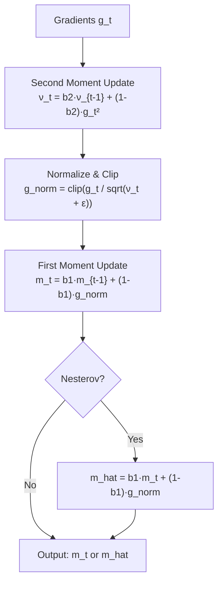
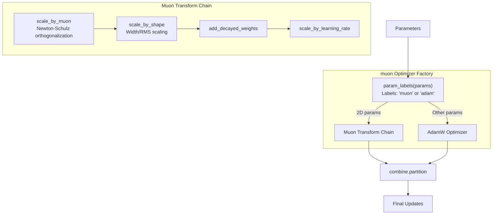

<!-- source: DeepWiki mcp.deepwiki.com · repo google-deepmind/optax · extra page ADOPT and Muon Optimizers · fetched 2026-10-26 -->

# ADOPT and Muon Optimizers

<details>
<summary>Relevant source files</summary>

The following files were used as context for generating this wiki page:

- [optax/contrib/_adopt.py](optax/contrib/_adopt.py)
- [optax/contrib/_muon.py](optax/contrib/_muon.py)
- [optax/contrib/_muon_test.py](optax/contrib/_muon_test.py)

</details>


## Purpose and Scope

This page documents two experimental optimizers available in `optax.contrib`: **ADOPT** (Adaptive Optimization with Provable Theoretical guarantees) and **Muon** (Momentum Orthogonalized by Newton-Schulz). Both optimizers provide alternatives to standard Adam-family optimizers with distinct theoretical motivations and implementation characteristics.

For other contributed optimizers like AdEMAMix and Sophia, see [AdEMAMix and Momentum Variants](#3.3.1) and [Other Contrib Optimizers](#3.3.3). For standard optimizers like Adam and AdamW, see [Standard Optimizers](#3.1).

---

## ADOPT Optimizer

### Overview

ADOPT is a modified version of Adam designed to improve robustness with respect to the choice of the `b2` (second moment decay) hyperparameter. The optimizer addresses potential instability issues in Adam, particularly when gradient elements are near-zero at initialization.

**Key Modification:** ADOPT clips the normalized gradient before accumulating momentum, unlike Adam which applies momentum accumulation before normalization. This ordering change improves stability across a wider range of `b2` values.

Sources: [optax/contrib/_adopt.py:15-175]()

### Algorithm Structure



Sources: [optax/contrib/_adopt.py:67-93]()

### Core Implementation Components

| Component | Function | Description |
|-----------|----------|-------------|
| **Transformation** | `scale_by_adopt` | Low-level gradient transformation implementing ADOPT logic |
| **Optimizer** | `adopt` | High-level optimizer combining `scale_by_adopt` with learning rate scaling |
| **State** | `ScaleByAdamState` | Tracks count, first moment (mu), and second moment (nu) |

Sources: [optax/contrib/_adopt.py:28-95, 98-175]()

### Parameters

#### `scale_by_adopt` Parameters

```python
def scale_by_adopt(
    b1: jax.typing.ArrayLike = 0.9,
    b2: jax.typing.ArrayLike = 0.9999,
    eps: jax.typing.ArrayLike = 1e-6,
    mu_dtype: Optional[jax.typing.DTypeLike] = None,
    *,
    nesterov: bool = False,
    use_clipping: bool = True,
    clip_value_fn: Callable[[jax.Array], jax.Array] = lambda x: x**0.25,
)
```

| Parameter | Type | Default | Description |
|-----------|------|---------|-------------|
| `b1` | float | 0.9 | Exponential decay rate for first moment |
| `b2` | float | 0.9999 | Exponential decay rate for second moment (note: higher default than Adam's 0.999) |
| `eps` | float | 1e-6 | Numerical stability constant |
| `mu_dtype` | dtype | None | Optional dtype for first moment accumulator |
| `nesterov` | bool | False | Whether to use Nesterov momentum |
| `use_clipping` | bool | True | Whether to clip normalized gradients |
| `clip_value_fn` | Callable | `x**0.25` | Function mapping step count to clip value |

Sources: [optax/contrib/_adopt.py:28-56]()

### Implementation Details

The key algorithmic difference from Adam occurs in the update function:

1. **Second moment update** (line 71): `nu = optax.tree.update_moment_per_elem_norm(updates, state.nu, b2_, 2)`
   - Updates using element-wise squared norm
   - Special handling for first step: `b2_ = jnp.where(state.count > 0, b2, 0)`

2. **Normalization with optional clipping** (lines 72-84):
   ```python
   if use_clipping:
       mu_updates = jax.tree.map(
           lambda ud, nu: jnp.clip(
               ud / jnp.maximum(jnp.sqrt(nu), eps), 
               -clip_value, 
               clip_value
           ),
           updates, state.nu,
       )
   ```

3. **First moment accumulation** (line 85): Applied to normalized/clipped gradients
   - `mu = optax.tree.update_moment(mu_updates, state.mu, b1_, 1)`

4. **Optional Nesterov momentum** (lines 87-90): 
   - If enabled, computes one additional momentum step forward

Sources: [optax/contrib/_adopt.py:67-93]()

### Usage Example

From the docstring example:

```python
import optax
import jax.numpy as jnp

# Create optimizer
solver = optax.contrib.adopt(learning_rate=0.003)

# Initialize
params = jnp.array([1., 2., 3.])
opt_state = solver.init(params)

# Training loop
for _ in range(5):
    grad = jax.grad(f)(params)
    updates, opt_state = solver.update(grad, opt_state, params)
    params = optax.apply_updates(params, updates)
```

Sources: [optax/contrib/_adopt.py:139-158]()

---

## Muon Optimizer

### Overview

Muon (Momentum Orthogonalized by Newton-Schulz) is a variant of Shampoo that uses Newton-Schulz iteration to orthogonalize momentum-accumulated gradients. Mathematically, it performs steepest descent under the Schatten-p norm for large p values. The optimizer is particularly designed for training neural networks with matrix-structured parameters.

**Key Features:**
- Orthogonalization via Newton-Schulz iteration
- Automatic partitioning: 2D parameters use Muon, others use Adam
- Support for higher-dimensional tensors via `MuonDimensionNumbers`
- Optional adaptive scaling and Nesterov momentum

Sources: [optax/contrib/_muon.py:15-77]()

### Architecture Overview



Sources: [optax/contrib/_muon.py:1-734]()

### MuonDimensionNumbers Specification

The `MuonDimensionNumbers` namedtuple specifies how to reshape tensors for orthogonalization:

```python
class MuonDimensionNumbers(NamedTuple):
    reduction_axis: Sequence[int] | int = 0
    output_axis: Sequence[int] | int = 1
```

**Conceptual Model:** Given a matrix-vector product `x W = y`, the `reduction_axis` corresponds to the axis contracted over (input dimension), and `output_axis` corresponds to the result dimension.

**Axes Classification:**
- **Reduction axes:** Flattened into first matrix dimension (rows)
- **Output axes:** Flattened into second matrix dimension (columns)
- **Batch axes:** All remaining axes; operations applied independently via `jax.vmap`

Sources: [optax/contrib/_muon.py:56-77]()

### Dimension Number Reshaping Flow

```mermaid
graph LR
    Input["Tensor<br/>shape: (B1, B2, R1, R2, O1, O2)"]
    Normalize["Normalize Axes<br/>reduction_axis=(2,3)<br/>output_axis=(4,5)"]
    Transpose["Transpose to<br/>(B1, B2, R1, R2, O1, O2)"]
    Flatten["Reshape to<br/>(B1*B2, R1*R2, O1*O2)"]
    Process["Apply Newton-Schulz<br/>via vmap over batch"]
    Unflatten["Reshape back"]
    InvTranspose["Inverse transpose"]
    Output["Original shape"]
    
    Input --> Normalize
    Normalize --> Transpose
    Transpose --> Flatten
    Flatten --> Process
    Process --> Unflatten
    Unflatten --> InvTranspose
    InvTranspose --> Output
```



Sources: [optax/contrib/_muon.py:85-131]()

### Core Components

| Component | Location | Purpose |
|-----------|----------|---------|
| `MuonDimensionNumbers` | Lines 56-77 | Specification for tensor reshaping |
| `scale_by_shape` | Lines 162-193 | Width scaling or consistent RMS scaling |
| `_compute_muon_reshape` | Lines 100-131 | Reshape logic based on dimension numbers |

Sources: [optax/contrib/_muon.py:56-193]()

### Newton-Schulz Iteration

The Newton-Schulz method iteratively orthogonalizes a matrix. Given matrix X, it applies quintic iteration to approximate polar decomposition.

**Implementation Details:**
- Default coefficients: `(3.4445, -4.7750, 2.0315)` optimized for fast convergence
- Supports presets like `'standard'` and `'dion'` coefficients
- Normalizes spectral norm before iteration

Sources: [optax/contrib/_muon.py:41-53]()

### Parameters

#### `scale_by_shape` Parameters

| Parameter | Type | Default | Description |
|-----------|------|---------|-------------|
| `weight_dimension_numbers` | WeightDimNumOrFn | None | Dimension specifications for non-2D parameters or callable |
| `consistent_rms` | ArrayLike | None | Optional float to activate consistent RMS scaling |

Sources: [optax/contrib/_muon.py:162-179]()

### Shape Scaling

The `scale_by_shape` transformation provides two scaling modes:

**Width Transfer Scaling (default):**
```python
scale = jnp.sqrt(jnp.maximum(1, fan_out / fan_in))
```

**Consistent RMS Scaling (when `consistent_rms` is set):**
```python
scale = jnp.sqrt(jnp.maximum(fan_in, fan_out)) * consistent_rms
```

Sources: [optax/contrib/_muon.py:142-160]()

### Usage Patterns

#### Pattern 1: Explicit Selection with Dimension Numbers

```python
# Define dimension numbers for specific parameters
weight_dim_nums = {
    "layer1": {
        "w": _muon.MuonDimensionNumbers(0, 1),  # 2D matrix
        "b": None,  # Use Adam for bias
    },
}
```

Sources: [optax/contrib/_muon_test.py:135-145]()

#### Pattern 2: Callable Dimension Numbers

```python
# Dynamically determine dimension numbers based on parameter shapes
def weight_dim_nums_fn(params):
    fn_ = lambda x: _muon.MuonDimensionNumbers(0, 1) if x.ndim == 2 else None
    return jax.tree.map(fn_, params)
```

Sources: [optax/contrib/_muon_test.py:125-128]()

---

## Comparison Table

| Feature | ADOPT | Muon |
|---------|-------|------|
| **Base Algorithm** | Modified Adam | Shampoo-inspired |
| **Key Innovation** | Clip before momentum | Newton-Schulz orthogonalization |
| **Main Benefit** | Robust to b2 choice | Better conditioning for matrices |
| **Parameter Requirements** | Works on any shape | Optimized for 2D (matrices) |
| **State Components** | count, mu, nu | count, mu, ns_coeffs |
| **Default b1** | 0.9 | 0.95 |
| **Default b2** | 0.9999 | N/A (no second moment) |
| **Computational Cost** | Similar to Adam | Higher (Newton-Schulz iterations) |
| **Memory Overhead** | Similar to Adam | Similar to Adam (first moment only) |
| **Nesterov Support** | Yes | Yes (default: True) |
| **Unique Features** | Adaptive clipping | Dimension numbers for non-2D params |

Sources: [optax/contrib/_adopt.py](), [optax/contrib/_muon.py]()

---

## References

**ADOPT:**
- Taniguchi et al., "ADOPT: Modified Adam Can Converge with Any beta2 with the Optimal Rate", NeurIPS 2024
  - Paper: https://arxiv.org/abs/2403.00855

**Muon:**
- Jordan, "modded-nanogpt: Speedrunning the NanoGPT baseline", 2024
  - Repository: https://github.com/KellerJordan/modded-nanogpt
- Liu et al., "Muon is Scalable for LLM Training", 2025
  - Paper: https://arxiv.org/abs/2502.16982

Sources: [optax/contrib/_adopt.py:160-162](), [optax/contrib/_muon.py:15-20]()

---

