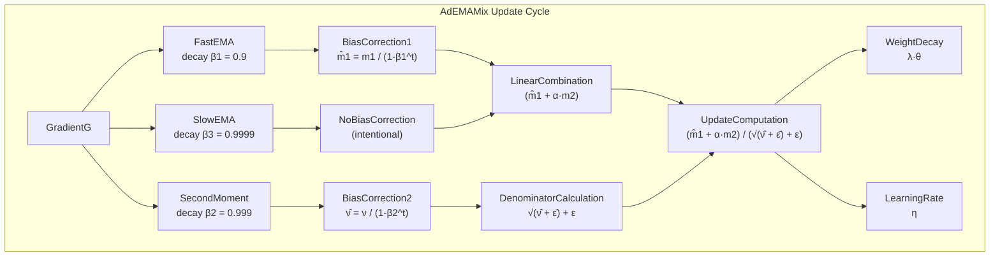
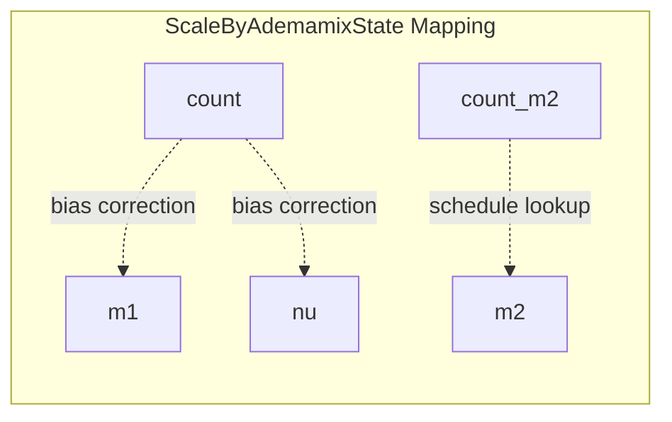
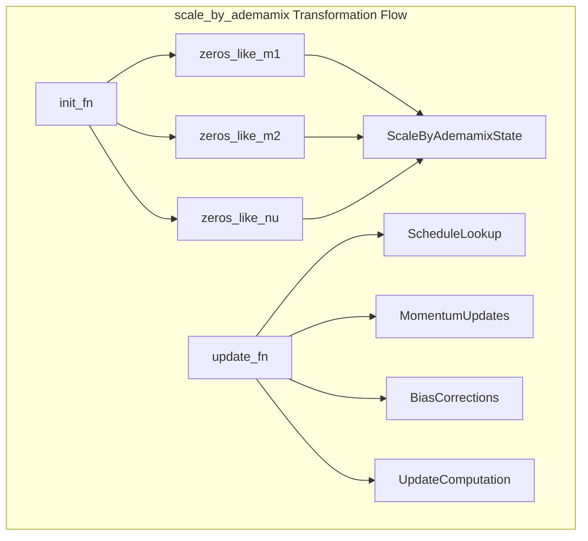
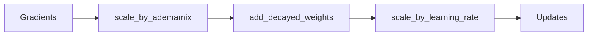
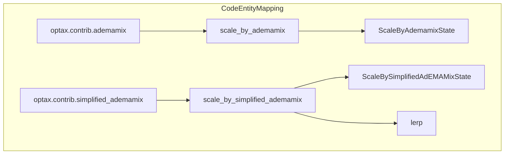

<!-- source: DeepWiki mcp.deepwiki.com · repo google-deepmind/optax · extra page AdEMAMix and Momentum Variants · fetched 2026-10-26 -->

# AdEMAMix and Momentum Variants

<details>
<summary>Relevant source files</summary>

The following files were used as context for generating this wiki page:

- [examples/contrib/rosenbrock_ademamix.ipynb](examples/contrib/rosenbrock_ademamix.ipynb)
- [optax/contrib/_ademamix.py](optax/contrib/_ademamix.py)

</details>


## Purpose and Scope

This page documents the **AdEMAMix** optimizer family and related momentum-based variants located in `optax.contrib`. AdEMAMix (Adaptive EMA Mixture) combines fast and slow exponential moving averages (EMAs) to better leverage historical gradient information over long training horizons. This page covers:

- **AdEMAMix**: Dual-momentum optimizer mixing fast and slow EMAs (`optax.contrib.ademamix`)
- **Simplified AdEMAMix**: Single-momentum variant with simpler mixing (`optax.contrib.simplified_ademamix`)
- **MoMo**: Momentum Models with adaptive learning rates based on loss bounds (`optax.contrib.momo`)

For other contributed optimizers like ADOPT and Muon, see [ADOPT and Muon Optimizers](#3.3.2). For standard optimizers like Adam and SGD, see [Standard Optimizers](#3.1).

Sources: [optax/contrib/_ademamix.py:35-130]()

---

## AdEMAMix Architecture

AdEMAMix extends AdamW by maintaining **two separate momentum buffers**: a fast EMA (`m1`) capturing recent gradient dynamics and a slow EMA (`m2`) that retains gradient information over thousands of steps. The optimizer linearly combines these EMAs to compute the final update direction.

### Dual Momentum System

### AdEMAMix Update Cycle Architecture


**Key Design Decisions:**
- **Fast EMA** (`m1`): Bias-corrected, captures recent gradient trends.
- **Slow EMA** (`m2`): NOT bias-corrected, fills gradually with very old gradients.
- **Mixing parameter** (`alpha`): Often scheduled from `0` to a final value (e.g., `5.0`).
- **Slow decay** (`b3`): Typically `0.9999`, can be scheduled for low-iteration scenarios.

Sources: [optax/contrib/_ademamix.py:35-130]()

### State Management and Code Entity Space

### Code Entity State Management Mapping


`ScaleByAdemamixState` maintains **two separate iteration counters**:
- `count`: Incremented every step, used for bias correction of `m1` and `nu`.
- `count_m2`: Incremented every step, used to schedule `b3` and `alpha` parameters independently.

Sources: [optax/contrib/_ademamix.py:35-52](), [optax/contrib/_ademamix.py:91-101]()

### Mathematical Formulation

The AdEMAMix update equations implemented in `scale_by_ademamix` are:

$$
\begin{aligned}
m_1^{(t)} &\leftarrow \beta_1 \cdot m_1^{(t-1)} + (1-\beta_1) \cdot g^{(t)} \\
m_2^{(t)} &\leftarrow \beta_3 \cdot m_2^{(t-1)} + (1-\beta_3) \cdot g^{(t)} \\
\nu^{(t)} &\leftarrow \beta_2 \cdot \nu^{(t-1)} + (1-\beta_2) \cdot {g^{(t)}}^2 \\
\hat{m_1}^{(t)} &\leftarrow m_1^{(t)} / {(1-\beta_1^{(t)})} \\
\hat{\nu}^{(t)} &\leftarrow \nu^{(t)} / {(1-\beta_2^{(t)})} \\
\theta^{(t)} &\leftarrow \theta^{(t-1)} - \eta \cdot \left(
\frac{(\hat{m_1}^{(t)} + \alpha m_2^{(t)})}{\left(\sqrt{\hat{\nu}^{(t)} + \bar{\varepsilon}} + \varepsilon\right)} + \lambda \theta^{(t-1)}
\right)
\end{aligned}
$$

Sources: [optax/contrib/_ademamix.py:169-186]()

### Implementation Details

### scale_by_ademamix Transformation Flow


Key implementation aspects:
1. **Data Type Control**: `mu_dtype` canonicalizes lower-precision accumulators via `utils.canonicalize_dtype`.
2. **Schedule Callables**: Both `b3` and `alpha` accept `ScalarOrSchedule` types.
3. **Tree Operations**: Utilizes `optax.tree.update_moment` and `optax.tree.bias_correction`.

Sources: [optax/contrib/_ademamix.py:54-130](), [optax/contrib/_ademamix.py:133-269]()

### Full Optimizer Construction

### Optimizer Construction Chaining


Sources: [optax/contrib/_ademamix.py:257-269]()

---

## Simplified AdEMAMix

Simplified AdEMAMix reduces complexity by maintaining a single momentum buffer and eliminating separate scheduling for `b3` and `alpha`.

- **Momentum Buffers**: 1 (`m`) instead of 2.
- **Iteration Counters**: 1 (`t`).
- **Mixing**: `m + alpha * g`.

Sources: [optax/contrib/_ademamix.py:272-284](), [optax/contrib/_ademamix.py:380-393]()

---

## MoMo: Momentum Models for Adaptive Learning Rates

MoMo derives an adaptive learning rate from a lower bound on the loss function, requiring the loss value to be passed to `update()` via keyword arguments.

Sources: [optax/contrib/_momo.py:33-184]()

---

## Usage Patterns

### Basic AdEMAMix Usage

```python
import optax

optimizer = optax.contrib.ademamix(
    learning_rate=0.003,
    b1=0.9,
    b2=0.999,
    b3=0.9999,
    alpha=5.0,
)
```

Sources: [optax/contrib/_ademamix.py:133-269]()

---

## Code Entity Mapping Bridge

### Python API to Code Entities Mapping


Sources: [optax/contrib/_ademamix.py:1-461]()

---

