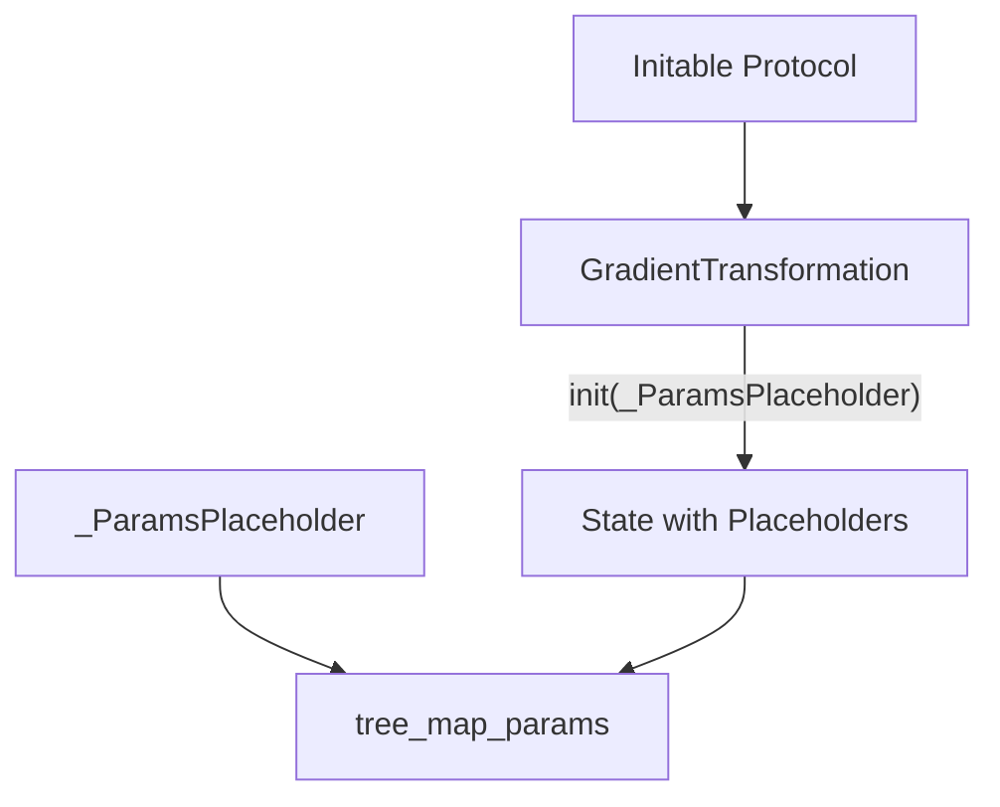
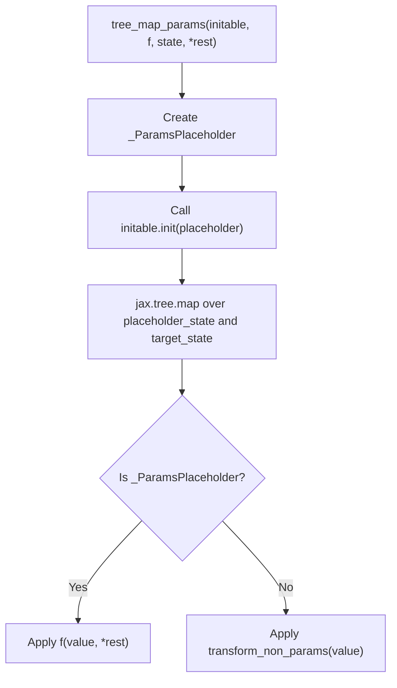
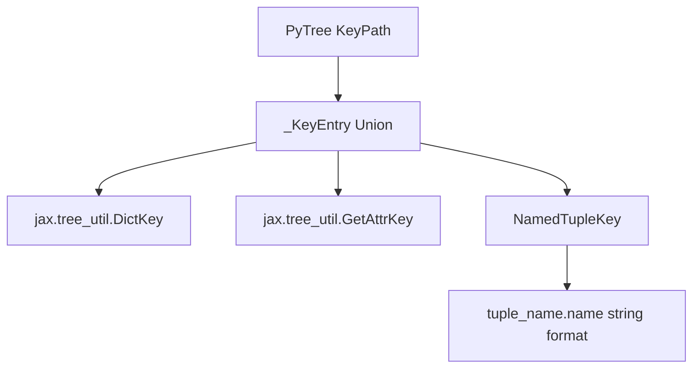

<!-- source: DeepWiki mcp.deepwiki.com · repo google-deepmind/optax · extra page Optimizer State Introspection · fetched 2026-10-26 -->

# Optimizer State Introspection

Relevant source files

The following files were used as context for generating this wiki page:

- [optax/tree_utils/_state_utils.py](optax/tree_utils/_state_utils.py)
- [optax/tree_utils/_state_utils_test.py](optax/tree_utils/_state_utils_test.py)

This page documents the technical implementation of optimizer state introspection utilities provided in `optax/tree_utils/_state_utils.py`. These tools enable reading, filtering, mapping, and updating hyperparameters, parameter-shaped states (such as moments or gradient statistics), and named attributes within nested JAX PyTrees representing Optax optimizer states (`OptState`).

---

## 1. Core Abstractions: Placeholders and Protocols

Optax optimizer states (`base.OptState`) are nested PyTrees whose structures mirror the parameter trees they optimize, combined with optimizer-specific metadata (e.g., update counters, moving average buffers, or injected hyperparameter dictionaries). To manipulate or inspect parts of these states relative to the parameters, `_state_utils.py` relies on structural placeholders and structural typing protocols.

### `_ParamsPlaceholder` and `Initable`
* **`_ParamsPlaceholder`**: A registered JAX PyTree node (`@jax.tree_util.register_pytree_node_class`) [optax/tree_utils/_state_utils.py:27] that flattens to an empty tuple `()` and `None` auxiliary data [optax/tree_utils/_state_utils.py:30-31]. It acts as a sentinel representing parameter leaves when evaluating an optimizer's initialization routine without concrete parameter arrays.
* **`Initable`**: A runtime-checkable protocol (`@typing.runtime_checkable`) [optax/tree_utils/_state_utils.py:82] defining any object or transformation that exposes an `init(params: base.Params) -> base.OptState` method [optax/tree_utils/_state_utils.py:83-88].

*Sources: [optax/tree_utils/_state_utils.py:27-37], [optax/tree_utils/_state_utils.py:82-88]*

---

## 2. Parameter State Mapping (`tree_map_params`)

The central workhorse for structural manipulation of optimizer states relative to parameters is `tree_map_params`. It allows callers to apply transformations specifically to parameter-shaped substructures (like moments $\mu$ and $\nu$ in Adam) while handling non-parameter fields separately.

### Implementation Details
`tree_map_params` accepts an `initable` (either a callable or an `Initable` object), a mapping function `f`, the optimizer `state`, optional rest arguments matching the parameter tree shape, and an optional `transform_non_params` callable [optax/tree_utils/_state_utils.py:90-141].

1. It initializes a dummy state using `_ParamsPlaceholder()` in place of actual model parameters [optax/tree_utils/_state_utils.py:144-150].
2. It traverses both the placeholder-initialized state and the actual `state` simultaneously using `jax.tree.map` [optax/tree_utils/_state_utils.py:159-164].
3. When it encounters a `_ParamsPlaceholder` node in the reference structure, it applies `f` to the corresponding leaves in the target state [optax/tree_utils/_state_utils.py:152-154].
4. For non-parameter fields, it invokes `transform_non_params(value)` if provided, otherwise returning the value unmodified [optax/tree_utils/_state_utils.py:155-157].

*Sources: [optax/tree_utils/_state_utils.py:90-164], [optax/tree_utils/_state_utils_test.py:91-97]*

---

## 3. Path Filtering and Key Types (`NamedTupleKey`)

When inspecting nested optimizer states or hyperparameter containers, navigating standard JAX `KeyPath` entries (`DictKey`, `GetAttrKey`, `SequenceKey`, `FlattenedIndexKey`) is often insufficient when dealing with `NamedTuple` structures.

### `NamedTupleKey`
`NamedTupleKey` represents a key entry specific to `NamedTuple` fields within a PyTree path [optax/tree_utils/_state_utils.py:40-68].

* **Attributes**:
  * `tuple_name` (`str`): The name of the `NamedTuple` container [optax/tree_utils/_state_utils.py:50].
  * `name` (`str`): The field name within the tuple [optax/tree_utils/_state_utils.py:51].
* **String Representation**: Formatted as `tuple_name.name` via `__str__` [optax/tree_utils/_state_utils.py:67-68].

This key type integrates directly into filtering callables (`filtering: Callable[[_KeyPath, Any], bool]`) passed to path extraction utilities like `tree_get_all_with_path`, `tree_get`, and `tree_set` [optax/tree_utils/_state_utils.py:43-47, 167-171].

*Sources: [optax/tree_utils/_state_utils.py:40-79]*

---

## 4. Testing and Usage Patterns

As demonstrated in `_state_utils_test.py`, state introspection utilities are primarily used for:
1. **Sharding and Partition Specification**: Constructing sharding constraint trees matching optimizer states by replacing parameter leaves with partition specs and mapping non-parameter fields (like `count`) to default sharding values (`FakeShardSpec`) [optax/tree_utils/_state_utils.py:91-96, optax/tree_utils/_state_utils_test.py:91-97].
2. **Hyperparameter Inspection**: Extracting and verifying dynamic hyperparameters managed by wrappers like `inject_hyperparams` [optax/tree_utils/_state_utils_test.py:174-186].
3. **State Pruning**: Mapping parameter-shaped optimizer states to `None` for serialization or memory optimization [optax/tree_utils/_state_utils_test.py:187-199].

*Sources: [optax/tree_utils/_state_utils.py:90-141], [optax/tree_utils/_state_utils_test.py:78-209]*

---

