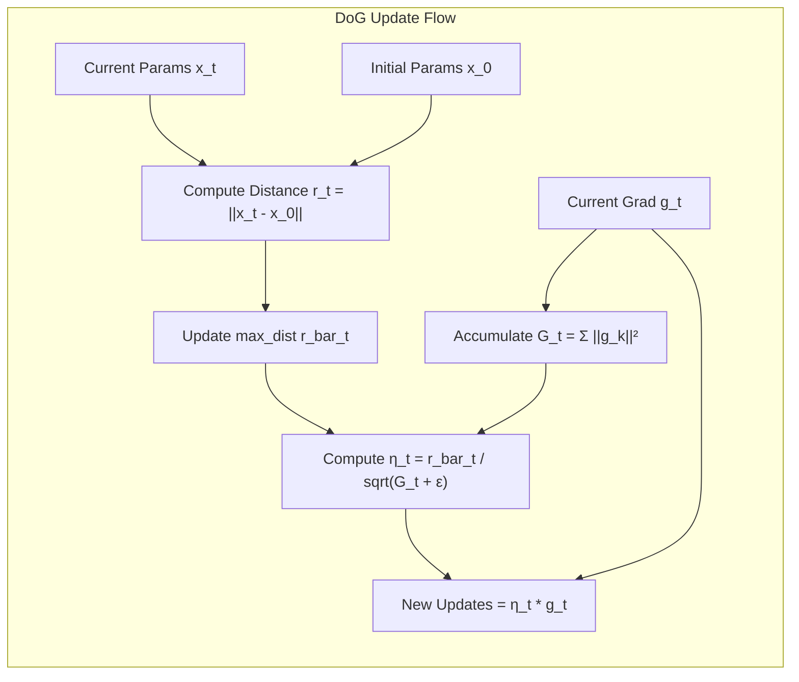
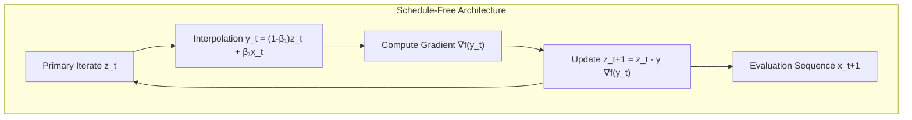
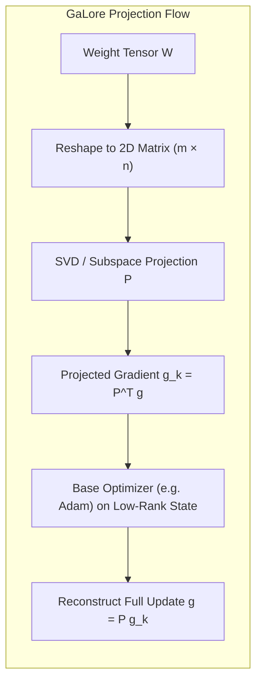

<!-- source: DeepWiki mcp.deepwiki.com · repo google-deepmind/optax · extra page Other Contrib Optimizers · fetched 2026-10-26 -->

# Other Contrib Optimizers

<details>
<summary>Relevant source files</summary>

The following files were used as context for generating this wiki page:

- [docs/api/losses.rst](docs/api/losses.rst)
- [optax/_src/factorized_test.py](optax/_src/factorized_test.py)
- [optax/_src/lookahead_test.py](optax/_src/lookahead_test.py)
- [optax/contrib/_cocob.py](optax/contrib/_cocob.py)
- [optax/contrib/_complex_valued.py](optax/contrib/_complex_valued.py)
- [optax/contrib/_complex_valued_test.py](optax/contrib/_complex_valued_test.py)
- [optax/contrib/_dadapt_adamw.py](optax/contrib/_dadapt_adamw.py)
- [optax/contrib/_dog.py](optax/contrib/_dog.py)
- [optax/contrib/_galore.py](optax/contrib/_galore.py)
- [optax/contrib/_galore_test.py](optax/contrib/_galore_test.py)
- [optax/contrib/_mechanic.py](optax/contrib/_mechanic.py)
- [optax/contrib/_mechanic_test.py](optax/contrib/_mechanic_test.py)
- [optax/contrib/_momo.py](optax/contrib/_momo.py)
- [optax/contrib/_prodigy.py](optax/contrib/_prodigy.py)
- [optax/contrib/_reduce_on_plateau.py](optax/contrib/_reduce_on_plateau.py)
- [optax/contrib/_reduce_on_plateau_test.py](optax/contrib/_reduce_on_plateau_test.py)
- [optax/contrib/_sam.py](optax/contrib/_sam.py)
- [optax/contrib/_sam_test.py](optax/contrib/_sam_test.py)
- [optax/contrib/_schedule_free.py](optax/contrib/_schedule_free.py)
- [optax/contrib/_schedule_free_test.py](optax/contrib/_schedule_free_test.py)
- [optax/losses/__init__.py](optax/losses/__init__.py)

</details>


## Purpose and Scope

This page documents the remaining experimental and specialized optimizers available in `optax.contrib` that are not covered in other sections. For AdEMAMix and momentum-based variants, see [AdEMAMix and Momentum Variants](#3.3.1). For ADOPT and Muon optimizers, see [ADOPT and Muon Optimizers](#3.3.2).

This page covers:
- **Second-order optimizers**: Sophia (Hessian-based optimization)
- **Adaptive learning rate & parameter-free methods**: Prodigy, D-Adaptation, COCOB, DoG/DoWG, Momo
- **Low-rank projection methods**: GaLore
- **Schedule-free methods**: Optimizers and wrappers that eliminate learning rate schedules
- **Specialized algorithms**: MADGRAD, ACProp
- **Optimizer wrappers**: SAM, Mechanize, Reduce-on-Plateau, complex-valued optimization

---

## Contrib Optimizer Taxonomy

```mermaid
graph TB
    subgraph "Second-Order & Low-Rank"
        SOPHIA["sophia<br/>Hessian-based"]
        GALORE["scale_by_galore<br/>GaLore Low-Rank SVD"]
    end
    
    subgraph "Adaptive & Parameter-Free LR"
        PRODIGY["prodigy<br/>Expeditiously Adaptive"]
        DADAPT["dadapt_adamw<br/>D-Adaptation"]
        COCOB["scale_by_cocob / cocob<br/>Coin Betting"]
        DOG["scale_by_dog / dog<br/>Distance over Gradients"]
        MOMO["momo<br/>Momentum Models"]
    end
    
    subgraph "Schedule-Free Methods"
        SF_WRAP["schedule_free<br/>(wrapper)"]
    end
    
    subgraph "Optimizer Wrappers"
        SAM["sam<br/>Sharpness-Aware"]
        MECH["mechanize<br/>Mechanic"]
        PLATEAU["reduce_on_plateau<br/>ReduceLROnPlateauState"]
        COMPLEX["split_real_and_imaginary<br/>Complex Values"]
    end
    
    SOPHIA --> |"Uses"| HUTCHINSON["hutchinson_estimator_diag_hessian"]
    GALORE --> |"Projects 2D Weights"| GA_STATE["GaLoreState"]
    PRODIGY --> |"Adapt LR"| PROD_STATE["ProdigyState"]
    DOG --> |"Dynamic Step"| DOG_STATE["DoGState"]
    MOMO --> |"Polyak LR"| MOMO_STATE["MomoState"]
    SF_WRAP --> |"Dual Sequences"| SF_STATE["ScheduleFreeState"]
    PLATEAU --> |"Monitors Metric"| PLATEAU_STATE["ReduceLROnPlateauState"]

    classDef default stroke:#000,fill:none;
```



**Sources:** [optax/contrib/_dog.py:36-43](), [optax/contrib/_schedule_free.py:31-40](), [optax/contrib/_momo.py:33-41](), [optax/contrib/_prodigy.py:33-46](), [optax/contrib/_galore.py:141-155](), [optax/contrib/_cocob.py:32-40](), [optax/contrib/_reduce_on_plateau.py:31-40]()

---

## Distance over Gradients (DoG) & DoWG

### Overview

Distance over Gradients (DoG) [optax/contrib/_dog.py:45-120]() and its variants implement parameter-free dynamic step size schedules. DoG scales updates using the ratio between the maximum distance traveled from the initial parameters ($r_t = \|x_t - x_0\|$) and the root sum of squared gradient norms ($G_t = \sum_{k \leq t} \|g_k\|^2$).

### Mathematical Formulation and Update Flow



**Sources:** [optax/contrib/_dog.py:96-117]()

### Implementation Details

- **State (`DoGState`)**: Tracks `is_init_step`, `init_params`, `max_dist`, and `sum_sq_norm_grads` [optax/contrib/_dog.py:36-43]().
- **Initial Step Heuristic**: Supports `distance`, `learning_rate`, and `heuristic` specifications [optax/contrib/_dog.py:70-87](). The heuristic sets $r_0 = \alpha (1 + \|x_0\|)$ [optax/contrib/_dog.py:80-81]().

**Sources:** [optax/contrib/_dog.py:36-120]()

---

## Schedule-Free Optimization

### Core Concept

Schedule-free methods [optax/contrib/_schedule_free.py:55-132]() eliminate the need for decaying learning rate schedules by maintaining separate iterate sequences for training ($z$) and evaluation ($x$).



**Sources:** [optax/contrib/_schedule_free.py:55-88]()

### Key Functions and Usage

- `schedule_free()`: Wraps any base optimizer [optax/contrib/_schedule_free.py:55-132]().
- `schedule_free_eval_params()`: Computes parameters for evaluation from the state and primary parameters [optax/contrib/_schedule_free.py:42-53]().
- **State (`ScheduleFreeState`)**: Tracks `b1`, `weight_sum`, `step_count`, `max_lr`, `base_optimizer_state`, and `z` [optax/contrib/_schedule_free.py:31-40]().

**Sources:** [optax/contrib/_schedule_free.py:31-132]()

---

## Momentum Monitoring (Momo)

### Overview

MoMo [optax/contrib/_momo.py:43-104]() performs SGD with momentum using a Polyak-type adaptive learning rate that leverages knowledge of a lower bound on the loss function.

### Implementation and Update Mechanics

- **State (`MomoState`)**: Contains `exp_avg`, `barf` (moving average of loss), `gamma`, `lb` (lower bound), and `count` [optax/contrib/_momo.py:33-41]().
- **Requirement**: Requires the current minibatch loss `value` to be passed to `update()` [optax/contrib/_momo.py:121-122]().

```python
# Usage pattern for Momo
updates, state = opt.update(grads, state, params, value=loss_value)
```

**Sources:** [optax/contrib/_momo.py:33-185]()

---

## Prodigy & D-Adaptation

### Overview

Prodigy [optax/contrib/_prodigy.py:48-95]() is an expeditiously adaptive parameter-free variant of D-Adapt AdamW. It adapts the baseline learning rate faster by weighting recent gradients more heavily.

- **State (`ProdigyState`)**: Tracks `exp_avg`, `exp_avg_sq`, `grad_sum`, `params0`, `estim_lr`, `numerator_weighted`, and `count` [optax/contrib/_prodigy.py:33-46]().
- **Usage**: Recommended with a linear schedule from `1.0` down to `0.0` with warm-up [optax/contrib/_prodigy.py:69-72]().

**Sources:** [optax/contrib/_prodigy.py:33-95]()

---

## COCOB (Continuous Coin Betting)

### Overview

COCOB [optax/contrib/_cocob.py:114-146]() is a parameter-free stochastic subgradient descent algorithm based on online coin betting, eliminating learning rate tuning entirely.

- **State (`COCOBState`)**: Tracks `init_particles`, `cumulative_gradients`, `scale`, `subgradients`, and `reward` [optax/contrib/_cocob.py:32-40]().
- **Core Transformation**: `scale_by_cocob()` handles the betting update equations [optax/contrib/_cocob.py:42-111]().

**Sources:** [optax/contrib/_cocob.py:32-146]()

---

## GaLore (Gradient Low-Rank Projection)

### Overview

GaLore [optax/contrib/_galore.py:157-182]() projects gradients of 2D weight matrices into a low-rank subspace via SVD, dramatically reducing optimizer state memory while enabling full-parameter learning.



**Sources:** [optax/contrib/_galore.py:87-138](), [optax/contrib/_galore.py:157-182]()

- **Dimension Numbers (`GaLoreDimensionNumbers`)**: Specifies reduction and output axes for multidimensional tensors (e.g., attention projections) [optax/contrib/_galore.py:35-57]().
- **State (`GaLoreState`)**: Stores `count`, `base_optimizer_state`, and `projector` matrices [optax/contrib/_galore.py:141-155]().

**Sources:** [optax/contrib/_galore.py:35-182]()

---

## Reduce-on-Plateau Callback

### Overview

`reduce_on_plateau()` [optax/contrib/_reduce_on_plateau.py:42-77]() monitors a metric and reduces the learning scale by a factor when no improvement is observed for a given `patience` duration.

- **State (`ReduceLROnPlateauState`)**: Tracks `scale`, `best_value`, `plateau_count`, `cooldown_count`, `count`, and `avg_value` [optax/contrib/_reduce_on_plateau.py:31-40]().
- **Update Requirement**: Requires `value` to be passed to `update()` [optax/contrib/_reduce_on_plateau.py:169-170]().

```python
updates, state = transform.update(updates, state, value=loss_value)
```

**Sources:** [optax/contrib/_reduce_on_plateau.py:31-181]()

---

## Summary Table

| Optimizer / Wrapper | Primary Use Case | Key State / Abstraction | Requirement |
|-------------------|------------------|-------------------------|-------------|
| **dog / dowg** | Parameter-free step size | `DoGState` [optax/contrib/_dog.py:36-43]() | - |
| **schedule_free** | Eliminating LR schedules | `ScheduleFreeState` [optax/contrib/_schedule_free.py:31-40]() | Use `schedule_free_eval_params` [optax/contrib/_schedule_free.py:42-53]() |
| **momo** | Adaptive momentum models | `MomoState` [optax/contrib/_momo.py:33-41]() | Pass `value` in update [optax/contrib/_momo.py:121-122]() |
| **prodigy** | Expeditiously adaptive LR | `ProdigyState` [optax/contrib/_prodigy.py:33-46]() | - |
| **cocob** | Coin betting optimization | `COCOBState` [optax/contrib/_cocob.py:32-40]() | - |
| **galore** | Memory-efficient LLM training | `GaLoreState` [optax/contrib/_galore.py:141-155]() | Non-parameter-dependent base optimizer [optax/contrib/_galore.py:174-179]() |
| **reduce_on_plateau** | Metric-driven LR decay | `ReduceLROnPlateauState` [optax/contrib/_reduce_on_plateau.py:31-40]() | Pass `value` in update [optax/contrib/_reduce_on_plateau.py:169-170]() |

**Sources:** [optax/contrib/_dog.py:36-43](), [optax/contrib/_schedule_free.py:31-53](), [optax/contrib/_momo.py:33-41](), [optax/contrib/_prodigy.py:33-46](), [optax/contrib/_cocob.py:32-40](), [optax/contrib/_galore.py:141-179](), [optax/contrib/_reduce_on_plateau.py:31-40]()

---

