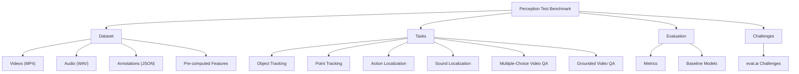
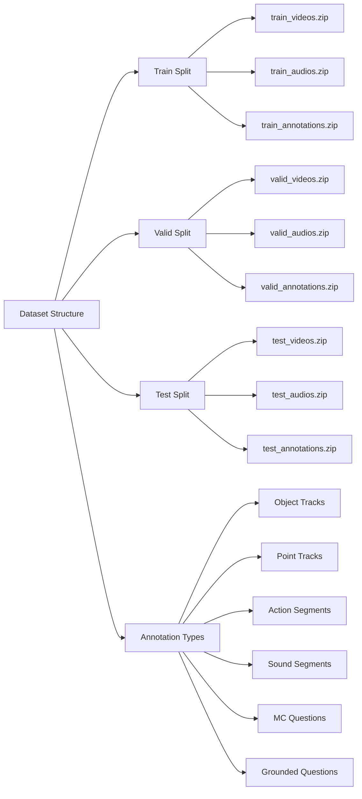
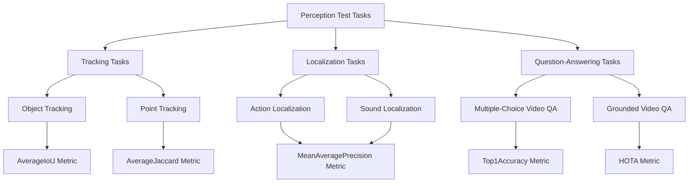
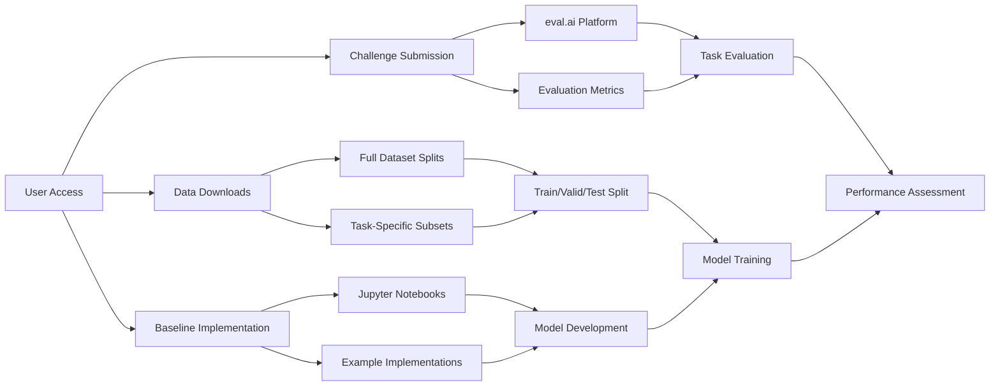

<!-- source: DeepWiki mcp.deepwiki.com · repo google-deepmind/perception_test · page 1 Overview · fetched 2026-10-26 -->

# Overview

Relevant source files

The following files were used as context for generating this wiki page:

- [README.md](README.md)

This page provides a comprehensive introduction to the Perception Test benchmark, a diagnostic tool designed to evaluate perception and reasoning skills of multimodal video models. The benchmark encompasses a dataset of real-world videos, six distinct computational tasks, evaluation metrics, and baseline implementations.

For specific information about the dataset structure and organization, see [Dataset](#2). For details about individual tasks and their requirements, see [Tasks](#3).

## Purpose and Scope

The Perception Test benchmark serves as a standardized evaluation framework for assessing how well multimodal video models can perceive and reason about visual, audio, and textual information in videos. It specifically tests understanding across four key areas:

- **Memory**: Tracking objects and actions across time
- **Abstraction**: Recognizing patterns and making generalizations
- **Physics**: Understanding physical interactions and predicting outcomes
- **Semantics**: Comprehending semantic meaning of events and relationships

The benchmark enables rigorous comparison of different model architectures and approaches through standardized tasks, metrics, and evaluation procedures.

Sources: [README.md:19-20](), [README.md:30-35]()

## System Architecture

The Perception Test benchmark consists of four primary components that work together to provide a comprehensive evaluation framework:

**System Component Diagram**

Sources: [README.md:19-28](), [README.md:37-44](), [README.md:155-163]()

## Dataset Overview

The Perception Test dataset consists of real-world videos with associated audio and detailed annotations. The dataset is split into training, validation, and testing sets, with annotations provided for various perceptual tasks.

**Dataset Organization Diagram**

Sources: [README.md:37-44](), [README.md:45-52](), [README.md:167-180]()

### Annotation Summary

The Perception Test contains rich annotations across multiple modalities:

| Annotation type | Number of videos | Number of annotations |
|-----------------|------------------|------------------------|
| Object tracks   | 11,609           | 189,940               |
| Point tracks    | 145              | 8,647                 |
| Action segments | 11,353           | 73,503                |
| Sound segments  | 11,433           | 137,128               |
| Multiple-choice Questions | 10,361 | 38,060                |
| Grounded video Questions | 3,063   | 6,086                 |

Sources: [README.md:172-179]()

## Computational Tasks

The benchmark defines six primary computational tasks to evaluate different aspects of perception and reasoning:

**Task Hierarchy and Evaluation Metrics Diagram**

Sources: [README.md:155-163](), [README.md:137-147]()

### Task Descriptions

1. **Single Object Tracking**: Track individual objects throughout a video
2. **Single Point Tracking**: Track specific points (on objects) across frames
3. **Temporal Action Localization**: Identify when specific actions occur in a video
4. **Temporal Sound Localization**: Identify when specific sounds occur in a video
5. **Multiple-Choice Video QA**: Answer multiple-choice questions about video content
6. **Grounded Video QA**: Answer questions by localizing objects in the video

Each task has specific evaluation metrics designed to measure performance on that particular perceptual skill.

Sources: [README.md:155-163](), [README.md:137-147]()

## Evaluation Framework

The evaluation framework consists of metrics for each task and baseline implementations:

| Computational task | Metric | Baseline Implementation |
|--------------------|--------|-------------------------|
| Single Object Tracking | Average IoU | Static |
| Single Point Tracking | Average Jaccard | Static |
| Temporal Action Localization | Mean Average Precision | ActionFormer |
| Temporal Sound Localization | Mean Average Precision | ActionFormer |
| Multiple-Choice Video QA | Top-1 Accuracy | Frequency |
| Grounded Video QA | HOTA | MDETR + static |

The baseline implementations provide reference points for model performance and demonstrate how to interact with the dataset and evaluation metrics.

Sources: [README.md:137-147](), [README.md:155-163]()

## Data and Challenge Access

The Perception Test benchmark is accessible through:

1. **Dataset Downloads**: Split into videos, audio, annotations, and pre-computed features
2. **Challenge Platforms**: Tasks hosted on the eval.ai platform for standardized evaluation
3. **Baseline Notebooks**: Jupyter notebooks demonstrating data loading and evaluation

**Data Access and Usage Flow Diagram**

Sources: [README.md:9-16](), [README.md:37-52](), [README.md:59-70]()

## Relationship to Code Organization

The repository structure maps directly to the benchmark components:

1. **Dataset Access and Visualization**: Code for downloading and exploring the dataset
2. **Baselines Directory**: Contains task-specific notebooks with baseline implementations
3. **Evaluation Metrics**: Code for calculating performance metrics for each task

For detailed information about specific tasks, data organization, or evaluation procedures, please refer to the corresponding pages in this wiki.

Sources: [README.md:22-27](), [README.md:137-147]()

---

