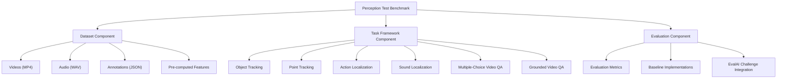
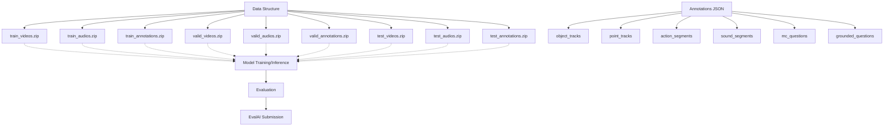
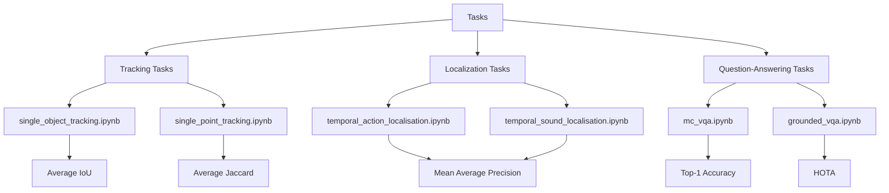
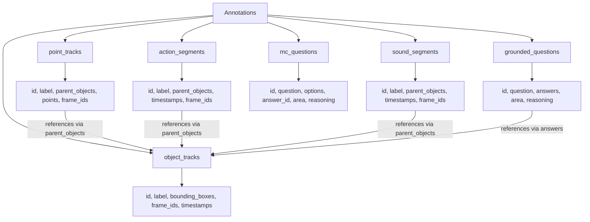
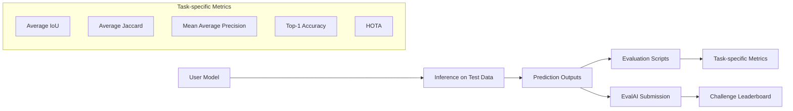
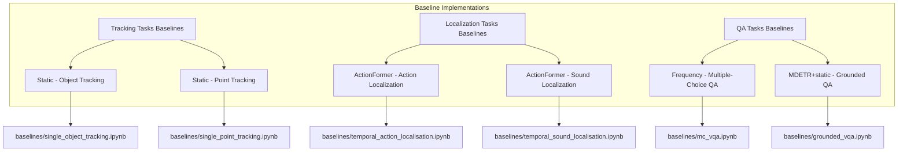
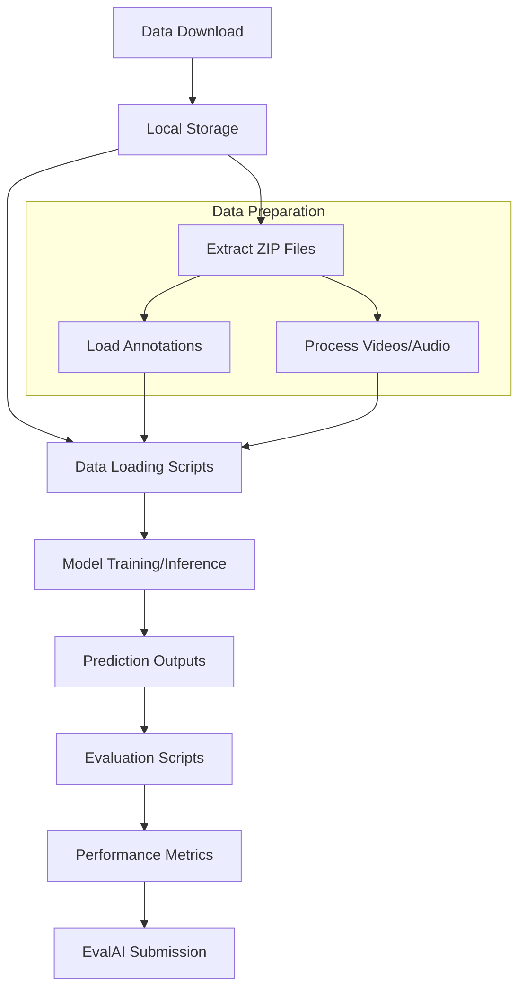
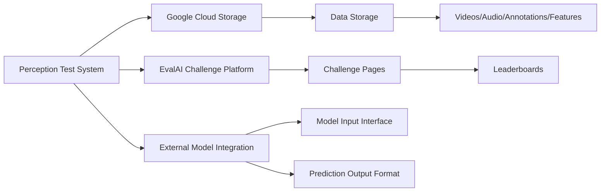

<!-- source: DeepWiki mcp.deepwiki.com · repo google-deepmind/perception_test · page 1.1 System Architecture · fetched 2026-10-26 -->

# System Architecture

Relevant source files

The following files were used as context for generating this wiki page:

- [README.md](README.md)

## Purpose and Scope

This document describes the high-level architecture of the Perception Test benchmark system, which provides a framework for evaluating multimodal video models across six distinct perceptual and reasoning tasks. This architecture documentation covers the organization of system components, data flows, task definitions, and evaluation mechanisms. For detailed information about specific tasks and their requirements, see [Tasks](#3).

## High-Level System Overview

Sources: README.md

The Perception Test benchmark consists of three primary components:

1. **Dataset Component**: Manages multimodal data (videos, audio, annotations)
2. **Task Framework Component**: Defines six perception and reasoning tasks
3. **Evaluation Component**: Provides metrics, baseline implementations, and challenge integration

## Data Architecture

Sources: README.md:37-53

The data is organized into three splits (train, valid, test), each containing videos, audio files, and annotations in standardized formats. Pre-computed features are also provided for specific tasks.

### Data Formats and Structure

| Component | Format | Description | Size Example |
|-----------|--------|-------------|--------------|
| Videos | MP4 | Visual content | train_videos.zip (26.5GB) |
| Audio | WAV | Audio content | train_audios.zip (12.3GB) |
| Annotations | JSON | Structured data | train_annotations.zip (30.6MB) |
| Pre-computed Features | ZIP | Task-specific features | action_localisation_train_video_features.zip (81.7MB) |

Sources: README.md:39-53

## Task Framework Architecture

Sources: README.md:138-162

The task framework organizes six tasks into three categories:
1. **Tracking Tasks**: Object tracking and point tracking
2. **Localization Tasks**: Action localization and sound localization
3. **Question-Answering Tasks**: Multiple-choice video QA and grounded video QA

Each task has dedicated baseline implementation notebooks and specific evaluation metrics.

## Annotation Structure and Relationships

Sources: README.md:166-272

The annotation structure follows a hierarchical schema. Object tracks form the foundation, with point tracks, action segments, sound segments, and grounded video QA all referencing object tracks. Multiple-choice QA annotations stand independently.

### Annotation Field Summary

| Annotation Type | Key Fields | Relationship |
|-----------------|------------|--------------|
| Object Tracks | id, label, bounding_boxes, frame_ids, timestamps | Foundation |
| Point Tracks | id, label, parent_objects, points, frame_ids | References Object Tracks |
| Action Segments | id, label, parent_objects, timestamps, frame_ids | References Object Tracks |
| Sound Segments | id, label, parent_objects, timestamps, frame_ids | References Object Tracks |
| Multiple-Choice QA | id, question, options, answer_id, area, reasoning | Independent |
| Grounded Video QA | id, question, answers, area, reasoning | References Object Tracks |

Sources: README.md:180-272

## Evaluation System Architecture

Sources: README.md:151-164

The evaluation system enables users to:
1. Run models on test data
2. Generate prediction outputs in the required format
3. Evaluate performance using task-specific metrics
4. Submit results to EvalAI for official challenge ranking

## Baseline Implementation Architecture

Sources: README.md:137-147

Each task has a baseline implementation provided as a Jupyter notebook in the `baselines/` directory. The implementations range from simple approaches (static baselines for tracking) to more sophisticated models (ActionFormer for localization, MDETR for grounded QA).

## Data Processing and Workflow

Sources: README.md:37-134

The typical workflow begins with downloading dataset components, followed by data preparation, loading and processing, model development, performance evaluation, and challenge submission.

## Integration Points with External Systems

Sources: README.md:5-16, 37-53

The benchmark system integrates with:
1. **Google Cloud Storage**: For hosting and distributing the dataset
2. **EvalAI**: For challenge hosting and leaderboard management
3. **External Models**: Through standardized input/output interfaces

## Technical Implementation Details

The benchmark implementation relies on:

1. **Standard Data Formats**:
   - Videos: MP4 format
   - Audio: WAV format
   - Annotations: JSON format
   - Pre-computed Features: Custom numpy arrays

2. **Evaluation Implementations**:
   - Object Tracking: Average IoU calculation
   - Point Tracking: Average Jaccard index
   - Action/Sound Localization: Mean Average Precision
   - Multiple-Choice QA: Top-1 Accuracy
   - Grounded QA: HOTA metric

3. **Baseline Models**:
   - Simple baselines (static)
   - Pre-trained models (ActionFormer, MDETR)
   - Statistical approaches (Frequency baseline)

Sources: README.md:137-164

## Summary

The Perception Test benchmark architecture provides a comprehensive framework for evaluating multimodal video understanding models. The system integrates dataset management, task definitions, baseline implementations, and evaluation mechanisms into a cohesive platform that enables fair and standardized comparison of model performance across six challenging perception and reasoning tasks.

Sources: README.md

---

