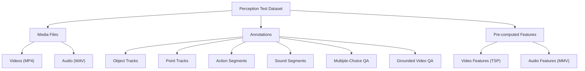
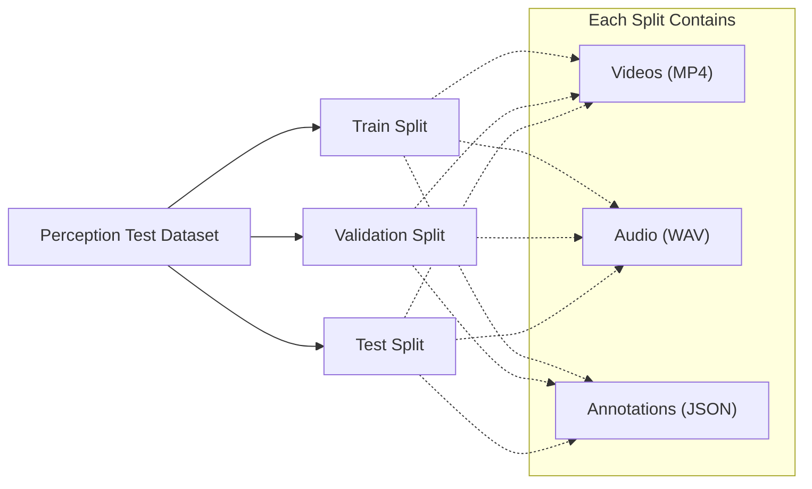
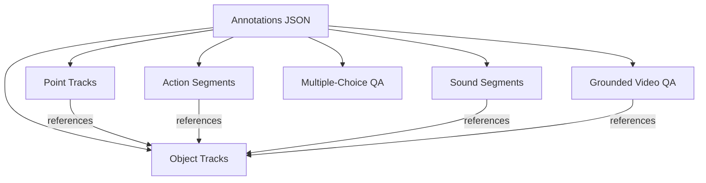
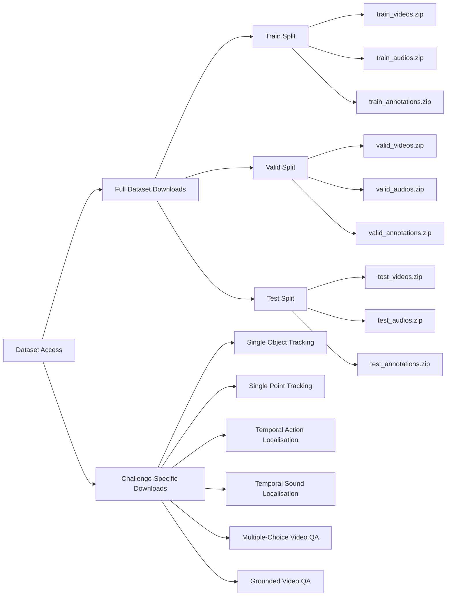

<!-- source: DeepWiki mcp.deepwiki.com · repo google-deepmind/perception_test · page 2 Dataset · fetched 2026-10-26 -->

# Dataset

Relevant source files

The following files were used as context for generating this wiki page:

- [README.md](README.md)

The Perception Test dataset is a comprehensive multimodal benchmark collection designed to evaluate perception and reasoning skills of video understanding models. This document provides detailed information about the dataset's structure, organization, content types, and annotation formats. For information about specific tasks that can be performed using this dataset, see [Tasks](#3).

## Dataset Overview

The Perception Test dataset consists of real-world videos showing perceptually interesting situations, accompanied by audio and detailed annotations. The dataset is specifically designed to test understanding across multiple modalities (visual, audio, and text) and across different perceptual and reasoning skills.

Sources: [README.md:37-43]()

## Dataset Scale and Statistics

The Perception Test dataset contains a substantial number of videos and annotations across different categories:

| Annotation type | Number of videos | Number of annotations |
|-----------------|------------------|------------------------|
| Object tracks | 11,609 | 189,940 |
| Point tracks | 145 | 8,647 |
| Action segments | 11,353 | 73,503 |
| Sound segments | 11,433 | 137,128 |
| Multiple-choice Questions | 10,361 | 38,060 |
| Grounded video Questions | 3,063 | 6,086 |

Sources: [README.md:172-179]()

## Data Organization

The dataset is organized into three primary splits: training, validation, and testing. Each split contains videos, audio, and corresponding annotations.

Sources: [README.md:45-53]()

For certain tasks, only a subset of the videos is used. The repository provides CSV files listing the video IDs specific to each task challenge.

## Data Formats and Structure

### Video and Audio Files

The videos are provided as MP4 files and include the following metadata:

| Field Name | Description |
|------------|-------------|
| split | The data split the video belongs to, one of ['train','valid','test'] |
| video_id | The ID of the video ['video_xxxx'] |
| frame_rate | The frame rate of the video in frames per second |
| num_frames | The total number of frames in the video |
| resolution | The height and width of the video in pixels |
| audio_samples | The total number of audio samples in the video |
| audio_sample_rate | The sample rate of the audio in the video in Hz |
| is_cup_game | Whether the video shows a cups-game or not |
| is_camera_moving | Whether the camera used to film the video is moving or not |

Sources: [README.md:184-195]()

Audio is also provided separately as WAV files, which allows for easier audio-only processing.

### Annotation Structure

The annotations are provided in JSON format and include six different types of annotations. These annotations have relationships between them, as illustrated in the following diagram:

Sources: [README.md:198-272]()

#### Object Tracks

Object tracks are the fundamental annotations in the dataset, with other annotation types often referencing them:

| Field Name | Description |
|------------|-------------|
| id | A unique annotation ID for each object track |
| label | The name of the object, can also contain object attributes, e.g. red box |
| is_occluder | Whether the object occludes other objects in the video (valid only for cups-games videos) |
| bounding_boxes | The coordinates of the object's bounding box in the format [x1,y1,x2,y2] |
| initial_tracking_box | One-hot vector indicating which box annotation should be used to start tracking |
| frame_ids | The IDs of the frames that are annotated, normally 1 per second |
| timestamps | The timestamps of the annotated frames in μs |
| is_masked | Whether the object is masked in the annotated frame (valid only for cups-games videos) |

Sources: [README.md:200-210]()

#### Point Tracks

| Field Name | Description |
|------------|-------------|
| id | A unique annotation ID for each point track |
| label | The label of the point track |
| parent_objects | The id of the object that the point belongs to |
| frame_ids | The IDs of the frames that are annotated |
| points | The coordinates of the points in [y,x] |

Sources: [README.md:214-221]()

#### Action Segments

| Field Name | Description |
|------------|-------------|
| id | A unique annotation ID for each action segment |
| label | The templated class of the action segment |
| parent_objects | The ids of the objects involved in the action |
| timestamps | The start and end timestamps of the action segment in μs |
| frame_ids | The start and end frame IDs of the action segment |
| label_id | A unique class ID for each label in the dataset |

Sources: [README.md:224-232]()

#### Sound Segments

| Field Name | Description |
|------------|-------------|
| id | A unique annotation ID for each sound segment |
| label | The name or class of the sound segment |
| parent_objects | The object ids related to this sound segment |
| timestamps | The start and end timestamps of the sound segment in μs |
| frame_ids | The start and end frame IDs of the sound segment |
| is_visible | Whether the objects causing the sound in this segment are visible |
| label_id | A unique class ID for each label in the dataset |

Sources: [README.md:237-246]()

#### Multiple-Choice Video QA

| Field Name | Description |
|------------|-------------|
| id | A unique annotation ID for each question |
| question | The text of the question |
| options | The possible options for the question (3 options, one correct) |
| answer_id | The ID of the correct option for the question |
| area | The skill area the question pertains to (Memory, Abstraction, Physics, Semantics) |
| reasoning | Type of reasoning required (Descriptive, Explanatory, Predictive, Counterfactual) |
| tag | Different skills involved in answering the question |

Sources: [README.md:251-260]()

#### Grounded Video QA

| Field Name | Description |
|------------|-------------|
| id | A unique annotation ID for each question |
| question | The text of the question |
| answers | List of IDs relating to object tracking annotation IDs |
| area | The skill area the question pertains to |
| reasoning | Type of reasoning required |

Sources: [README.md:265-272]()

## Dataset Access and Downloads

The Perception Test dataset is available for download in various zip files containing videos, audio, and annotations for different splits and tasks.

Sources: [README.md:37-133]()

### Full Dataset Splits

The complete dataset is available as zip files for each split:

| Split | Videos | Audio | Annotations |
|-------|--------|-------|------------|
| Train | train_videos.zip (26.5GB) | train_audios.zip (12.3GB) | train_annotations.zip (30.6MB) |
| Valid | valid_videos.zip (70.2GB) | valid_audios.zip (33.1GB) | valid_annotations.zip (81.5MB) |
| Test | test_videos.zip (41.8GB) | test_audios.zip (19.3GB) | test_annotations.zip (633.9kB) |

Sources: [README.md:47-52]()

### Challenge-Specific Downloads

For certain challenges, smaller subsets of the dataset are provided:

1. **Single Object Tracking**
2. **Single Point Tracking**
3. **Temporal Action Localisation**
4. **Temporal Sound Localisation**
5. **Multiple-Choice Video QA**
6. **Grounded Video QA**

Each challenge has its own specific video IDs and, in some cases, dedicated download links.

Sources: [README.md:59-133]()

## Pre-computed Features

To facilitate model development for certain tasks, the dataset includes pre-computed features:

1. **Video Features (TSP)** - For Temporal Action Localisation
2. **Audio Features (MMV)** - For Temporal Sound Localisation

These features can be used directly for model training without requiring extensive feature extraction preprocessing.

Sources: [README.md:99-114]()

## Special Considerations

For videos where the end reveals answers to certain questions (e.g., cup games), the test videos have the end cut off. For validation and training splits, cutpoint information is provided in JSON files:
- `cut_frame_mapping_train.json`
- `cut_frame_mapping_valid.json`

Sources: [README.md:54-55]()

## Dataset Usage

The Perception Test dataset is designed to be used with the associated tasks and baseline models. For information about specific tasks and how to use the dataset for evaluation, see [Tasks](#3) and [Evaluation](#4).

Sources: [README.md:19-28]()

---

