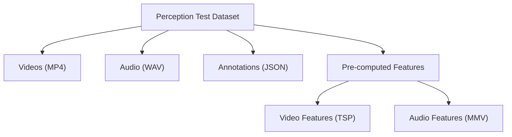
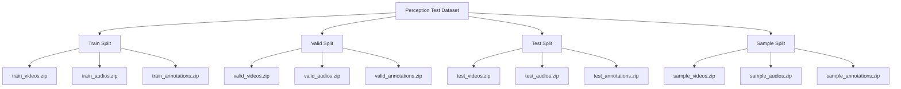
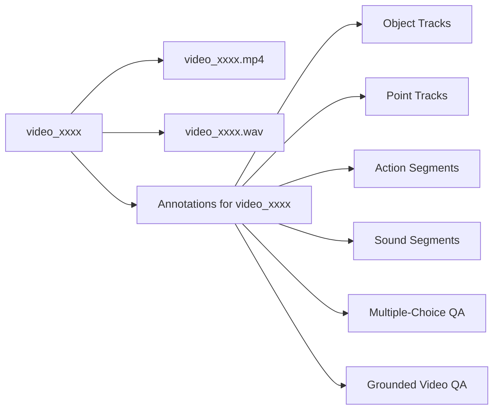
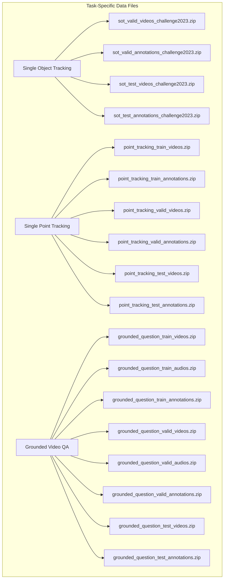
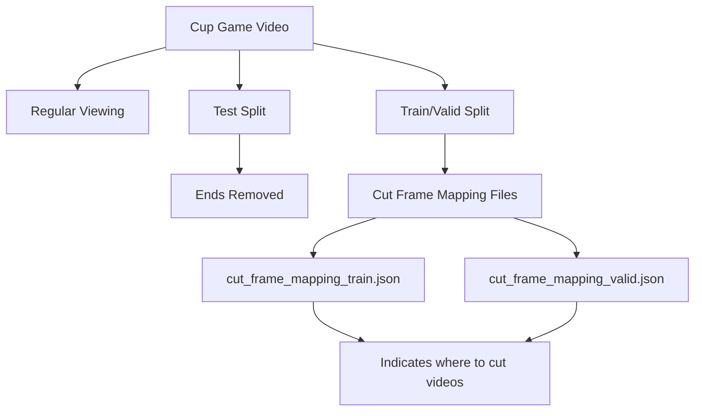

<!-- source: DeepWiki mcp.deepwiki.com · repo google-deepmind/perception_test · page 2.1 Data Organization · fetched 2026-10-26 -->

# Data Organization

Relevant source files

The following files were used as context for generating this wiki page:

- [README.md](README.md)

This document describes the structure, format, and organization of the Perception Test benchmark dataset. It covers how data is divided into splits, the various file formats used, and the organization of task-specific subsets for challenges. For details about the specific contents and schema of annotations, see [Annotation Structure](#2.2).

## Dataset Components

The Perception Test dataset consists of three primary components:

1. **Videos**: MP4 files containing visual content with embedded audio
2. **Audio**: WAV files containing standalone audio tracks
3. **Annotations**: JSON files containing labels, bounding boxes, and other task-specific metadata

In addition, the dataset includes pre-computed features for specific tasks:
- Video features (TSP) for temporal action localization
- Audio features (MMV) for temporal sound localization

Sources: [README.md:37-43](https://github.com/deepmind/perception_test/blob/main/README.md)

## Dataset Splits

The dataset is organized into three main splits:

| Split | Purpose | Videos | Audio | Annotations |
|-------|---------|--------|-------|------------|
| Train | Model training | 26.5GB | 12.3GB | 30.6MB |
| Valid | Model validation | 70.2GB | 33.1GB | 81.5MB |
| Test | Model evaluation | 41.8GB | 19.3GB | 633.9kB |

Additionally, a small sample subset is provided for quick exploration and development.

Sources: [README.md:45-52](https://github.com/deepmind/perception_test/blob/main/README.md)

## File Structure and Naming Conventions

Each data component follows a consistent naming convention:

1. **Main Dataset Splits**:
   - `{split}_videos.zip`: Contains MP4 files with unique video IDs (e.g., video_xxxx)
   - `{split}_audios.zip`: Contains WAV files with matching video IDs
   - `{split}_annotations.zip`: Contains JSON annotation files

2. **Video IDs**:
   - Each video has a unique identifier in the format `video_xxxx`
   - These IDs are consistent across video files, audio files, and annotations

Sources: [README.md:180-196](https://github.com/deepmind/perception_test/blob/main/README.md)

## Task-Specific Data Organization

The dataset is organized to support six computational tasks, with each task potentially using a subset of the full dataset:

1. **Single Object Tracking**
2. **Single Point Tracking**
3. **Temporal Action Localization**
4. **Temporal Sound Localization**
5. **Multiple-Choice Video QA**
6. **Grounded Video QA**

### Video ID Lists for Filtering

For tasks that use subsets of the full dataset, CSV files listing the relevant video IDs are provided:

```mermaid
graph TD
    A["Task Subsets"] --> B["Single Object Tracking"]
    A --> C["Single Point Tracking"]
    A --> D["Temporal Action Localization"]
    A --> E["Temporal Sound Localization"]
    A --> F["Multiple-Choice Video QA"]
    A --> G["Grounded Video QA"]
    
    B --> B1["object_tracking_train_id_list.csv"]
    B --> B2["object_tracking_valid_subset_id_list.csv"]
    B --> B3["object_tracking_test_subset_id_list.csv"]
    
    C --> C1["point_tracking_train_id_list.csv"]
    C --> C2["point_tracking_valid_id_list.csv"]
    C --> C3["point_tracking_test_id_list.csv"]
    
    D --> D1["action_localisation_train_id_list.csv"]
    D --> D2["localisation_challenge_valid_id_list.csv"]
    D --> D3["localisation_challenge_test_id_list.csv"]
    
    E --> E1["sound_localisation_train_id_list.csv"]
    E --> E2["localisation_challenge_valid_id_list.csv"]
    E --> E3["localisation_challenge_test_id_list.csv"]
    
    F --> F1["mc_question_train_id_list.csv"]
    F --> F2["mc_question_valid_id_list.csv"]
    F --> F3["mc_question_test_id_list.csv"]
    
    G --> G1["grounded_question_train_id_list.csv"]
    G --> G2["grounded_question_valid_id_list.csv"]
    G --> G3["grounded_question_test_id_list.csv"]
```

Sources: [README.md:59-70](https://github.com/deepmind/perception_test/blob/main/README.md)

### Task-Specific Data Subsets

For three tasks, smaller task-specific ZIP files are available instead of filtering the full dataset:

1. **Single Object Tracking**:
   - Task-specific validation and test ZIP files
   - Uses the full train dataset

2. **Single Point Tracking**:
   - Task-specific train, validation, and test ZIP files

3. **Grounded Video QA**:
   - Task-specific train, validation, and test ZIP files

For the remaining tasks, users need to filter the full dataset using the provided video ID lists.

Sources: [README.md:76-133](https://github.com/deepmind/perception_test/blob/main/README.md)

## Pre-computed Features

For temporal localization tasks, pre-computed features are provided to simplify model training:

1. **Temporal Action Localization**:
   - `action_localisation_train_video_features.zip`
   - `action_localisation_valid_video_features.zip`
   - `action_localisation_test_video_features.zip`

2. **Temporal Sound Localization**:
   - `sound_localisation_train_audio_features.zip`
   - `sound_localisation_valid_audio_features.zip`
   - `sound_localisation_test_audio_features.zip`

These features are extracted using pre-trained models (TSP for video, MMV for audio) and can be used directly for model training and evaluation.

Sources: [README.md:96-114](https://github.com/deepmind/perception_test/blob/main/README.md)

## Special Handling for Cup Game Videos

In videos featuring cup games (where objects are hidden under cups and moved around), special handling is implemented:

1. **Test Videos**: The end of the video is completely cut off to avoid revealing answers
2. **Train and Valid Videos**: Mapping files are provided to indicate where videos should be cut:
   - `cut_frame_mapping_train.json`
   - `cut_frame_mapping_valid.json`

These files help ensure proper evaluation without giving away answers in tasks that involve tracking objects or answering questions about hidden objects.

Sources: [README.md:54-55](https://github.com/deepmind/perception_test/blob/main/README.md), [README.md:122-124](https://github.com/deepmind/perception_test/blob/main/README.md)

## Recommended Data Loading Workflow

The recommended workflow for working with the Perception Test dataset is:

1. Download the appropriate ZIP files for your task
2. Extract the files to maintain the directory structure
3. Use the provided task-specific ID lists to filter the data if needed
4. For cup game videos, apply the appropriate cut frame mapping
5. Load the videos, audio, and annotations as required by your model

The data organization is designed to make it easy to work with specific tasks while maintaining the relationship between videos, audio, and annotations.

Sources: [README.md:37-133](https://github.com/deepmind/perception_test/blob/main/README.md)

---

