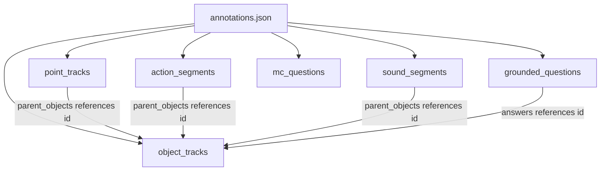
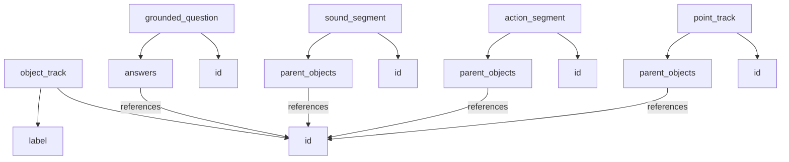
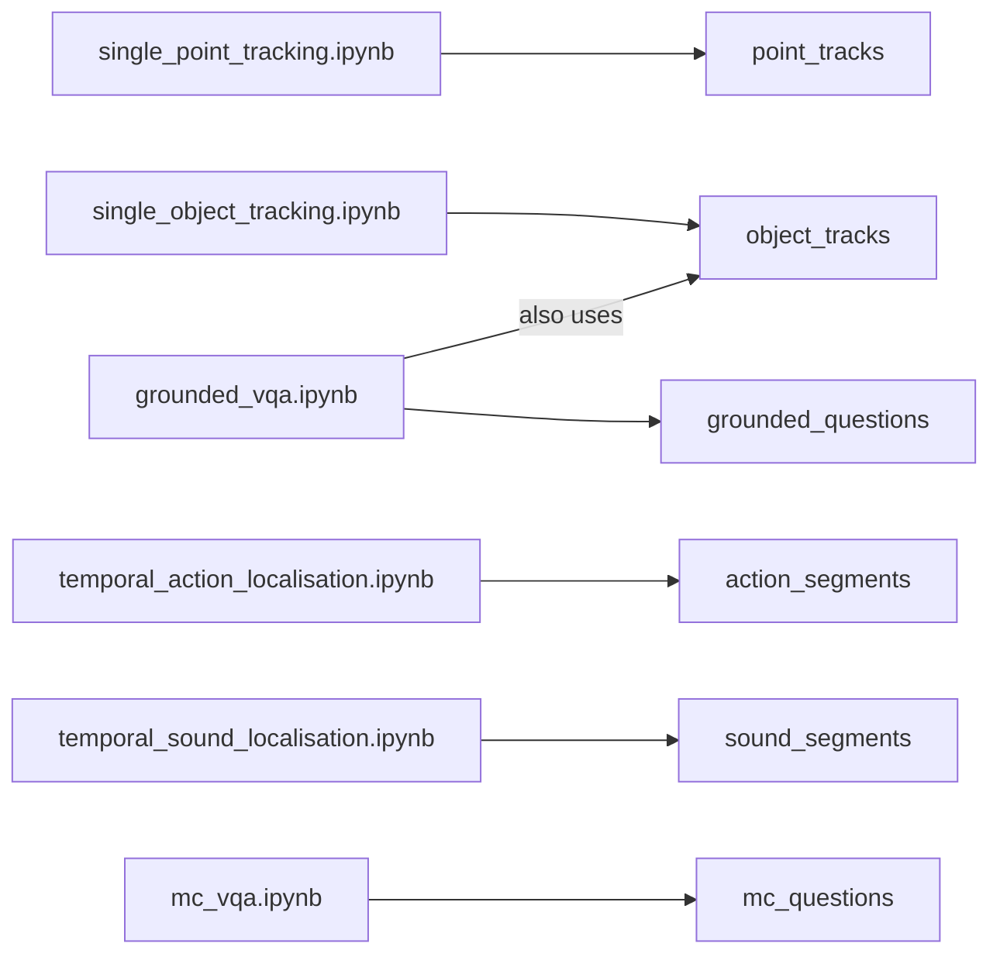

<!-- source: DeepWiki mcp.deepwiki.com · repo google-deepmind/perception_test · page 2.2 Annotation Structure · fetched 2026-10-26 -->

# Annotation Structure

Relevant source files

The following files were used as context for generating this wiki page:

- [README.md](README.md)

This document details the structure and organization of annotations in the Perception Test benchmark. It explains the different annotation types, their fields, and the hierarchical relationships between them. These annotations form the foundation for the six tasks defined in the benchmark.

## Overview

The Perception Test benchmark uses JSON-formatted annotations to provide ground truth data for various perceptual tasks. Annotations are organized by video and include six primary types:

- Object tracks
- Point tracks
- Action segments
- Sound segments
- Multiple-choice video questions
- Grounded video questions

The annotation system follows a hierarchical structure, with object tracks forming the foundation that other annotation types often reference.

### Annotation Structure Hierarchy

Sources: [README.md:167-272]()

## Annotation Types and Fields

Each annotation type has specific fields that define its properties and relationships to other annotations. Below is a detailed description of each annotation type and its fields.

### Video Metadata

Every video in the dataset includes metadata that provides context for all annotations:

| Field Name | Type | Description |
|------------|------|-------------|
| split | string | The data split: 'train', 'valid', or 'test' |
| video_id | string | Unique identifier for the video ('video_xxxx') |
| frame_rate | float | Frame rate in frames per second |
| num_frames | integer | Total number of frames in the video |
| resolution | list | Height and width of the video in pixels |
| audio_samples | integer | Total number of audio samples |
| audio_sample_rate | integer | Audio sample rate in Hz |
| is_cup_game | boolean | Whether the video shows a cups-game |
| is_camera_moving | boolean | Whether the camera is moving |

Sources: [README.md:181-195]()

### Object Tracks

Object tracks are the most fundamental annotation type, representing the position and properties of objects in videos over time.

| Field Name | Type | Description |
|------------|------|-------------|
| id | string | Unique identifier for each object track |
| label | string | Object name and attributes (e.g., "red box") |
| is_occluder | boolean | Whether the object occludes others (cup-games only) |
| bounding_boxes | list | Coordinates in format [x1, y1, x2, y2] for each annotated frame |
| initial_tracking_box | list | One-hot vector indicating which box to use for starting tracking |
| frame_ids | list | IDs of annotated frames (typically 1 per second) |
| timestamps | list | Timestamps of annotated frames in μs |
| is_masked | list | Whether the object is masked in each annotated frame |

Sources: [README.md:198-210]()

### Point Tracks

Point tracks represent the position of specific points on objects over time.

| Field Name | Type | Description |
|------------|------|-------------|
| id | string | Unique identifier for each point track |
| label | string | Label of the point track |
| parent_objects | string | ID of the object that the point belongs to |
| frame_ids | list | IDs of annotated frames |
| points | list | Coordinates of points in [y, x] format |

Sources: [README.md:212-221]()

### Action Segments

Action segments represent temporal intervals during which specific actions occur.

| Field Name | Type | Description |
|------------|------|-------------|
| id | string | Unique identifier for each action segment |
| label | string | Class of the action (e.g., "Putting something into something") |
| parent_objects | list | IDs of objects involved in the action |
| timestamps | list | Start and end timestamps in μs [start, end] |
| frame_ids | list | Start and end frame IDs [start, end] |
| label_id | integer | Unique class ID for the label |

Sources: [README.md:222-232]()

### Sound Segments

Sound segments represent temporal intervals during which specific sounds occur.

| Field Name | Type | Description |
|------------|------|-------------|
| id | string | Unique identifier for each sound segment |
| label | string | Name or class of the sound |
| parent_objects | list | IDs of objects related to the sound |
| timestamps | list | Start and end timestamps in μs [start, end] |
| frame_ids | list | Start and end frame IDs [start, end] |
| is_visible | boolean | Whether objects causing the sound are visible |
| label_id | integer | Unique class ID for the label |

Sources: [README.md:234-246]()

### Multiple-Choice Video Questions

Multiple-choice questions test understanding of video content through selection from options.

| Field Name | Type | Description |
|------------|------|-------------|
| id | string | Unique identifier for each question |
| question | string | Text of the question |
| options | list | Three possible options (only one correct) |
| answer_id | integer | ID of the correct option |
| area | string | Skill area: Memory, Abstraction, Physics, or Semantics |
| reasoning | string | Type of reasoning: Descriptive, Explanatory, Predictive, or Counterfactual |
| tag | list | Different skills involved in answering the question |

Sources: [README.md:248-260]()

### Grounded Video Questions

Grounded video questions require identifying specific objects as answers.

| Field Name | Type | Description |
|------------|------|-------------|
| id | string | Unique identifier for each question |
| question | string | Text of the question |
| answers | list | List of IDs referencing object tracks |
| area | string | Skill area: Memory, Abstraction, Physics, or Semantics |
| reasoning | string | Type of reasoning: Descriptive, Explanatory, Predictive, or Counterfactual |

Sources: [README.md:262-272]()

## Key Annotation Relationships

The annotation types form a structured hierarchy, with several types referencing object tracks:

### Inter-Annotation References

Sources: [README.md:167-272]()

These relationships reflect the structure of video content:
- Point tracks are anchored to parent objects
- Action segments involve specific objects
- Sound segments are associated with objects producing sounds
- Grounded video questions require identifying specific objects

## Task-Annotation Mapping

Each task in the Perception Test benchmark uses specific annotation types as inputs and evaluation targets:

### Task to Annotation Relationship

Sources: [README.md:140-148]()

The mapping shows which annotation files are used by each task:

| Task | Primary Annotation Type | Additional Types |
|------|------------------------|------------------|
| Object Tracking | object_tracks | None |
| Point Tracking | point_tracks | None |
| Action Localization | action_segments | None |
| Sound Localization | sound_segments | None |
| Multiple-Choice Video QA | mc_questions | None |
| Grounded Video QA | grounded_questions | object_tracks |

Sources: [README.md:140-148]()

## Annotation Statistics

The Perception Test dataset includes a substantial number of annotations across all types:

| Annotation Type | Number of Videos | Number of Annotations |
|-----------------|------------------|----------------------|
| Object tracks | 11,609 | 189,940 |
| Point tracks | 145 | 8,647 |
| Action segments | 11,353 | 73,503 |
| Sound segments | 11,433 | 137,128 |
| Multiple-choice Questions | 10,361 | 38,060 |
| Grounded video Questions | 3,063 | 6,086 |

Sources: [README.md:170-180]()

These statistics demonstrate the scale and diversity of annotations available for model training and evaluation.

## Conclusion

The Perception Test benchmark uses a comprehensive annotation structure to support six distinct tasks. Object tracks form the foundation, with other annotation types building upon them through reference relationships. This hierarchical structure reflects real-world relationships between objects, points, actions, sounds, and questions, enabling the evaluation of models across multiple perception and reasoning tasks.

For information about the specific tasks that use these annotations, see [Tasks](#3).

---

