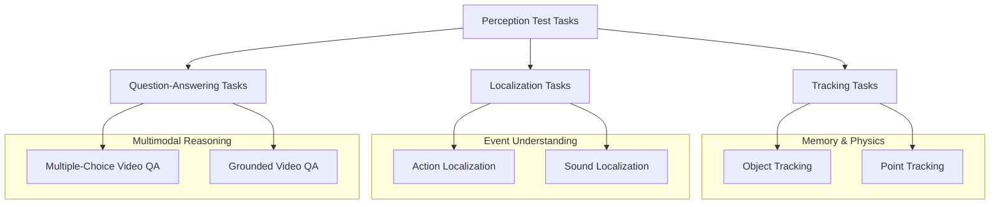
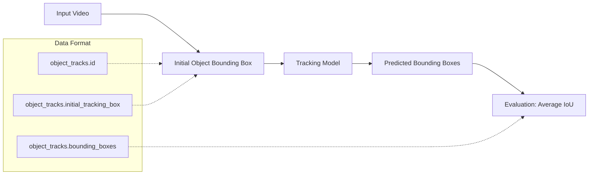
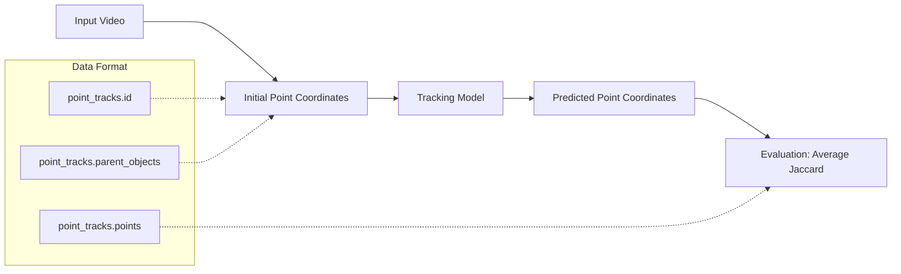
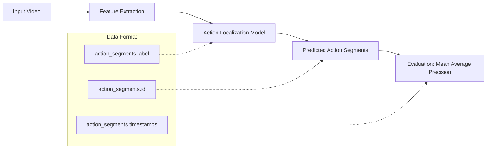
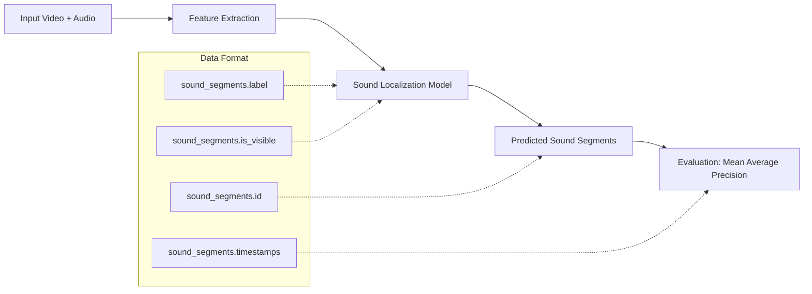
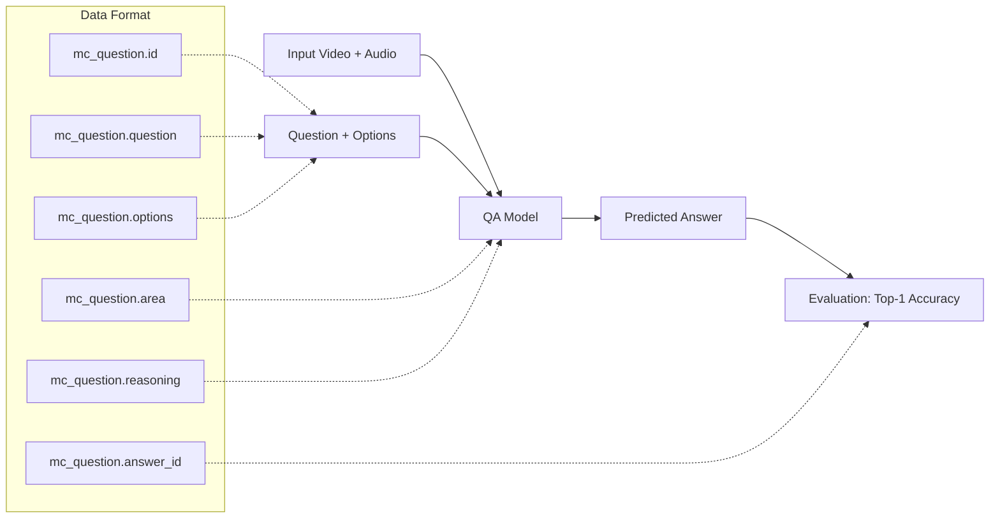
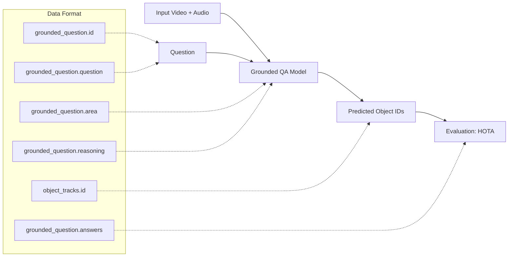
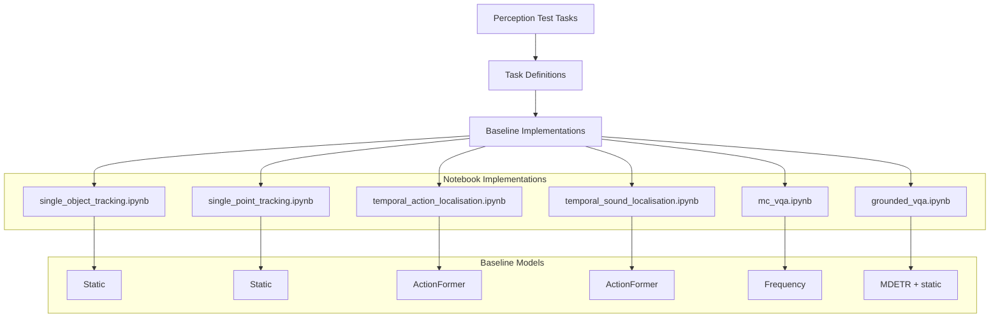

<!-- source: DeepWiki mcp.deepwiki.com · repo google-deepmind/perception_test · page 3 Tasks · fetched 2026-10-26 -->

# Tasks

Relevant source files

The following files were used as context for generating this wiki page:

- [README.md](README.md)

## Purpose and Scope

This page documents the six perceptual and reasoning tasks that comprise the Perception Test benchmark. Each task is designed to evaluate specific capabilities of multimodal video models across visual, audio, and textual modalities. This document covers task definitions, input/output specifications, and performance metrics for each task. For information about the dataset structure and organization, see [Dataset](#2). For evaluation details and metrics computation, see [Evaluation](#4).

## Overview of Tasks

The Perception Test benchmark consists of six distinct tasks organized into three categories: tracking tasks, localization tasks, and question-answering tasks. Each task evaluates different perceptual and reasoning capabilities.

Sources: [README.md:139-147]()

## Task Categories and Relationships

Each task evaluates specific capabilities of multimodal video models and uses defined evaluation metrics to measure performance. The table below summarizes the tasks and their associated metrics:

| Task Category | Task Name | Primary Skill | Evaluation Metric |
|--------------|-----------|---------------|-------------------|
| Tracking     | Object Tracking | Visual tracking, occlusion reasoning | Average IoU |
| Tracking     | Point Tracking | Motion understanding, fine-grained tracking | Average Jaccard |
| Localization | Action Localization | Action recognition, temporal segmentation | Mean Average Precision |
| Localization | Sound Localization | Audio-visual correlation | Mean Average Precision |
| QA           | Multiple-Choice Video QA | Reasoning across modalities | Top-1 Accuracy |
| QA           | Grounded Video QA | Referential understanding | HOTA |

Sources: [README.md:155-162]()

## Tracking Tasks

Tracking tasks evaluate a model's ability to continuously locate and follow objects or points across video frames, testing spatial reasoning and memory capabilities.

### Single Object Tracking

Single Object Tracking requires models to track the position of a specified object throughout a video sequence.

**Task Definition**: Given a video and the initial bounding box of an object in the first frame, predict the bounding box coordinates of the same object in all subsequent frames.

**Input**:
- Video sequence
- Initial object bounding box coordinates [x1, y1, x2, y2]

**Output**:
- Bounding box coordinates for all frames

**Evaluation Metric**: Average Intersection over Union (IoU) between predicted and ground-truth bounding boxes.

**Baseline**: Static baseline that keeps the initial bounding box constant throughout the video.

Sources: [README.md:76-83](), [README.md:142-142](), [README.md:157-157](), [README.md:197-210]()

### Single Point Tracking

Single Point Tracking requires models to track specific points on objects throughout a video sequence.

**Task Definition**: Given a video and the initial coordinates of a point in the first frame, predict the coordinates of the same point in all subsequent frames.

**Input**:
- Video sequence
- Initial point coordinates [y, x]

**Output**:
- Point coordinates for all frames

**Evaluation Metric**: Average Jaccard similarity between predicted and ground-truth points.

**Baseline**: Static baseline that keeps the initial point location constant throughout the video.

Sources: [README.md:86-93](), [README.md:143-143](), [README.md:158-158](), [README.md:212-221]()

## Localization Tasks

Localization tasks evaluate a model's ability to identify when specific events occur in videos, testing temporal reasoning and multimodal understanding.

### Temporal Action Localization

Temporal Action Localization requires models to identify when specific actions occur within a video.

**Task Definition**: Given a video, identify all action segments and classify them according to predefined action categories.

**Input**:
- Video sequence
- Optional pre-computed TSP video features

**Output**:
- List of detected action segments with start/end timestamps and class labels

**Evaluation Metric**: Mean Average Precision (mAP) at various temporal IoU thresholds.

**Baseline**: ActionFormer model fine-tuned on Perception Test data.

Sources: [README.md:96-103](), [README.md:144-144](), [README.md:159-159](), [README.md:222-232]()

### Temporal Sound Localization

Temporal Sound Localization requires models to identify when specific sounds occur within a video's audio track.

**Task Definition**: Given a video with audio, identify all sound segments and classify them according to predefined sound categories.

**Input**:
- Video sequence with audio
- Optional pre-computed MMV audio features

**Output**:
- List of detected sound segments with start/end timestamps and class labels

**Evaluation Metric**: Mean Average Precision (mAP) at various temporal IoU thresholds.

**Baseline**: ActionFormer model fine-tuned on Perception Test data.

Sources: [README.md:107-114](), [README.md:145-145](), [README.md:160-160](), [README.md:235-246]()

## Question-Answering Tasks

Question-Answering tasks evaluate a model's ability to reason about video content and answer natural language questions, testing high-level understanding and integration of multiple modalities.

### Multiple-Choice Video QA

Multiple-Choice Video QA requires models to answer questions about video content by selecting from provided options.

**Task Definition**: Given a video and a question with multiple-choice options, select the correct answer from the options.

**Input**:
- Video sequence with audio
- Question text
- Answer options (3 choices)

**Output**:
- Selected answer option ID

**Evaluation Metric**: Top-1 Accuracy.

**Baseline**: Frequency baseline using statistics from training question/answer pairs.

Sources: [README.md:117-124](), [README.md:146-146](), [README.md:161-161](), [README.md:249-260]()

### Grounded Video QA

Grounded Video QA requires models to answer questions about video content by identifying specific objects in the video.

**Task Definition**: Given a video and a question, identify the object(s) in the video that correctly answer the question.

**Input**:
- Video sequence with audio
- Question text

**Output**:
- List of object IDs that answer the question

**Evaluation Metric**: Higher Order Tracking Accuracy (HOTA) between predicted and ground-truth object references.

**Baseline**: MDETR for open-vocabulary object detection combined with static tracking.

Sources: [README.md:126-133](), [README.md:147-147](), [README.md:162-162](), [README.md:263-272]()

## Task Implementation and Code Organization

The following diagram shows how the task definitions relate to their baseline implementations in the codebase:

The implementation of each task is provided in separate Jupyter notebooks, which serve as examples for loading data, implementing baseline models, and evaluating performance.

Sources: [README.md:137-147](), [README.md:155-162]()

## Skill Areas and Reasoning Types

Each task in the Perception Test is designed to evaluate specific skill areas and reasoning types:

| Skill Area | Description | Related Tasks |
|------------|-------------|---------------|
| Memory | Ability to track and recall events | Object Tracking, Point Tracking, Multiple-Choice QA, Grounded QA |
| Abstraction | Understanding patterns and generalizations | Multiple-Choice QA, Grounded QA |
| Physics | Understanding physical interactions | Object Tracking, Point Tracking, Action Localization, Multiple-Choice QA, Grounded QA |
| Semantics | Understanding meaning and relationships | Action Localization, Sound Localization, Multiple-Choice QA, Grounded QA |

| Reasoning Type | Description | Related Tasks |
|----------------|-------------|---------------|
| Descriptive | What is happening | Multiple-Choice QA, Grounded QA |
| Explanatory | Why something happened | Multiple-Choice QA, Grounded QA |
| Predictive | What will happen next | Multiple-Choice QA, Grounded QA |
| Counterfactual | What would happen if | Multiple-Choice QA, Grounded QA |

These skill areas and reasoning types are explicitly annotated for the question-answering tasks and implicitly tested in the tracking and localization tasks.

Sources: [README.md:249-260](), [README.md:263-272]()

---

