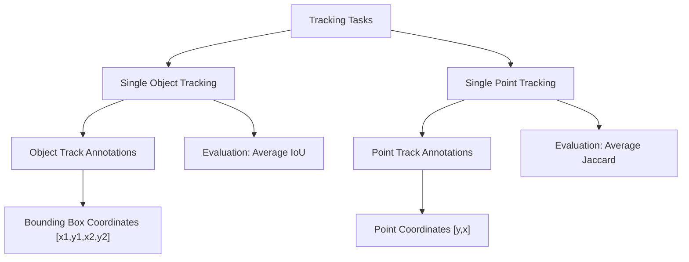
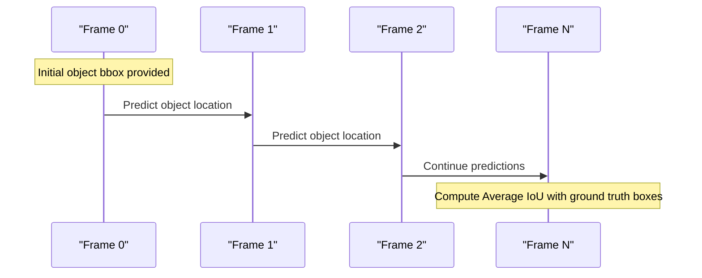
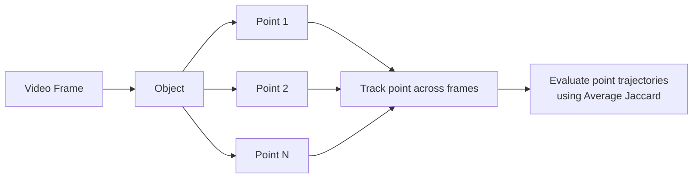
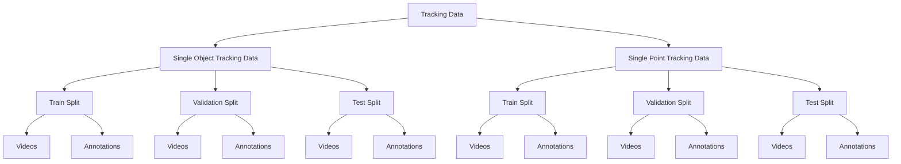
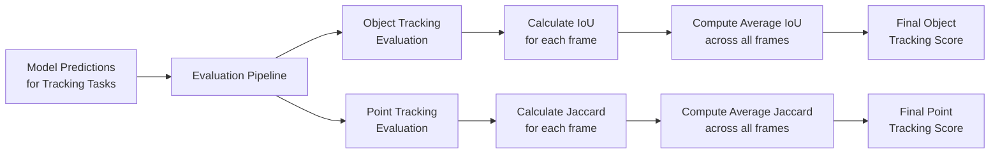
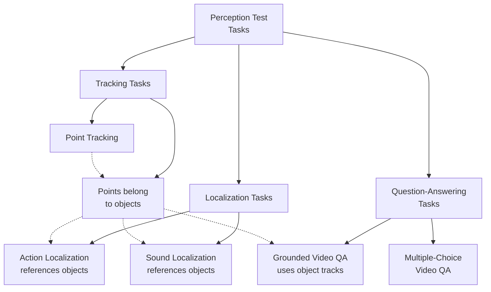

<!-- source: DeepWiki mcp.deepwiki.com · repo google-deepmind/perception_test · page 3.1 Tracking Tasks · fetched 2026-10-26 -->

# Tracking Tasks

<details>
<summary>Relevant source files</summary>

The following files were used as context for generating this wiki page:

- [README.md](README.md)

</details>


This document provides detailed information about the tracking tasks in the Perception Test benchmark. Tracking tasks evaluate a model's ability to follow objects or specific points as they move across video frames. This document focuses on the two tracking tasks in the benchmark: Single Object Tracking and Single Point Tracking. For information about other tasks such as localization or question-answering, see [Localization Tasks](#3.2) and [Question-Answering Tasks](#3.3).

## Overview

Tracking tasks assess models' core visual perception capabilities, specifically their ability to maintain consistent identity for objects and points as they move in videos, including when they undergo visual transformations or temporary occlusions.



Sources: README.md

## Task Definitions

### Single Object Tracking (SOT)

Single Object Tracking requires models to track a specific object throughout a video sequence. The model is provided with the initial bounding box of the target object in the first frame, and it must predict the object's location (as a bounding box) in all subsequent frames.



Sources: README.md

### Single Point Tracking (SPT)

Single Point Tracking requires models to track specific points on objects throughout a video sequence. These points may be on articulated objects (e.g., joints of a human body) or rigid objects (e.g., corners of a box). The model must predict the precise location of these points in each frame.

The point tracking task differs from object tracking in that it requires more precise localization at the pixel level rather than region level.



Sources: README.md

## Annotation Structure

### Object Tracking Annotations

Object tracking annotations provide frame-by-frame locations of objects as bounding boxes.

| Field Name | Description |
|------------|-------------|
| id | Unique annotation ID for each object track |
| label | Object name, possibly with attributes (e.g., "red box") |
| is_occluder | Whether the object occludes others (valid only for cups-games) |
| bounding_boxes | Object coordinates as [x1,y1,x2,y2] with shape [n,4] where n is the number of annotated frames |
| initial_tracking_box | One-hot vector indicating which box annotation should be used to start tracking |
| frame_ids | IDs of annotated frames, typically 1 per second (e.g., 0, 30, 60) |
| timestamps | Timestamps of annotated frames in μs |
| is_masked | Whether the object is masked in the annotated frame (valid only for cups-games) |

Sources: README.md

### Point Tracking Annotations

Point tracking annotations provide frame-by-frame locations of specific points as coordinate pairs.

| Field Name | Description |
|------------|-------------|
| id | Unique annotation ID for each point track |
| label | Label of the point track |
| parent_objects | ID of the object the point belongs to |
| frame_ids | IDs of annotated frames, typically sequential (0, 1, 2, etc.) |
| points | Coordinates of points as [y,x] with shape [N,2] where N is the total number of points in the track |

Sources: README.md

## Data Organization

The tracking tasks data is organized into train, validation, and test splits. Each split contains videos and corresponding annotations.



Sources: README.md

### Data Downloads

#### Single Object Tracking

| Split | Videos | Annotations |
|-------|--------|-------------|
| Train | Full dataset download | Full dataset download |
| Valid | [sot_valid_videos_challenge2023.zip (11.6GB)](https://storage.googleapis.com/dm-perception-test/zip_data/sot_valid_videos_challenge2023.zip) | [sot_valid_annotations_challenge2023.zip (9MB)](https://storage.googleapis.com/dm-perception-test/zip_data/sot_valid_annotations_challenge2023.zip) |
| Test | [sot_test_videos_challenge2023.zip (12.1GB)](https://storage.googleapis.com/dm-perception-test/zip_data/sot_test_videos_challenge2023.zip) | [sot_test_annotations_challenge2023.zip (613kB)](https://storage.googleapis.com/dm-perception-test/zip_data/sot_test_annotations_challenge2023.zip) |

**Video IDs:** 
- Train: [object_tracking_train_id_list.csv](https://storage.googleapis.com/dm-perception-test/misc/object_tracking_train_id_list.csv)
- Valid: [object_tracking_valid_subset_id_list.csv](https://storage.googleapis.com/dm-perception-test/misc/object_tracking_valid_subset_id_list.csv) 
- Test: [object_tracking_test_subset_id_list.csv](https://storage.googleapis.com/dm-perception-test/misc/object_tracking_test_subset_id_list.csv)

#### Single Point Tracking

| Split | Videos | Annotations |
|-------|--------|-------------|
| Train | [point_tracking_train_videos.zip (398.4MB)](https://storage.googleapis.com/dm-perception-test/zip_data/point_tracking_train_videos.zip) | [point_tracking_train_annotations.zip (4.7MB)](https://storage.googleapis.com/dm-perception-test/zip_data/point_tracking_train_annotations.zip) |
| Valid | [point_tracking_valid_videos.zip (1.1GB)](https://storage.googleapis.com/dm-perception-test/zip_data/point_tracking_valid_videos.zip) | [point_tracking_valid_annotations.zip (11.1MB)](https://storage.googleapis.com/dm-perception-test/zip_data/point_tracking_valid_annotations.zip) |
| Test | [point_tracking_test_videos.zip (691MB)](https://storage.googleapis.com/dm-perception-test/zip_data/point_tracking_test_videos.zip) | [point_tracking_test_annotations.zip (42.2kB)](https://storage.googleapis.com/dm-perception-test/zip_data/point_tracking_test_annotations.zip) |

**Video IDs:** 
- Train: [point_tracking_train_id_list.csv](https://storage.googleapis.com/dm-perception-test/misc/point_tracking_train_id_list.csv)
- Valid: [point_tracking_valid_id_list.csv](https://storage.googleapis.com/dm-perception-test/misc/point_tracking_valid_id_list.csv)
- Test: [point_tracking_test_id_list.csv](https://storage.googleapis.com/dm-perception-test/misc/point_tracking_test_id_list.csv)

Sources: README.md

## Evaluation Metrics

### Single Object Tracking: Average IoU

The Average Intersection over Union (IoU) measures the overlap between predicted bounding boxes and ground truth boxes across all frames. For each frame, IoU is calculated as:

```
IoU = Area of Overlap / Area of Union
```

The final score is the average of IoU values across all frames.

### Single Point Tracking: Average Jaccard

The Average Jaccard metric measures precision in point tracking. For each frame, it calculates the Jaccard similarity between the predicted point and ground truth point, considering a threshold distance. The final score is the average of Jaccard similarities across all frames.



Sources: README.md

## Baseline Implementations

The Perception Test benchmark provides simple baseline implementations for both tracking tasks.

### Static Object Tracking Baseline

The static object tracking baseline assumes that objects don't move throughout the video. It simply keeps the initial bounding box constant across all frames.

Implementation: [single_object_tracking.ipynb](https://github.com/deepmind/perception_test/blob/main/baselines/single_object_tracking.ipynb)

### Static Point Tracking Baseline

Similarly, the static point tracking baseline assumes points remain in the same location throughout the video. It uses the initial point coordinates for all frames.

Implementation: [single_point_tracking.ipynb](https://github.com/deepmind/perception_test/blob/main/baselines/single_point_tracking.ipynb)

Sources: README.md

## Challenges

Both tracking tasks have dedicated challenge tracks on the evaluation platform. Models can be submitted for evaluation on the test set, with performances ranked on a leaderboard.

| Task | Challenge Platform |
|------|-------------------|
| Single Object Tracking | [eval.ai challenge](https://eval.ai/web/challenges/challenge-page/2094/overview) |
| Single Point Tracking | [eval.ai challenge](https://eval.ai/web/challenges/challenge-page/2108/overview) |

Sources: README.md

## Relationship with Other Tasks



In the Perception Test benchmark, tracking tasks form a foundational component. Object tracks are referenced by other task annotations, including:

- Point tracks (which reference parent objects)
- Action segments (which reference parent objects)
- Sound segments (which reference parent objects)
- Grounded Video QA (which references objects as answers)

This interconnected structure highlights how tracking capabilities support other perception and reasoning skills in multimodal understanding.

Sources: README.md

---

