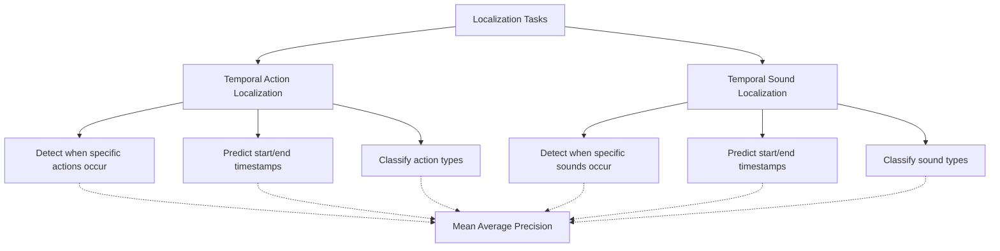
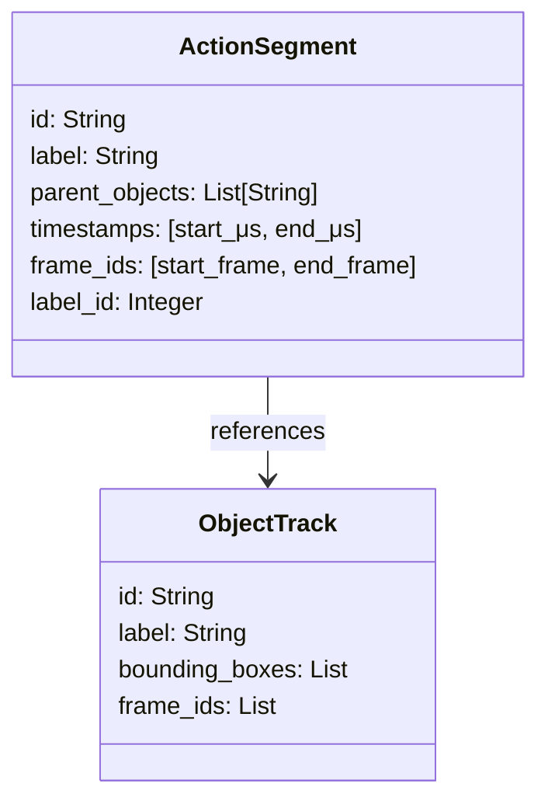
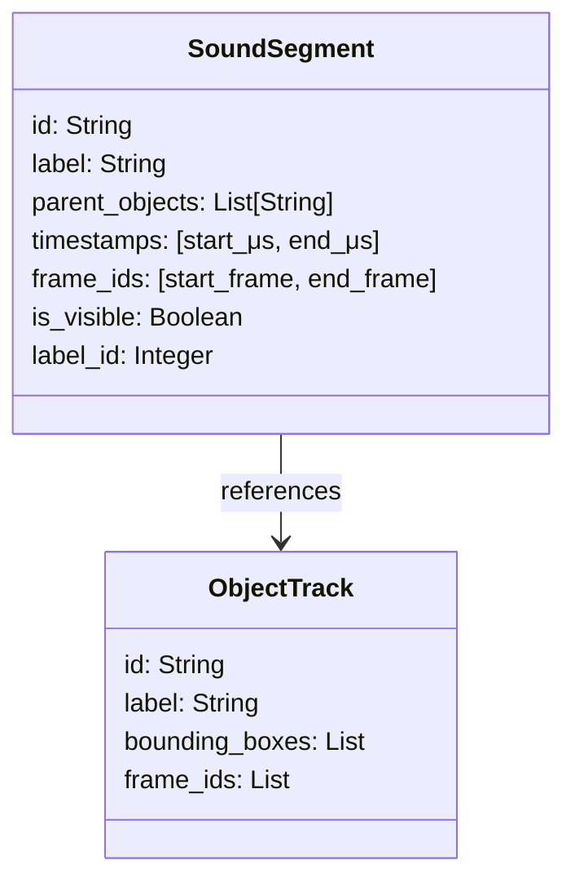
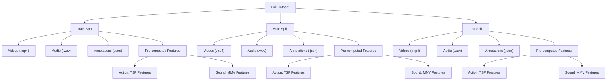
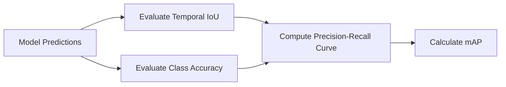
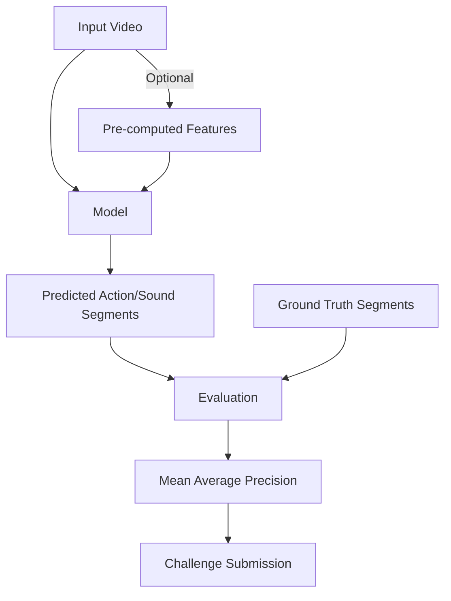
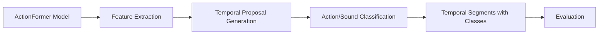

<!-- source: DeepWiki mcp.deepwiki.com · repo google-deepmind/perception_test · page 3.2 Localization Tasks · fetched 2026-10-26 -->

# Localization Tasks

Relevant source files

The following files were used as context for generating this wiki page:

- [README.md](README.md)

## Purpose and Scope

This document provides technical documentation for the temporal localization tasks within the Perception Test benchmark. It covers two specific tasks:

1. Temporal Action Localization
2. Temporal Sound Localization

Both tasks involve detecting and temporally localizing events within videos, requiring models to identify when specific actions or sounds occur. For information about tracking tasks, see [Tracking Tasks](#3.1), and for question-answering tasks, see [Question-Answering Tasks](#3.3).

## Task Definitions

### Task Overview

Sources: [README.md:158-162]()

### Temporal Action Localization

Temporal Action Localization requires models to detect when specific actions occur within a video by identifying the start and end timestamps of action segments and classifying the action types. 

Actions follow a templated class format (e.g., "Putting something into something") and may involve one or more objects within the scene.

### Temporal Sound Localization

Temporal Sound Localization requires models to detect when specific sounds occur within a video by identifying the start and end timestamps of sound segments and classifying the sound types.

Sound segments may be associated with objects in the scene, and the system tracks whether the objects causing the sounds are visible or not.

## Data Structure

### Action Segments

Sources: [README.md:222-231]()

Action segments have the following structure:

| Field Name | Type | Description |
|------------|------|-------------|
| id | String | Unique annotation ID for each action segment |
| label | String | Templated class of the action (e.g., "Putting something into something") |
| parent_objects | List[String] | IDs of objects involved in the action (can be empty, single, multiple, or -1) |
| timestamps | [int, int] | Start and end timestamps in microseconds |
| frame_ids | [int, int] | Start and end frame IDs |
| label_id | Integer | Unique class ID for each label in the dataset |

### Sound Segments

Sources: [README.md:235-245]()

Sound segments have the following structure:

| Field Name | Type | Description |
|------------|------|-------------|
| id | String | Unique annotation ID for each sound segment |
| label | String | Name or class of the sound segment |
| parent_objects | List[String] | Object IDs related to this sound segment (can be empty, single, multiple, or -1) |
| timestamps | [int, int] | Start and end timestamps in microseconds |
| frame_ids | [int, int] | Start and end frame IDs |
| is_visible | Boolean | Whether objects causing the sound are visible |
| label_id | Integer | Unique class ID for each label in the dataset |

## Dataset Organization

### Dataset Statistics

The Perception Test contains extensive annotations for both localization tasks:

| Annotation type | Number of videos | Number of annotations |
|-----------------|------------------|----------------------|
| Action segments | 11,353 | 73,503 |
| Sound segments | 11,433 | 137,128 |

Sources: [README.md:171-179]()

### Data Flow and Organization

Sources: [README.md:98-114]()

For the localization tasks, the dataset provides:

1. **Full Dataset**: Train, validation, and test splits
2. **Video & Audio**: MP4 and WAV files for each split
3. **Task-specific Annotations**: JSON files containing temporal segment annotations
4. **Pre-computed Features**:
   - Action Localization: TSP (Temporal Segment Proposal) features
   - Sound Localization: MMV (MultiModal Video) audio features

### Challenge Subset Selection

The challenge provides ID lists to filter the dataset for specific tasks:

| Task | Train IDs | Valid IDs | Test IDs |
|------|-----------|-----------|----------|
| Temporal Action Localization | action_localisation_train_id_list.csv | localisation_challenge_valid_id_list.csv | localisation_challenge_test_id_list.csv |
| Temporal Sound Localization | sound_localisation_train_id_list.csv | localisation_challenge_valid_id_list.csv | localisation_challenge_test_id_list.csv |

Sources: [README.md:66-68]()

## Evaluation Process

### Metrics

Both localization tasks use Mean Average Precision (mAP) as the evaluation metric. This metric evaluates:

1. The temporal accuracy of the predicted segments
2. The classification accuracy of the predicted action/sound types

Sources: [README.md:159-161]()

### Evaluation Workflow

Sources: [README.md:149-160]()

## Baseline Models

Both localization tasks use ActionFormer models fine-tuned on Perception Test data as baselines.

Sources: [README.md:138-145]()

### Implementation Details

| Task | Baseline | Implementation |
|------|----------|----------------|
| Temporal Action Localization | ActionFormer | temporal_action_localisation.ipynb |
| Temporal Sound Localization | ActionFormer | temporal_sound_localisation.ipynb |

Sources: [README.md:144-145]()

The ActionFormer baseline:
1. Takes pre-computed features as input
2. Generates temporal proposals for action/sound segments
3. Classifies each proposed segment
4. Outputs segments with start/end times and class labels

## Usage Example

A typical workflow for these tasks would include:

1. **Data Preparation**:
   - Download the full dataset or task-specific subsets
   - Extract videos, audio, annotations, and pre-computed features

2. **Model Development**:
   - Train a model using the provided training data
   - Use the baseline notebooks as starting points

3. **Evaluation**:
   - Run the model on validation/test data
   - Evaluate using the Mean Average Precision metric
   - Submit results to the challenge

Sources: [README.md:98-114](), [README.md:138-145]()

---

