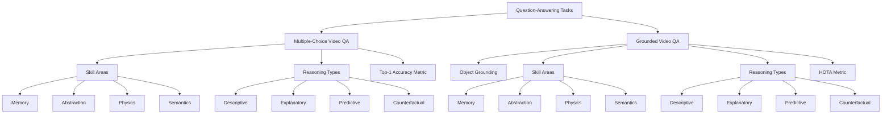
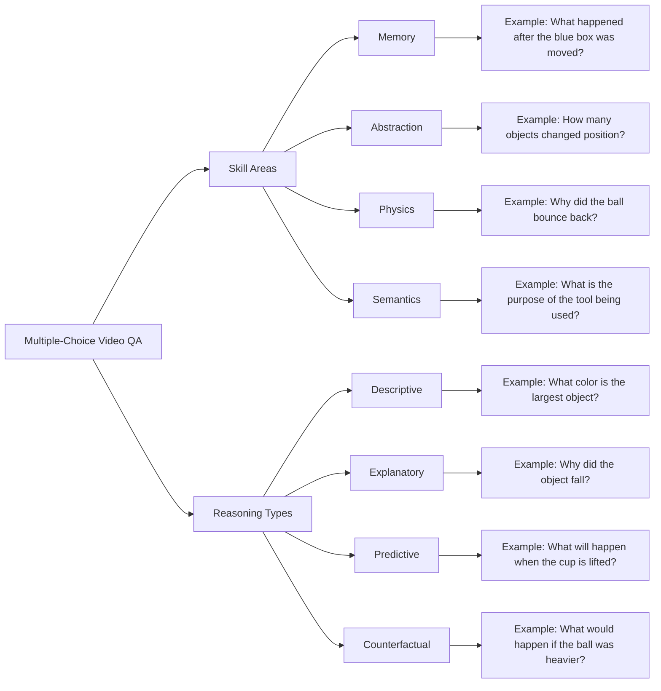
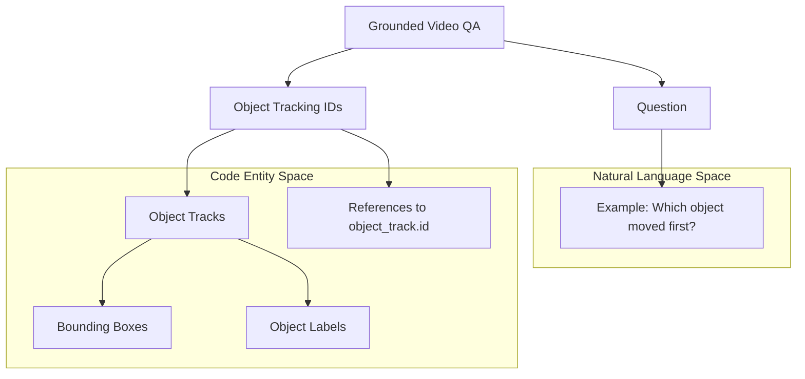
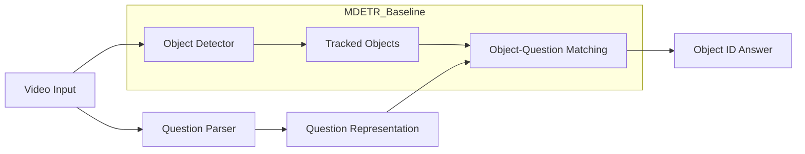
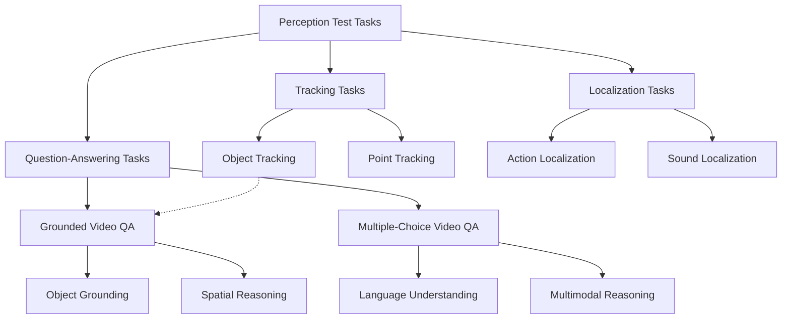

<!-- source: DeepWiki mcp.deepwiki.com · repo google-deepmind/perception_test · page 3.3 Question-Answering Tasks · fetched 2026-10-26 -->

# Question-Answering Tasks

Relevant source files

The following files were used as context for generating this wiki page:

- [README.md](README.md)

This document provides a comprehensive overview of the question-answering tasks in the Perception Test benchmark. The benchmark includes two distinct question-answering tasks that evaluate a model's ability to perceive and reason about multimodal video content: Multiple-Choice Video QA and Grounded Video QA. These tasks assess different aspects of perception and reasoning across visual, audio, and text modalities.

For information about other tasks in the benchmark, see [Tracking Tasks](#3.1) and [Localization Tasks](#3.2).

## Overview of Question-Answering Tasks

The question-answering tasks in Perception Test evaluate a model's ability to understand video content and answer questions that require different types of reasoning and perceptual skills.

Sources: [README.md:248-272]()

## Multiple-Choice Video QA

The Multiple-Choice Video QA task requires models to answer questions about video content by selecting the correct option from three choices. This task tests comprehension and reasoning across different skill areas and reasoning types.

### Task Description

Models are provided with:
- A video with audio
- A question about the video content
- Three possible answer options

The model must select the correct answer option. Questions may require understanding of the visual content, audio content, or both.

### Annotation Structure

Multiple-Choice Video QA annotations include the following fields:

| Field Name | Description |
|------------|-------------|
| id | A unique annotation ID for each question |
| question | The text of the question |
| options | Three possible options for the question (only one is correct) |
| answer_id | The ID of the correct option |
| area | The skill area: Memory, Abstraction, Physics, or Semantics |
| reasoning | The reasoning type: Descriptive, Explanatory, Predictive, or Counterfactual |
| tag | Different skills involved in answering the question (can have multiple tags) |

Sources: [README.md:249-260]()

### Dataset Scale

The Multiple-Choice Video QA task includes:
- 38,060 questions across 10,361 videos
- Split across train, validation, and test sets

Sources: [README.md:172-179]()

### Skill Areas and Reasoning Types

Sources: [README.md:249-260]()

### Evaluation Metric

The evaluation metric for Multiple-Choice Video QA is Top-1 Accuracy, which measures the percentage of questions for which the model selects the correct answer option.

### Baseline Approach

The baseline model for this task is a "Frequency" baseline that uses statistics from training question/answer pairs to make predictions.

Sources: [README.md:146](), [README.md:155-162]()

## Grounded Video QA

The Grounded Video QA task requires models to answer questions by identifying specific objects in the video. This task evaluates spatial understanding and object localization in addition to reasoning.

### Task Description

Models are provided with:
- A video with audio
- A question about objects in the video
- Object tracking annotations

The model must identify the correct object(s) in the video that answer the question, by referencing object IDs from the tracking annotations.

### Annotation Structure

Grounded Video QA annotations include the following fields:

| Field Name | Description |
|------------|-------------|
| id | A unique annotation ID for each question |
| question | The text of the question |
| answers | List of object tracking annotation IDs that answer the question |
| area | The skill area: Memory, Abstraction, Physics, or Semantics |
| reasoning | The reasoning type: Descriptive, Explanatory, Predictive, or Counterfactual |

Sources: [README.md:263-272]()

### Dataset Scale

The Grounded Video QA task includes:
- 6,086 questions across 3,063 videos
- Split across train, validation, and test sets

Sources: [README.md:172-179]()

### Connection with Object Tracking

Sources: [README.md:263-272](), [README.md:198-210]()

### Data Flow and Processing

Sources: [README.md:147]()

### Evaluation Metric

The evaluation metric for Grounded Video QA is HOTA (Higher Order Tracking Accuracy), which combines detection accuracy and association accuracy to evaluate object tracking performance in the context of answering questions.

Sources: [README.md:155-162]()

### Baseline Approach

The baseline model for this task is "MDETR + static", which uses MDETR for open-vocabulary object detection and keeps the detected objects static throughout the video.

Sources: [README.md:147]()

## Relationship with Other Tasks

The question-answering tasks build upon and complement other tasks in the Perception Test benchmark:

Sources: [README.md:9-20]()

## Dataset Access and Usage

To access and use the Question-Answering task data:

### Multiple-Choice Video QA

| Split | Videos | Audio | Labels |
|-------|--------|-------|--------|
| Train | Use full split download | Use full split download | [mc_question_train_annotations.zip](https://storage.googleapis.com/dm-perception-test/zip_data/mc_question_train_annotations.zip), [cut_frame_mapping_train.json](https://storage.googleapis.com/dm-perception-test/misc/cut_frame_mapping_train.json) |
| Valid | Use full split download | Use full split download | [mc_question_valid_annotations.zip](https://storage.googleapis.com/dm-perception-test/zip_data/mc_question_valid_annotations.zip), [cut_frame_mapping_valid.json](https://storage.googleapis.com/dm-perception-test/misc/cut_frame_mapping_valid.json) |
| Test | Use full split download | Use full split download | [mc_question_test_annotations.zip](https://storage.googleapis.com/dm-perception-test/zip_data/mc_question_test_annotations.zip) |

Video IDs for each split can be obtained from:
- Train: [mc_question_train_id_list.csv](https://storage.googleapis.com/dm-perception-test/misc/mc_question_train_id_list.csv)
- Valid: [mc_question_valid_id_list.csv](https://storage.googleapis.com/dm-perception-test/misc/mc_question_valid_id_list.csv)
- Test: [mc_question_test_id_list.csv](https://storage.googleapis.com/dm-perception-test/misc/mc_question_test_id_list.csv)

Sources: [README.md:117-124](), [README.md:64-70]()

### Grounded Video QA

| Split | Videos | Audio | Labels |
|-------|--------|-------|--------|
| Train | [grounded_question_train_videos.zip](https://storage.googleapis.com/dm-perception-test/zip_data/grounded_question_train_videos.zip) | [grounded_question_train_audios.zip](https://storage.googleapis.com/dm-perception-test/zip_data/grounded_question_train_audios.zip) | [grounded_question_train_annotations.zip](https://storage.googleapis.com/dm-perception-test/zip_data/grounded_question_train_annotations.zip) |
| Valid | [grounded_question_valid_videos.zip](https://storage.googleapis.com/dm-perception-test/zip_data/grounded_question_valid_videos.zip) | [grounded_question_valid_audios.zip](https://storage.googleapis.com/dm-perception-test/zip_data/grounded_question_valid_audios.zip) | [grounded_question_valid_annotations.zip](https://storage.googleapis.com/dm-perception-test/zip_data/grounded_question_valid_annotations.zip) |
| Test | [grounded_question_test_videos.zip](https://storage.googleapis.com/dm-perception-test/zip_data/grounded_question_test_videos.zip) | - | [grounded_question_test_annotations.zip](https://storage.googleapis.com/dm-perception-test/zip_data/grounded_question_test_annotations.zip) |

Video IDs for each split can be obtained from:
- Train: [grounded_question_train_id_list.csv](https://storage.googleapis.com/dm-perception-test/misc/grounded_question_train_id_list.csv)
- Valid: [grounded_question_valid_id_list.csv](https://storage.googleapis.com/dm-perception-test/misc/grounded_question_valid_id_list.csv)
- Test: [grounded_question_test_id_list.csv](https://storage.googleapis.com/dm-perception-test/misc/grounded_question_test_id_list.csv)

Sources: [README.md:126-133](), [README.md:64-70]()

## Baselines Implementation

Baseline implementations for the question-answering tasks are provided in the repository:

- Multiple-Choice Video QA: [baselines/mc_vqa.ipynb](https://github.com/deepmind/perception_test/blob/main/baselines/mc_vqa.ipynb)
- Grounded Video QA: [baselines/grounded_vqa.ipynb](https://github.com/deepmind/perception_test/blob/main/baselines/grounded_vqa.ipynb)

These notebooks include code for loading the data, implementing the baseline models, and evaluating performance.

Sources: [README.md:137-147]()

---

