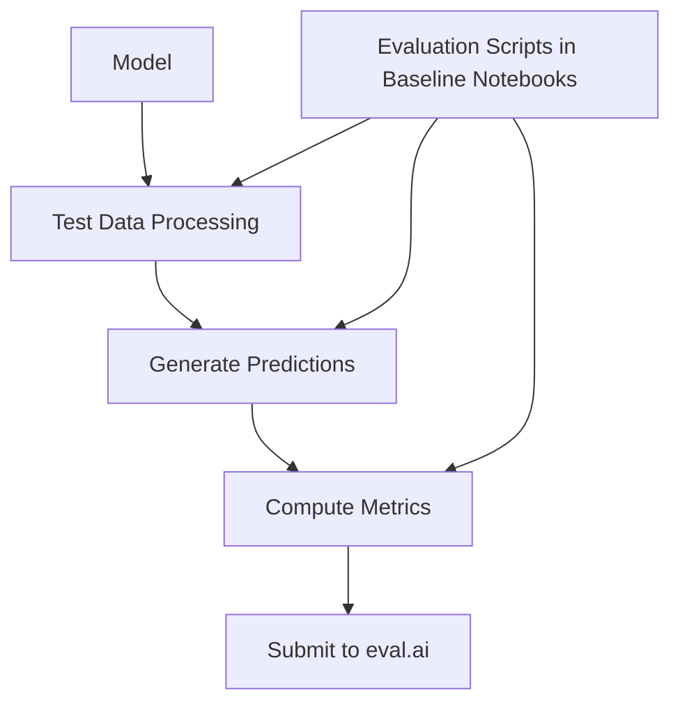
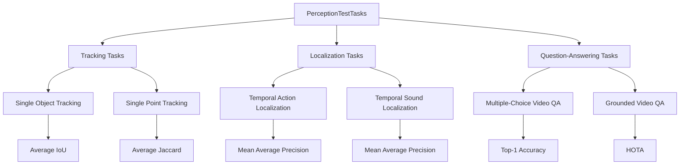
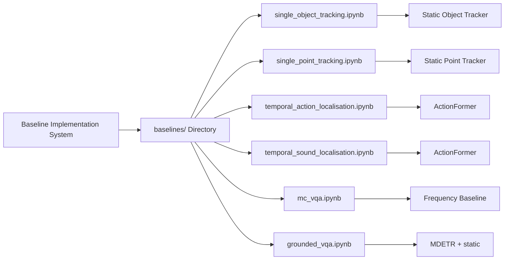
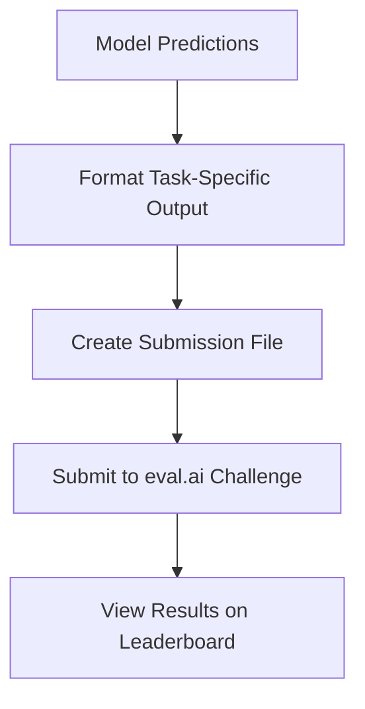

<!-- source: DeepWiki mcp.deepwiki.com · repo google-deepmind/perception_test · page 4 Evaluation · fetched 2026-10-26 -->

# Evaluation

Relevant source files

The following files were used as context for generating this wiki page:

- [README.md](README.md)

## Purpose and Scope

The Evaluation system of the Perception Test benchmark provides a comprehensive framework for measuring the performance of multimodal video models across six different perception and reasoning tasks. This document explains the evaluation metrics, baseline models, submission process, and evaluation tools provided by the benchmark.

The evaluation framework is designed to systematically assess how well models can:
- Track objects and points across video frames
- Temporally localize actions and sounds in videos
- Answer multiple-choice questions about video content
- Ground textual queries to specific objects in videos

For information about the specific tasks being evaluated, see [Tasks](#3).
For details about the dataset used for evaluation, see [Dataset](#2).

Sources: [README.md:24-27]()

## Evaluation Process Overview

The evaluation of models in the Perception Test benchmark follows a standardized workflow from data processing to submission of results.

### Evaluation Process Flow

Sources: [README.md:151-164]()

The general evaluation process involves:

1. **Data Processing**: Loading test videos, audio, and annotations for the specific task
2. **Prediction Generation**: Running the model on test data to produce task-specific outputs
3. **Metric Computation**: Calculating the appropriate evaluation metric for the task
4. **Results Submission**: Submitting predictions to the eval.ai platform for official scoring

Each task has its own evaluation pipeline, implemented in the corresponding baseline notebook.

Sources: [README.md:137-147]()

## Evaluation Metrics

The Perception Test benchmark uses specific metrics tailored to each task to measure model performance accurately.

### Metrics and Tasks Relationship

Sources: [README.md:152-164]()

The table below summarizes the evaluation metrics used for each task:

| Task | Metric | Description |
|------|--------|-------------|
| Single Object Tracking | Average IoU | Measures the average overlap between predicted and ground truth bounding boxes |
| Single Point Tracking | Average Jaccard | Measures similarity between predicted and ground truth point positions |
| Temporal Action Localization | Mean Average Precision | Evaluates temporal localization and classification of actions |
| Temporal Sound Localization | Mean Average Precision | Evaluates temporal localization and classification of sounds |
| Multiple-Choice Video QA | Top-1 Accuracy | Percentage of questions answered correctly |
| Grounded Video QA | HOTA | Higher Order Tracking Accuracy for evaluating object detection and tracking |

Sources: [README.md:152-164]()

## Baseline Models and Implementation

The benchmark provides baseline implementations for each task to serve as reference points for comparison.

### Baseline Models to Code Relationship

Sources: [README.md:137-147]()

The table below details the baseline models provided for each task:

| Task | Baseline | Implementation | Description |
|------|----------|----------------|-------------|
| Single Object Tracking | Static | [baselines/single_object_tracking.ipynb]() | Keeps the initial detection box static throughout the video |
| Single Point Tracking | Static | [baselines/single_point_tracking.ipynb]() | Keeps the initial point position static throughout the video |
| Temporal Action Localization | ActionFormer | [baselines/temporal_action_localisation.ipynb]() | Fine-tuned ActionFormer model on Perception Test data |
| Temporal Sound Localization | ActionFormer | [baselines/temporal_sound_localisation.ipynb]() | Fine-tuned ActionFormer model on Perception Test data |
| Multiple-Choice Video QA | Frequency | [baselines/mc_vqa.ipynb]() | Selects answers based on training set frequency statistics |
| Grounded Video QA | MDETR + static | [baselines/grounded_vqa.ipynb]() | Uses MDETR for object detection with static tracking |

Sources: [README.md:137-147]()

## Evaluation Structure and Code Organization

The evaluation system in the Perception Test benchmark is organized around task-specific implementations and a common workflow.

### Evaluation Components and Code Structure

```mermaid
graph TD
    EvaluationSystem["Evaluation System"] --> Metrics["Metrics Implementation"]
    EvaluationSystem --> Baselines["Baseline Models"]
    EvaluationSystem --> DataLoaders["Data Loaders"]
    EvaluationSystem --> Challenges["eval.ai Challenges"]
    
    Metrics --> AverageIoU["Average IoU"]
    Metrics --> AverageJaccard["Average Jaccard"]
    Metrics --> MeanAP["Mean Average Precision"]
    Metrics --> Accuracy["Top-1 Accuracy"]
    Metrics --> HOTA["HOTA"]
    
    DataLoaders --> VideoLoaders["load_video()"]
    DataLoaders --> AudioLoaders["load_audio()"]
    DataLoaders --> AnnotationLoaders["load_annotations()"]
    
    Baselines --> NotebookImpl["Jupyter Notebooks"]
    
    Challenges --> SOTChallenge["Object Tracking Challenge"]
    Challenges --> SPTChallenge["Point Tracking Challenge"]
    Challenges --> TALChallenge["Action Localization Challenge"]
    Challenges --> TSLChallenge["Sound Localization Challenge"]
    Challenges --> MCVQAChallenge["Multiple-Choice Video QA Challenge"]
    Challenges --> GVQAChallenge["Grounded Video QA Challenge"]
```

Sources: [README.md:15-17](), [README.md:152-164]()

## Submission Process

Model predictions for the Perception Test benchmark are submitted to the eval.ai platform, which hosts separate evaluation servers for each task.

### Submission Workflow

Sources: [README.md:15-17]()

### Task-Specific Submission Endpoints

Each task has a dedicated evaluation server on the eval.ai platform:

| Task | Challenge URL |
|------|--------------|
| Multiple-Choice Video QA | https://eval.ai/web/challenges/challenge-page/2091/overview |
| Object Tracking | https://eval.ai/web/challenges/challenge-page/2094/overview |
| Action Localization | https://eval.ai/web/challenges/challenge-page/2101/overview |
| Point Tracking | https://eval.ai/web/challenges/challenge-page/2108/overview |
| Sound Localization | https://eval.ai/web/challenges/challenge-page/2109/overview |
| Grounded Video QA | https://eval.ai/web/challenges/challenge-page/2110/overview |

Sources: [README.md:15-17]()

## Test Data for Evaluation

The benchmark provides test data for evaluating models on each task. This data includes videos, audio, and annotations.

| Task | Test Videos | Test Audio | Test Annotations |
|------|------------|------------|------------------|
| All Tasks | [test_videos.zip (41.8GB)]() | [test_audios.zip (19.3GB)]() | [test_annotations.zip (633.9kB)]() |
| Single Object Tracking | [sot_test_videos_challenge2023.zip (12.1GB)]() | N/A | [sot_test_annotations_challenge2023.zip (613kB)]() |
| Single Point Tracking | [point_tracking_test_videos.zip (691MB)]() | N/A | [point_tracking_test_annotations.zip (42.2kB)]() |
| Temporal Action/Sound Localization | Use full test split | Use full test split | N/A |
| Multiple-Choice Video QA | Use full test split | Use full test split | [mc_question_test_annotations.zip (200kB)]() |
| Grounded Video QA | [grounded_question_test_videos.zip (11.3GB)]() | N/A | [grounded_question_test_annotations.zip (17.5kB)]() |

Sources: [README.md:37-134]()

For tasks that use subsets of the full test split, the benchmark provides ID lists to filter the relevant videos:

- Single Object Tracking: [object_tracking_test_subset_id_list.csv]()
- Single Point Tracking: [point_tracking_test_id_list.csv]()
- Action/Sound Localization: [localisation_challenge_test_id_list.csv]()
- Multiple-Choice Video QA: [mc_question_test_id_list.csv]()
- Grounded Video QA: [grounded_question_test_id_list.csv]()

Sources: [README.md:59-70]()

## Evaluation Features and Resources

The Perception Test benchmark provides pre-computed features for the action and sound localization tasks to facilitate model development and evaluation:

| Task | Features | Description |
|------|----------|-------------|
| Temporal Action Localization | [action_localisation_test_video_features.zip (131.7MB)]() | TSP features extracted from test videos |
| Temporal Sound Localization | [sound_localisation_test_video_features.zip (177.2MB)]() | MMV features extracted from test audio |

Sources: [README.md:96-114]()

These pre-computed features can be used to develop and evaluate models without having to process the raw video and audio data directly.

For support or questions about evaluation in the Perception Test benchmark, please contact perception-test@google.com.

Sources: [README.md:274-276]()

---

