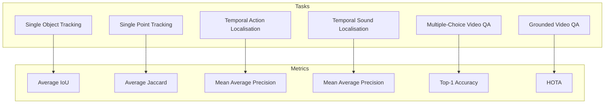
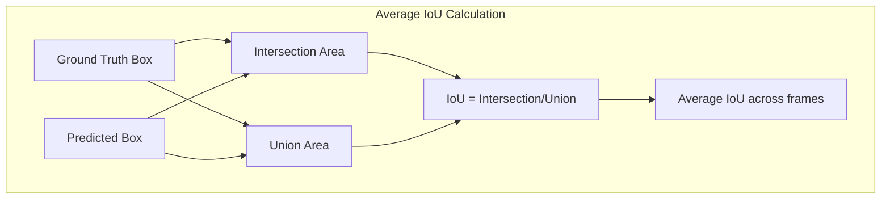
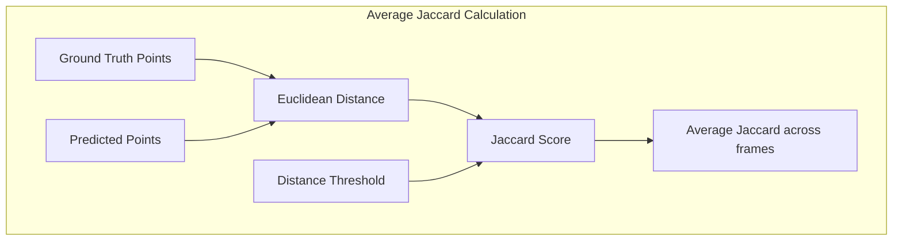
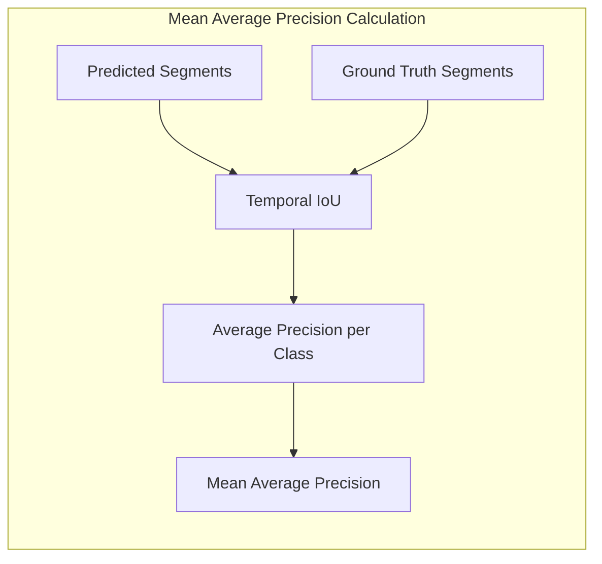
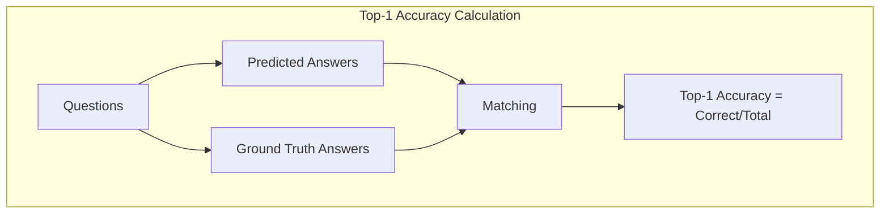
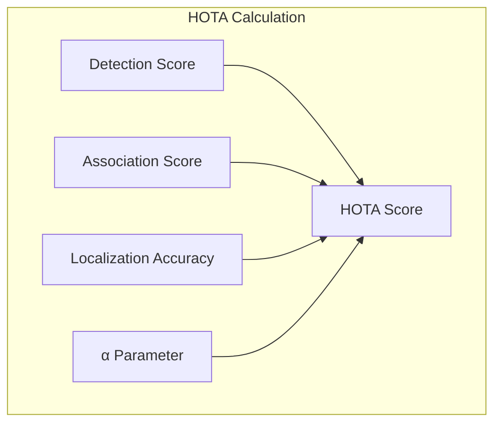
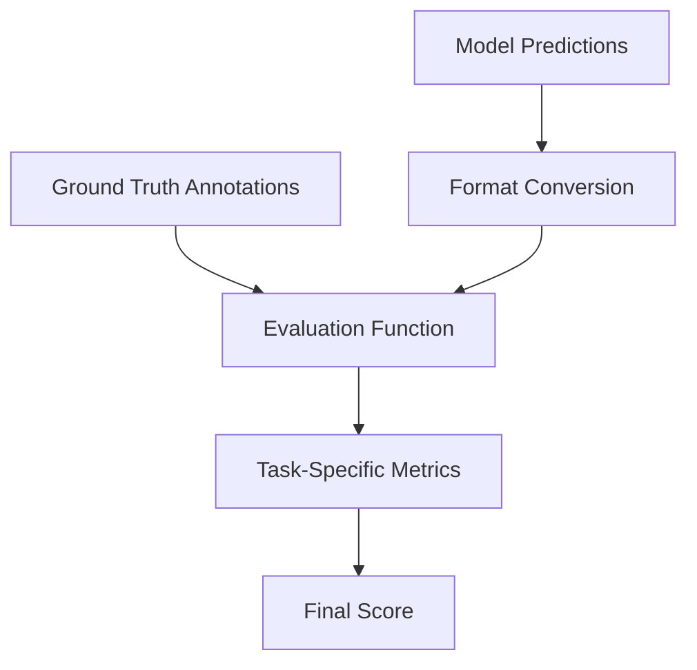
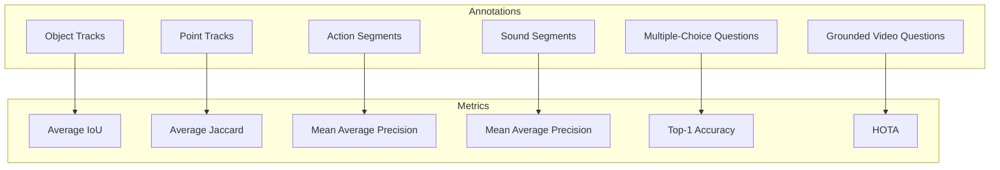

<!-- source: DeepWiki mcp.deepwiki.com · repo google-deepmind/perception_test · page 4.1 Metrics · fetched 2026-10-26 -->

# Metrics

Relevant source files

The following files were used as context for generating this wiki page:

- [README.md](README.md)

This document describes the evaluation metrics used in the Perception Test benchmark to assess model performance across the six computational tasks. Each task employs a specific metric designed to appropriately measure relevant aspects of perception and reasoning performance. For information about the baseline models that can be evaluated using these metrics, see [Baselines](#4.2).

## Overview of Evaluation Metrics

The Perception Test benchmark uses task-specific evaluation metrics that quantify different aspects of model performance. The following table summarizes the metrics used for each computational task:

| Computational Task | Metric | Description |
|-------------------|--------|-------------|
| Single Object Tracking | Average IoU | Measures spatial overlap between predicted and ground truth bounding boxes |
| Single Point Tracking | Average Jaccard | Measures spatial proximity between predicted and ground truth points |
| Temporal Action Localisation | Mean Average Precision | Evaluates detection and temporal localization of actions |
| Temporal Sound Localisation | Mean Average Precision | Evaluates detection and temporal localization of sounds |
| Multiple-Choice Video QA | Top-1 Accuracy | Measures correct answer selection rate |
| Grounded Video QA | HOTA | Balances detection, association, and localization accuracy for object tracking |

Sources: [README.md:151-164]()

## Relationship Between Tasks and Metrics

The following diagram illustrates the relationship between the different tasks in the Perception Test benchmark and their corresponding evaluation metrics:

Sources: [README.md:155-162]()

## Detailed Metrics Description

### Average IoU (for Single Object Tracking)

Average Intersection over Union (IoU) measures the spatial overlap between predicted bounding boxes and ground truth bounding boxes across all frames in a video. The metric ranges from 0 (no overlap) to 1 (perfect overlap).

For each frame with an annotated ground truth bounding box (typically 1 frame per second), the IoU is calculated as the ratio of the intersection area to the union area between the predicted and ground truth boxes. These values are then averaged across all frames to get the final Average IoU score.

Sources: [README.md:157]()

### Average Jaccard (for Single Point Tracking)

Average Jaccard measures the spatial proximity between predicted points and ground truth points in a video. This metric is designed specifically for evaluating point tracking accuracy.

The Jaccard score is calculated based on the Euclidean distance between predicted and ground truth points, with a distance threshold determining whether points are considered matched. The final metric is obtained by averaging these scores across all frames.

Sources: [README.md:158]()

### Mean Average Precision (for Temporal Localisation Tasks)

Mean Average Precision (mAP) is used for both Temporal Action Localisation and Temporal Sound Localisation tasks. It evaluates both the detection accuracy (correct class prediction) and the temporal localisation accuracy (correct start and end times).

The process involves:
1. Calculating the temporal IoU between predicted segments and ground truth segments
2. Determining true/false positives based on IoU thresholds
3. Computing precision-recall curves for each class
4. Calculating the Average Precision (AP) as the area under the precision-recall curve
5. Averaging AP across all classes to get mAP

Sources: [README.md:159-160]()

### Top-1 Accuracy (for Multiple-Choice Video QA)

Top-1 Accuracy measures the proportion of multiple-choice questions for which the model selects the correct answer from the available options.

For each question, the model predicts one answer from the available options. The accuracy is calculated as the ratio of correctly answered questions to the total number of questions.

Sources: [README.md:161]()

### HOTA (for Grounded Video QA)

Higher Order Tracking Accuracy (HOTA) is a comprehensive metric that balances detection, association, and localization accuracy for object tracking tasks. It's particularly suited for Grounded Video QA, which requires identifying objects that answer specific questions.

HOTA decomposition:
1. **Detection Score**: Measures how well the model detects all objects
2. **Association Score**: Measures how well the model links detections of the same object together
3. **Localization Accuracy**: Measures spatial precision of the detections

The final HOTA score balances these components to provide a comprehensive assessment of tracking performance.

Sources: [README.md:162]()

## Implementation Considerations

When implementing these metrics for evaluation, several considerations should be taken into account:

1. **Temporal Sampling**: For tracking metrics (Average IoU and Average Jaccard), evaluations are typically performed on annotated frames (usually 1 frame per second) rather than every frame.

2. **Thresholds**: 
   - For Mean Average Precision, multiple IoU thresholds are often used
   - For HOTA, the α parameter balances detection and association components

3. **Class Balancing**: For multi-class tasks (action and sound localisation), ensuring proper handling of class imbalance when computing mAP.

Here's a diagram showing the general evaluation flow:

Sources: [README.md:151-164]()

## Relationship to Data Structure

The metrics are closely tied to the annotation structure in the Perception Test dataset. The following diagram illustrates this relationship:

Each annotation type in the dataset corresponds to a specific task and is evaluated using the appropriate metric.

Sources: [README.md:167-179]()

## Summary

The Perception Test benchmark employs a diverse set of evaluation metrics tailored to the specific requirements of each computational task. These metrics provide a comprehensive assessment of model performance across different aspects of perception and reasoning in multimodal video understanding. The choice of metrics reflects the different challenges posed by each task, from spatial accuracy in tracking to semantic correctness in question answering.

Sources: [README.md:151-164]()

---

