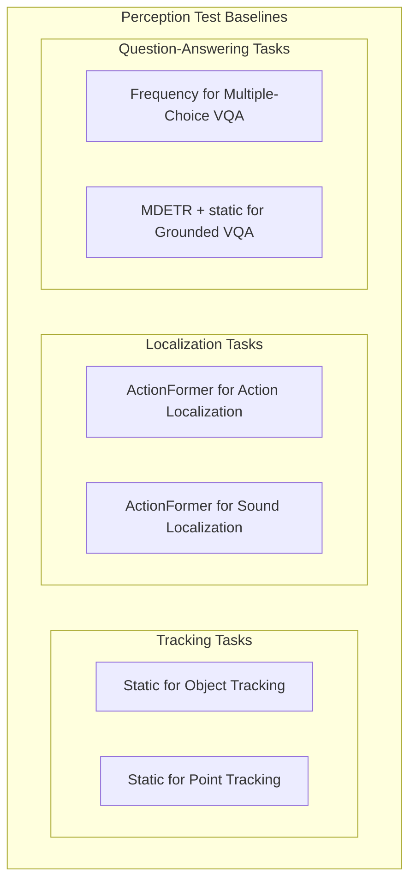
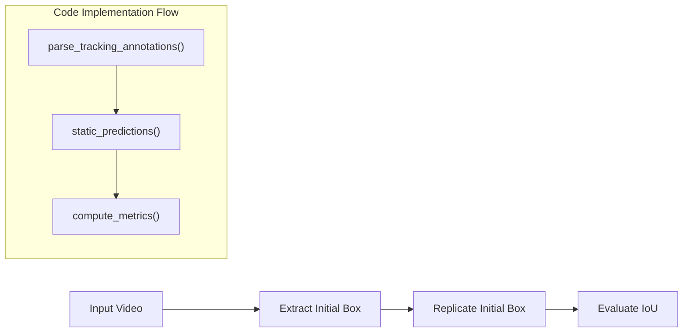
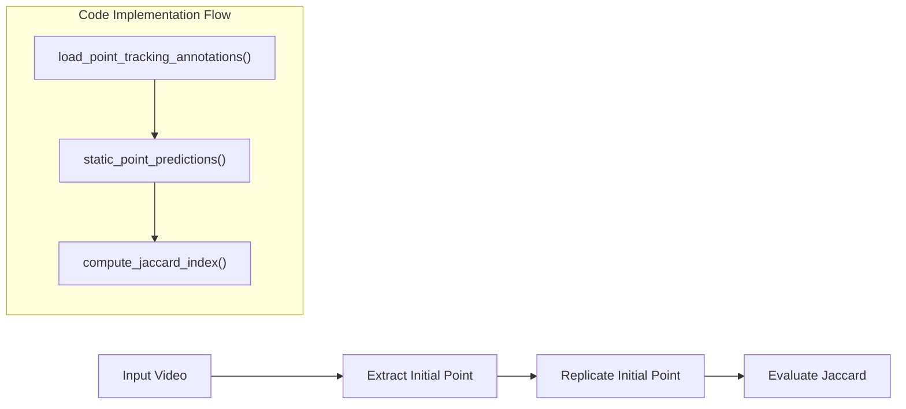
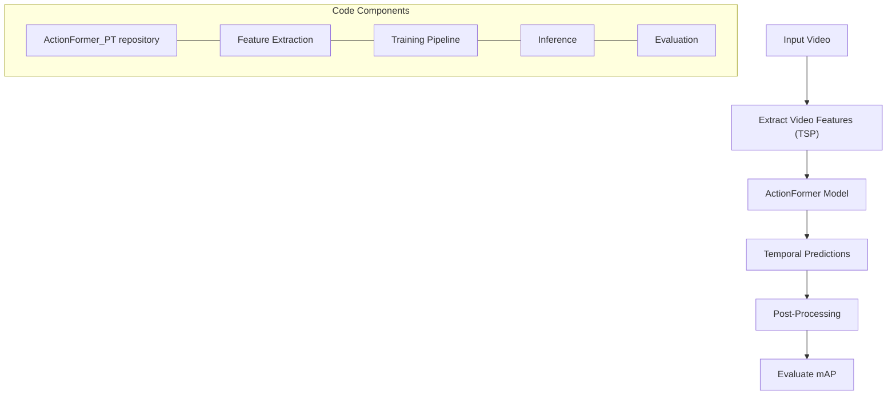
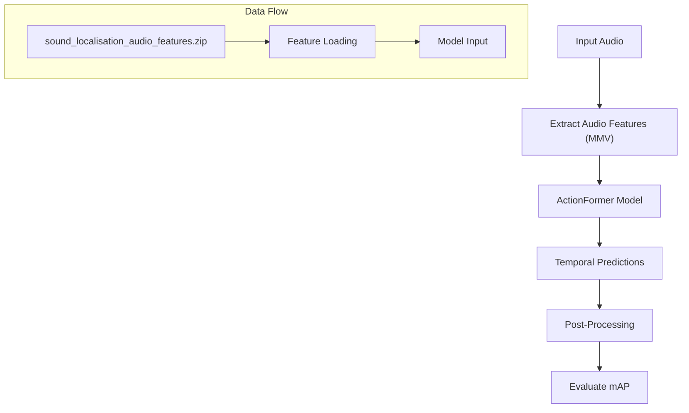
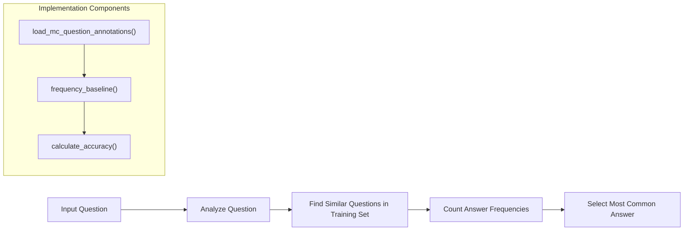
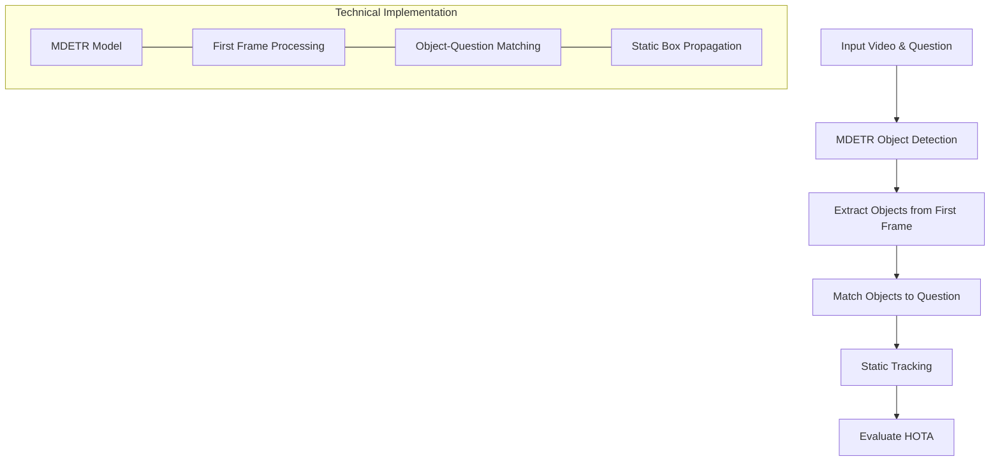

<!-- source: DeepWiki mcp.deepwiki.com · repo google-deepmind/perception_test · page 4.2 Baselines · fetched 2026-10-26 -->

# Baselines

Relevant source files

The following files were used as context for generating this wiki page:

- [README.md](README.md)

This document provides an in-depth overview of the baseline models implemented for each task in the Perception Test benchmark. These baselines serve as reference implementations and performance benchmarks for comparison with more advanced models. For information about evaluation metrics used to assess these baselines, see [Metrics](#4.1).

## Overview of Baseline Models

The Perception Test benchmark provides six baseline models, one for each computational task. These baselines vary in complexity from simple static approaches to more sophisticated models that have been fine-tuned on Perception Test data.

Sources: [README.md:137-147]()

| Computational Task | Baseline | Description | Implementation |
|--------------------|----------|-------------|----------------|
| Single Object Tracking | Static | Static object baseline | [baselines/single_object_tracking.ipynb]() |
| Single Point Tracking | Static | Static point baseline | [baselines/single_point_tracking.ipynb]() |
| Temporal Action Localization | ActionFormer | ActionFormer model fine-tuned on Perception Test data | [baselines/temporal_action_localisation.ipynb]() |
| Temporal Sound Localization | ActionFormer | ActionFormer model fine-tuned on Perception Test data | [baselines/temporal_sound_localisation.ipynb]() |
| Multiple-Choice Video QA | Frequency | Frequency-based baseline using training question/answer pairs | [baselines/mc_vqa.ipynb]() |
| Grounded Video QA | MDETR + static | MDETR object detection with static tracking | [baselines/grounded_vqa.ipynb]() |

Sources: [README.md:140-147]()

## Tracking Task Baselines

### Static Baseline for Object Tracking

The single object tracking baseline implements a simple static tracking approach that represents the minimal performance benchmark. This baseline takes the initial bounding box and replicates it across all frames without any actual tracking.

Sources: [README.md:142]()

### Static Baseline for Point Tracking

Similar to object tracking, the point tracking baseline also uses a static approach, replicating the initial point coordinates throughout all frames. This establishes a performance floor for models attempting the point tracking task.

Sources: [README.md:143]()

## Localization Task Baselines

### ActionFormer for Action Localization

The action localization baseline uses the ActionFormer model, which has been fine-tuned on Perception Test data. ActionFormer is a transformer-based architecture designed specifically for temporal action detection.

Sources: [README.md:144]()

### ActionFormer for Sound Localization

The sound localization baseline also employs the ActionFormer architecture, but uses audio features (MMV) as input rather than video features. The model structure and training pipeline are similar to the action localization baseline.

Sources: [README.md:145]()

## Question-Answering Task Baselines

### Frequency Baseline for Multiple-Choice Video QA

The multiple-choice Video QA baseline implements a frequency-based approach that analyzes the training set to determine answer patterns. It selects the most common answer from similar questions in the training set without processing video content.

Sources: [README.md:146]()

### MDETR + Static Baseline for Grounded Video QA

The grounded Video QA baseline combines MDETR (Modulated Detection for End-to-End Multi-Modal Understanding) for object detection with a static tracking approach. MDETR performs open-vocabulary object detection on the first frame, and these detections are maintained statically throughout the video.

Sources: [README.md:147]()

## Running the Baselines

Each baseline is implemented as a Jupyter notebook in the `baselines/` directory. To run a baseline:

1. Download the appropriate dataset splits as described in the [Data Download](#5.1) section
2. Open the corresponding notebook for the task of interest
3. Follow the notebook instructions to run the baseline
4. Review the evaluation results using the task-specific metrics

The notebooks are designed to be self-contained and include all necessary code for data loading, model execution, and result evaluation.

Sources: [README.md:15](), [README.md:137-147]()

## Performance Expectations

The baselines are intentionally simple in most cases, serving primarily as reference points rather than state-of-the-art solutions. They establish performance floors that more sophisticated models should exceed. The exceptions are the ActionFormer-based models for localization tasks, which represent more competitive approaches.

For detailed performance metrics of these baselines, refer to the original Perception Test paper cited in the repository.

Sources: [README.md:137-147]()

---

