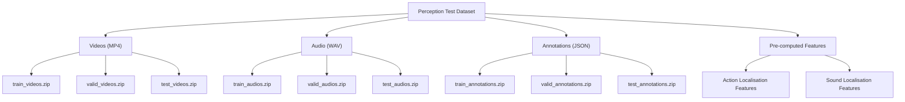
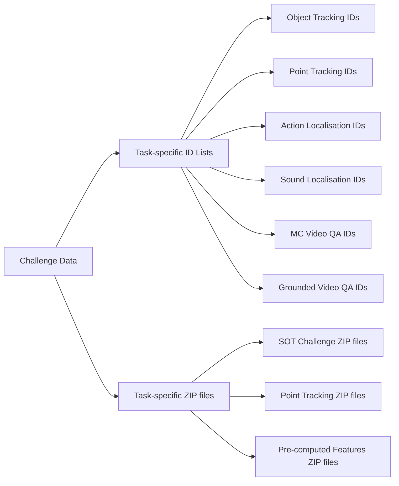
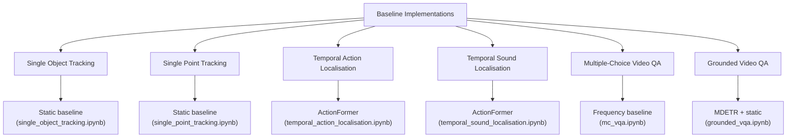
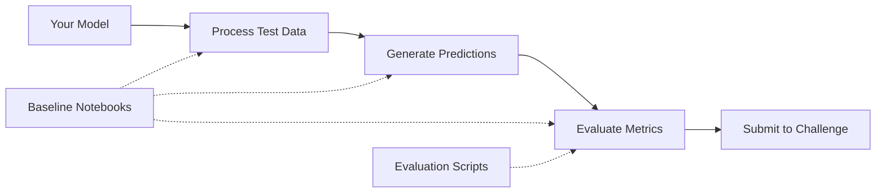

<!-- source: DeepWiki mcp.deepwiki.com · repo google-deepmind/perception_test · page 5 Using the Benchmark · fetched 2026-10-26 -->

# Using the Benchmark

<details>
<summary>Relevant source files</summary>

The following files were used as context for generating this wiki page:

- [README.md](README.md)

</details>


This document provides comprehensive instructions for downloading, setting up, and using the Perception Test benchmark. It covers data organization, working with baselines, and submitting results to challenges. For an overview of the benchmark's purpose and design, see [Overview](#1).

## Data Download and Organization

The Perception Test benchmark consists of multiple components that need to be downloaded and organized properly to use the benchmark effectively.

### Dataset Structure



Sources: [README.md:37-53]()

### Dataset Downloads

The dataset can be downloaded in three main components for each split (train, valid, test):

1. **Videos**: MP4 files containing the visual content
2. **Audio**: WAV files containing the audio content
3. **Annotations**: JSON files with task-specific annotations
4. **Pre-computed Features**: For action and sound localization tasks

The full dataset can be downloaded using the links provided in the README, but be aware of the file sizes:

| Split | Videos | Audio | Annotations |
|-------|--------|-------|------------|
| Train | 26.5GB | 12.3GB | 30.6MB |
| Valid | 70.2GB | 33.1GB | 81.5MB |
| Test  | 41.8GB | 19.3GB | 633.9kB |

For smaller storage requirements, you can download only the data needed for specific challenges using the challenge-specific links and video ID lists.

Sources: [README.md:45-52](), [README.md:58-133]()

### Challenge-Specific Downloads

If you're interested in a specific task, you can download only the relevant subset:



For some challenges (Single Object Tracking, Single Point Tracking, and Grounded Video QA), separate smaller zip files are provided since their subsets are much smaller than the full dataset.

Sources: [README.md:58-133]()

### Recommended Directory Structure

After downloading, organize your files in the following structure:

```
perception_test/
├── data/
│   ├── videos/
│   │   ├── train/
│   │   ├── valid/
│   │   └── test/
│   ├── audio/
│   │   ├── train/
│   │   ├── valid/
│   │   └── test/
│   ├── annotations/
│   │   ├── train/
│   │   ├── valid/
│   │   └── test/
│   └── features/
│       ├── action/
│       └── sound/
├── baselines/
└── submissions/
```

Sources: [README.md:37-53]()

## Working with Baseline Models

The Perception Test benchmark provides baseline implementations for all six tasks. These serve as starting points for understanding how to process the data and evaluate models.

### Available Baselines



Sources: [README.md:137-147]()

### Running the Baselines

Each baseline is provided as a Jupyter notebook in the `baselines/` directory. The notebooks demonstrate:

1. How to load the data
2. How to preprocess inputs
3. How to implement and run simple models
4. How to evaluate the results using appropriate metrics

To run a baseline:

1. Open the corresponding notebook
2. Update paths to point to your downloaded data
3. Run all cells to see the baseline in action

The baselines range from simple (static predictions for tracking tasks) to more complex models (ActionFormer for localization tasks).

Sources: [README.md:137-147]()

## Evaluating Models

Each task in the Perception Test benchmark has a specific evaluation metric designed to measure performance on that task.

### Evaluation Metrics

| Task | Metric |
|------|--------|
| Single Object Tracking | Average IoU |
| Single Point Tracking | Average Jaccard |
| Temporal Action Localisation | Mean Average Precision |
| Temporal Sound Localisation | Mean Average Precision |
| Multiple-Choice Video QA | Top-1 Accuracy |
| Grounded Video QA | HOTA |

Sources: [README.md:151-164]()

### Evaluation Workflow



The baseline notebooks demonstrate the complete evaluation workflow for each task, showing how to:
1. Load and preprocess the data
2. Make predictions with a model
3. Calculate the appropriate metric for evaluation
4. Format results for submission

Sources: [README.md:137-147](), [README.md:151-164]()

## Submitting to Challenges

The Perception Test benchmark is associated with challenges hosted on the eval.ai platform. This allows you to compare your model's performance against others in the community.

### Challenge Platforms

Each task has a dedicated challenge page on eval.ai where you can submit your results:

| Task | Challenge Platform |
|------|-------------------|
| Multiple-Choice Video QA | eval.ai challenge page |
| Object Tracking | eval.ai challenge page |
| Action Localisation | eval.ai challenge page |
| Point Tracking | eval.ai challenge page |
| Sound Localisation | eval.ai challenge page |
| Grounded Video QA | eval.ai challenge page |

Sources: [README.md:9-16]()

### Submission Format

Each challenge expects submissions in a specific format, which is demonstrated in the corresponding baseline notebook. The general process is:

1. Run your model on the test set
2. Format the predictions according to the challenge requirements
3. Submit the formatted predictions to the eval.ai challenge page

### Working with Different Splits

For development and testing, use the appropriate data splits:

1. **Train Split**: Use for training your models
2. **Validation Split**: Use for hyperparameter tuning and development-time evaluation
3. **Test Split**: Use only for final evaluation and challenge submissions

For some videos, particularly in cup-games where the end of the video reveals answers, the test videos have been trimmed. For validation and training splits, a cut frame mapping is provided to indicate where videos should be cut.

Sources: [README.md:45-55]()

## Special Considerations

### Cup-Games Videos

Some videos in the dataset show "cup games" where objects are hidden under cups and moved around. These videos have special considerations:

1. The ends of videos may be cut to avoid revealing the answer
2. Special annotations mark objects as "occluders" (e.g., cups covering other objects)
3. The `is_masked` field in object track annotations indicates when an object is hidden

Sources: [README.md:54-55](), [README.md:193-194](), [README.md:204-209]()

### Pre-computed Features

For the temporal action and sound localization tasks, pre-computed features are provided:

1. **Action Localization**: TSP features
2. **Sound Localization**: MMV features

Using these features can simplify model development, especially when working with the ActionFormer baseline.

Sources: [README.md:99-104](), [README.md:109-114]()

## Getting Support

If you encounter issues or have questions about using the benchmark, contact the Perception Test team at perception-test@google.com.

Sources: [README.md:274-276]()

---

