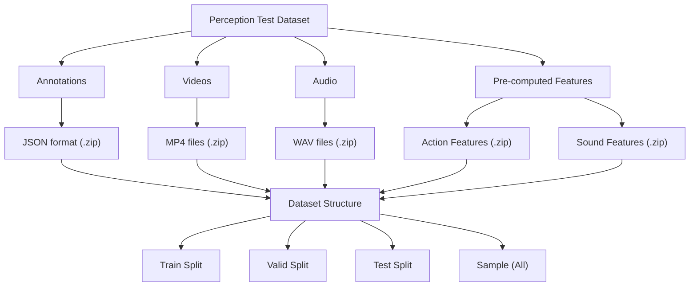
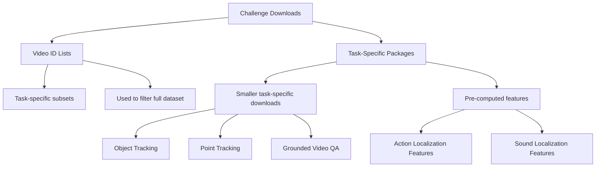
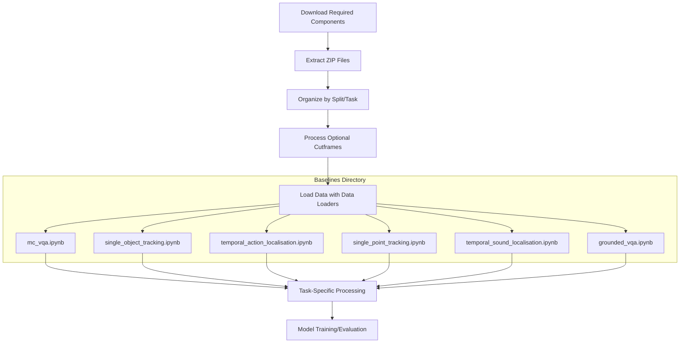
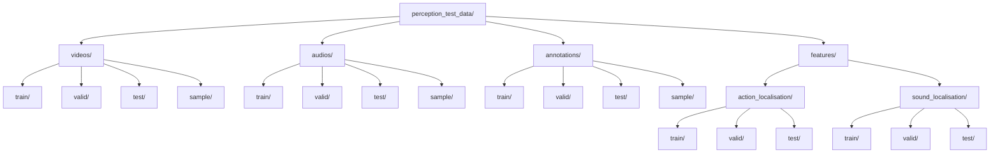

<!-- source: DeepWiki mcp.deepwiki.com · repo google-deepmind/perception_test · page 5.1 Data Download · fetched 2026-10-26 -->

# Data Download

Relevant source files

The following files were used as context for generating this wiki page:

- [README.md](README.md)

This document provides comprehensive instructions for downloading and preparing the Perception Test benchmark dataset. It covers all dataset components, full splits, and task-specific downloads required for participation in the benchmark challenges.

For information about using the downloaded data for model evaluation or submitting results to the challenges, see [Submission Process](#5.2).

## Dataset Components

The Perception Test dataset consists of multiple file types that together form the complete benchmark:

Sources: [README.md:37-44]()

## Full Dataset Splits

The Perception Test dataset is divided into three primary splits: train, validation, and test. Additionally, a small sample is provided for quick experimentation. Each split contains the following components:

| Split | Videos | Audio | Annotations |
|-------|--------|-------|------------|
| Sample | [sample_videos.zip (214.9MB)](https://storage.googleapis.com/dm-perception-test/zip_data/sample_videos.zip) | [sample_audios.zip (83.9MB)](https://storage.googleapis.com/dm-perception-test/zip_data/sample_audios.zip) | [sample_annotations.zip (3MB)](https://storage.googleapis.com/dm-perception-test/zip_data/sample_annotations.zip) |
| Train | [train_videos.zip (26.5GB)](https://storage.googleapis.com/dm-perception-test/zip_data/train_videos.zip) | [train_audios.zip (12.3GB)](https://storage.googleapis.com/dm-perception-test/zip_data/train_audios.zip) | [train_annotations.zip (30.6MB)](https://storage.googleapis.com/dm-perception-test/zip_data/train_annotations.zip) |
| Valid | [valid_videos.zip (70.2GB)](https://storage.googleapis.com/dm-perception-test/zip_data/valid_videos.zip) | [valid_audios.zip (33.1GB)](https://storage.googleapis.com/dm-perception-test/zip_data/valid_audios.zip) | [valid_annotations.zip (81.5MB)](https://storage.googleapis.com/dm-perception-test/zip_data/valid_annotations.zip) |
| Test | [test_videos.zip (41.8GB)](https://storage.googleapis.com/dm-perception-test/zip_data/test_videos.zip) | [test_audios.zip (19.3GB)](https://storage.googleapis.com/dm-perception-test/zip_data/test_audios.zip) | [test_annotations.zip (633.9kB)](https://storage.googleapis.com/dm-perception-test/zip_data/test_annotations.zip) |

Sources: [README.md:45-53]()

### Special Considerations for Videos

In certain test videos where the ending may reveal answers to questions (particularly in cup-game videos), the end of the video is cut. For validation and training splits, frame mapping files indicate where these cuts should be made:

- [cut_frame_mapping_train.json](https://storage.googleapis.com/dm-perception-test/misc/cut_frame_mapping_train.json)
- [cut_frame_mapping_valid.json](https://storage.googleapis.com/dm-perception-test/misc/cut_frame_mapping_valid.json)

Sources: [README.md:54-55]()

## Challenge-Specific Downloads

Sources: [README.md:57-70]()

### Video ID Lists

Since some challenges use subsets of the full benchmark, video ID lists are provided for filtering videos, audio, and annotations from the full splits. The following ID lists are available for each task:

| Computational Task | Challenge Train Video IDs | Challenge Valid Video IDs | Challenge Test Video IDs |
|--------------------|---------------------------|---------------------------|--------------------------|
| Single Object Tracking | [object_tracking_train_id_list.csv](https://storage.googleapis.com/dm-perception-test/misc/object_tracking_train_id_list.csv) | [object_tracking_valid_subset_id_list.csv](https://storage.googleapis.com/dm-perception-test/misc/object_tracking_valid_subset_id_list.csv) | [object_tracking_test_subset_id_list.csv](https://storage.googleapis.com/dm-perception-test/misc/object_tracking_test_subset_id_list.csv) |
| Single Point Tracking | [point_tracking_train_id_list.csv](https://storage.googleapis.com/dm-perception-test/misc/point_tracking_train_id_list.csv) | [point_tracking_valid_id_list.csv](https://storage.googleapis.com/dm-perception-test/misc/point_tracking_valid_id_list.csv) | [point_tracking_test_id_list.csv](https://storage.googleapis.com/dm-perception-test/misc/point_tracking_test_id_list.csv) |
| Temporal Action Localisation | [action_localisation_train_id_list.csv](https://storage.googleapis.com/dm-perception-test/misc/action_localisation_train_id_list.csv) | [localisation_challenge_valid_id_list.csv](https://storage.googleapis.com/dm-perception-test/misc/localisation_challenge_valid_id_list.csv) | [localisation_challenge_test_id_list.csv](https://storage.googleapis.com/dm-perception-test/misc/localisation_challenge_test_id_list.csv) |
| Temporal Sound Localisation | [sound_localisation_train_id_list.csv](https://storage.googleapis.com/dm-perception-test/misc/sound_localisation_train_id_list.csv) | [localisation_challenge_valid_id_list.csv](https://storage.googleapis.com/dm-perception-test/misc/localisation_challenge_valid_id_list.csv) | [localisation_challenge_test_id_list.csv](https://storage.googleapis.com/dm-perception-test/misc/localisation_challenge_test_id_list.csv) |
| Multiple-Choice Video QA | [mc_question_train_id_list.csv](https://storage.googleapis.com/dm-perception-test/misc/mc_question_train_id_list.csv) | [mc_question_valid_id_list.csv](https://storage.googleapis.com/dm-perception-test/misc/mc_question_valid_id_list.csv) | [mc_question_test_id_list.csv](https://storage.googleapis.com/dm-perception-test/misc/mc_question_test_id_list.csv) |
| Grounded Video QA | [grounded_question_train_id_list.csv](https://storage.googleapis.com/dm-perception-test/misc/grounded_question_train_id_list.csv) | [grounded_question_valid_id_list.csv](https://storage.googleapis.com/dm-perception-test/misc/grounded_question_valid_id_list.csv) | [grounded_question_test_id_list.csv](https://storage.googleapis.com/dm-perception-test/misc/grounded_question_test_id_list.csv) |

Sources: [README.md:60-70]()

## Task-Specific Downloads

For smaller task-specific subsets and specialized components, dedicated download packages are available:

### Single Object Tracking

| Split | Videos | Audio | Labels |
|-------|--------|-------|--------|
| Train | Use full split download above | N/A | Use full split download above |
| Valid | [sot_valid_videos_challenge2023.zip (11.6GB)](https://storage.googleapis.com/dm-perception-test/zip_data/sot_valid_videos_challenge2023.zip) | N/A | [sot_valid_annotations_challenge2023.zip (9MB)](https://storage.googleapis.com/dm-perception-test/zip_data/sot_valid_annotations_challenge2023.zip) |
| Test | [sot_test_videos_challenge2023.zip (12.1GB)](https://storage.googleapis.com/dm-perception-test/zip_data/sot_test_videos_challenge2023.zip) | N/A | [sot_test_annotations_challenge2023.zip (613kB)](https://storage.googleapis.com/dm-perception-test/zip_data/sot_test_annotations_challenge2023.zip) |

Sources: [README.md:76-83]()

### Single Point Tracking

| Split | Videos | Audio | Labels |
|-------|--------|-------|--------|
| Train | [point_tracking_train_videos.zip (398.4MB)](https://storage.googleapis.com/dm-perception-test/zip_data/point_tracking_train_videos.zip) | N/A | [point_tracking_train_annotations.zip (4.7MB)](https://storage.googleapis.com/dm-perception-test/zip_data/point_tracking_train_annotations.zip) |
| Valid | [point_tracking_valid_videos.zip (1.1GB)](https://storage.googleapis.com/dm-perception-test/zip_data/point_tracking_valid_videos.zip) | N/A | [point_tracking_valid_annotations.zip (11.1MB)](https://storage.googleapis.com/dm-perception-test/zip_data/point_tracking_valid_annotations.zip) |
| Test | [point_tracking_test_videos.zip (691MB)](https://storage.googleapis.com/dm-perception-test/zip_data/point_tracking_test_videos.zip) | N/A | [point_tracking_test_annotations.zip (42.2kB)](https://storage.googleapis.com/dm-perception-test/zip_data/point_tracking_test_annotations.zip) |

Sources: [README.md:86-93]()

### Temporal Action Localisation

| Split | Videos | Audio | Labels | Video Features (TSP) |
|-------|--------|-------|--------|----------------------|
| Train | Use full split download above | Use full split download above | [action_localisation_train_annotations.zip (217kB)](https://storage.googleapis.com/dm-perception-test/zip_data/action_localisation_train_annotations.zip) | [action_localisation_train_video_features.zip (81.7MB)](https://storage.googleapis.com/dm-perception-test/zip_data/action_localisation_train_video_features.zip) |
| Valid | Use full split download above | Use full split download above | [challenge_action_localisation_valid_annotations.zip (558kB)](https://storage.googleapis.com/dm-perception-test/zip_data/challenge_action_localisation_valid_annotations.zip) | [action_localisation_valid_video_features.zip (219.2MB)](https://storage.googleapis.com/dm-perception-test/zip_data/action_localisation_valid_video_features.zip) |
| Test | Use full split download above | Use full split download above | N/A | [action_localisation_test_video_features.zip (131.7MB)](https://storage.googleapis.com/dm-perception-test/zip_data/action_localisation_test_video_features.zip) |

Sources: [README.md:96-103]()

### Temporal Sound Localisation

| Split | Videos | Audio | Labels | Audio Features (MMV) |
|-------|--------|-------|--------|----------------------|
| Train | Use full split download above | Use full split download above | [sound_localisation_train_annotations.zip (363kB)](https://storage.googleapis.com/dm-perception-test/zip_data/sound_localisation_train_annotations.zip) | [sound_localisation_train_audio_features.zip (109.1MB)](https://storage.googleapis.com/dm-perception-test/zip_data/sound_localisation_train_audio_features.zip) |
| Valid | Use full split download above | Use full split download above | [challenge_sound_localisation_valid_annotations.zip (552kB)](https://storage.googleapis.com/dm-perception-test/zip_data/challenge_sound_localisation_valid_annotations.zip) | [sound_localisation_valid_audio_features.zip (291.4MB)](https://storage.googleapis.com/dm-perception-test/zip_data/sound_localisation_valid_audio_features.zip) |
| Test | Use full split download above | Use full split download above | N/A | [sound_localisation_test_audio_features.zip (177.2MB)](https://storage.googleapis.com/dm-perception-test/zip_data/sound_localisation_test_audio_features.zip) |

Sources: [README.md:107-114]()

### Multiple-Choice Video QA

| Split | Videos | Audio | Labels |
|-------|--------|-------|--------|
| Train | Use full split download above | Use full split download above | [mc_question_train_annotations.zip (85kB)](https://storage.googleapis.com/dm-perception-test/zip_data/mc_question_train_annotations.zip), [cut_frame_mapping_train.json](https://storage.googleapis.com/dm-perception-test/misc/cut_frame_mapping_train.json) |
| Valid | Use full split download above | Use full split download above | [mc_question_valid_annotations.zip (200kB)](https://storage.googleapis.com/dm-perception-test/zip_data/mc_question_valid_annotations.zip), [cut_frame_mapping_valid.json](https://storage.googleapis.com/dm-perception-test/misc/cut_frame_mapping_valid.json) |
| Test | Use full split download above | Use full split download above | [mc_question_test_annotations.zip (200kB)](https://storage.googleapis.com/dm-perception-test/zip_data/mc_question_test_annotations.zip) |

Sources: [README.md:117-124]()

### Grounded Video QA

| Split | Videos | Audio | Labels |
|-------|--------|-------|--------|
| Train | [grounded_question_train_videos.zip (7.3GB)](https://storage.googleapis.com/dm-perception-test/zip_data/grounded_question_train_videos.zip) | [grounded_question_train_audios.zip (3.4GB)](https://storage.googleapis.com/dm-perception-test/zip_data/grounded_question_train_audios.zip) | [grounded_question_train_annotations.zip (6.1MB)](https://storage.googleapis.com/dm-perception-test/zip_data/grounded_question_train_annotations.zip) |
| Valid | [grounded_question_valid_videos.zip (19.3GB)](https://storage.googleapis.com/dm-perception-test/zip_data/grounded_question_valid_videos.zip) | [grounded_question_valid_audios.zip (9.1GB)](https://storage.googleapis.com/dm-perception-test/zip_data/grounded_question_valid_audios.zip) | [grounded_question_valid_annotations.zip (16.8MB)](https://storage.googleapis.com/dm-perception-test/zip_data/grounded_question_valid_annotations.zip) |
| Test | [grounded_question_test_videos.zip (11.3GB)](https://storage.googleapis.com/dm-perception-test/zip_data/grounded_question_test_videos.zip) | N/A | [grounded_question_test_annotations.zip (17.5kB)](https://storage.googleapis.com/dm-perception-test/zip_data/grounded_question_test_annotations.zip) |

Sources: [README.md:127-133]()

## Data Loading Process

Once downloaded, the data should be processed according to the following workflow:

Sources: [README.md:10-16](), [README.md:137-147]()

## File Structure and Organization

After downloading and extracting, your data organization should match this structure:

Sources: [README.md:37-44]()

## Additional Resources

For visualization and exploration of the downloaded data, the following resources are available:

- **Data Visualization Notebook**: [data_visualisation.ipynb](https://github.com/deepmind/perception_test/blob/main/data_visualisation.ipynb)
- **Dataset Explorer**: [Dataset Explorer](https://ptchallenge-workshop.github.io/explore.html)

These tools can help you understand the structure of the annotations and how they relate to the videos and audio files.

Sources: [README.md:10-14](), [README.md:168]()

---

