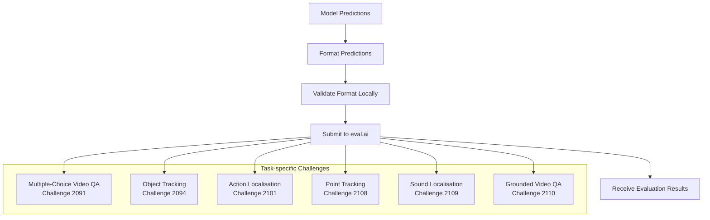
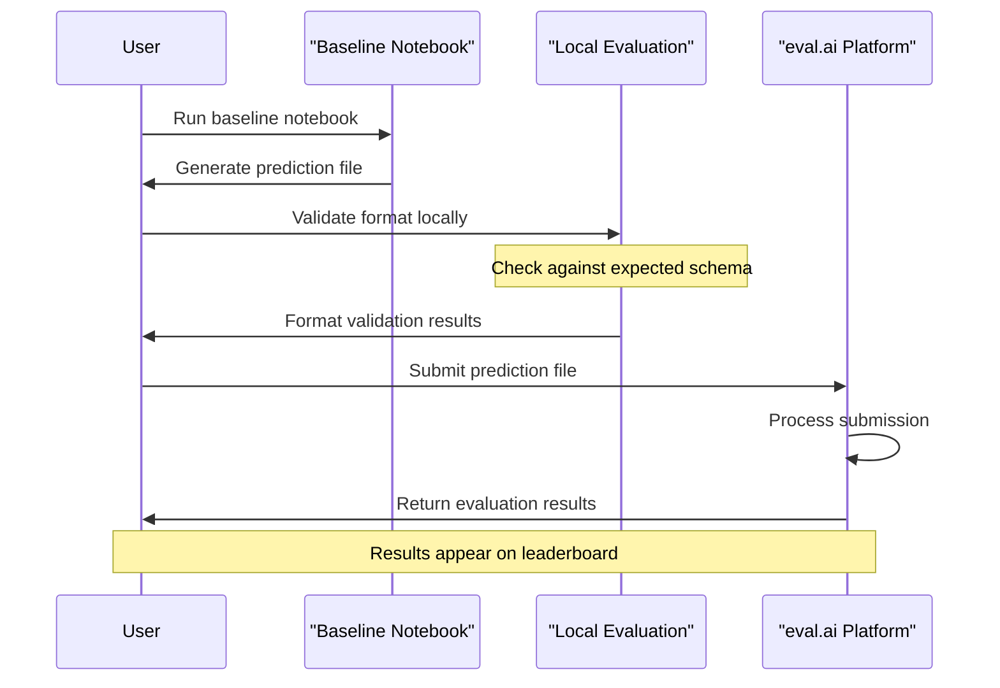
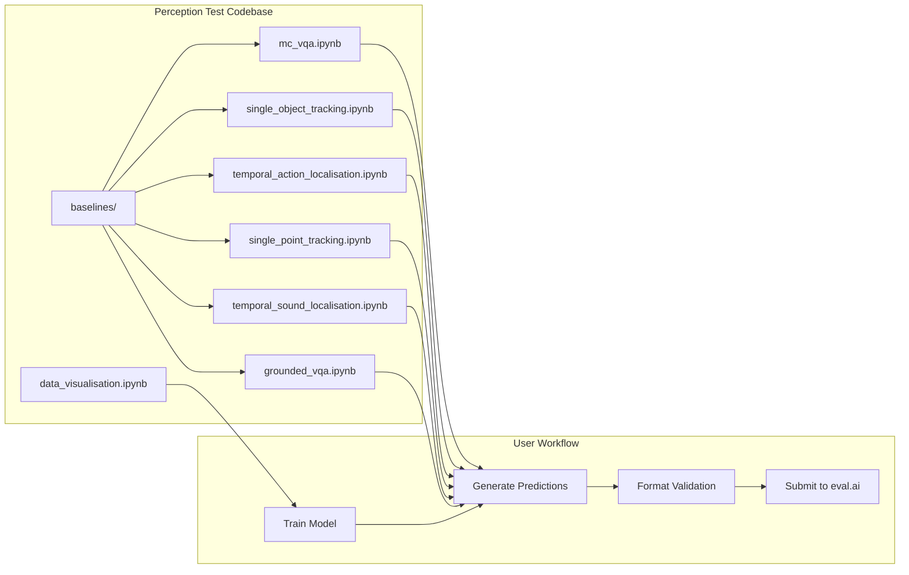
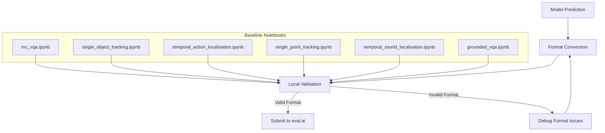

<!-- source: DeepWiki mcp.deepwiki.com · repo google-deepmind/perception_test · page 5.2 Submission Process · fetched 2026-10-26 -->

# Submission Process

<details>
<summary>Relevant source files</summary>

The following files were used as context for generating this wiki page:

- [README.md](README.md)

</details>


This document explains how to submit model predictions to the Perception Test benchmark challenges hosted on the eval.ai platform. It covers the submission formats, workflow, and requirements for all six tasks in the benchmark. For information about downloading the dataset, see [Data Download](#5.1).

## Overview

The Perception Test benchmark includes six different tasks, each with its own evaluation server on eval.ai. Submissions require properly formatted prediction files that conform to specific requirements for each task.



Sources: [README.md:15-16]()

## Submission Requirements

Before submitting, ensure you have:

1. An account on the eval.ai platform
2. Generated predictions in the correct format for your chosen task
3. Validated your prediction format locally using the provided baseline notebooks

### Challenge Platforms

Each task has a dedicated challenge page on eval.ai:

| Task | Challenge URL | Challenge ID |
|------|--------------|-------------|
| Multiple-Choice Video QA | eval.ai/web/challenges/challenge-page/2091/overview | 2091 |
| Object Tracking | eval.ai/web/challenges/challenge-page/2094/overview | 2094 |
| Action Localisation | eval.ai/web/challenges/challenge-page/2101/overview | 2101 |
| Point Tracking | eval.ai/web/challenges/challenge-page/2108/overview | 2108 |
| Sound Localisation | eval.ai/web/challenges/challenge-page/2109/overview | 2109 |
| Grounded Video QA | eval.ai/web/challenges/challenge-page/2110/overview | 2110 |

Sources: [README.md:15-16]()

## Submission Process Flow

The general workflow for submitting to any of the Perception Test challenges follows these steps:



Sources: [README.md:137-147]()

## Task-Specific Submission Formats

Each task requires predictions in a specific format. The baseline notebooks demonstrate how to generate and validate these formats.

### Multiple-Choice Video QA

Submissions should be a JSON file containing predictions for each question ID, where the prediction is the index of the selected answer option.

```
{
  "question_id_1": answer_index,
  "question_id_2": answer_index,
  ...
}
```

Evaluate locally using the MC Video QA baseline notebook.

Sources: [README.md:118-124](), [README.md:146]()

### Object Tracking

Submissions should be a JSON file with each object's predicted bounding boxes across frames:

```
{
  "video_id_1": {
    "object_id_1": {
      "frame_ids": [0, 30, 60, ...],
      "bounding_boxes": [[x1, y1, x2, y2], ...]
    },
    ...
  },
  ...
}
```

Evaluate locally using the Object Tracking baseline notebook.

Sources: [README.md:76-83](), [README.md:142]()

### Action Localisation

Submissions should be a JSON file with predicted temporal action segments:

```
{
  "video_id_1": [
    {
      "label_id": class_id,
      "timestamps": [start_time, end_time],
      "score": confidence_score
    },
    ...
  ],
  ...
}
```

Evaluate locally using the Action Localisation baseline notebook.

Sources: [README.md:96-103](), [README.md:144]()

### Point Tracking

Submissions should be a JSON file with predicted point coordinates across frames:

```
{
  "video_id_1": {
    "point_id_1": {
      "frame_ids": [0, 1, 2, ...],
      "points": [[y1, x1], [y2, x2], ...]
    },
    ...
  },
  ...
}
```

Evaluate locally using the Point Tracking baseline notebook.

Sources: [README.md:86-93](), [README.md:143]()

### Sound Localisation

Submissions should be a JSON file with predicted temporal sound segments:

```
{
  "video_id_1": [
    {
      "label_id": class_id,
      "timestamps": [start_time, end_time],
      "score": confidence_score
    },
    ...
  ],
  ...
}
```

Evaluate locally using the Sound Localisation baseline notebook.

Sources: [README.md:107-114](), [README.md:145]()

### Grounded Video QA

Submissions should be a JSON file with object IDs that answer each question:

```
{
  "question_id_1": [object_id_1, object_id_2, ...],
  "question_id_2": [object_id_1],
  ...
}
```

Evaluate locally using the Grounded Video QA baseline notebook.

Sources: [README.md:126-133](), [README.md:147]()

## Code Integration for Submissions

The following diagram shows how the codebase integrates with the submission process:



Sources: [README.md:137-147](), [README.md:15-16]()

## Evaluation Metrics

Each task is evaluated using specific metrics once submitted:

| Task | Metric | Description |
|------|--------|-------------|
| Multiple-Choice Video QA | Top-1 Accuracy | Percentage of correct answer predictions |
| Object Tracking | Average IoU | Average Intersection over Union across frames |
| Action Localisation | Mean Average Precision | MAP for temporal action segments |
| Point Tracking | Average Jaccard | Average Jaccard index of point tracking accuracy |
| Sound Localisation | Mean Average Precision | MAP for temporal sound segments |
| Grounded Video QA | HOTA | Higher Order Tracking Accuracy for object answers |

Sources: [README.md:151-164]()

## Submission Validation

Before submitting to eval.ai, it's recommended to validate your submission format locally using the baseline notebooks:



Sources: [README.md:137-147]()

## Troubleshooting Submissions

If you encounter issues with your submission:

1. Verify that your prediction file follows the exact format required for the task
2. Check that your JSON is valid and properly formatted
3. Ensure all required fields are present for your task
4. Verify that all video_ids and annotation_ids match those in the test set
5. Contact the Perception Test team at perception-test@google.com for additional support

Sources: [README.md:274-276]()

---

