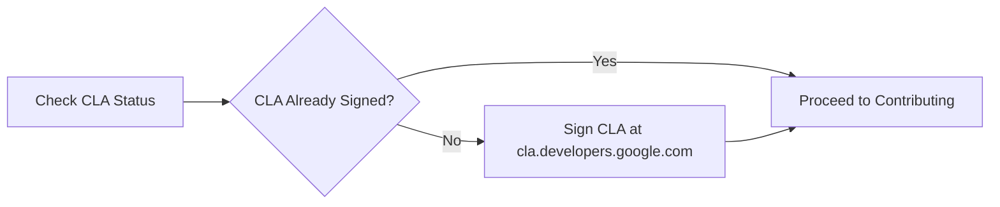
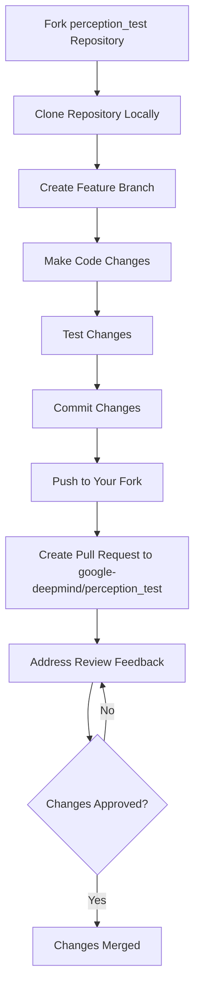
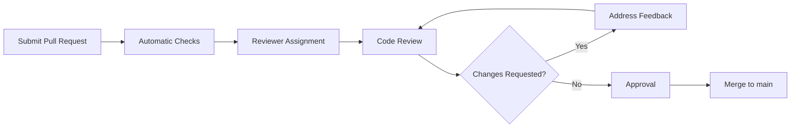

<!-- source: DeepWiki mcp.deepwiki.com · repo google-deepmind/perception_test · page 6 Contributing · fetched 2026-10-26 -->

# Contributing

Relevant source files

The following files were used as context for generating this wiki page:

- [CONTRIBUTING.md](CONTRIBUTING.md)
- [README.md](README.md)

This document outlines how to contribute to the Perception Test benchmark project. It explains the necessary steps to prepare and submit contributions, as well as the requirements for having your contributions accepted.

For information about using the benchmark, see [Using the Benchmark](#5). For details about the dataset, see [Dataset](#2).

## Contributor License Agreement

All contributions to the Perception Test project must be accompanied by a Contributor License Agreement (CLA). This is a legal requirement that gives Google permission to use and redistribute your contributions as part of the project.

### CLA Process

Important notes about the CLA:
- You (or your employer) retain the copyright to your contribution
- You generally only need to submit a CLA once, even if it was for a different project
- Visit https://cla.developers.google.com/ to see your current agreements or sign a new one

Sources: [CONTRIBUTING.md:4-13]()

## Contribution Workflow

The following diagram illustrates the end-to-end process for contributing to the Perception Test project:

### Steps in Detail

1. **Fork Repository**: Create your own fork of the [google-deepmind/perception_test](https://github.com/google-deepmind/perception_test) repository on GitHub
2. **Clone Repository**: Clone your fork to your local machine
3. **Create Branch**: Create a new branch for your specific contribution
4. **Make Changes**: Implement your changes to the codebase
5. **Test Changes**: Ensure your changes work as expected and don't break existing functionality
6. **Commit Changes**: Commit your changes with clear, descriptive commit messages
7. **Push Changes**: Push your branch to your fork on GitHub
8. **Create Pull Request**: Submit a pull request from your fork to the main Perception Test repository
9. **Code Review**: All submissions require review, including submissions by project members
10. **Address Feedback**: Respond to reviewer comments and make necessary adjustments
11. **Merge**: Once approved, your changes will be merged into the main repository

Sources: [CONTRIBUTING.md:15-20]()

## Potential Contribution Areas

The Perception Test project welcomes contributions in various areas. This diagram maps potential contribution types to specific components of the codebase:

```mermaid
graph TD
    A["Contribution Areas"] --> B["Baseline Improvements"]
    A --> C["Metrics Enhancements"]
    A --> D["Data Utilities"]
    A --> E["Documentation"]
    A --> F["Bug Fixes"]
    
    B --> B1["baselines/single_object_tracking.ipynb"]
    B --> B2["baselines/single_point_tracking.ipynb"]
    B --> B3["baselines/temporal_action_localisation.ipynb"]
    B --> B4["baselines/temporal_sound_localisation.ipynb"]
    B --> B5["baselines/mc_vqa.ipynb"]
    B --> B6["baselines/grounded_vqa.ipynb"]
    
    C --> C1["Average IoU for Object Tracking"]
    C --> C2["Average Jaccard for Point Tracking"]
    C --> C3["Mean Average Precision for Localisation"]
    C --> C4["Top-1 Accuracy for MC Video QA"]
    C --> C5["HOTA for Grounded Video QA"]
    
    D --> D1["Data Loading Utilities"]
    D --> D2["Annotation Handlers"]
    D --> D3["Feature Extractors"]
    
    E --> E1["README.md"]
    E --> E2["Code Comments"]
    E --> E3["Example Notebooks"]
    
    F --> F1["Issue Fixes"]
```

Sources: [README.md:137-147](), [README.md:151-164]()

### Task-Specific Baselines

Each task in the Perception Test benchmark has an associated baseline implementation that could be improved:

| Task | Baseline File | Current Implementation |
|------|--------------|------------------------|
| Single Object Tracking | [baselines/single_object_tracking.ipynb]() | Static object baseline |
| Single Point Tracking | [baselines/single_point_tracking.ipynb]() | Static point baseline |
| Temporal Action Localisation | [baselines/temporal_action_localisation.ipynb]() | ActionFormer fine-tuned on Perception Test data |
| Temporal Sound Localisation | [baselines/temporal_sound_localisation.ipynb]() | ActionFormer fine-tuned on Perception Test data |
| Multiple-Choice Video QA | [baselines/mc_vqa.ipynb]() | Frequency baseline using training question/answer pairs |
| Grounded Video QA | [baselines/grounded_vqa.ipynb]() | MDETR + static approach |

Sources: [README.md:137-147]()

### Metrics Contributions

Improvements to the evaluation metrics for any task are valuable contributions:

| Task | Current Metric | Implementation Focus |
|------|---------------|---------------------|
| Single Object Tracking | Average IoU | Accuracy and efficiency |
| Single Point Tracking | Average Jaccard | Precision and robustness |
| Action/Sound Localisation | Mean Average Precision | Temporal alignment accuracy |
| Multiple-Choice Video QA | Top-1 Accuracy | Classification correctness |
| Grounded Video QA | HOTA | Object detection and tracking evaluation |

Sources: [README.md:151-164]()

## Code Review Process

All submissions to the Perception Test project require code review, which is handled through GitHub pull requests. This applies to all contributors, including project members.

Sources: [CONTRIBUTING.md:15-20]()

## Community Guidelines

The Perception Test project follows [Google's Open Source Community Guidelines](https://opensource.google/conduct/). These guidelines provide a framework for respectful and productive collaboration within the project community.

Sources: [CONTRIBUTING.md:22-25]()

## Getting Help

If you have questions or need assistance with the contribution process, you can reach out to the project maintainers:

- Email: **perception-test@google.com**

Sources: [README.md:274-276]()

## Related Development Information

- For development environment details, see [Development Environment](#7)
- For data structure information that may influence your contributions, see [Data Organization](#2.1) and [Annotation Structure](#2.2)
- For task definitions that your contributions might address, see [Tasks](#3)

---

