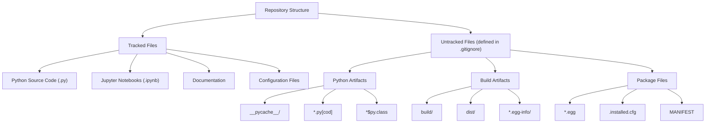
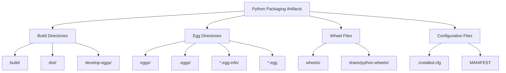
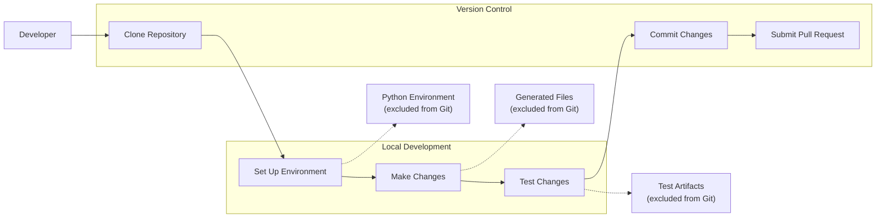

<!-- source: DeepWiki mcp.deepwiki.com · repo google-deepmind/perception_test · page 7 Development Environment · fetched 2026-10-26 -->

# Development Environment

Relevant source files

The following files were used as context for generating this wiki page:

- [.gitignore](.gitignore)

This document describes the development environment for the Perception Test benchmark project. It focuses on the version control structure and excluded files and directories that are not tracked in the repository. For information about contributing to the project, see [Contributing](#6).

## Version Control Structure

The Perception Test project uses Git for version control. The repository is hosted on GitHub at [google-deepmind/perception_test](https://github.com/google-deepmind/perception_test). The project follows standard Git practices with specific exclusions defined in the `.gitignore` file.

### Git Exclusion Patterns

The `.gitignore` file in the repository root specifies patterns for files and directories that should not be tracked by Git. These exclusions help keep the repository clean from build artifacts, temporary files, and other non-essential components.

*Diagram: Version Control Structure of Perception Test Repository*

Sources: [.gitignore:1-24]()

## Python-Specific Exclusions

The Perception Test codebase excludes several Python-specific files and directories from version control to avoid cluttering the repository with generated code and artifacts.

### Byte-compiled and Optimized Files

Python creates cached bytecode files for faster loading of modules. These files are implementation details and should not be committed to the repository.

| Pattern | Description |
|---------|-------------|
| `__pycache__/` | Directory containing byte-compiled Python files |
| `*.py[cod]` | Python compiled files (.pyc, .pyo, .pyd) |
| `*$py.class` | Python optimized files with debugging |

Sources: [.gitignore:1-4]()

## Distribution and Packaging Exclusions

When packaging Python code for distribution, several artifacts are generated that should not be included in version control.

*Diagram: Python Packaging Artifacts Excluded from Version Control*

The following distribution and packaging files are excluded:

| Category | Patterns |
|----------|----------|
| Environment | `.Python` |
| Build directories | `build/`, `dist/`, `develop-eggs/` |
| Egg directories | `eggs/`, `.eggs/`, `*.egg-info/`, `*.egg` |
| Wheel directories | `wheels/`, `share/python-wheels/` |
| Configuration | `.installed.cfg` |
| Manifest | `MANIFEST` |
| Other directories | `lib/`, `lib64/`, `parts/`, `sdist/`, `var/`, `downloads/` |

Sources: [.gitignore:6-24]()

## Development Workflow

The development environment for the Perception Test project is designed to facilitate efficient development while maintaining code quality and consistency.

*Diagram: Development Workflow in Perception Test Project*

Sources: [.gitignore:1-24]()

## Best Practices

When working with the Perception Test development environment, follow these best practices:

1. **Do not commit generated files**: The `.gitignore` file is set up to exclude most generated files, but be vigilant about not committing other temporary or generated files.

2. **Keep dependencies documented**: Any new dependencies should be properly documented and added to the appropriate requirements files.

3. **Respect the exclusion patterns**: Do not force-add files that match patterns in the `.gitignore` file unless there is a compelling reason to do so.

4. **Clean your build artifacts**: Regularly clean build artifacts and other generated files to avoid confusion and maintain a clean workspace.

## File Categories in Development Environment

The following table summarizes the categories of files in the development environment and their version control status:

| File Category | Examples | Version Control Status | Purpose |
|---------------|----------|------------------------|---------|
| Source Code | `.py` files | Tracked | Core functionality |
| Notebooks | `.ipynb` files | Tracked | Examples and tutorials |
| Documentation | Markdown files | Tracked | Project documentation |
| Configuration | Non-generated config files | Tracked | Project configuration |
| Python Bytecode | `__pycache__/`, `.pyc` files | Excluded | Optimization artifacts |
| Build Artifacts | `build/`, `dist/` | Excluded | Distribution artifacts |
| Package Info | `*.egg-info/`, `.eggs/` | Excluded | Package metadata |
| Installation | `.installed.cfg` | Excluded | Installation state |

Sources: [.gitignore:1-24]()

By following these guidelines and understanding the structure of the development environment, contributors can effectively work on the Perception Test project while maintaining a clean and organized codebase.