# Page: Overview

# Overview

<details>
<summary>Relevant source files</summary>

The following files were used as context for generating this wiki page:

- [README.md](README.md)

</details>


This page provides a comprehensive introduction to the Perception Test benchmark, a diagnostic tool designed to evaluate perception and reasoning skills of multimodal video models. The benchmark encompasses a dataset of real-world videos, six distinct computational tasks, evaluation metrics, and baseline implementations.

For specific information about the dataset structure and organization, see [Dataset](#2). For details about individual tasks and their requirements, see [Tasks](#3).

## Purpose and Scope

The Perception Test benchmark serves as a standardized evaluation framework for assessing how well multimodal video models can perceive and reason about visual, audio, and textual information in videos. It specifically tests understanding across four key areas:

- **Memory**: Tracking objects and actions across time
- **Abstraction**: Recognizing patterns and making generalizations
- **Physics**: Understanding physical interactions and predicting outcomes
- **Semantics**: Comprehending semantic meaning of events and relationships

The benchmark enables rigorous comparison of different model architectures and approaches through standardized tasks, metrics, and evaluation procedures.

Sources: [README.md:19-20](), [README.md:30-35]()

## System Architecture

The Perception Test benchmark consists of four primary components that work together to provide a comprehensive evaluation framework:

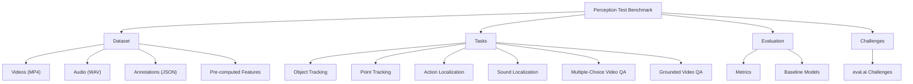

**System Component Diagram**

Sources: [README.md:19-28](), [README.md:37-44](), [README.md:155-163]()

## Dataset Overview

The Perception Test dataset consists of real-world videos with associated audio and detailed annotations. The dataset is split into training, validation, and testing sets, with annotations provided for various perceptual tasks.

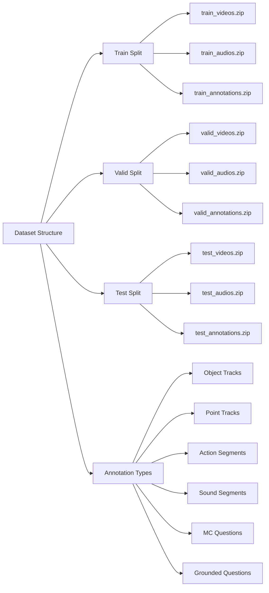

**Dataset Organization Diagram**

Sources: [README.md:37-44](), [README.md:45-52](), [README.md:167-180]()

### Annotation Summary

The Perception Test contains rich annotations across multiple modalities:

| Annotation type | Number of videos | Number of annotations |
|-----------------|------------------|------------------------|
| Object tracks   | 11,609           | 189,940               |
| Point tracks    | 145              | 8,647                 |
| Action segments | 11,353           | 73,503                |
| Sound segments  | 11,433           | 137,128               |
| Multiple-choice Questions | 10,361 | 38,060                |
| Grounded video Questions | 3,063   | 6,086                 |

Sources: [README.md:172-179]()

## Computational Tasks

The benchmark defines six primary computational tasks to evaluate different aspects of perception and reasoning:

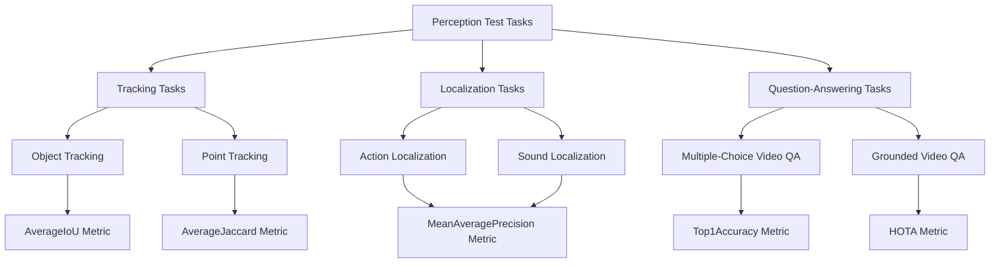

**Task Hierarchy and Evaluation Metrics Diagram**

Sources: [README.md:155-163](), [README.md:137-147]()

### Task Descriptions

1. **Single Object Tracking**: Track individual objects throughout a video
2. **Single Point Tracking**: Track specific points (on objects) across frames
3. **Temporal Action Localization**: Identify when specific actions occur in a video
4. **Temporal Sound Localization**: Identify when specific sounds occur in a video
5. **Multiple-Choice Video QA**: Answer multiple-choice questions about video content
6. **Grounded Video QA**: Answer questions by localizing objects in the video

Each task has specific evaluation metrics designed to measure performance on that particular perceptual skill.

Sources: [README.md:155-163](), [README.md:137-147]()

## Evaluation Framework

The evaluation framework consists of metrics for each task and baseline implementations:

| Computational task | Metric | Baseline Implementation |
|--------------------|--------|-------------------------|
| Single Object Tracking | Average IoU | Static |
| Single Point Tracking | Average Jaccard | Static |
| Temporal Action Localization | Mean Average Precision | ActionFormer |
| Temporal Sound Localization | Mean Average Precision | ActionFormer |
| Multiple-Choice Video QA | Top-1 Accuracy | Frequency |
| Grounded Video QA | HOTA | MDETR + static |

The baseline implementations provide reference points for model performance and demonstrate how to interact with the dataset and evaluation metrics.

Sources: [README.md:137-147](), [README.md:155-163]()

## Data and Challenge Access

The Perception Test benchmark is accessible through:

1. **Dataset Downloads**: Split into videos, audio, annotations, and pre-computed features
2. **Challenge Platforms**: Tasks hosted on the eval.ai platform for standardized evaluation
3. **Baseline Notebooks**: Jupyter notebooks demonstrating data loading and evaluation

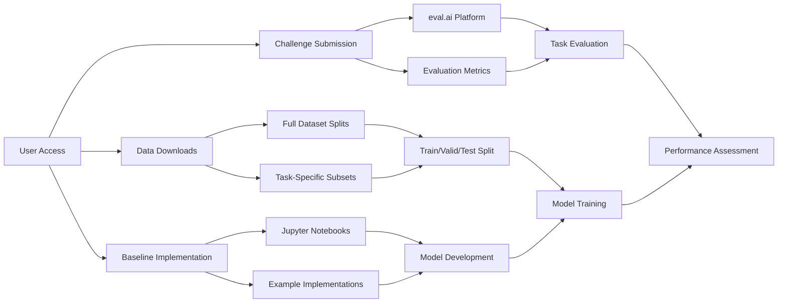

**Data Access and Usage Flow Diagram**

Sources: [README.md:9-16](), [README.md:37-52](), [README.md:59-70]()

## Relationship to Code Organization

The repository structure maps directly to the benchmark components:

1. **Dataset Access and Visualization**: Code for downloading and exploring the dataset
2. **Baselines Directory**: Contains task-specific notebooks with baseline implementations
3. **Evaluation Metrics**: Code for calculating performance metrics for each task

For detailed information about specific tasks, data organization, or evaluation procedures, please refer to the corresponding pages in this wiki.

Sources: [README.md:22-27](), [README.md:137-147]()

---

# Page: System Architecture

# System Architecture

<details>
<summary>Relevant source files</summary>

The following files were used as context for generating this wiki page:

- [README.md](README.md)

</details>


## Purpose and Scope

This document describes the high-level architecture of the Perception Test benchmark system, which provides a framework for evaluating multimodal video models across six distinct perceptual and reasoning tasks. This architecture documentation covers the organization of system components, data flows, task definitions, and evaluation mechanisms. For detailed information about specific tasks and their requirements, see [Tasks](#3).

## High-Level System Overview

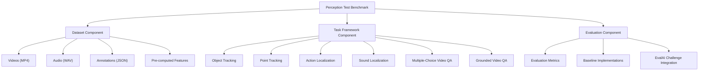

Sources: README.md

The Perception Test benchmark consists of three primary components:

1. **Dataset Component**: Manages multimodal data (videos, audio, annotations)
2. **Task Framework Component**: Defines six perception and reasoning tasks
3. **Evaluation Component**: Provides metrics, baseline implementations, and challenge integration

## Data Architecture

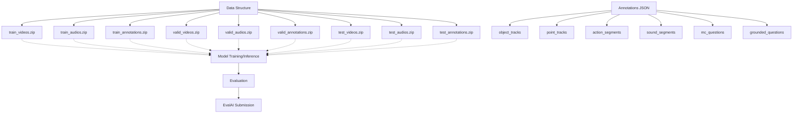

Sources: README.md:37-53

The data is organized into three splits (train, valid, test), each containing videos, audio files, and annotations in standardized formats. Pre-computed features are also provided for specific tasks.

### Data Formats and Structure

| Component | Format | Description | Size Example |
|-----------|--------|-------------|--------------|
| Videos | MP4 | Visual content | train_videos.zip (26.5GB) |
| Audio | WAV | Audio content | train_audios.zip (12.3GB) |
| Annotations | JSON | Structured data | train_annotations.zip (30.6MB) |
| Pre-computed Features | ZIP | Task-specific features | action_localisation_train_video_features.zip (81.7MB) |

Sources: README.md:39-53

## Task Framework Architecture

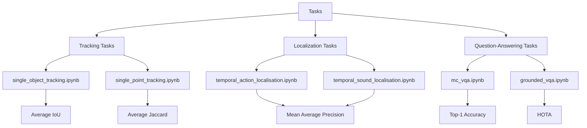

Sources: README.md:138-162

The task framework organizes six tasks into three categories:
1. **Tracking Tasks**: Object tracking and point tracking
2. **Localization Tasks**: Action localization and sound localization
3. **Question-Answering Tasks**: Multiple-choice video QA and grounded video QA

Each task has dedicated baseline implementation notebooks and specific evaluation metrics.

## Annotation Structure and Relationships

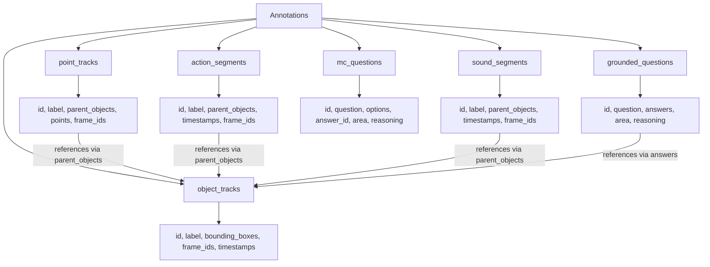

Sources: README.md:166-272

The annotation structure follows a hierarchical schema. Object tracks form the foundation, with point tracks, action segments, sound segments, and grounded video QA all referencing object tracks. Multiple-choice QA annotations stand independently.

### Annotation Field Summary

| Annotation Type | Key Fields | Relationship |
|-----------------|------------|--------------|
| Object Tracks | id, label, bounding_boxes, frame_ids, timestamps | Foundation |
| Point Tracks | id, label, parent_objects, points, frame_ids | References Object Tracks |
| Action Segments | id, label, parent_objects, timestamps, frame_ids | References Object Tracks |
| Sound Segments | id, label, parent_objects, timestamps, frame_ids | References Object Tracks |
| Multiple-Choice QA | id, question, options, answer_id, area, reasoning | Independent |
| Grounded Video QA | id, question, answers, area, reasoning | References Object Tracks |

Sources: README.md:180-272

## Evaluation System Architecture

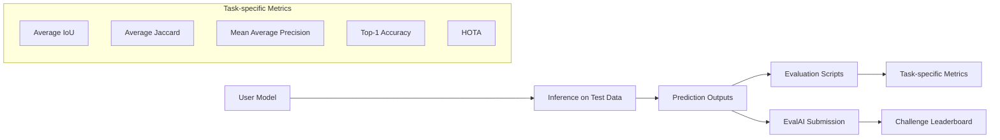

Sources: README.md:151-164

The evaluation system enables users to:
1. Run models on test data
2. Generate prediction outputs in the required format
3. Evaluate performance using task-specific metrics
4. Submit results to EvalAI for official challenge ranking

## Baseline Implementation Architecture

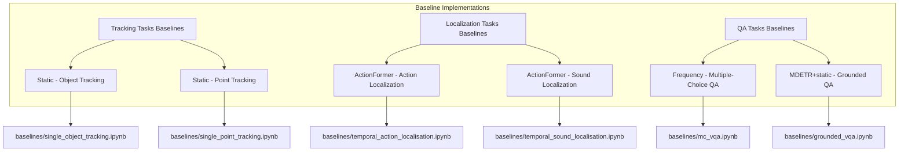

Sources: README.md:137-147

Each task has a baseline implementation provided as a Jupyter notebook in the `baselines/` directory. The implementations range from simple approaches (static baselines for tracking) to more sophisticated models (ActionFormer for localization, MDETR for grounded QA).

## Data Processing and Workflow

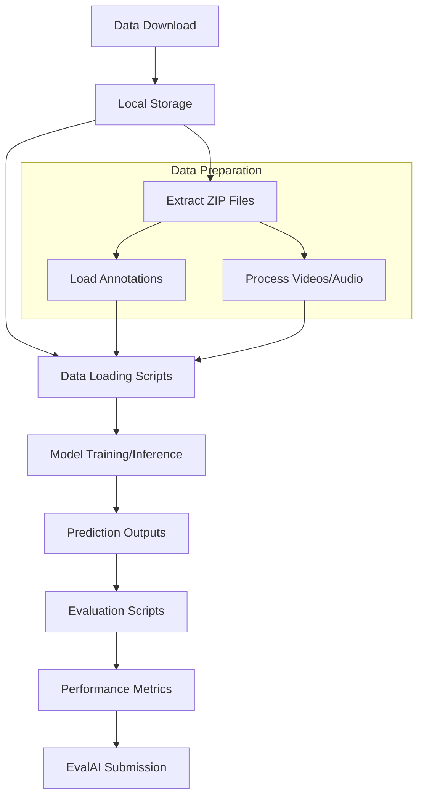

Sources: README.md:37-134

The typical workflow begins with downloading dataset components, followed by data preparation, loading and processing, model development, performance evaluation, and challenge submission.

## Integration Points with External Systems

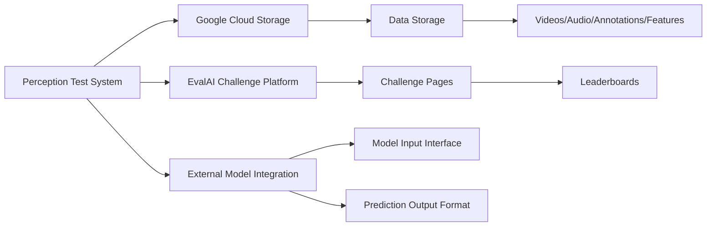

Sources: README.md:5-16, 37-53

The benchmark system integrates with:
1. **Google Cloud Storage**: For hosting and distributing the dataset
2. **EvalAI**: For challenge hosting and leaderboard management
3. **External Models**: Through standardized input/output interfaces

## Technical Implementation Details

The benchmark implementation relies on:

1. **Standard Data Formats**:
   - Videos: MP4 format
   - Audio: WAV format
   - Annotations: JSON format
   - Pre-computed Features: Custom numpy arrays

2. **Evaluation Implementations**:
   - Object Tracking: Average IoU calculation
   - Point Tracking: Average Jaccard index
   - Action/Sound Localization: Mean Average Precision
   - Multiple-Choice QA: Top-1 Accuracy
   - Grounded QA: HOTA metric

3. **Baseline Models**:
   - Simple baselines (static)
   - Pre-trained models (ActionFormer, MDETR)
   - Statistical approaches (Frequency baseline)

Sources: README.md:137-164

## Summary

The Perception Test benchmark architecture provides a comprehensive framework for evaluating multimodal video understanding models. The system integrates dataset management, task definitions, baseline implementations, and evaluation mechanisms into a cohesive platform that enables fair and standardized comparison of model performance across six challenging perception and reasoning tasks.

Sources: README.md

---

# Page: Dataset

# Dataset

<details>
<summary>Relevant source files</summary>

The following files were used as context for generating this wiki page:

- [README.md](README.md)

</details>


The Perception Test dataset is a comprehensive multimodal benchmark collection designed to evaluate perception and reasoning skills of video understanding models. This document provides detailed information about the dataset's structure, organization, content types, and annotation formats. For information about specific tasks that can be performed using this dataset, see [Tasks](#3).

## Dataset Overview

The Perception Test dataset consists of real-world videos showing perceptually interesting situations, accompanied by audio and detailed annotations. The dataset is specifically designed to test understanding across multiple modalities (visual, audio, and text) and across different perceptual and reasoning skills.

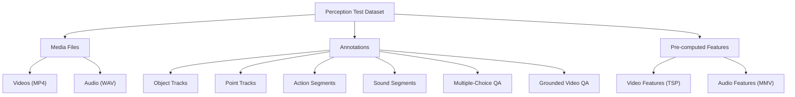

Sources: [README.md:37-43]()

## Dataset Scale and Statistics

The Perception Test dataset contains a substantial number of videos and annotations across different categories:

| Annotation type | Number of videos | Number of annotations |
|-----------------|------------------|------------------------|
| Object tracks | 11,609 | 189,940 |
| Point tracks | 145 | 8,647 |
| Action segments | 11,353 | 73,503 |
| Sound segments | 11,433 | 137,128 |
| Multiple-choice Questions | 10,361 | 38,060 |
| Grounded video Questions | 3,063 | 6,086 |

Sources: [README.md:172-179]()

## Data Organization

The dataset is organized into three primary splits: training, validation, and testing. Each split contains videos, audio, and corresponding annotations.

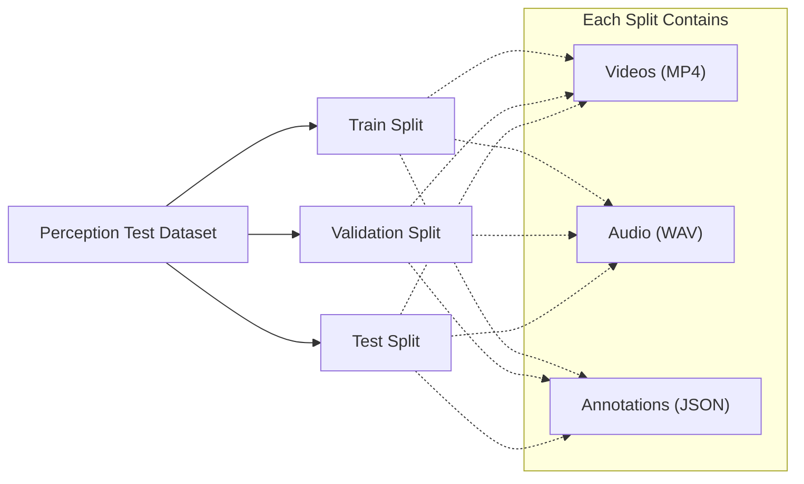

Sources: [README.md:45-53]()

For certain tasks, only a subset of the videos is used. The repository provides CSV files listing the video IDs specific to each task challenge.

## Data Formats and Structure

### Video and Audio Files

The videos are provided as MP4 files and include the following metadata:

| Field Name | Description |
|------------|-------------|
| split | The data split the video belongs to, one of ['train','valid','test'] |
| video_id | The ID of the video ['video_xxxx'] |
| frame_rate | The frame rate of the video in frames per second |
| num_frames | The total number of frames in the video |
| resolution | The height and width of the video in pixels |
| audio_samples | The total number of audio samples in the video |
| audio_sample_rate | The sample rate of the audio in the video in Hz |
| is_cup_game | Whether the video shows a cups-game or not |
| is_camera_moving | Whether the camera used to film the video is moving or not |

Sources: [README.md:184-195]()

Audio is also provided separately as WAV files, which allows for easier audio-only processing.

### Annotation Structure

The annotations are provided in JSON format and include six different types of annotations. These annotations have relationships between them, as illustrated in the following diagram:

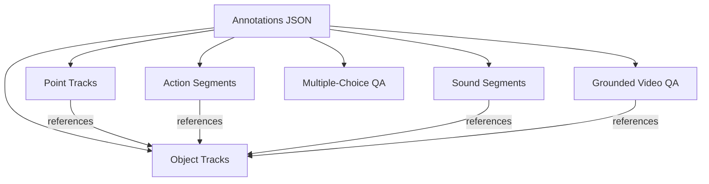

Sources: [README.md:198-272]()

#### Object Tracks

Object tracks are the fundamental annotations in the dataset, with other annotation types often referencing them:

| Field Name | Description |
|------------|-------------|
| id | A unique annotation ID for each object track |
| label | The name of the object, can also contain object attributes, e.g. red box |
| is_occluder | Whether the object occludes other objects in the video (valid only for cups-games videos) |
| bounding_boxes | The coordinates of the object's bounding box in the format [x1,y1,x2,y2] |
| initial_tracking_box | One-hot vector indicating which box annotation should be used to start tracking |
| frame_ids | The IDs of the frames that are annotated, normally 1 per second |
| timestamps | The timestamps of the annotated frames in μs |
| is_masked | Whether the object is masked in the annotated frame (valid only for cups-games videos) |

Sources: [README.md:200-210]()

#### Point Tracks

| Field Name | Description |
|------------|-------------|
| id | A unique annotation ID for each point track |
| label | The label of the point track |
| parent_objects | The id of the object that the point belongs to |
| frame_ids | The IDs of the frames that are annotated |
| points | The coordinates of the points in [y,x] |

Sources: [README.md:214-221]()

#### Action Segments

| Field Name | Description |
|------------|-------------|
| id | A unique annotation ID for each action segment |
| label | The templated class of the action segment |
| parent_objects | The ids of the objects involved in the action |
| timestamps | The start and end timestamps of the action segment in μs |
| frame_ids | The start and end frame IDs of the action segment |
| label_id | A unique class ID for each label in the dataset |

Sources: [README.md:224-232]()

#### Sound Segments

| Field Name | Description |
|------------|-------------|
| id | A unique annotation ID for each sound segment |
| label | The name or class of the sound segment |
| parent_objects | The object ids related to this sound segment |
| timestamps | The start and end timestamps of the sound segment in μs |
| frame_ids | The start and end frame IDs of the sound segment |
| is_visible | Whether the objects causing the sound in this segment are visible |
| label_id | A unique class ID for each label in the dataset |

Sources: [README.md:237-246]()

#### Multiple-Choice Video QA

| Field Name | Description |
|------------|-------------|
| id | A unique annotation ID for each question |
| question | The text of the question |
| options | The possible options for the question (3 options, one correct) |
| answer_id | The ID of the correct option for the question |
| area | The skill area the question pertains to (Memory, Abstraction, Physics, Semantics) |
| reasoning | Type of reasoning required (Descriptive, Explanatory, Predictive, Counterfactual) |
| tag | Different skills involved in answering the question |

Sources: [README.md:251-260]()

#### Grounded Video QA

| Field Name | Description |
|------------|-------------|
| id | A unique annotation ID for each question |
| question | The text of the question |
| answers | List of IDs relating to object tracking annotation IDs |
| area | The skill area the question pertains to |
| reasoning | Type of reasoning required |

Sources: [README.md:265-272]()

## Dataset Access and Downloads

The Perception Test dataset is available for download in various zip files containing videos, audio, and annotations for different splits and tasks.

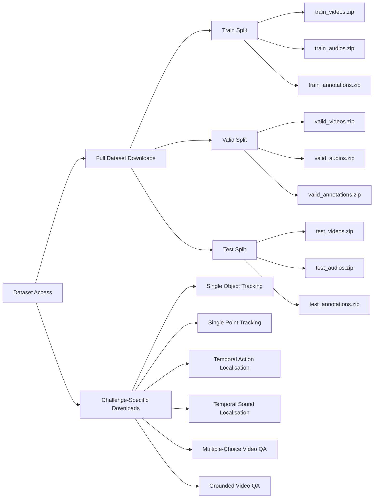

Sources: [README.md:37-133]()

### Full Dataset Splits

The complete dataset is available as zip files for each split:

| Split | Videos | Audio | Annotations |
|-------|--------|-------|------------|
| Train | train_videos.zip (26.5GB) | train_audios.zip (12.3GB) | train_annotations.zip (30.6MB) |
| Valid | valid_videos.zip (70.2GB) | valid_audios.zip (33.1GB) | valid_annotations.zip (81.5MB) |
| Test | test_videos.zip (41.8GB) | test_audios.zip (19.3GB) | test_annotations.zip (633.9kB) |

Sources: [README.md:47-52]()

### Challenge-Specific Downloads

For certain challenges, smaller subsets of the dataset are provided:

1. **Single Object Tracking**
2. **Single Point Tracking**
3. **Temporal Action Localisation**
4. **Temporal Sound Localisation**
5. **Multiple-Choice Video QA**
6. **Grounded Video QA**

Each challenge has its own specific video IDs and, in some cases, dedicated download links.

Sources: [README.md:59-133]()

## Pre-computed Features

To facilitate model development for certain tasks, the dataset includes pre-computed features:

1. **Video Features (TSP)** - For Temporal Action Localisation
2. **Audio Features (MMV)** - For Temporal Sound Localisation

These features can be used directly for model training without requiring extensive feature extraction preprocessing.

Sources: [README.md:99-114]()

## Special Considerations

For videos where the end reveals answers to certain questions (e.g., cup games), the test videos have the end cut off. For validation and training splits, cutpoint information is provided in JSON files:
- `cut_frame_mapping_train.json`
- `cut_frame_mapping_valid.json`

Sources: [README.md:54-55]()

## Dataset Usage

The Perception Test dataset is designed to be used with the associated tasks and baseline models. For information about specific tasks and how to use the dataset for evaluation, see [Tasks](#3) and [Evaluation](#4).

Sources: [README.md:19-28]()

---

# Page: Data Organization

# Data Organization

<details>
<summary>Relevant source files</summary>

The following files were used as context for generating this wiki page:

- [README.md](README.md)

</details>


This document describes the structure, format, and organization of the Perception Test benchmark dataset. It covers how data is divided into splits, the various file formats used, and the organization of task-specific subsets for challenges. For details about the specific contents and schema of annotations, see [Annotation Structure](#2.2).

## Dataset Components

The Perception Test dataset consists of three primary components:

1. **Videos**: MP4 files containing visual content with embedded audio
2. **Audio**: WAV files containing standalone audio tracks
3. **Annotations**: JSON files containing labels, bounding boxes, and other task-specific metadata

In addition, the dataset includes pre-computed features for specific tasks:
- Video features (TSP) for temporal action localization
- Audio features (MMV) for temporal sound localization

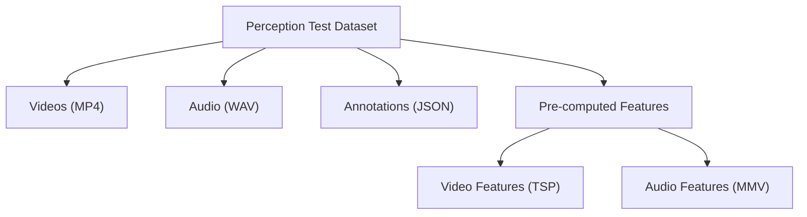

Sources: [README.md:37-43](https://github.com/deepmind/perception_test/blob/main/README.md)

## Dataset Splits

The dataset is organized into three main splits:

| Split | Purpose | Videos | Audio | Annotations |
|-------|---------|--------|-------|------------|
| Train | Model training | 26.5GB | 12.3GB | 30.6MB |
| Valid | Model validation | 70.2GB | 33.1GB | 81.5MB |
| Test | Model evaluation | 41.8GB | 19.3GB | 633.9kB |

Additionally, a small sample subset is provided for quick exploration and development.

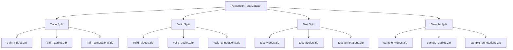

Sources: [README.md:45-52](https://github.com/deepmind/perception_test/blob/main/README.md)

## File Structure and Naming Conventions

Each data component follows a consistent naming convention:

1. **Main Dataset Splits**:
   - `{split}_videos.zip`: Contains MP4 files with unique video IDs (e.g., video_xxxx)
   - `{split}_audios.zip`: Contains WAV files with matching video IDs
   - `{split}_annotations.zip`: Contains JSON annotation files

2. **Video IDs**:
   - Each video has a unique identifier in the format `video_xxxx`
   - These IDs are consistent across video files, audio files, and annotations

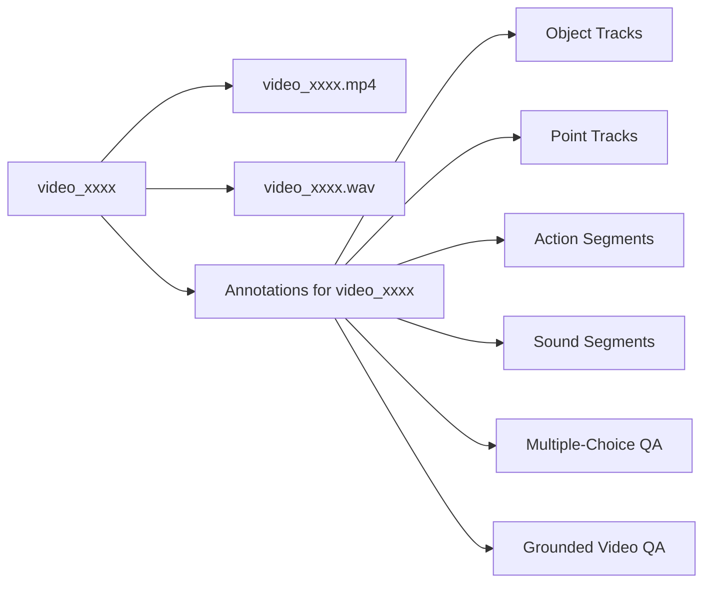

Sources: [README.md:180-196](https://github.com/deepmind/perception_test/blob/main/README.md)

## Task-Specific Data Organization

The dataset is organized to support six computational tasks, with each task potentially using a subset of the full dataset:

1. **Single Object Tracking**
2. **Single Point Tracking**
3. **Temporal Action Localization**
4. **Temporal Sound Localization**
5. **Multiple-Choice Video QA**
6. **Grounded Video QA**

### Video ID Lists for Filtering

For tasks that use subsets of the full dataset, CSV files listing the relevant video IDs are provided:

```mermaid
graph TD
    A["Task Subsets"] --> B["Single Object Tracking"]
    A --> C["Single Point Tracking"]
    A --> D["Temporal Action Localization"]
    A --> E["Temporal Sound Localization"]
    A --> F["Multiple-Choice Video QA"]
    A --> G["Grounded Video QA"]
    
    B --> B1["object_tracking_train_id_list.csv"]
    B --> B2["object_tracking_valid_subset_id_list.csv"]
    B --> B3["object_tracking_test_subset_id_list.csv"]
    
    C --> C1["point_tracking_train_id_list.csv"]
    C --> C2["point_tracking_valid_id_list.csv"]
    C --> C3["point_tracking_test_id_list.csv"]
    
    D --> D1["action_localisation_train_id_list.csv"]
    D --> D2["localisation_challenge_valid_id_list.csv"]
    D --> D3["localisation_challenge_test_id_list.csv"]
    
    E --> E1["sound_localisation_train_id_list.csv"]
    E --> E2["localisation_challenge_valid_id_list.csv"]
    E --> E3["localisation_challenge_test_id_list.csv"]
    
    F --> F1["mc_question_train_id_list.csv"]
    F --> F2["mc_question_valid_id_list.csv"]
    F --> F3["mc_question_test_id_list.csv"]
    
    G --> G1["grounded_question_train_id_list.csv"]
    G --> G2["grounded_question_valid_id_list.csv"]
    G --> G3["grounded_question_test_id_list.csv"]
```

Sources: [README.md:59-70](https://github.com/deepmind/perception_test/blob/main/README.md)

### Task-Specific Data Subsets

For three tasks, smaller task-specific ZIP files are available instead of filtering the full dataset:

1. **Single Object Tracking**:
   - Task-specific validation and test ZIP files
   - Uses the full train dataset

2. **Single Point Tracking**:
   - Task-specific train, validation, and test ZIP files

3. **Grounded Video QA**:
   - Task-specific train, validation, and test ZIP files

For the remaining tasks, users need to filter the full dataset using the provided video ID lists.

```mermaid
graph TD
    subgraph "Task-Specific Data Files"
        A1["Single Object Tracking"] --> A2["sot_valid_videos_challenge2023.zip"]
        A1 --> A3["sot_valid_annotations_challenge2023.zip"]
        A1 --> A4["sot_test_videos_challenge2023.zip"]
        A1 --> A5["sot_test_annotations_challenge2023.zip"]
        
        B1["Single Point Tracking"] --> B2["point_tracking_train_videos.zip"]
        B1 --> B3["point_tracking_train_annotations.zip"]
        B1 --> B4["point_tracking_valid_videos.zip"]
        B1 --> B5["point_tracking_valid_annotations.zip"]
        B1 --> B6["point_tracking_test_videos.zip"]
        B1 --> B7["point_tracking_test_annotations.zip"]
        
        C1["Grounded Video QA"] --> C2["grounded_question_train_videos.zip"]
        C1 --> C3["grounded_question_train_audios.zip"]
        C1 --> C4["grounded_question_train_annotations.zip"]
        C1 --> C5["grounded_question_valid_videos.zip"]
        C1 --> C6["grounded_question_valid_audios.zip"]
        C1 --> C7["grounded_question_valid_annotations.zip"]
        C1 --> C8["grounded_question_test_videos.zip"]
        C1 --> C9["grounded_question_test_annotations.zip"]
    end
```

Sources: [README.md:76-133](https://github.com/deepmind/perception_test/blob/main/README.md)

## Pre-computed Features

For temporal localization tasks, pre-computed features are provided to simplify model training:

1. **Temporal Action Localization**:
   - `action_localisation_train_video_features.zip`
   - `action_localisation_valid_video_features.zip`
   - `action_localisation_test_video_features.zip`

2. **Temporal Sound Localization**:
   - `sound_localisation_train_audio_features.zip`
   - `sound_localisation_valid_audio_features.zip`
   - `sound_localisation_test_audio_features.zip`

These features are extracted using pre-trained models (TSP for video, MMV for audio) and can be used directly for model training and evaluation.

Sources: [README.md:96-114](https://github.com/deepmind/perception_test/blob/main/README.md)

## Special Handling for Cup Game Videos

In videos featuring cup games (where objects are hidden under cups and moved around), special handling is implemented:

1. **Test Videos**: The end of the video is completely cut off to avoid revealing answers
2. **Train and Valid Videos**: Mapping files are provided to indicate where videos should be cut:
   - `cut_frame_mapping_train.json`
   - `cut_frame_mapping_valid.json`

These files help ensure proper evaluation without giving away answers in tasks that involve tracking objects or answering questions about hidden objects.

```mermaid
graph TD
    A["Cup Game Video"] --> B["Regular Viewing"]
    A --> C["Test Split"]
    A --> D["Train/Valid Split"]
    
    C --> C1["Ends Removed"]
    D --> D1["Cut Frame Mapping Files"]
    
    D1 --> D2["cut_frame_mapping_train.json"]
    D1 --> D3["cut_frame_mapping_valid.json"]
    
    D2 --> E["Indicates where to cut videos"]
    D3 --> E
```

Sources: [README.md:54-55](https://github.com/deepmind/perception_test/blob/main/README.md), [README.md:122-124](https://github.com/deepmind/perception_test/blob/main/README.md)

## Recommended Data Loading Workflow

The recommended workflow for working with the Perception Test dataset is:

1. Download the appropriate ZIP files for your task
2. Extract the files to maintain the directory structure
3. Use the provided task-specific ID lists to filter the data if needed
4. For cup game videos, apply the appropriate cut frame mapping
5. Load the videos, audio, and annotations as required by your model

The data organization is designed to make it easy to work with specific tasks while maintaining the relationship between videos, audio, and annotations.

Sources: [README.md:37-133](https://github.com/deepmind/perception_test/blob/main/README.md)

---

# Page: Annotation Structure

# Annotation Structure

<details>
<summary>Relevant source files</summary>

The following files were used as context for generating this wiki page:

- [README.md](README.md)

</details>


This document details the structure and organization of annotations in the Perception Test benchmark. It explains the different annotation types, their fields, and the hierarchical relationships between them. These annotations form the foundation for the six tasks defined in the benchmark.

## Overview

The Perception Test benchmark uses JSON-formatted annotations to provide ground truth data for various perceptual tasks. Annotations are organized by video and include six primary types:

- Object tracks
- Point tracks
- Action segments
- Sound segments
- Multiple-choice video questions
- Grounded video questions

The annotation system follows a hierarchical structure, with object tracks forming the foundation that other annotation types often reference.

### Annotation Structure Hierarchy

```mermaid
graph TD
    A["annotations.json"] --> B["object_tracks"]
    A --> C["point_tracks"]
    A --> D["action_segments"]
    A --> E["sound_segments"]
    A --> F["mc_questions"]
    A --> G["grounded_questions"]
    
    C -- "parent_objects references id" --> B
    D -- "parent_objects references id" --> B
    E -- "parent_objects references id" --> B
    G -- "answers references id" --> B
```

Sources: [README.md:167-272]()

## Annotation Types and Fields

Each annotation type has specific fields that define its properties and relationships to other annotations. Below is a detailed description of each annotation type and its fields.

### Video Metadata

Every video in the dataset includes metadata that provides context for all annotations:

| Field Name | Type | Description |
|------------|------|-------------|
| split | string | The data split: 'train', 'valid', or 'test' |
| video_id | string | Unique identifier for the video ('video_xxxx') |
| frame_rate | float | Frame rate in frames per second |
| num_frames | integer | Total number of frames in the video |
| resolution | list | Height and width of the video in pixels |
| audio_samples | integer | Total number of audio samples |
| audio_sample_rate | integer | Audio sample rate in Hz |
| is_cup_game | boolean | Whether the video shows a cups-game |
| is_camera_moving | boolean | Whether the camera is moving |

Sources: [README.md:181-195]()

### Object Tracks

Object tracks are the most fundamental annotation type, representing the position and properties of objects in videos over time.

| Field Name | Type | Description |
|------------|------|-------------|
| id | string | Unique identifier for each object track |
| label | string | Object name and attributes (e.g., "red box") |
| is_occluder | boolean | Whether the object occludes others (cup-games only) |
| bounding_boxes | list | Coordinates in format [x1, y1, x2, y2] for each annotated frame |
| initial_tracking_box | list | One-hot vector indicating which box to use for starting tracking |
| frame_ids | list | IDs of annotated frames (typically 1 per second) |
| timestamps | list | Timestamps of annotated frames in μs |
| is_masked | list | Whether the object is masked in each annotated frame |

Sources: [README.md:198-210]()

### Point Tracks

Point tracks represent the position of specific points on objects over time.

| Field Name | Type | Description |
|------------|------|-------------|
| id | string | Unique identifier for each point track |
| label | string | Label of the point track |
| parent_objects | string | ID of the object that the point belongs to |
| frame_ids | list | IDs of annotated frames |
| points | list | Coordinates of points in [y, x] format |

Sources: [README.md:212-221]()

### Action Segments

Action segments represent temporal intervals during which specific actions occur.

| Field Name | Type | Description |
|------------|------|-------------|
| id | string | Unique identifier for each action segment |
| label | string | Class of the action (e.g., "Putting something into something") |
| parent_objects | list | IDs of objects involved in the action |
| timestamps | list | Start and end timestamps in μs [start, end] |
| frame_ids | list | Start and end frame IDs [start, end] |
| label_id | integer | Unique class ID for the label |

Sources: [README.md:222-232]()

### Sound Segments

Sound segments represent temporal intervals during which specific sounds occur.

| Field Name | Type | Description |
|------------|------|-------------|
| id | string | Unique identifier for each sound segment |
| label | string | Name or class of the sound |
| parent_objects | list | IDs of objects related to the sound |
| timestamps | list | Start and end timestamps in μs [start, end] |
| frame_ids | list | Start and end frame IDs [start, end] |
| is_visible | boolean | Whether objects causing the sound are visible |
| label_id | integer | Unique class ID for the label |

Sources: [README.md:234-246]()

### Multiple-Choice Video Questions

Multiple-choice questions test understanding of video content through selection from options.

| Field Name | Type | Description |
|------------|------|-------------|
| id | string | Unique identifier for each question |
| question | string | Text of the question |
| options | list | Three possible options (only one correct) |
| answer_id | integer | ID of the correct option |
| area | string | Skill area: Memory, Abstraction, Physics, or Semantics |
| reasoning | string | Type of reasoning: Descriptive, Explanatory, Predictive, or Counterfactual |
| tag | list | Different skills involved in answering the question |

Sources: [README.md:248-260]()

### Grounded Video Questions

Grounded video questions require identifying specific objects as answers.

| Field Name | Type | Description |
|------------|------|-------------|
| id | string | Unique identifier for each question |
| question | string | Text of the question |
| answers | list | List of IDs referencing object tracks |
| area | string | Skill area: Memory, Abstraction, Physics, or Semantics |
| reasoning | string | Type of reasoning: Descriptive, Explanatory, Predictive, or Counterfactual |

Sources: [README.md:262-272]()

## Key Annotation Relationships

The annotation types form a structured hierarchy, with several types referencing object tracks:

### Inter-Annotation References

```mermaid
graph TD
    OT["object_track"] --> OT_ID["id"]
    OT --> OT_L["label"]
    
    PT["point_track"] --> PT_ID["id"]
    PT --> PT_PO["parent_objects"]
    
    AS["action_segment"] --> AS_ID["id"]
    AS --> AS_PO["parent_objects"]
    
    SS["sound_segment"] --> SS_ID["id"]
    SS --> SS_PO["parent_objects"]
    
    GQ["grounded_question"] --> GQ_ID["id"]
    GQ --> GQ_A["answers"]
    
    PT_PO -- "references" --> OT_ID
    AS_PO -- "references" --> OT_ID
    SS_PO -- "references" --> OT_ID
    GQ_A -- "references" --> OT_ID
```

Sources: [README.md:167-272]()

These relationships reflect the structure of video content:
- Point tracks are anchored to parent objects
- Action segments involve specific objects
- Sound segments are associated with objects producing sounds
- Grounded video questions require identifying specific objects

## Task-Annotation Mapping

Each task in the Perception Test benchmark uses specific annotation types as inputs and evaluation targets:

### Task to Annotation Relationship

```mermaid
graph LR
    SOT["single_object_tracking.ipynb"] --> OT["object_tracks"]
    SPT["single_point_tracking.ipynb"] --> PT["point_tracks"]
    TAL["temporal_action_localisation.ipynb"] --> AS["action_segments"]
    TSL["temporal_sound_localisation.ipynb"] --> SS["sound_segments"]
    MCVQA["mc_vqa.ipynb"] --> MC["mc_questions"]
    GVQA["grounded_vqa.ipynb"] --> GQ["grounded_questions"]
    GVQA -- "also uses" --> OT
```

Sources: [README.md:140-148]()

The mapping shows which annotation files are used by each task:

| Task | Primary Annotation Type | Additional Types |
|------|------------------------|------------------|
| Object Tracking | object_tracks | None |
| Point Tracking | point_tracks | None |
| Action Localization | action_segments | None |
| Sound Localization | sound_segments | None |
| Multiple-Choice Video QA | mc_questions | None |
| Grounded Video QA | grounded_questions | object_tracks |

Sources: [README.md:140-148]()

## Annotation Statistics

The Perception Test dataset includes a substantial number of annotations across all types:

| Annotation Type | Number of Videos | Number of Annotations |
|-----------------|------------------|----------------------|
| Object tracks | 11,609 | 189,940 |
| Point tracks | 145 | 8,647 |
| Action segments | 11,353 | 73,503 |
| Sound segments | 11,433 | 137,128 |
| Multiple-choice Questions | 10,361 | 38,060 |
| Grounded video Questions | 3,063 | 6,086 |

Sources: [README.md:170-180]()

These statistics demonstrate the scale and diversity of annotations available for model training and evaluation.

## Conclusion

The Perception Test benchmark uses a comprehensive annotation structure to support six distinct tasks. Object tracks form the foundation, with other annotation types building upon them through reference relationships. This hierarchical structure reflects real-world relationships between objects, points, actions, sounds, and questions, enabling the evaluation of models across multiple perception and reasoning tasks.

For information about the specific tasks that use these annotations, see [Tasks](#3).

---

# Page: Tasks

# Tasks

<details>
<summary>Relevant source files</summary>

The following files were used as context for generating this wiki page:

- [README.md](README.md)

</details>


## Purpose and Scope

This page documents the six perceptual and reasoning tasks that comprise the Perception Test benchmark. Each task is designed to evaluate specific capabilities of multimodal video models across visual, audio, and textual modalities. This document covers task definitions, input/output specifications, and performance metrics for each task. For information about the dataset structure and organization, see [Dataset](#2). For evaluation details and metrics computation, see [Evaluation](#4).

## Overview of Tasks

The Perception Test benchmark consists of six distinct tasks organized into three categories: tracking tasks, localization tasks, and question-answering tasks. Each task evaluates different perceptual and reasoning capabilities.

```mermaid
graph TD
    A["Perception Test Tasks"] --> B["Tracking Tasks"]
    A --> C["Localization Tasks"]
    A --> D["Question-Answering Tasks"]
    
    B --> B1["Object Tracking"]
    B --> B2["Point Tracking"]
    
    C --> C1["Action Localization"]
    C --> C2["Sound Localization"]
    
    D --> D1["Multiple-Choice Video QA"]
    D --> D2["Grounded Video QA"]
    
    subgraph "Memory & Physics"
    B1
    B2
    end
    
    subgraph "Event Understanding"
    C1
    C2
    end
    
    subgraph "Multimodal Reasoning"
    D1
    D2
    end
```

Sources: [README.md:139-147]()

## Task Categories and Relationships

Each task evaluates specific capabilities of multimodal video models and uses defined evaluation metrics to measure performance. The table below summarizes the tasks and their associated metrics:

| Task Category | Task Name | Primary Skill | Evaluation Metric |
|--------------|-----------|---------------|-------------------|
| Tracking     | Object Tracking | Visual tracking, occlusion reasoning | Average IoU |
| Tracking     | Point Tracking | Motion understanding, fine-grained tracking | Average Jaccard |
| Localization | Action Localization | Action recognition, temporal segmentation | Mean Average Precision |
| Localization | Sound Localization | Audio-visual correlation | Mean Average Precision |
| QA           | Multiple-Choice Video QA | Reasoning across modalities | Top-1 Accuracy |
| QA           | Grounded Video QA | Referential understanding | HOTA |

Sources: [README.md:155-162]()

## Tracking Tasks

Tracking tasks evaluate a model's ability to continuously locate and follow objects or points across video frames, testing spatial reasoning and memory capabilities.

### Single Object Tracking

Single Object Tracking requires models to track the position of a specified object throughout a video sequence.

```mermaid
flowchart LR
    A["Input Video"] --> B["Initial Object Bounding Box"]
    B --> C["Tracking Model"]
    C --> D["Predicted Bounding Boxes"]
    D --> E["Evaluation: Average IoU"]
    
    subgraph "Data Format"
    F["object_tracks.id"]
    G["object_tracks.bounding_boxes"]
    H["object_tracks.initial_tracking_box"]
    end
    
    F -.-> B
    G -.-> E
    H -.-> B
```

**Task Definition**: Given a video and the initial bounding box of an object in the first frame, predict the bounding box coordinates of the same object in all subsequent frames.

**Input**:
- Video sequence
- Initial object bounding box coordinates [x1, y1, x2, y2]

**Output**:
- Bounding box coordinates for all frames

**Evaluation Metric**: Average Intersection over Union (IoU) between predicted and ground-truth bounding boxes.

**Baseline**: Static baseline that keeps the initial bounding box constant throughout the video.

Sources: [README.md:76-83](), [README.md:142-142](), [README.md:157-157](), [README.md:197-210]()

### Single Point Tracking

Single Point Tracking requires models to track specific points on objects throughout a video sequence.

```mermaid
flowchart LR
    A["Input Video"] --> B["Initial Point Coordinates"]
    B --> C["Tracking Model"]
    C --> D["Predicted Point Coordinates"]
    D --> E["Evaluation: Average Jaccard"]
    
    subgraph "Data Format"
    F["point_tracks.id"]
    G["point_tracks.points"]
    H["point_tracks.parent_objects"]
    end
    
    F -.-> B
    G -.-> E
    H -.-> B
```

**Task Definition**: Given a video and the initial coordinates of a point in the first frame, predict the coordinates of the same point in all subsequent frames.

**Input**:
- Video sequence
- Initial point coordinates [y, x]

**Output**:
- Point coordinates for all frames

**Evaluation Metric**: Average Jaccard similarity between predicted and ground-truth points.

**Baseline**: Static baseline that keeps the initial point location constant throughout the video.

Sources: [README.md:86-93](), [README.md:143-143](), [README.md:158-158](), [README.md:212-221]()

## Localization Tasks

Localization tasks evaluate a model's ability to identify when specific events occur in videos, testing temporal reasoning and multimodal understanding.

### Temporal Action Localization

Temporal Action Localization requires models to identify when specific actions occur within a video.

```mermaid
flowchart LR
    A["Input Video"] --> B["Feature Extraction"]
    B --> C["Action Localization Model"]
    C --> D["Predicted Action Segments"]
    D --> E["Evaluation: Mean Average Precision"]
    
    subgraph "Data Format"
    F["action_segments.id"]
    G["action_segments.label"]
    H["action_segments.timestamps"]
    end
    
    F -.-> D
    G -.-> C
    H -.-> E
```

**Task Definition**: Given a video, identify all action segments and classify them according to predefined action categories.

**Input**:
- Video sequence
- Optional pre-computed TSP video features

**Output**:
- List of detected action segments with start/end timestamps and class labels

**Evaluation Metric**: Mean Average Precision (mAP) at various temporal IoU thresholds.

**Baseline**: ActionFormer model fine-tuned on Perception Test data.

Sources: [README.md:96-103](), [README.md:144-144](), [README.md:159-159](), [README.md:222-232]()

### Temporal Sound Localization

Temporal Sound Localization requires models to identify when specific sounds occur within a video's audio track.

```mermaid
flowchart LR
    A["Input Video + Audio"] --> B["Feature Extraction"]
    B --> C["Sound Localization Model"]
    C --> D["Predicted Sound Segments"]
    D --> E["Evaluation: Mean Average Precision"]
    
    subgraph "Data Format"
    F["sound_segments.id"]
    G["sound_segments.label"]
    H["sound_segments.timestamps"]
    I["sound_segments.is_visible"]
    end
    
    F -.-> D
    G -.-> C
    H -.-> E
    I -.-> C
```

**Task Definition**: Given a video with audio, identify all sound segments and classify them according to predefined sound categories.

**Input**:
- Video sequence with audio
- Optional pre-computed MMV audio features

**Output**:
- List of detected sound segments with start/end timestamps and class labels

**Evaluation Metric**: Mean Average Precision (mAP) at various temporal IoU thresholds.

**Baseline**: ActionFormer model fine-tuned on Perception Test data.

Sources: [README.md:107-114](), [README.md:145-145](), [README.md:160-160](), [README.md:235-246]()

## Question-Answering Tasks

Question-Answering tasks evaluate a model's ability to reason about video content and answer natural language questions, testing high-level understanding and integration of multiple modalities.

### Multiple-Choice Video QA

Multiple-Choice Video QA requires models to answer questions about video content by selecting from provided options.

```mermaid
flowchart LR
    A["Input Video + Audio"] --> C["QA Model"]
    B["Question + Options"] --> C
    C --> D["Predicted Answer"]
    D --> E["Evaluation: Top-1 Accuracy"]
    
    subgraph "Data Format"
    F["mc_question.id"]
    G["mc_question.question"]
    H["mc_question.options"]
    I["mc_question.answer_id"]
    J["mc_question.area"]
    K["mc_question.reasoning"]
    end
    
    F -.-> B
    G -.-> B
    H -.-> B
    I -.-> E
    J -.-> C
    K -.-> C
```

**Task Definition**: Given a video and a question with multiple-choice options, select the correct answer from the options.

**Input**:
- Video sequence with audio
- Question text
- Answer options (3 choices)

**Output**:
- Selected answer option ID

**Evaluation Metric**: Top-1 Accuracy.

**Baseline**: Frequency baseline using statistics from training question/answer pairs.

Sources: [README.md:117-124](), [README.md:146-146](), [README.md:161-161](), [README.md:249-260]()

### Grounded Video QA

Grounded Video QA requires models to answer questions about video content by identifying specific objects in the video.

```mermaid
flowchart LR
    A["Input Video + Audio"] --> C["Grounded QA Model"]
    B["Question"] --> C
    C --> D["Predicted Object IDs"]
    D --> E["Evaluation: HOTA"]
    
    subgraph "Data Format"
    F["grounded_question.id"]
    G["grounded_question.question"]
    H["grounded_question.answers"]
    I["grounded_question.area"]
    J["grounded_question.reasoning"]
    K["object_tracks.id"]
    end
    
    F -.-> B
    G -.-> B
    H -.-> E
    I -.-> C
    J -.-> C
    K -.-> D
```

**Task Definition**: Given a video and a question, identify the object(s) in the video that correctly answer the question.

**Input**:
- Video sequence with audio
- Question text

**Output**:
- List of object IDs that answer the question

**Evaluation Metric**: Higher Order Tracking Accuracy (HOTA) between predicted and ground-truth object references.

**Baseline**: MDETR for open-vocabulary object detection combined with static tracking.

Sources: [README.md:126-133](), [README.md:147-147](), [README.md:162-162](), [README.md:263-272]()

## Task Implementation and Code Organization

The following diagram shows how the task definitions relate to their baseline implementations in the codebase:

```mermaid
flowchart TD
    A["Perception Test Tasks"] --> B["Task Definitions"]
    B --> C["Baseline Implementations"]
    
    subgraph "Notebook Implementations"
    C1["single_object_tracking.ipynb"]
    C2["single_point_tracking.ipynb"]
    C3["temporal_action_localisation.ipynb"]
    C4["temporal_sound_localisation.ipynb"]
    C5["mc_vqa.ipynb"]
    C6["grounded_vqa.ipynb"]
    end
    
    C --> C1
    C --> C2
    C --> C3
    C --> C4
    C --> C5
    C --> C6
    
    subgraph "Baseline Models"
    D1["Static"]
    D2["Static"]
    D3["ActionFormer"]
    D4["ActionFormer"]
    D5["Frequency"]
    D6["MDETR + static"]
    end
    
    C1 --> D1
    C2 --> D2
    C3 --> D3
    C4 --> D4
    C5 --> D5
    C6 --> D6
```

The implementation of each task is provided in separate Jupyter notebooks, which serve as examples for loading data, implementing baseline models, and evaluating performance.

Sources: [README.md:137-147](), [README.md:155-162]()

## Skill Areas and Reasoning Types

Each task in the Perception Test is designed to evaluate specific skill areas and reasoning types:

| Skill Area | Description | Related Tasks |
|------------|-------------|---------------|
| Memory | Ability to track and recall events | Object Tracking, Point Tracking, Multiple-Choice QA, Grounded QA |
| Abstraction | Understanding patterns and generalizations | Multiple-Choice QA, Grounded QA |
| Physics | Understanding physical interactions | Object Tracking, Point Tracking, Action Localization, Multiple-Choice QA, Grounded QA |
| Semantics | Understanding meaning and relationships | Action Localization, Sound Localization, Multiple-Choice QA, Grounded QA |

| Reasoning Type | Description | Related Tasks |
|----------------|-------------|---------------|
| Descriptive | What is happening | Multiple-Choice QA, Grounded QA |
| Explanatory | Why something happened | Multiple-Choice QA, Grounded QA |
| Predictive | What will happen next | Multiple-Choice QA, Grounded QA |
| Counterfactual | What would happen if | Multiple-Choice QA, Grounded QA |

These skill areas and reasoning types are explicitly annotated for the question-answering tasks and implicitly tested in the tracking and localization tasks.

Sources: [README.md:249-260](), [README.md:263-272]()

---

# Page: Tracking Tasks

# Tracking Tasks

<details>
<summary>Relevant source files</summary>

The following files were used as context for generating this wiki page:

- [README.md](README.md)

</details>


This document provides detailed information about the tracking tasks in the Perception Test benchmark. Tracking tasks evaluate a model's ability to follow objects or specific points as they move across video frames. This document focuses on the two tracking tasks in the benchmark: Single Object Tracking and Single Point Tracking. For information about other tasks such as localization or question-answering, see [Localization Tasks](#3.2) and [Question-Answering Tasks](#3.3).

## Overview

Tracking tasks assess models' core visual perception capabilities, specifically their ability to maintain consistent identity for objects and points as they move in videos, including when they undergo visual transformations or temporary occlusions.

```mermaid
graph TD
    A["Tracking Tasks"]
    A --> B["Single Object Tracking"]
    A --> C["Single Point Tracking"]
    
    B --> D["Object Track Annotations"]
    C --> E["Point Track Annotations"]
    
    D --> F["Bounding Box Coordinates [x1,y1,x2,y2]"]
    E --> G["Point Coordinates [y,x]"]
    
    B --> H["Evaluation: Average IoU"]
    C --> I["Evaluation: Average Jaccard"]
```

Sources: README.md

## Task Definitions

### Single Object Tracking (SOT)

Single Object Tracking requires models to track a specific object throughout a video sequence. The model is provided with the initial bounding box of the target object in the first frame, and it must predict the object's location (as a bounding box) in all subsequent frames.

```mermaid
sequenceDiagram
    participant F0 as "Frame 0"
    participant F1 as "Frame 1"
    participant F2 as "Frame 2"
    participant FN as "Frame N"
    
    Note over F0: Initial object bbox provided
    F0->>F1: Predict object location
    F1->>F2: Predict object location
    F2->>FN: Continue predictions
    
    Note over FN: Compute Average IoU with ground truth boxes
```

Sources: README.md

### Single Point Tracking (SPT)

Single Point Tracking requires models to track specific points on objects throughout a video sequence. These points may be on articulated objects (e.g., joints of a human body) or rigid objects (e.g., corners of a box). The model must predict the precise location of these points in each frame.

The point tracking task differs from object tracking in that it requires more precise localization at the pixel level rather than region level.

```mermaid
graph LR
    A["Video Frame"] --> B["Object"]
    B --> C["Point 1"]
    B --> D["Point 2"]
    B --> E["Point N"]
    
    C --> F["Track point across frames"]
    D --> F
    E --> F
    
    F --> G["Evaluate point trajectories<br>using Average Jaccard"]
```

Sources: README.md

## Annotation Structure

### Object Tracking Annotations

Object tracking annotations provide frame-by-frame locations of objects as bounding boxes.

| Field Name | Description |
|------------|-------------|
| id | Unique annotation ID for each object track |
| label | Object name, possibly with attributes (e.g., "red box") |
| is_occluder | Whether the object occludes others (valid only for cups-games) |
| bounding_boxes | Object coordinates as [x1,y1,x2,y2] with shape [n,4] where n is the number of annotated frames |
| initial_tracking_box | One-hot vector indicating which box annotation should be used to start tracking |
| frame_ids | IDs of annotated frames, typically 1 per second (e.g., 0, 30, 60) |
| timestamps | Timestamps of annotated frames in μs |
| is_masked | Whether the object is masked in the annotated frame (valid only for cups-games) |

Sources: README.md

### Point Tracking Annotations

Point tracking annotations provide frame-by-frame locations of specific points as coordinate pairs.

| Field Name | Description |
|------------|-------------|
| id | Unique annotation ID for each point track |
| label | Label of the point track |
| parent_objects | ID of the object the point belongs to |
| frame_ids | IDs of annotated frames, typically sequential (0, 1, 2, etc.) |
| points | Coordinates of points as [y,x] with shape [N,2] where N is the total number of points in the track |

Sources: README.md

## Data Organization

The tracking tasks data is organized into train, validation, and test splits. Each split contains videos and corresponding annotations.

```mermaid
graph TD
    A["Tracking Data"]
    A --> B["Single Object Tracking Data"]
    A --> C["Single Point Tracking Data"]
    
    B --> D["Train Split"]
    B --> E["Validation Split"]
    B --> F["Test Split"]
    
    C --> G["Train Split"]
    C --> H["Validation Split"]
    C --> I["Test Split"]
    
    D --> D1["Videos"]
    D --> D2["Annotations"]
    
    E --> E1["Videos"]
    E --> E2["Annotations"]
    
    F --> F1["Videos"]
    F --> F2["Annotations"]
    
    G --> G1["Videos"]
    G --> G2["Annotations"]
    
    H --> H1["Videos"]
    H --> H2["Annotations"]
    
    I --> I1["Videos"]
    I --> I2["Annotations"]
```

Sources: README.md

### Data Downloads

#### Single Object Tracking

| Split | Videos | Annotations |
|-------|--------|-------------|
| Train | Full dataset download | Full dataset download |
| Valid | [sot_valid_videos_challenge2023.zip (11.6GB)](https://storage.googleapis.com/dm-perception-test/zip_data/sot_valid_videos_challenge2023.zip) | [sot_valid_annotations_challenge2023.zip (9MB)](https://storage.googleapis.com/dm-perception-test/zip_data/sot_valid_annotations_challenge2023.zip) |
| Test | [sot_test_videos_challenge2023.zip (12.1GB)](https://storage.googleapis.com/dm-perception-test/zip_data/sot_test_videos_challenge2023.zip) | [sot_test_annotations_challenge2023.zip (613kB)](https://storage.googleapis.com/dm-perception-test/zip_data/sot_test_annotations_challenge2023.zip) |

**Video IDs:** 
- Train: [object_tracking_train_id_list.csv](https://storage.googleapis.com/dm-perception-test/misc/object_tracking_train_id_list.csv)
- Valid: [object_tracking_valid_subset_id_list.csv](https://storage.googleapis.com/dm-perception-test/misc/object_tracking_valid_subset_id_list.csv) 
- Test: [object_tracking_test_subset_id_list.csv](https://storage.googleapis.com/dm-perception-test/misc/object_tracking_test_subset_id_list.csv)

#### Single Point Tracking

| Split | Videos | Annotations |
|-------|--------|-------------|
| Train | [point_tracking_train_videos.zip (398.4MB)](https://storage.googleapis.com/dm-perception-test/zip_data/point_tracking_train_videos.zip) | [point_tracking_train_annotations.zip (4.7MB)](https://storage.googleapis.com/dm-perception-test/zip_data/point_tracking_train_annotations.zip) |
| Valid | [point_tracking_valid_videos.zip (1.1GB)](https://storage.googleapis.com/dm-perception-test/zip_data/point_tracking_valid_videos.zip) | [point_tracking_valid_annotations.zip (11.1MB)](https://storage.googleapis.com/dm-perception-test/zip_data/point_tracking_valid_annotations.zip) |
| Test | [point_tracking_test_videos.zip (691MB)](https://storage.googleapis.com/dm-perception-test/zip_data/point_tracking_test_videos.zip) | [point_tracking_test_annotations.zip (42.2kB)](https://storage.googleapis.com/dm-perception-test/zip_data/point_tracking_test_annotations.zip) |

**Video IDs:** 
- Train: [point_tracking_train_id_list.csv](https://storage.googleapis.com/dm-perception-test/misc/point_tracking_train_id_list.csv)
- Valid: [point_tracking_valid_id_list.csv](https://storage.googleapis.com/dm-perception-test/misc/point_tracking_valid_id_list.csv)
- Test: [point_tracking_test_id_list.csv](https://storage.googleapis.com/dm-perception-test/misc/point_tracking_test_id_list.csv)

Sources: README.md

## Evaluation Metrics

### Single Object Tracking: Average IoU

The Average Intersection over Union (IoU) measures the overlap between predicted bounding boxes and ground truth boxes across all frames. For each frame, IoU is calculated as:

```
IoU = Area of Overlap / Area of Union
```

The final score is the average of IoU values across all frames.

### Single Point Tracking: Average Jaccard

The Average Jaccard metric measures precision in point tracking. For each frame, it calculates the Jaccard similarity between the predicted point and ground truth point, considering a threshold distance. The final score is the average of Jaccard similarities across all frames.

```mermaid
graph LR
    A["Model Predictions<br>for Tracking Tasks"] --> B["Evaluation Pipeline"]
    
    B --> C["Object Tracking<br>Evaluation"]
    B --> D["Point Tracking<br>Evaluation"]
    
    C --> E["Calculate IoU<br>for each frame"]
    D --> F["Calculate Jaccard<br>for each frame"]
    
    E --> G["Compute Average IoU<br>across all frames"]
    F --> H["Compute Average Jaccard<br>across all frames"]
    
    G --> I["Final Object<br>Tracking Score"]
    H --> J["Final Point<br>Tracking Score"]
```

Sources: README.md

## Baseline Implementations

The Perception Test benchmark provides simple baseline implementations for both tracking tasks.

### Static Object Tracking Baseline

The static object tracking baseline assumes that objects don't move throughout the video. It simply keeps the initial bounding box constant across all frames.

Implementation: [single_object_tracking.ipynb](https://github.com/deepmind/perception_test/blob/main/baselines/single_object_tracking.ipynb)

### Static Point Tracking Baseline

Similarly, the static point tracking baseline assumes points remain in the same location throughout the video. It uses the initial point coordinates for all frames.

Implementation: [single_point_tracking.ipynb](https://github.com/deepmind/perception_test/blob/main/baselines/single_point_tracking.ipynb)

Sources: README.md

## Challenges

Both tracking tasks have dedicated challenge tracks on the evaluation platform. Models can be submitted for evaluation on the test set, with performances ranked on a leaderboard.

| Task | Challenge Platform |
|------|-------------------|
| Single Object Tracking | [eval.ai challenge](https://eval.ai/web/challenges/challenge-page/2094/overview) |
| Single Point Tracking | [eval.ai challenge](https://eval.ai/web/challenges/challenge-page/2108/overview) |

Sources: README.md

## Relationship with Other Tasks

```mermaid
graph TD
    A["Perception Test<br>Tasks"]
    
    A --> B["Tracking Tasks"]
    A --> C["Localization Tasks"]
    A --> D["Question-Answering<br>Tasks"]
    
    B --> B1["Object Tracking"]
    B --> B2["Point Tracking"]
    
    C --> C1["Action Localization"]
    C --> C2["Sound Localization"]
    
    D --> D1["Multiple-Choice<br>Video QA"]
    D --> D2["Grounded<br>Video QA"]
    
    B1 -.-> D2["Grounded Video QA<br>uses object tracks"]
    B1 -.-> C1["Action Localization<br>references objects"]
    B1 -.-> C2["Sound Localization<br>references objects"]
    B2 -.-> B1["Points belong<br>to objects"]
```

In the Perception Test benchmark, tracking tasks form a foundational component. Object tracks are referenced by other task annotations, including:

- Point tracks (which reference parent objects)
- Action segments (which reference parent objects)
- Sound segments (which reference parent objects)
- Grounded Video QA (which references objects as answers)

This interconnected structure highlights how tracking capabilities support other perception and reasoning skills in multimodal understanding.

Sources: README.md

---

# Page: Localization Tasks

# Localization Tasks

<details>
<summary>Relevant source files</summary>

The following files were used as context for generating this wiki page:

- [README.md](README.md)

</details>


## Purpose and Scope

This document provides technical documentation for the temporal localization tasks within the Perception Test benchmark. It covers two specific tasks:

1. Temporal Action Localization
2. Temporal Sound Localization

Both tasks involve detecting and temporally localizing events within videos, requiring models to identify when specific actions or sounds occur. For information about tracking tasks, see [Tracking Tasks](#3.1), and for question-answering tasks, see [Question-Answering Tasks](#3.3).

## Task Definitions

### Task Overview

```mermaid
graph TD
    A["Localization Tasks"] --> B["Temporal Action Localization"]
    A --> C["Temporal Sound Localization"]
    
    B --> B1["Detect when specific actions occur"]
    B --> B2["Predict start/end timestamps"]
    B --> B3["Classify action types"]
    
    C --> C1["Detect when specific sounds occur"]
    C --> C2["Predict start/end timestamps"]
    C --> C3["Classify sound types"]
    
    B1 -.-> D["Mean Average Precision"]
    B2 -.-> D
    B3 -.-> D
    C1 -.-> D
    C2 -.-> D
    C3 -.-> D
```

Sources: [README.md:158-162]()

### Temporal Action Localization

Temporal Action Localization requires models to detect when specific actions occur within a video by identifying the start and end timestamps of action segments and classifying the action types. 

Actions follow a templated class format (e.g., "Putting something into something") and may involve one or more objects within the scene.

### Temporal Sound Localization

Temporal Sound Localization requires models to detect when specific sounds occur within a video by identifying the start and end timestamps of sound segments and classifying the sound types.

Sound segments may be associated with objects in the scene, and the system tracks whether the objects causing the sounds are visible or not.

## Data Structure

### Action Segments

```mermaid
classDiagram
    class ActionSegment {
        id: String
        label: String
        parent_objects: List[String]
        timestamps: [start_μs, end_μs]
        frame_ids: [start_frame, end_frame]
        label_id: Integer
    }
    
    class ObjectTrack {
        id: String
        label: String
        bounding_boxes: List
        frame_ids: List
    }
    
    ActionSegment --> ObjectTrack: references
```

Sources: [README.md:222-231]()

Action segments have the following structure:

| Field Name | Type | Description |
|------------|------|-------------|
| id | String | Unique annotation ID for each action segment |
| label | String | Templated class of the action (e.g., "Putting something into something") |
| parent_objects | List[String] | IDs of objects involved in the action (can be empty, single, multiple, or -1) |
| timestamps | [int, int] | Start and end timestamps in microseconds |
| frame_ids | [int, int] | Start and end frame IDs |
| label_id | Integer | Unique class ID for each label in the dataset |

### Sound Segments

```mermaid
classDiagram
    class SoundSegment {
        id: String
        label: String
        parent_objects: List[String]
        timestamps: [start_μs, end_μs]
        frame_ids: [start_frame, end_frame]
        is_visible: Boolean
        label_id: Integer
    }
    
    class ObjectTrack {
        id: String
        label: String
        bounding_boxes: List
        frame_ids: List
    }
    
    SoundSegment --> ObjectTrack: references
```

Sources: [README.md:235-245]()

Sound segments have the following structure:

| Field Name | Type | Description |
|------------|------|-------------|
| id | String | Unique annotation ID for each sound segment |
| label | String | Name or class of the sound segment |
| parent_objects | List[String] | Object IDs related to this sound segment (can be empty, single, multiple, or -1) |
| timestamps | [int, int] | Start and end timestamps in microseconds |
| frame_ids | [int, int] | Start and end frame IDs |
| is_visible | Boolean | Whether objects causing the sound are visible |
| label_id | Integer | Unique class ID for each label in the dataset |

## Dataset Organization

### Dataset Statistics

The Perception Test contains extensive annotations for both localization tasks:

| Annotation type | Number of videos | Number of annotations |
|-----------------|------------------|----------------------|
| Action segments | 11,353 | 73,503 |
| Sound segments | 11,433 | 137,128 |

Sources: [README.md:171-179]()

### Data Flow and Organization

```mermaid
flowchart TD
    A["Full Dataset"] --> B["Train Split"]
    A --> C["Valid Split"]
    A --> D["Test Split"]
    
    B --> B1["Videos (.mp4)"]
    B --> B2["Audio (.wav)"]
    B --> B3["Annotations (.json)"]
    B --> B4["Pre-computed Features"]
    
    C --> C1["Videos (.mp4)"]
    C --> C2["Audio (.wav)"]
    C --> C3["Annotations (.json)"]
    C --> C4["Pre-computed Features"]
    
    D --> D1["Videos (.mp4)"]
    D --> D2["Audio (.wav)"]
    D --> D3["Annotations (.json)"]
    D --> D4["Pre-computed Features"]
    
    B4 --> B41["Action: TSP Features"]
    B4 --> B42["Sound: MMV Features"]
    
    C4 --> C41["Action: TSP Features"]
    C4 --> C42["Sound: MMV Features"]
    
    D4 --> D41["Action: TSP Features"]
    D4 --> D42["Sound: MMV Features"]
```

Sources: [README.md:98-114]()

For the localization tasks, the dataset provides:

1. **Full Dataset**: Train, validation, and test splits
2. **Video & Audio**: MP4 and WAV files for each split
3. **Task-specific Annotations**: JSON files containing temporal segment annotations
4. **Pre-computed Features**:
   - Action Localization: TSP (Temporal Segment Proposal) features
   - Sound Localization: MMV (MultiModal Video) audio features

### Challenge Subset Selection

The challenge provides ID lists to filter the dataset for specific tasks:

| Task | Train IDs | Valid IDs | Test IDs |
|------|-----------|-----------|----------|
| Temporal Action Localization | action_localisation_train_id_list.csv | localisation_challenge_valid_id_list.csv | localisation_challenge_test_id_list.csv |
| Temporal Sound Localization | sound_localisation_train_id_list.csv | localisation_challenge_valid_id_list.csv | localisation_challenge_test_id_list.csv |

Sources: [README.md:66-68]()

## Evaluation Process

### Metrics

Both localization tasks use Mean Average Precision (mAP) as the evaluation metric. This metric evaluates:

1. The temporal accuracy of the predicted segments
2. The classification accuracy of the predicted action/sound types

```mermaid
flowchart LR
    A["Model Predictions"] --> B["Evaluate Temporal IoU"]
    A --> C["Evaluate Class Accuracy"]
    
    B --> D["Compute Precision-Recall Curve"]
    C --> D
    
    D --> E["Calculate mAP"]
```

Sources: [README.md:159-161]()

### Evaluation Workflow

```mermaid
flowchart TD
    A["Input Video"] --> B["Model"]
    A -- "Optional" --> C["Pre-computed Features"]
    C --> B
    
    B --> D["Predicted Action/Sound Segments"]
    D --> E["Evaluation"]
    
    F["Ground Truth Segments"] --> E
    
    E --> G["Mean Average Precision"]
    G --> H["Challenge Submission"]
```

Sources: [README.md:149-160]()

## Baseline Models

Both localization tasks use ActionFormer models fine-tuned on Perception Test data as baselines.

```mermaid
flowchart LR
    A["ActionFormer Model"] --> B["Feature Extraction"]
    B --> C["Temporal Proposal Generation"]
    C --> D["Action/Sound Classification"]
    
    D --> E["Temporal Segments with Classes"]
    E --> F["Evaluation"]
```

Sources: [README.md:138-145]()

### Implementation Details

| Task | Baseline | Implementation |
|------|----------|----------------|
| Temporal Action Localization | ActionFormer | temporal_action_localisation.ipynb |
| Temporal Sound Localization | ActionFormer | temporal_sound_localisation.ipynb |

Sources: [README.md:144-145]()

The ActionFormer baseline:
1. Takes pre-computed features as input
2. Generates temporal proposals for action/sound segments
3. Classifies each proposed segment
4. Outputs segments with start/end times and class labels

## Usage Example

A typical workflow for these tasks would include:

1. **Data Preparation**:
   - Download the full dataset or task-specific subsets
   - Extract videos, audio, annotations, and pre-computed features

2. **Model Development**:
   - Train a model using the provided training data
   - Use the baseline notebooks as starting points

3. **Evaluation**:
   - Run the model on validation/test data
   - Evaluate using the Mean Average Precision metric
   - Submit results to the challenge

Sources: [README.md:98-114](), [README.md:138-145]()

---

# Page: Question-Answering Tasks

# Question-Answering Tasks

<details>
<summary>Relevant source files</summary>

The following files were used as context for generating this wiki page:

- [README.md](README.md)

</details>


This document provides a comprehensive overview of the question-answering tasks in the Perception Test benchmark. The benchmark includes two distinct question-answering tasks that evaluate a model's ability to perceive and reason about multimodal video content: Multiple-Choice Video QA and Grounded Video QA. These tasks assess different aspects of perception and reasoning across visual, audio, and text modalities.

For information about other tasks in the benchmark, see [Tracking Tasks](#3.1) and [Localization Tasks](#3.2).

## Overview of Question-Answering Tasks

The question-answering tasks in Perception Test evaluate a model's ability to understand video content and answer questions that require different types of reasoning and perceptual skills.

```mermaid
graph TD
    A["Question-Answering Tasks"] --> B["Multiple-Choice Video QA"]
    A --> C["Grounded Video QA"]
    
    B --> D["Skill Areas"]
    B --> E["Reasoning Types"]
    B --> F["Top-1 Accuracy Metric"]
    
    C --> G["Object Grounding"]
    C --> H["Skill Areas"]
    C --> I["Reasoning Types"]
    C --> J["HOTA Metric"]
    
    D --> D1["Memory"]
    D --> D2["Abstraction"]
    D --> D3["Physics"]
    D --> D4["Semantics"]
    
    E --> E1["Descriptive"]
    E --> E2["Explanatory"]
    E --> E3["Predictive"]
    E --> E4["Counterfactual"]
    
    H --> H1["Memory"]
    H --> H2["Abstraction"]
    H --> H3["Physics"]
    H --> H4["Semantics"]
    
    I --> I1["Descriptive"]
    I --> I2["Explanatory"]
    I --> I3["Predictive"]
    I --> I4["Counterfactual"]
```

Sources: [README.md:248-272]()

## Multiple-Choice Video QA

The Multiple-Choice Video QA task requires models to answer questions about video content by selecting the correct option from three choices. This task tests comprehension and reasoning across different skill areas and reasoning types.

### Task Description

Models are provided with:
- A video with audio
- A question about the video content
- Three possible answer options

The model must select the correct answer option. Questions may require understanding of the visual content, audio content, or both.

### Annotation Structure

Multiple-Choice Video QA annotations include the following fields:

| Field Name | Description |
|------------|-------------|
| id | A unique annotation ID for each question |
| question | The text of the question |
| options | Three possible options for the question (only one is correct) |
| answer_id | The ID of the correct option |
| area | The skill area: Memory, Abstraction, Physics, or Semantics |
| reasoning | The reasoning type: Descriptive, Explanatory, Predictive, or Counterfactual |
| tag | Different skills involved in answering the question (can have multiple tags) |

Sources: [README.md:249-260]()

### Dataset Scale

The Multiple-Choice Video QA task includes:
- 38,060 questions across 10,361 videos
- Split across train, validation, and test sets

Sources: [README.md:172-179]()

### Skill Areas and Reasoning Types

```mermaid
graph LR
    A["Multiple-Choice Video QA"] --> B["Skill Areas"]
    A --> C["Reasoning Types"]
    
    B --> B1["Memory"]
    B --> B2["Abstraction"]
    B --> B3["Physics"]
    B --> B4["Semantics"]
    
    C --> C1["Descriptive"]
    C --> C2["Explanatory"]
    C --> C3["Predictive"]
    C --> C4["Counterfactual"]
    
    B1 --> D["Example: What happened after the blue box was moved?"]
    B2 --> E["Example: How many objects changed position?"]
    B3 --> F["Example: Why did the ball bounce back?"]
    B4 --> G["Example: What is the purpose of the tool being used?"]
    
    C1 --> H["Example: What color is the largest object?"]
    C2 --> I["Example: Why did the object fall?"]
    C3 --> J["Example: What will happen when the cup is lifted?"]
    C4 --> K["Example: What would happen if the ball was heavier?"]
```

Sources: [README.md:249-260]()

### Evaluation Metric

The evaluation metric for Multiple-Choice Video QA is Top-1 Accuracy, which measures the percentage of questions for which the model selects the correct answer option.

### Baseline Approach

The baseline model for this task is a "Frequency" baseline that uses statistics from training question/answer pairs to make predictions.

Sources: [README.md:146](), [README.md:155-162]()

## Grounded Video QA

The Grounded Video QA task requires models to answer questions by identifying specific objects in the video. This task evaluates spatial understanding and object localization in addition to reasoning.

### Task Description

Models are provided with:
- A video with audio
- A question about objects in the video
- Object tracking annotations

The model must identify the correct object(s) in the video that answer the question, by referencing object IDs from the tracking annotations.

### Annotation Structure

Grounded Video QA annotations include the following fields:

| Field Name | Description |
|------------|-------------|
| id | A unique annotation ID for each question |
| question | The text of the question |
| answers | List of object tracking annotation IDs that answer the question |
| area | The skill area: Memory, Abstraction, Physics, or Semantics |
| reasoning | The reasoning type: Descriptive, Explanatory, Predictive, or Counterfactual |

Sources: [README.md:263-272]()

### Dataset Scale

The Grounded Video QA task includes:
- 6,086 questions across 3,063 videos
- Split across train, validation, and test sets

Sources: [README.md:172-179]()

### Connection with Object Tracking

```mermaid
graph TD
    A["Grounded Video QA"] --> B["Question"]
    A --> C["Object Tracking IDs"]
    
    C --> D["Object Tracks"] 
    
    D --> E["Bounding Boxes"]
    D --> F["Object Labels"]
    
    B --> G["Example: Which object moved first?"]
    C --> H["References to object_track.id"]
    
    subgraph "Natural Language Space"
        G
    end
    
    subgraph "Code Entity Space"
        H
        D
        E
        F
    end
```

Sources: [README.md:263-272](), [README.md:198-210]()

### Data Flow and Processing

```mermaid
flowchart LR
    A["Video Input"] --> B["Object Detector"]
    A --> C["Question Parser"]
    
    B --> D["Tracked Objects"]
    C --> E["Question Representation"]
    
    D --> F["Object-Question Matching"]
    E --> F
    
    F --> G["Object ID Answer"]
    
    subgraph "MDETR_Baseline"
        B
        D
        F
    end
```

Sources: [README.md:147]()

### Evaluation Metric

The evaluation metric for Grounded Video QA is HOTA (Higher Order Tracking Accuracy), which combines detection accuracy and association accuracy to evaluate object tracking performance in the context of answering questions.

Sources: [README.md:155-162]()

### Baseline Approach

The baseline model for this task is "MDETR + static", which uses MDETR for open-vocabulary object detection and keeps the detected objects static throughout the video.

Sources: [README.md:147]()

## Relationship with Other Tasks

The question-answering tasks build upon and complement other tasks in the Perception Test benchmark:

```mermaid
graph TD
    A["Perception Test Tasks"] --> B["Tracking Tasks"]
    A --> C["Localization Tasks"]
    A --> D["Question-Answering Tasks"]
    
    B --> B1["Object Tracking"]
    B --> B2["Point Tracking"]
    
    C --> C1["Action Localization"]
    C --> C2["Sound Localization"]
    
    D --> D1["Multiple-Choice Video QA"]
    D --> D2["Grounded Video QA"]
    
    B1 -.-> D2["Grounded Video QA"]
    
    D1 --> E["Language Understanding"]
    D1 --> F["Multimodal Reasoning"]
    
    D2 --> G["Object Grounding"]
    D2 --> H["Spatial Reasoning"]
```

Sources: [README.md:9-20]()

## Dataset Access and Usage

To access and use the Question-Answering task data:

### Multiple-Choice Video QA

| Split | Videos | Audio | Labels |
|-------|--------|-------|--------|
| Train | Use full split download | Use full split download | [mc_question_train_annotations.zip](https://storage.googleapis.com/dm-perception-test/zip_data/mc_question_train_annotations.zip), [cut_frame_mapping_train.json](https://storage.googleapis.com/dm-perception-test/misc/cut_frame_mapping_train.json) |
| Valid | Use full split download | Use full split download | [mc_question_valid_annotations.zip](https://storage.googleapis.com/dm-perception-test/zip_data/mc_question_valid_annotations.zip), [cut_frame_mapping_valid.json](https://storage.googleapis.com/dm-perception-test/misc/cut_frame_mapping_valid.json) |
| Test | Use full split download | Use full split download | [mc_question_test_annotations.zip](https://storage.googleapis.com/dm-perception-test/zip_data/mc_question_test_annotations.zip) |

Video IDs for each split can be obtained from:
- Train: [mc_question_train_id_list.csv](https://storage.googleapis.com/dm-perception-test/misc/mc_question_train_id_list.csv)
- Valid: [mc_question_valid_id_list.csv](https://storage.googleapis.com/dm-perception-test/misc/mc_question_valid_id_list.csv)
- Test: [mc_question_test_id_list.csv](https://storage.googleapis.com/dm-perception-test/misc/mc_question_test_id_list.csv)

Sources: [README.md:117-124](), [README.md:64-70]()

### Grounded Video QA

| Split | Videos | Audio | Labels |
|-------|--------|-------|--------|
| Train | [grounded_question_train_videos.zip](https://storage.googleapis.com/dm-perception-test/zip_data/grounded_question_train_videos.zip) | [grounded_question_train_audios.zip](https://storage.googleapis.com/dm-perception-test/zip_data/grounded_question_train_audios.zip) | [grounded_question_train_annotations.zip](https://storage.googleapis.com/dm-perception-test/zip_data/grounded_question_train_annotations.zip) |
| Valid | [grounded_question_valid_videos.zip](https://storage.googleapis.com/dm-perception-test/zip_data/grounded_question_valid_videos.zip) | [grounded_question_valid_audios.zip](https://storage.googleapis.com/dm-perception-test/zip_data/grounded_question_valid_audios.zip) | [grounded_question_valid_annotations.zip](https://storage.googleapis.com/dm-perception-test/zip_data/grounded_question_valid_annotations.zip) |
| Test | [grounded_question_test_videos.zip](https://storage.googleapis.com/dm-perception-test/zip_data/grounded_question_test_videos.zip) | - | [grounded_question_test_annotations.zip](https://storage.googleapis.com/dm-perception-test/zip_data/grounded_question_test_annotations.zip) |

Video IDs for each split can be obtained from:
- Train: [grounded_question_train_id_list.csv](https://storage.googleapis.com/dm-perception-test/misc/grounded_question_train_id_list.csv)
- Valid: [grounded_question_valid_id_list.csv](https://storage.googleapis.com/dm-perception-test/misc/grounded_question_valid_id_list.csv)
- Test: [grounded_question_test_id_list.csv](https://storage.googleapis.com/dm-perception-test/misc/grounded_question_test_id_list.csv)

Sources: [README.md:126-133](), [README.md:64-70]()

## Baselines Implementation

Baseline implementations for the question-answering tasks are provided in the repository:

- Multiple-Choice Video QA: [baselines/mc_vqa.ipynb](https://github.com/deepmind/perception_test/blob/main/baselines/mc_vqa.ipynb)
- Grounded Video QA: [baselines/grounded_vqa.ipynb](https://github.com/deepmind/perception_test/blob/main/baselines/grounded_vqa.ipynb)

These notebooks include code for loading the data, implementing the baseline models, and evaluating performance.

Sources: [README.md:137-147]()

---

# Page: Evaluation

# Evaluation

<details>
<summary>Relevant source files</summary>

The following files were used as context for generating this wiki page:

- [README.md](README.md)

</details>


## Purpose and Scope

The Evaluation system of the Perception Test benchmark provides a comprehensive framework for measuring the performance of multimodal video models across six different perception and reasoning tasks. This document explains the evaluation metrics, baseline models, submission process, and evaluation tools provided by the benchmark.

The evaluation framework is designed to systematically assess how well models can:
- Track objects and points across video frames
- Temporally localize actions and sounds in videos
- Answer multiple-choice questions about video content
- Ground textual queries to specific objects in videos

For information about the specific tasks being evaluated, see [Tasks](#3).
For details about the dataset used for evaluation, see [Dataset](#2).

Sources: [README.md:24-27]()

## Evaluation Process Overview

The evaluation of models in the Perception Test benchmark follows a standardized workflow from data processing to submission of results.

### Evaluation Process Flow

```mermaid
flowchart TD
    Model["Model"] --> DataProcessing["Test Data Processing"]
    DataProcessing --> GeneratePredictions["Generate Predictions"]
    GeneratePredictions --> ComputeMetrics["Compute Metrics"]
    ComputeMetrics --> SubmitResults["Submit to eval.ai"]
    
    EvaluationScripts["Evaluation Scripts in Baseline Notebooks"] --> DataProcessing
    EvaluationScripts --> GeneratePredictions
    EvaluationScripts --> ComputeMetrics
```

Sources: [README.md:151-164]()

The general evaluation process involves:

1. **Data Processing**: Loading test videos, audio, and annotations for the specific task
2. **Prediction Generation**: Running the model on test data to produce task-specific outputs
3. **Metric Computation**: Calculating the appropriate evaluation metric for the task
4. **Results Submission**: Submitting predictions to the eval.ai platform for official scoring

Each task has its own evaluation pipeline, implemented in the corresponding baseline notebook.

Sources: [README.md:137-147]()

## Evaluation Metrics

The Perception Test benchmark uses specific metrics tailored to each task to measure model performance accurately.

### Metrics and Tasks Relationship

```mermaid
graph TD
    PTTasks["PerceptionTestTasks"] --> TrackingTasks["Tracking Tasks"]
    PTTasks --> LocalizationTasks["Localization Tasks"]
    PTTasks --> QATasks["Question-Answering Tasks"]
    
    TrackingTasks --> ObjectTracking["Single Object Tracking"]
    TrackingTasks --> PointTracking["Single Point Tracking"]
    
    LocalizationTasks --> ActionLocal["Temporal Action Localization"]
    LocalizationTasks --> SoundLocal["Temporal Sound Localization"]
    
    QATasks --> MCVideoQA["Multiple-Choice Video QA"]
    QATasks --> GroundedVQA["Grounded Video QA"]
    
    ObjectTracking --> AverageIoU["Average IoU"]
    PointTracking --> AverageJaccard["Average Jaccard"]
    ActionLocal --> MAP1["Mean Average Precision"]
    SoundLocal --> MAP2["Mean Average Precision"]
    MCVideoQA --> Top1Accuracy["Top-1 Accuracy"]
    GroundedVQA --> HOTA["HOTA"]
```

Sources: [README.md:152-164]()

The table below summarizes the evaluation metrics used for each task:

| Task | Metric | Description |
|------|--------|-------------|
| Single Object Tracking | Average IoU | Measures the average overlap between predicted and ground truth bounding boxes |
| Single Point Tracking | Average Jaccard | Measures similarity between predicted and ground truth point positions |
| Temporal Action Localization | Mean Average Precision | Evaluates temporal localization and classification of actions |
| Temporal Sound Localization | Mean Average Precision | Evaluates temporal localization and classification of sounds |
| Multiple-Choice Video QA | Top-1 Accuracy | Percentage of questions answered correctly |
| Grounded Video QA | HOTA | Higher Order Tracking Accuracy for evaluating object detection and tracking |

Sources: [README.md:152-164]()

## Baseline Models and Implementation

The benchmark provides baseline implementations for each task to serve as reference points for comparison.

### Baseline Models to Code Relationship

```mermaid
graph LR
    BaselineSystem["Baseline Implementation System"] --> NotebooksDir["baselines/ Directory"]
    
    NotebooksDir --> SOT["single_object_tracking.ipynb"]
    NotebooksDir --> SPT["single_point_tracking.ipynb"]
    NotebooksDir --> TAL["temporal_action_localisation.ipynb"]
    NotebooksDir --> TSL["temporal_sound_localisation.ipynb"]
    NotebooksDir --> MCVQA["mc_vqa.ipynb"]
    NotebooksDir --> GVQA["grounded_vqa.ipynb"]
    
    SOT --> StaticObjectTracker["Static Object Tracker"]
    SPT --> StaticPointTracker["Static Point Tracker"]
    TAL --> ActionFormer1["ActionFormer"]
    TSL --> ActionFormer2["ActionFormer"]
    MCVQA --> FrequencyBaseline["Frequency Baseline"]
    GVQA --> MDETRStatic["MDETR + static"]
```

Sources: [README.md:137-147]()

The table below details the baseline models provided for each task:

| Task | Baseline | Implementation | Description |
|------|----------|----------------|-------------|
| Single Object Tracking | Static | [baselines/single_object_tracking.ipynb]() | Keeps the initial detection box static throughout the video |
| Single Point Tracking | Static | [baselines/single_point_tracking.ipynb]() | Keeps the initial point position static throughout the video |
| Temporal Action Localization | ActionFormer | [baselines/temporal_action_localisation.ipynb]() | Fine-tuned ActionFormer model on Perception Test data |
| Temporal Sound Localization | ActionFormer | [baselines/temporal_sound_localisation.ipynb]() | Fine-tuned ActionFormer model on Perception Test data |
| Multiple-Choice Video QA | Frequency | [baselines/mc_vqa.ipynb]() | Selects answers based on training set frequency statistics |
| Grounded Video QA | MDETR + static | [baselines/grounded_vqa.ipynb]() | Uses MDETR for object detection with static tracking |

Sources: [README.md:137-147]()

## Evaluation Structure and Code Organization

The evaluation system in the Perception Test benchmark is organized around task-specific implementations and a common workflow.

### Evaluation Components and Code Structure

```mermaid
graph TD
    EvaluationSystem["Evaluation System"] --> Metrics["Metrics Implementation"]
    EvaluationSystem --> Baselines["Baseline Models"]
    EvaluationSystem --> DataLoaders["Data Loaders"]
    EvaluationSystem --> Challenges["eval.ai Challenges"]
    
    Metrics --> AverageIoU["Average IoU"]
    Metrics --> AverageJaccard["Average Jaccard"]
    Metrics --> MeanAP["Mean Average Precision"]
    Metrics --> Accuracy["Top-1 Accuracy"]
    Metrics --> HOTA["HOTA"]
    
    DataLoaders --> VideoLoaders["load_video()"]
    DataLoaders --> AudioLoaders["load_audio()"]
    DataLoaders --> AnnotationLoaders["load_annotations()"]
    
    Baselines --> NotebookImpl["Jupyter Notebooks"]
    
    Challenges --> SOTChallenge["Object Tracking Challenge"]
    Challenges --> SPTChallenge["Point Tracking Challenge"]
    Challenges --> TALChallenge["Action Localization Challenge"]
    Challenges --> TSLChallenge["Sound Localization Challenge"]
    Challenges --> MCVQAChallenge["Multiple-Choice Video QA Challenge"]
    Challenges --> GVQAChallenge["Grounded Video QA Challenge"]
```

Sources: [README.md:15-17](), [README.md:152-164]()

## Submission Process

Model predictions for the Perception Test benchmark are submitted to the eval.ai platform, which hosts separate evaluation servers for each task.

### Submission Workflow

```mermaid
flowchart TD
    ModelPredictions["Model Predictions"] --> FormatOutput["Format Task-Specific Output"]
    FormatOutput --> CreateSubmission["Create Submission File"]
    CreateSubmission --> SubmitToEvalAI["Submit to eval.ai Challenge"]
    SubmitToEvalAI --> ViewResults["View Results on Leaderboard"]
```

Sources: [README.md:15-17]()

### Task-Specific Submission Endpoints

Each task has a dedicated evaluation server on the eval.ai platform:

| Task | Challenge URL |
|------|--------------|
| Multiple-Choice Video QA | https://eval.ai/web/challenges/challenge-page/2091/overview |
| Object Tracking | https://eval.ai/web/challenges/challenge-page/2094/overview |
| Action Localization | https://eval.ai/web/challenges/challenge-page/2101/overview |
| Point Tracking | https://eval.ai/web/challenges/challenge-page/2108/overview |
| Sound Localization | https://eval.ai/web/challenges/challenge-page/2109/overview |
| Grounded Video QA | https://eval.ai/web/challenges/challenge-page/2110/overview |

Sources: [README.md:15-17]()

## Test Data for Evaluation

The benchmark provides test data for evaluating models on each task. This data includes videos, audio, and annotations.

| Task | Test Videos | Test Audio | Test Annotations |
|------|------------|------------|------------------|
| All Tasks | [test_videos.zip (41.8GB)]() | [test_audios.zip (19.3GB)]() | [test_annotations.zip (633.9kB)]() |
| Single Object Tracking | [sot_test_videos_challenge2023.zip (12.1GB)]() | N/A | [sot_test_annotations_challenge2023.zip (613kB)]() |
| Single Point Tracking | [point_tracking_test_videos.zip (691MB)]() | N/A | [point_tracking_test_annotations.zip (42.2kB)]() |
| Temporal Action/Sound Localization | Use full test split | Use full test split | N/A |
| Multiple-Choice Video QA | Use full test split | Use full test split | [mc_question_test_annotations.zip (200kB)]() |
| Grounded Video QA | [grounded_question_test_videos.zip (11.3GB)]() | N/A | [grounded_question_test_annotations.zip (17.5kB)]() |

Sources: [README.md:37-134]()

For tasks that use subsets of the full test split, the benchmark provides ID lists to filter the relevant videos:

- Single Object Tracking: [object_tracking_test_subset_id_list.csv]()
- Single Point Tracking: [point_tracking_test_id_list.csv]()
- Action/Sound Localization: [localisation_challenge_test_id_list.csv]()
- Multiple-Choice Video QA: [mc_question_test_id_list.csv]()
- Grounded Video QA: [grounded_question_test_id_list.csv]()

Sources: [README.md:59-70]()

## Evaluation Features and Resources

The Perception Test benchmark provides pre-computed features for the action and sound localization tasks to facilitate model development and evaluation:

| Task | Features | Description |
|------|----------|-------------|
| Temporal Action Localization | [action_localisation_test_video_features.zip (131.7MB)]() | TSP features extracted from test videos |
| Temporal Sound Localization | [sound_localisation_test_video_features.zip (177.2MB)]() | MMV features extracted from test audio |

Sources: [README.md:96-114]()

These pre-computed features can be used to develop and evaluate models without having to process the raw video and audio data directly.

For support or questions about evaluation in the Perception Test benchmark, please contact perception-test@google.com.

Sources: [README.md:274-276]()

---

# Page: Metrics

# Metrics

<details>
<summary>Relevant source files</summary>

The following files were used as context for generating this wiki page:

- [README.md](README.md)

</details>


This document describes the evaluation metrics used in the Perception Test benchmark to assess model performance across the six computational tasks. Each task employs a specific metric designed to appropriately measure relevant aspects of perception and reasoning performance. For information about the baseline models that can be evaluated using these metrics, see [Baselines](#4.2).

## Overview of Evaluation Metrics

The Perception Test benchmark uses task-specific evaluation metrics that quantify different aspects of model performance. The following table summarizes the metrics used for each computational task:

| Computational Task | Metric | Description |
|-------------------|--------|-------------|
| Single Object Tracking | Average IoU | Measures spatial overlap between predicted and ground truth bounding boxes |
| Single Point Tracking | Average Jaccard | Measures spatial proximity between predicted and ground truth points |
| Temporal Action Localisation | Mean Average Precision | Evaluates detection and temporal localization of actions |
| Temporal Sound Localisation | Mean Average Precision | Evaluates detection and temporal localization of sounds |
| Multiple-Choice Video QA | Top-1 Accuracy | Measures correct answer selection rate |
| Grounded Video QA | HOTA | Balances detection, association, and localization accuracy for object tracking |

Sources: [README.md:151-164]()

## Relationship Between Tasks and Metrics

The following diagram illustrates the relationship between the different tasks in the Perception Test benchmark and their corresponding evaluation metrics:

```mermaid
graph TD
    subgraph "Tasks"
        SOT["Single Object Tracking"]
        SPT["Single Point Tracking"]
        TAL["Temporal Action Localisation"]
        TSL["Temporal Sound Localisation"]
        MCVQA["Multiple-Choice Video QA"]
        GVQA["Grounded Video QA"]
    end

    subgraph "Metrics"
        IoU["Average IoU"]
        Jaccard["Average Jaccard"]
        MAP1["Mean Average Precision"]
        MAP2["Mean Average Precision"]
        Acc["Top-1 Accuracy"]
        HOTA["HOTA"]
    end
    
    SOT --> IoU
    SPT --> Jaccard
    TAL --> MAP1
    TSL --> MAP2
    MCVQA --> Acc
    GVQA --> HOTA
```

Sources: [README.md:155-162]()

## Detailed Metrics Description

### Average IoU (for Single Object Tracking)

Average Intersection over Union (IoU) measures the spatial overlap between predicted bounding boxes and ground truth bounding boxes across all frames in a video. The metric ranges from 0 (no overlap) to 1 (perfect overlap).

```mermaid
graph TD
    subgraph "Average IoU Calculation"
        GT["Ground Truth Box"]
        Pred["Predicted Box"]
        Inter["Intersection Area"]
        Union["Union Area"]
        IoUVal["IoU = Intersection/Union"]
        Avg["Average IoU across frames"]
        
        GT --> Inter
        Pred --> Inter
        GT --> Union
        Pred --> Union
        Inter --> IoUVal
        Union --> IoUVal
        IoUVal --> Avg
    end
```

For each frame with an annotated ground truth bounding box (typically 1 frame per second), the IoU is calculated as the ratio of the intersection area to the union area between the predicted and ground truth boxes. These values are then averaged across all frames to get the final Average IoU score.

Sources: [README.md:157]()

### Average Jaccard (for Single Point Tracking)

Average Jaccard measures the spatial proximity between predicted points and ground truth points in a video. This metric is designed specifically for evaluating point tracking accuracy.

```mermaid
graph TD
    subgraph "Average Jaccard Calculation"
        GT["Ground Truth Points"]
        Pred["Predicted Points"]
        Dist["Euclidean Distance"]
        Thres["Distance Threshold"]
        JaccVal["Jaccard Score"]
        Avg["Average Jaccard across frames"]
        
        GT --> Dist
        Pred --> Dist
        Dist --> JaccVal
        Thres --> JaccVal
        JaccVal --> Avg
    end
```

The Jaccard score is calculated based on the Euclidean distance between predicted and ground truth points, with a distance threshold determining whether points are considered matched. The final metric is obtained by averaging these scores across all frames.

Sources: [README.md:158]()

### Mean Average Precision (for Temporal Localisation Tasks)

Mean Average Precision (mAP) is used for both Temporal Action Localisation and Temporal Sound Localisation tasks. It evaluates both the detection accuracy (correct class prediction) and the temporal localisation accuracy (correct start and end times).

```mermaid
graph LR
    subgraph "Mean Average Precision Calculation"
        Pred["Predicted Segments"]
        GT["Ground Truth Segments"]
        IoUT["Temporal IoU"]
        AP["Average Precision per Class"]
        mAP["Mean Average Precision"]
        
        Pred --> IoUT
        GT --> IoUT
        IoUT --> AP
        AP --> mAP
    end
```

The process involves:
1. Calculating the temporal IoU between predicted segments and ground truth segments
2. Determining true/false positives based on IoU thresholds
3. Computing precision-recall curves for each class
4. Calculating the Average Precision (AP) as the area under the precision-recall curve
5. Averaging AP across all classes to get mAP

Sources: [README.md:159-160]()

### Top-1 Accuracy (for Multiple-Choice Video QA)

Top-1 Accuracy measures the proportion of multiple-choice questions for which the model selects the correct answer from the available options.

```mermaid
graph TD
    subgraph "Top-1 Accuracy Calculation"
        Q["Questions"]
        Pred["Predicted Answers"]
        GT["Ground Truth Answers"]
        Match["Matching"]
        Acc["Top-1 Accuracy = Correct/Total"]
        
        Q --> Pred
        Q --> GT
        Pred --> Match
        GT --> Match
        Match --> Acc
    end
```

For each question, the model predicts one answer from the available options. The accuracy is calculated as the ratio of correctly answered questions to the total number of questions.

Sources: [README.md:161]()

### HOTA (for Grounded Video QA)

Higher Order Tracking Accuracy (HOTA) is a comprehensive metric that balances detection, association, and localization accuracy for object tracking tasks. It's particularly suited for Grounded Video QA, which requires identifying objects that answer specific questions.

```mermaid
graph TD
    subgraph "HOTA Calculation"
        Det["Detection Score"]
        Assoc["Association Score"]
        Loc["Localization Accuracy"]
        Alpha["α Parameter"]
        HOTA["HOTA Score"]
        
        Det --> HOTA
        Assoc --> HOTA
        Loc --> HOTA
        Alpha --> HOTA
    end
```

HOTA decomposition:
1. **Detection Score**: Measures how well the model detects all objects
2. **Association Score**: Measures how well the model links detections of the same object together
3. **Localization Accuracy**: Measures spatial precision of the detections

The final HOTA score balances these components to provide a comprehensive assessment of tracking performance.

Sources: [README.md:162]()

## Implementation Considerations

When implementing these metrics for evaluation, several considerations should be taken into account:

1. **Temporal Sampling**: For tracking metrics (Average IoU and Average Jaccard), evaluations are typically performed on annotated frames (usually 1 frame per second) rather than every frame.

2. **Thresholds**: 
   - For Mean Average Precision, multiple IoU thresholds are often used
   - For HOTA, the α parameter balances detection and association components

3. **Class Balancing**: For multi-class tasks (action and sound localisation), ensuring proper handling of class imbalance when computing mAP.

Here's a diagram showing the general evaluation flow:

```mermaid
flowchart TD
    Model["Model Predictions"] --> Format["Format Conversion"]
    GT["Ground Truth Annotations"] --> Eval["Evaluation Function"]
    Format --> Eval
    Eval --> Metrics["Task-Specific Metrics"]
    Metrics --> Score["Final Score"]
```

Sources: [README.md:151-164]()

## Relationship to Data Structure

The metrics are closely tied to the annotation structure in the Perception Test dataset. The following diagram illustrates this relationship:

```mermaid
graph TD
    subgraph "Annotations"
        OT["Object Tracks"]
        PT["Point Tracks"]
        AS["Action Segments"]
        SS["Sound Segments"]
        MCQ["Multiple-Choice Questions"]
        GVQ["Grounded Video Questions"]
    end
    
    subgraph "Metrics"
        IoU["Average IoU"]
        Jaccard["Average Jaccard"]
        MAP1["Mean Average Precision"]
        MAP2["Mean Average Precision"]
        Acc["Top-1 Accuracy"]
        HOTA["HOTA"]
    end
    
    OT --> IoU
    PT --> Jaccard
    AS --> MAP1
    SS --> MAP2
    MCQ --> Acc
    GVQ --> HOTA
```

Each annotation type in the dataset corresponds to a specific task and is evaluated using the appropriate metric.

Sources: [README.md:167-179]()

## Summary

The Perception Test benchmark employs a diverse set of evaluation metrics tailored to the specific requirements of each computational task. These metrics provide a comprehensive assessment of model performance across different aspects of perception and reasoning in multimodal video understanding. The choice of metrics reflects the different challenges posed by each task, from spatial accuracy in tracking to semantic correctness in question answering.

Sources: [README.md:151-164]()

---

# Page: Baselines

# Baselines

<details>
<summary>Relevant source files</summary>

The following files were used as context for generating this wiki page:

- [README.md](README.md)

</details>


This document provides an in-depth overview of the baseline models implemented for each task in the Perception Test benchmark. These baselines serve as reference implementations and performance benchmarks for comparison with more advanced models. For information about evaluation metrics used to assess these baselines, see [Metrics](#4.1).

## Overview of Baseline Models

The Perception Test benchmark provides six baseline models, one for each computational task. These baselines vary in complexity from simple static approaches to more sophisticated models that have been fine-tuned on Perception Test data.

```mermaid
flowchart TD
    subgraph "Perception Test Baselines"
        subgraph "Tracking Tasks"
            direction LR
            B1["Static for Object Tracking"]
            B2["Static for Point Tracking"]
        end
        
        subgraph "Localization Tasks"
            direction LR
            B3["ActionFormer for Action Localization"]
            B4["ActionFormer for Sound Localization"]
        end
        
        subgraph "Question-Answering Tasks"
            direction LR
            B5["Frequency for Multiple-Choice VQA"]
            B6["MDETR + static for Grounded VQA"]
        end
    end
```

Sources: [README.md:137-147]()

| Computational Task | Baseline | Description | Implementation |
|--------------------|----------|-------------|----------------|
| Single Object Tracking | Static | Static object baseline | [baselines/single_object_tracking.ipynb]() |
| Single Point Tracking | Static | Static point baseline | [baselines/single_point_tracking.ipynb]() |
| Temporal Action Localization | ActionFormer | ActionFormer model fine-tuned on Perception Test data | [baselines/temporal_action_localisation.ipynb]() |
| Temporal Sound Localization | ActionFormer | ActionFormer model fine-tuned on Perception Test data | [baselines/temporal_sound_localisation.ipynb]() |
| Multiple-Choice Video QA | Frequency | Frequency-based baseline using training question/answer pairs | [baselines/mc_vqa.ipynb]() |
| Grounded Video QA | MDETR + static | MDETR object detection with static tracking | [baselines/grounded_vqa.ipynb]() |

Sources: [README.md:140-147]()

## Tracking Task Baselines

### Static Baseline for Object Tracking

The single object tracking baseline implements a simple static tracking approach that represents the minimal performance benchmark. This baseline takes the initial bounding box and replicates it across all frames without any actual tracking.

```mermaid
flowchart LR
    A["Input Video"] --> B["Extract Initial Box"]
    B --> C["Replicate Initial Box"]
    C --> D["Evaluate IoU"]
    
    subgraph "Code Implementation Flow"
        direction TB
        E["parse_tracking_annotations()"] --> F["static_predictions()"]
        F --> G["compute_metrics()"]
    end
```

Sources: [README.md:142]()

### Static Baseline for Point Tracking

Similar to object tracking, the point tracking baseline also uses a static approach, replicating the initial point coordinates throughout all frames. This establishes a performance floor for models attempting the point tracking task.

```mermaid
flowchart LR
    A["Input Video"] --> B["Extract Initial Point"]
    B --> C["Replicate Initial Point"]
    C --> D["Evaluate Jaccard"]
    
    subgraph "Code Implementation Flow"
        direction TB
        E["load_point_tracking_annotations()"] --> F["static_point_predictions()"]
        F --> G["compute_jaccard_index()"]
    end
```

Sources: [README.md:143]()

## Localization Task Baselines

### ActionFormer for Action Localization

The action localization baseline uses the ActionFormer model, which has been fine-tuned on Perception Test data. ActionFormer is a transformer-based architecture designed specifically for temporal action detection.

```mermaid
flowchart TD
    A["Input Video"] --> B["Extract Video Features (TSP)"]
    B --> C["ActionFormer Model"]
    C --> D["Temporal Predictions"]
    D --> E["Post-Processing"]
    E --> F["Evaluate mAP"]
    
    subgraph "Code Components"
        direction LR
        G["ActionFormer_PT repository"] --- H["Feature Extraction"]
        H --- I["Training Pipeline"]
        I --- J["Inference"]
        J --- K["Evaluation"]
    end
```

Sources: [README.md:144]()

### ActionFormer for Sound Localization

The sound localization baseline also employs the ActionFormer architecture, but uses audio features (MMV) as input rather than video features. The model structure and training pipeline are similar to the action localization baseline.

```mermaid
flowchart TD
    A["Input Audio"] --> B["Extract Audio Features (MMV)"]
    B --> C["ActionFormer Model"]
    C --> D["Temporal Predictions"]
    D --> E["Post-Processing"]
    E --> F["Evaluate mAP"]
    
    subgraph "Data Flow"
        direction LR
        G["sound_localisation_audio_features.zip"] --> H["Feature Loading"]
        H --> I["Model Input"]
    end
```

Sources: [README.md:145]()

## Question-Answering Task Baselines

### Frequency Baseline for Multiple-Choice Video QA

The multiple-choice Video QA baseline implements a frequency-based approach that analyzes the training set to determine answer patterns. It selects the most common answer from similar questions in the training set without processing video content.

```mermaid
flowchart LR
    A["Input Question"] --> B["Analyze Question"]
    B --> C["Find Similar Questions in Training Set"]
    C --> D["Count Answer Frequencies"]
    D --> E["Select Most Common Answer"]
    
    subgraph "Implementation Components"
        direction TB
        F["load_mc_question_annotations()"] --> G["frequency_baseline()"]
        G --> H["calculate_accuracy()"]
    end
```

Sources: [README.md:146]()

### MDETR + Static Baseline for Grounded Video QA

The grounded Video QA baseline combines MDETR (Modulated Detection for End-to-End Multi-Modal Understanding) for object detection with a static tracking approach. MDETR performs open-vocabulary object detection on the first frame, and these detections are maintained statically throughout the video.

```mermaid
flowchart TD
    A["Input Video & Question"] --> B["MDETR Object Detection"]
    B --> C["Extract Objects from First Frame"]
    C --> D["Match Objects to Question"]
    D --> E["Static Tracking"]
    E --> F["Evaluate HOTA"]
    
    subgraph "Technical Implementation"
        direction LR
        G["MDETR Model"] --- H["First Frame Processing"]
        H --- I["Object-Question Matching"]
        I --- J["Static Box Propagation"]
    end
```

Sources: [README.md:147]()

## Running the Baselines

Each baseline is implemented as a Jupyter notebook in the `baselines/` directory. To run a baseline:

1. Download the appropriate dataset splits as described in the [Data Download](#5.1) section
2. Open the corresponding notebook for the task of interest
3. Follow the notebook instructions to run the baseline
4. Review the evaluation results using the task-specific metrics

The notebooks are designed to be self-contained and include all necessary code for data loading, model execution, and result evaluation.

```mermaid
flowchart LR
    A["Download Data"] --> B["Open Task Notebook"]
    B --> C["Run Data Loading Code"]
    C --> D["Execute Baseline Model"]
    D --> E["Evaluate Results"]
    E --> F["Compare with Other Models"]
```

Sources: [README.md:15](), [README.md:137-147]()

## Performance Expectations

The baselines are intentionally simple in most cases, serving primarily as reference points rather than state-of-the-art solutions. They establish performance floors that more sophisticated models should exceed. The exceptions are the ActionFormer-based models for localization tasks, which represent more competitive approaches.

For detailed performance metrics of these baselines, refer to the original Perception Test paper cited in the repository.

Sources: [README.md:137-147]()

---

# Page: Using the Benchmark

# Using the Benchmark

<details>
<summary>Relevant source files</summary>

The following files were used as context for generating this wiki page:

- [README.md](README.md)

</details>


This document provides comprehensive instructions for downloading, setting up, and using the Perception Test benchmark. It covers data organization, working with baselines, and submitting results to challenges. For an overview of the benchmark's purpose and design, see [Overview](#1).

## Data Download and Organization

The Perception Test benchmark consists of multiple components that need to be downloaded and organized properly to use the benchmark effectively.

### Dataset Structure

```mermaid
flowchart TD
    A["Perception Test Dataset"] --> B["Videos (MP4)"]
    A --> C["Audio (WAV)"]
    A --> D["Annotations (JSON)"]
    A --> E["Pre-computed Features"]
    
    B --> F["train_videos.zip"]
    B --> G["valid_videos.zip"]
    B --> H["test_videos.zip"]
    
    C --> I["train_audios.zip"]
    C --> J["valid_audios.zip"]
    C --> K["test_audios.zip"]
    
    D --> L["train_annotations.zip"]
    D --> M["valid_annotations.zip"]
    D --> N["test_annotations.zip"]
    
    E --> O["Action Localisation Features"]
    E --> P["Sound Localisation Features"]
```

Sources: [README.md:37-53]()

### Dataset Downloads

The dataset can be downloaded in three main components for each split (train, valid, test):

1. **Videos**: MP4 files containing the visual content
2. **Audio**: WAV files containing the audio content
3. **Annotations**: JSON files with task-specific annotations
4. **Pre-computed Features**: For action and sound localization tasks

The full dataset can be downloaded using the links provided in the README, but be aware of the file sizes:

| Split | Videos | Audio | Annotations |
|-------|--------|-------|------------|
| Train | 26.5GB | 12.3GB | 30.6MB |
| Valid | 70.2GB | 33.1GB | 81.5MB |
| Test  | 41.8GB | 19.3GB | 633.9kB |

For smaller storage requirements, you can download only the data needed for specific challenges using the challenge-specific links and video ID lists.

Sources: [README.md:45-52](), [README.md:58-133]()

### Challenge-Specific Downloads

If you're interested in a specific task, you can download only the relevant subset:

```mermaid
flowchart LR
    A["Challenge Data"] --> B["Task-specific ID Lists"]
    A --> C["Task-specific ZIP files"]
    
    B --> B1["Object Tracking IDs"]
    B --> B2["Point Tracking IDs"]
    B --> B3["Action Localisation IDs"]
    B --> B4["Sound Localisation IDs"]
    B --> B5["MC Video QA IDs"]
    B --> B6["Grounded Video QA IDs"]
    
    C --> C1["SOT Challenge ZIP files"]
    C --> C2["Point Tracking ZIP files"]
    C --> C3["Pre-computed Features ZIP files"]
```

For some challenges (Single Object Tracking, Single Point Tracking, and Grounded Video QA), separate smaller zip files are provided since their subsets are much smaller than the full dataset.

Sources: [README.md:58-133]()

### Recommended Directory Structure

After downloading, organize your files in the following structure:

```
perception_test/
├── data/
│   ├── videos/
│   │   ├── train/
│   │   ├── valid/
│   │   └── test/
│   ├── audio/
│   │   ├── train/
│   │   ├── valid/
│   │   └── test/
│   ├── annotations/
│   │   ├── train/
│   │   ├── valid/
│   │   └── test/
│   └── features/
│       ├── action/
│       └── sound/
├── baselines/
└── submissions/
```

Sources: [README.md:37-53]()

## Working with Baseline Models

The Perception Test benchmark provides baseline implementations for all six tasks. These serve as starting points for understanding how to process the data and evaluate models.

### Available Baselines

```mermaid
flowchart TD
    A["Baseline Implementations"] --> B["Single Object Tracking"]
    A --> C["Single Point Tracking"]
    A --> D["Temporal Action Localisation"]
    A --> E["Temporal Sound Localisation"]
    A --> F["Multiple-Choice Video QA"]
    A --> G["Grounded Video QA"]
    
    B --> B1["Static baseline\n(single_object_tracking.ipynb)"]
    C --> C1["Static baseline\n(single_point_tracking.ipynb)"]
    D --> D1["ActionFormer\n(temporal_action_localisation.ipynb)"]
    E --> E1["ActionFormer\n(temporal_sound_localisation.ipynb)"]
    F --> F1["Frequency baseline\n(mc_vqa.ipynb)"]
    G --> G1["MDETR + static\n(grounded_vqa.ipynb)"]
```

Sources: [README.md:137-147]()

### Running the Baselines

Each baseline is provided as a Jupyter notebook in the `baselines/` directory. The notebooks demonstrate:

1. How to load the data
2. How to preprocess inputs
3. How to implement and run simple models
4. How to evaluate the results using appropriate metrics

To run a baseline:

1. Open the corresponding notebook
2. Update paths to point to your downloaded data
3. Run all cells to see the baseline in action

The baselines range from simple (static predictions for tracking tasks) to more complex models (ActionFormer for localization tasks).

Sources: [README.md:137-147]()

## Evaluating Models

Each task in the Perception Test benchmark has a specific evaluation metric designed to measure performance on that task.

### Evaluation Metrics

| Task | Metric |
|------|--------|
| Single Object Tracking | Average IoU |
| Single Point Tracking | Average Jaccard |
| Temporal Action Localisation | Mean Average Precision |
| Temporal Sound Localisation | Mean Average Precision |
| Multiple-Choice Video QA | Top-1 Accuracy |
| Grounded Video QA | HOTA |

Sources: [README.md:151-164]()

### Evaluation Workflow

```mermaid
flowchart LR
    A["Your Model"] --> B["Process Test Data"]
    B --> C["Generate Predictions"]
    C --> D["Evaluate Metrics"]
    D --> E["Submit to Challenge"]
    
    F["Baseline Notebooks"] -.-> B
    F -.-> C
    F -.-> D
    
    G["Evaluation Scripts"] -.-> D
```

The baseline notebooks demonstrate the complete evaluation workflow for each task, showing how to:
1. Load and preprocess the data
2. Make predictions with a model
3. Calculate the appropriate metric for evaluation
4. Format results for submission

Sources: [README.md:137-147](), [README.md:151-164]()

## Submitting to Challenges

The Perception Test benchmark is associated with challenges hosted on the eval.ai platform. This allows you to compare your model's performance against others in the community.

### Challenge Platforms

Each task has a dedicated challenge page on eval.ai where you can submit your results:

| Task | Challenge Platform |
|------|-------------------|
| Multiple-Choice Video QA | eval.ai challenge page |
| Object Tracking | eval.ai challenge page |
| Action Localisation | eval.ai challenge page |
| Point Tracking | eval.ai challenge page |
| Sound Localisation | eval.ai challenge page |
| Grounded Video QA | eval.ai challenge page |

Sources: [README.md:9-16]()

### Submission Format

Each challenge expects submissions in a specific format, which is demonstrated in the corresponding baseline notebook. The general process is:

1. Run your model on the test set
2. Format the predictions according to the challenge requirements
3. Submit the formatted predictions to the eval.ai challenge page

### Working with Different Splits

For development and testing, use the appropriate data splits:

1. **Train Split**: Use for training your models
2. **Validation Split**: Use for hyperparameter tuning and development-time evaluation
3. **Test Split**: Use only for final evaluation and challenge submissions

For some videos, particularly in cup-games where the end of the video reveals answers, the test videos have been trimmed. For validation and training splits, a cut frame mapping is provided to indicate where videos should be cut.

Sources: [README.md:45-55]()

## Special Considerations

### Cup-Games Videos

Some videos in the dataset show "cup games" where objects are hidden under cups and moved around. These videos have special considerations:

1. The ends of videos may be cut to avoid revealing the answer
2. Special annotations mark objects as "occluders" (e.g., cups covering other objects)
3. The `is_masked` field in object track annotations indicates when an object is hidden

Sources: [README.md:54-55](), [README.md:193-194](), [README.md:204-209]()

### Pre-computed Features

For the temporal action and sound localization tasks, pre-computed features are provided:

1. **Action Localization**: TSP features
2. **Sound Localization**: MMV features

Using these features can simplify model development, especially when working with the ActionFormer baseline.

Sources: [README.md:99-104](), [README.md:109-114]()

## Getting Support

If you encounter issues or have questions about using the benchmark, contact the Perception Test team at perception-test@google.com.

Sources: [README.md:274-276]()

---

# Page: Data Download

# Data Download

<details>
<summary>Relevant source files</summary>

The following files were used as context for generating this wiki page:

- [README.md](README.md)

</details>


This document provides comprehensive instructions for downloading and preparing the Perception Test benchmark dataset. It covers all dataset components, full splits, and task-specific downloads required for participation in the benchmark challenges.

For information about using the downloaded data for model evaluation or submitting results to the challenges, see [Submission Process](#5.2).

## Dataset Components

The Perception Test dataset consists of multiple file types that together form the complete benchmark:

```mermaid
flowchart TD
    A["Perception Test Dataset"] --> B["Annotations"]
    A --> C["Videos"]
    A --> D["Audio"]
    A --> E["Pre-computed Features"]
    
    B --> B1["JSON format (.zip)"]
    C --> C1["MP4 files (.zip)"]
    D --> D1["WAV files (.zip)"]
    E --> E1["Action Features (.zip)"]
    E --> E2["Sound Features (.zip)"]
    
    B1 --> F["Dataset Structure"]
    C1 --> F
    D1 --> F
    E1 --> F
    E2 --> F
    
    F --> G1["Train Split"]
    F --> G2["Valid Split"]
    F --> G3["Test Split"]
    F --> G4["Sample (All)"]
```

Sources: [README.md:37-44]()

## Full Dataset Splits

The Perception Test dataset is divided into three primary splits: train, validation, and test. Additionally, a small sample is provided for quick experimentation. Each split contains the following components:

| Split | Videos | Audio | Annotations |
|-------|--------|-------|------------|
| Sample | [sample_videos.zip (214.9MB)](https://storage.googleapis.com/dm-perception-test/zip_data/sample_videos.zip) | [sample_audios.zip (83.9MB)](https://storage.googleapis.com/dm-perception-test/zip_data/sample_audios.zip) | [sample_annotations.zip (3MB)](https://storage.googleapis.com/dm-perception-test/zip_data/sample_annotations.zip) |
| Train | [train_videos.zip (26.5GB)](https://storage.googleapis.com/dm-perception-test/zip_data/train_videos.zip) | [train_audios.zip (12.3GB)](https://storage.googleapis.com/dm-perception-test/zip_data/train_audios.zip) | [train_annotations.zip (30.6MB)](https://storage.googleapis.com/dm-perception-test/zip_data/train_annotations.zip) |
| Valid | [valid_videos.zip (70.2GB)](https://storage.googleapis.com/dm-perception-test/zip_data/valid_videos.zip) | [valid_audios.zip (33.1GB)](https://storage.googleapis.com/dm-perception-test/zip_data/valid_audios.zip) | [valid_annotations.zip (81.5MB)](https://storage.googleapis.com/dm-perception-test/zip_data/valid_annotations.zip) |
| Test | [test_videos.zip (41.8GB)](https://storage.googleapis.com/dm-perception-test/zip_data/test_videos.zip) | [test_audios.zip (19.3GB)](https://storage.googleapis.com/dm-perception-test/zip_data/test_audios.zip) | [test_annotations.zip (633.9kB)](https://storage.googleapis.com/dm-perception-test/zip_data/test_annotations.zip) |

Sources: [README.md:45-53]()

### Special Considerations for Videos

In certain test videos where the ending may reveal answers to questions (particularly in cup-game videos), the end of the video is cut. For validation and training splits, frame mapping files indicate where these cuts should be made:

- [cut_frame_mapping_train.json](https://storage.googleapis.com/dm-perception-test/misc/cut_frame_mapping_train.json)
- [cut_frame_mapping_valid.json](https://storage.googleapis.com/dm-perception-test/misc/cut_frame_mapping_valid.json)

Sources: [README.md:54-55]()

## Challenge-Specific Downloads

```mermaid
flowchart TD
    A["Challenge Downloads"] --> B["Video ID Lists"]
    A --> C["Task-Specific Packages"]
    
    B --> B1["Task-specific subsets"]
    B --> B2["Used to filter full dataset"]
    
    C --> C1["Smaller task-specific downloads"]
    C --> C2["Pre-computed features"]
    
    C1 --> D1["Object Tracking"]
    C1 --> D2["Point Tracking"]
    C1 --> D3["Grounded Video QA"]
    
    C2 --> E1["Action Localization Features"]
    C2 --> E2["Sound Localization Features"]
```

Sources: [README.md:57-70]()

### Video ID Lists

Since some challenges use subsets of the full benchmark, video ID lists are provided for filtering videos, audio, and annotations from the full splits. The following ID lists are available for each task:

| Computational Task | Challenge Train Video IDs | Challenge Valid Video IDs | Challenge Test Video IDs |
|--------------------|---------------------------|---------------------------|--------------------------|
| Single Object Tracking | [object_tracking_train_id_list.csv](https://storage.googleapis.com/dm-perception-test/misc/object_tracking_train_id_list.csv) | [object_tracking_valid_subset_id_list.csv](https://storage.googleapis.com/dm-perception-test/misc/object_tracking_valid_subset_id_list.csv) | [object_tracking_test_subset_id_list.csv](https://storage.googleapis.com/dm-perception-test/misc/object_tracking_test_subset_id_list.csv) |
| Single Point Tracking | [point_tracking_train_id_list.csv](https://storage.googleapis.com/dm-perception-test/misc/point_tracking_train_id_list.csv) | [point_tracking_valid_id_list.csv](https://storage.googleapis.com/dm-perception-test/misc/point_tracking_valid_id_list.csv) | [point_tracking_test_id_list.csv](https://storage.googleapis.com/dm-perception-test/misc/point_tracking_test_id_list.csv) |
| Temporal Action Localisation | [action_localisation_train_id_list.csv](https://storage.googleapis.com/dm-perception-test/misc/action_localisation_train_id_list.csv) | [localisation_challenge_valid_id_list.csv](https://storage.googleapis.com/dm-perception-test/misc/localisation_challenge_valid_id_list.csv) | [localisation_challenge_test_id_list.csv](https://storage.googleapis.com/dm-perception-test/misc/localisation_challenge_test_id_list.csv) |
| Temporal Sound Localisation | [sound_localisation_train_id_list.csv](https://storage.googleapis.com/dm-perception-test/misc/sound_localisation_train_id_list.csv) | [localisation_challenge_valid_id_list.csv](https://storage.googleapis.com/dm-perception-test/misc/localisation_challenge_valid_id_list.csv) | [localisation_challenge_test_id_list.csv](https://storage.googleapis.com/dm-perception-test/misc/localisation_challenge_test_id_list.csv) |
| Multiple-Choice Video QA | [mc_question_train_id_list.csv](https://storage.googleapis.com/dm-perception-test/misc/mc_question_train_id_list.csv) | [mc_question_valid_id_list.csv](https://storage.googleapis.com/dm-perception-test/misc/mc_question_valid_id_list.csv) | [mc_question_test_id_list.csv](https://storage.googleapis.com/dm-perception-test/misc/mc_question_test_id_list.csv) |
| Grounded Video QA | [grounded_question_train_id_list.csv](https://storage.googleapis.com/dm-perception-test/misc/grounded_question_train_id_list.csv) | [grounded_question_valid_id_list.csv](https://storage.googleapis.com/dm-perception-test/misc/grounded_question_valid_id_list.csv) | [grounded_question_test_id_list.csv](https://storage.googleapis.com/dm-perception-test/misc/grounded_question_test_id_list.csv) |

Sources: [README.md:60-70]()

## Task-Specific Downloads

For smaller task-specific subsets and specialized components, dedicated download packages are available:

### Single Object Tracking

| Split | Videos | Audio | Labels |
|-------|--------|-------|--------|
| Train | Use full split download above | N/A | Use full split download above |
| Valid | [sot_valid_videos_challenge2023.zip (11.6GB)](https://storage.googleapis.com/dm-perception-test/zip_data/sot_valid_videos_challenge2023.zip) | N/A | [sot_valid_annotations_challenge2023.zip (9MB)](https://storage.googleapis.com/dm-perception-test/zip_data/sot_valid_annotations_challenge2023.zip) |
| Test | [sot_test_videos_challenge2023.zip (12.1GB)](https://storage.googleapis.com/dm-perception-test/zip_data/sot_test_videos_challenge2023.zip) | N/A | [sot_test_annotations_challenge2023.zip (613kB)](https://storage.googleapis.com/dm-perception-test/zip_data/sot_test_annotations_challenge2023.zip) |

Sources: [README.md:76-83]()

### Single Point Tracking

| Split | Videos | Audio | Labels |
|-------|--------|-------|--------|
| Train | [point_tracking_train_videos.zip (398.4MB)](https://storage.googleapis.com/dm-perception-test/zip_data/point_tracking_train_videos.zip) | N/A | [point_tracking_train_annotations.zip (4.7MB)](https://storage.googleapis.com/dm-perception-test/zip_data/point_tracking_train_annotations.zip) |
| Valid | [point_tracking_valid_videos.zip (1.1GB)](https://storage.googleapis.com/dm-perception-test/zip_data/point_tracking_valid_videos.zip) | N/A | [point_tracking_valid_annotations.zip (11.1MB)](https://storage.googleapis.com/dm-perception-test/zip_data/point_tracking_valid_annotations.zip) |
| Test | [point_tracking_test_videos.zip (691MB)](https://storage.googleapis.com/dm-perception-test/zip_data/point_tracking_test_videos.zip) | N/A | [point_tracking_test_annotations.zip (42.2kB)](https://storage.googleapis.com/dm-perception-test/zip_data/point_tracking_test_annotations.zip) |

Sources: [README.md:86-93]()

### Temporal Action Localisation

| Split | Videos | Audio | Labels | Video Features (TSP) |
|-------|--------|-------|--------|----------------------|
| Train | Use full split download above | Use full split download above | [action_localisation_train_annotations.zip (217kB)](https://storage.googleapis.com/dm-perception-test/zip_data/action_localisation_train_annotations.zip) | [action_localisation_train_video_features.zip (81.7MB)](https://storage.googleapis.com/dm-perception-test/zip_data/action_localisation_train_video_features.zip) |
| Valid | Use full split download above | Use full split download above | [challenge_action_localisation_valid_annotations.zip (558kB)](https://storage.googleapis.com/dm-perception-test/zip_data/challenge_action_localisation_valid_annotations.zip) | [action_localisation_valid_video_features.zip (219.2MB)](https://storage.googleapis.com/dm-perception-test/zip_data/action_localisation_valid_video_features.zip) |
| Test | Use full split download above | Use full split download above | N/A | [action_localisation_test_video_features.zip (131.7MB)](https://storage.googleapis.com/dm-perception-test/zip_data/action_localisation_test_video_features.zip) |

Sources: [README.md:96-103]()

### Temporal Sound Localisation

| Split | Videos | Audio | Labels | Audio Features (MMV) |
|-------|--------|-------|--------|----------------------|
| Train | Use full split download above | Use full split download above | [sound_localisation_train_annotations.zip (363kB)](https://storage.googleapis.com/dm-perception-test/zip_data/sound_localisation_train_annotations.zip) | [sound_localisation_train_audio_features.zip (109.1MB)](https://storage.googleapis.com/dm-perception-test/zip_data/sound_localisation_train_audio_features.zip) |
| Valid | Use full split download above | Use full split download above | [challenge_sound_localisation_valid_annotations.zip (552kB)](https://storage.googleapis.com/dm-perception-test/zip_data/challenge_sound_localisation_valid_annotations.zip) | [sound_localisation_valid_audio_features.zip (291.4MB)](https://storage.googleapis.com/dm-perception-test/zip_data/sound_localisation_valid_audio_features.zip) |
| Test | Use full split download above | Use full split download above | N/A | [sound_localisation_test_audio_features.zip (177.2MB)](https://storage.googleapis.com/dm-perception-test/zip_data/sound_localisation_test_audio_features.zip) |

Sources: [README.md:107-114]()

### Multiple-Choice Video QA

| Split | Videos | Audio | Labels |
|-------|--------|-------|--------|
| Train | Use full split download above | Use full split download above | [mc_question_train_annotations.zip (85kB)](https://storage.googleapis.com/dm-perception-test/zip_data/mc_question_train_annotations.zip), [cut_frame_mapping_train.json](https://storage.googleapis.com/dm-perception-test/misc/cut_frame_mapping_train.json) |
| Valid | Use full split download above | Use full split download above | [mc_question_valid_annotations.zip (200kB)](https://storage.googleapis.com/dm-perception-test/zip_data/mc_question_valid_annotations.zip), [cut_frame_mapping_valid.json](https://storage.googleapis.com/dm-perception-test/misc/cut_frame_mapping_valid.json) |
| Test | Use full split download above | Use full split download above | [mc_question_test_annotations.zip (200kB)](https://storage.googleapis.com/dm-perception-test/zip_data/mc_question_test_annotations.zip) |

Sources: [README.md:117-124]()

### Grounded Video QA

| Split | Videos | Audio | Labels |
|-------|--------|-------|--------|
| Train | [grounded_question_train_videos.zip (7.3GB)](https://storage.googleapis.com/dm-perception-test/zip_data/grounded_question_train_videos.zip) | [grounded_question_train_audios.zip (3.4GB)](https://storage.googleapis.com/dm-perception-test/zip_data/grounded_question_train_audios.zip) | [grounded_question_train_annotations.zip (6.1MB)](https://storage.googleapis.com/dm-perception-test/zip_data/grounded_question_train_annotations.zip) |
| Valid | [grounded_question_valid_videos.zip (19.3GB)](https://storage.googleapis.com/dm-perception-test/zip_data/grounded_question_valid_videos.zip) | [grounded_question_valid_audios.zip (9.1GB)](https://storage.googleapis.com/dm-perception-test/zip_data/grounded_question_valid_audios.zip) | [grounded_question_valid_annotations.zip (16.8MB)](https://storage.googleapis.com/dm-perception-test/zip_data/grounded_question_valid_annotations.zip) |
| Test | [grounded_question_test_videos.zip (11.3GB)](https://storage.googleapis.com/dm-perception-test/zip_data/grounded_question_test_videos.zip) | N/A | [grounded_question_test_annotations.zip (17.5kB)](https://storage.googleapis.com/dm-perception-test/zip_data/grounded_question_test_annotations.zip) |

Sources: [README.md:127-133]()

## Data Loading Process

Once downloaded, the data should be processed according to the following workflow:

```mermaid
flowchart TD
    A["Download Required Components"] --> B["Extract ZIP Files"]
    B --> C["Organize by Split/Task"]
    C --> D["Process Optional Cutframes"]
    D --> E["Load Data with Data Loaders"]
    
    subgraph "Baselines Directory"
        E --> F1["mc_vqa.ipynb"]
        E --> F2["single_object_tracking.ipynb"]
        E --> F3["temporal_action_localisation.ipynb"]
        E --> F4["single_point_tracking.ipynb"]
        E --> F5["temporal_sound_localisation.ipynb"]
        E --> F6["grounded_vqa.ipynb"]
    end
    
    F1 --> G["Task-Specific Processing"]
    F2 --> G
    F3 --> G
    F4 --> G
    F5 --> G
    F6 --> G
    
    G --> H["Model Training/Evaluation"]
```

Sources: [README.md:10-16](), [README.md:137-147]()

## File Structure and Organization

After downloading and extracting, your data organization should match this structure:

```mermaid
flowchart TD
    A["perception_test_data/"] --> B["videos/"]
    A --> C["audios/"]
    A --> D["annotations/"]
    A --> E["features/"]
    
    B --> B1["train/"]
    B --> B2["valid/"]
    B --> B3["test/"]
    B --> B4["sample/"]
    
    C --> C1["train/"]
    C --> C2["valid/"]
    C --> C3["test/"]
    C --> C4["sample/"]
    
    D --> D1["train/"]
    D --> D2["valid/"]
    D --> D3["test/"]
    D --> D4["sample/"]
    
    E --> E1["action_localisation/"]
    E --> E2["sound_localisation/"]
    
    E1 --> E1a["train/"]
    E1 --> E1b["valid/"]
    E1 --> E1c["test/"]
    
    E2 --> E2a["train/"]
    E2 --> E2b["valid/"]
    E2 --> E2c["test/"]
```

Sources: [README.md:37-44]()

## Additional Resources

For visualization and exploration of the downloaded data, the following resources are available:

- **Data Visualization Notebook**: [data_visualisation.ipynb](https://github.com/deepmind/perception_test/blob/main/data_visualisation.ipynb)
- **Dataset Explorer**: [Dataset Explorer](https://ptchallenge-workshop.github.io/explore.html)

These tools can help you understand the structure of the annotations and how they relate to the videos and audio files.

Sources: [README.md:10-14](), [README.md:168]()

---

# Page: Submission Process

# Submission Process

<details>
<summary>Relevant source files</summary>

The following files were used as context for generating this wiki page:

- [README.md](README.md)

</details>


This document explains how to submit model predictions to the Perception Test benchmark challenges hosted on the eval.ai platform. It covers the submission formats, workflow, and requirements for all six tasks in the benchmark. For information about downloading the dataset, see [Data Download](#5.1).

## Overview

The Perception Test benchmark includes six different tasks, each with its own evaluation server on eval.ai. Submissions require properly formatted prediction files that conform to specific requirements for each task.

```mermaid
flowchart TD
    A["Model Predictions"] --> B["Format Predictions"]
    B --> C["Validate Format Locally"]
    C --> D["Submit to eval.ai"]
    D --> E["Receive Evaluation Results"]
    
    subgraph "Task-specific Challenges"
        F["Multiple-Choice Video QA<br>Challenge 2091"]
        G["Object Tracking<br>Challenge 2094"]
        H["Action Localisation<br>Challenge 2101"]
        I["Point Tracking<br>Challenge 2108"]
        J["Sound Localisation<br>Challenge 2109"]
        K["Grounded Video QA<br>Challenge 2110"]
    end
    
    D --> F
    D --> G
    D --> H
    D --> I
    D --> J
    D --> K
```

Sources: [README.md:15-16]()

## Submission Requirements

Before submitting, ensure you have:

1. An account on the eval.ai platform
2. Generated predictions in the correct format for your chosen task
3. Validated your prediction format locally using the provided baseline notebooks

### Challenge Platforms

Each task has a dedicated challenge page on eval.ai:

| Task | Challenge URL | Challenge ID |
|------|--------------|-------------|
| Multiple-Choice Video QA | eval.ai/web/challenges/challenge-page/2091/overview | 2091 |
| Object Tracking | eval.ai/web/challenges/challenge-page/2094/overview | 2094 |
| Action Localisation | eval.ai/web/challenges/challenge-page/2101/overview | 2101 |
| Point Tracking | eval.ai/web/challenges/challenge-page/2108/overview | 2108 |
| Sound Localisation | eval.ai/web/challenges/challenge-page/2109/overview | 2109 |
| Grounded Video QA | eval.ai/web/challenges/challenge-page/2110/overview | 2110 |

Sources: [README.md:15-16]()

## Submission Process Flow

The general workflow for submitting to any of the Perception Test challenges follows these steps:

```mermaid
sequenceDiagram
    participant User
    participant Notebook as "Baseline Notebook"
    participant Local as "Local Evaluation"
    participant EvalAI as "eval.ai Platform"
    
    User->>Notebook: Run baseline notebook
    Notebook->>User: Generate prediction file
    User->>Local: Validate format locally
    Note over Local: Check against expected schema
    Local->>User: Format validation results
    
    User->>EvalAI: Submit prediction file
    EvalAI->>EvalAI: Process submission
    EvalAI->>User: Return evaluation results
    
    Note over User,EvalAI: Results appear on leaderboard
```

Sources: [README.md:137-147]()

## Task-Specific Submission Formats

Each task requires predictions in a specific format. The baseline notebooks demonstrate how to generate and validate these formats.

### Multiple-Choice Video QA

Submissions should be a JSON file containing predictions for each question ID, where the prediction is the index of the selected answer option.

```
{
  "question_id_1": answer_index,
  "question_id_2": answer_index,
  ...
}
```

Evaluate locally using the MC Video QA baseline notebook.

Sources: [README.md:118-124](), [README.md:146]()

### Object Tracking

Submissions should be a JSON file with each object's predicted bounding boxes across frames:

```
{
  "video_id_1": {
    "object_id_1": {
      "frame_ids": [0, 30, 60, ...],
      "bounding_boxes": [[x1, y1, x2, y2], ...]
    },
    ...
  },
  ...
}
```

Evaluate locally using the Object Tracking baseline notebook.

Sources: [README.md:76-83](), [README.md:142]()

### Action Localisation

Submissions should be a JSON file with predicted temporal action segments:

```
{
  "video_id_1": [
    {
      "label_id": class_id,
      "timestamps": [start_time, end_time],
      "score": confidence_score
    },
    ...
  ],
  ...
}
```

Evaluate locally using the Action Localisation baseline notebook.

Sources: [README.md:96-103](), [README.md:144]()

### Point Tracking

Submissions should be a JSON file with predicted point coordinates across frames:

```
{
  "video_id_1": {
    "point_id_1": {
      "frame_ids": [0, 1, 2, ...],
      "points": [[y1, x1], [y2, x2], ...]
    },
    ...
  },
  ...
}
```

Evaluate locally using the Point Tracking baseline notebook.

Sources: [README.md:86-93](), [README.md:143]()

### Sound Localisation

Submissions should be a JSON file with predicted temporal sound segments:

```
{
  "video_id_1": [
    {
      "label_id": class_id,
      "timestamps": [start_time, end_time],
      "score": confidence_score
    },
    ...
  ],
  ...
}
```

Evaluate locally using the Sound Localisation baseline notebook.

Sources: [README.md:107-114](), [README.md:145]()

### Grounded Video QA

Submissions should be a JSON file with object IDs that answer each question:

```
{
  "question_id_1": [object_id_1, object_id_2, ...],
  "question_id_2": [object_id_1],
  ...
}
```

Evaluate locally using the Grounded Video QA baseline notebook.

Sources: [README.md:126-133](), [README.md:147]()

## Code Integration for Submissions

The following diagram shows how the codebase integrates with the submission process:

```mermaid
graph LR
    subgraph "Perception Test Codebase"
        A["baselines/"]
        A --> B["mc_vqa.ipynb"]
        A --> C["single_object_tracking.ipynb"]
        A --> D["temporal_action_localisation.ipynb"]
        A --> E["single_point_tracking.ipynb"]
        A --> F["temporal_sound_localisation.ipynb"]
        A --> G["grounded_vqa.ipynb"]
        
        H["data_visualisation.ipynb"]
    end
    
    subgraph "User Workflow"
        I["Train Model"]
        J["Generate Predictions"]
        K["Format Validation"]
        L["Submit to eval.ai"]
    end
    
    B --> J
    C --> J
    D --> J
    E --> J
    F --> J
    G --> J
    
    H --> I
    I --> J
    J --> K
    K --> L
```

Sources: [README.md:137-147](), [README.md:15-16]()

## Evaluation Metrics

Each task is evaluated using specific metrics once submitted:

| Task | Metric | Description |
|------|--------|-------------|
| Multiple-Choice Video QA | Top-1 Accuracy | Percentage of correct answer predictions |
| Object Tracking | Average IoU | Average Intersection over Union across frames |
| Action Localisation | Mean Average Precision | MAP for temporal action segments |
| Point Tracking | Average Jaccard | Average Jaccard index of point tracking accuracy |
| Sound Localisation | Mean Average Precision | MAP for temporal sound segments |
| Grounded Video QA | HOTA | Higher Order Tracking Accuracy for object answers |

Sources: [README.md:151-164]()

## Submission Validation

Before submitting to eval.ai, it's recommended to validate your submission format locally using the baseline notebooks:

```mermaid
flowchart TD
    A["Model Prediction"] --> B["Format Conversion"]
    B --> C["Local Validation"]
    
    C -- "Valid Format" --> D["Submit to eval.ai"]
    C -- "Invalid Format" --> E["Debug Format Issues"]
    E --> B
    
    subgraph "Baseline Notebooks"
        F["mc_vqa.ipynb"]
        G["single_object_tracking.ipynb"]
        H["temporal_action_localisation.ipynb"]
        I["single_point_tracking.ipynb"]
        J["temporal_sound_localisation.ipynb"]
        K["grounded_vqa.ipynb"]
    end
    
    F --> C
    G --> C
    H --> C
    I --> C
    J --> C
    K --> C
```

Sources: [README.md:137-147]()

## Troubleshooting Submissions

If you encounter issues with your submission:

1. Verify that your prediction file follows the exact format required for the task
2. Check that your JSON is valid and properly formatted
3. Ensure all required fields are present for your task
4. Verify that all video_ids and annotation_ids match those in the test set
5. Contact the Perception Test team at perception-test@google.com for additional support

Sources: [README.md:274-276]()

---

# Page: Contributing

# Contributing

<details>
<summary>Relevant source files</summary>

The following files were used as context for generating this wiki page:

- [CONTRIBUTING.md](CONTRIBUTING.md)
- [README.md](README.md)

</details>


This document outlines how to contribute to the Perception Test benchmark project. It explains the necessary steps to prepare and submit contributions, as well as the requirements for having your contributions accepted.

For information about using the benchmark, see [Using the Benchmark](#5). For details about the dataset, see [Dataset](#2).

## Contributor License Agreement

All contributions to the Perception Test project must be accompanied by a Contributor License Agreement (CLA). This is a legal requirement that gives Google permission to use and redistribute your contributions as part of the project.

### CLA Process

```mermaid
flowchart LR
    A["Check CLA Status"] --> B{"CLA Already Signed?"}
    B -->|"Yes"| C["Proceed to Contributing"]
    B -->|"No"| D["Sign CLA at cla.developers.google.com"]
    D --> C
```

Important notes about the CLA:
- You (or your employer) retain the copyright to your contribution
- You generally only need to submit a CLA once, even if it was for a different project
- Visit https://cla.developers.google.com/ to see your current agreements or sign a new one

Sources: [CONTRIBUTING.md:4-13]()

## Contribution Workflow

The following diagram illustrates the end-to-end process for contributing to the Perception Test project:

```mermaid
flowchart TD
    A["Fork perception_test Repository"] --> B["Clone Repository Locally"]
    B --> C["Create Feature Branch"]
    C --> D["Make Code Changes"]
    D --> E["Test Changes"]
    E --> F["Commit Changes"]
    F --> G["Push to Your Fork"]
    G --> H["Create Pull Request to google-deepmind/perception_test"]
    H --> I["Address Review Feedback"]
    I --> J{"Changes Approved?"}
    J -->|"Yes"| K["Changes Merged"]
    J -->|"No"| I
```

### Steps in Detail

1. **Fork Repository**: Create your own fork of the [google-deepmind/perception_test](https://github.com/google-deepmind/perception_test) repository on GitHub
2. **Clone Repository**: Clone your fork to your local machine
3. **Create Branch**: Create a new branch for your specific contribution
4. **Make Changes**: Implement your changes to the codebase
5. **Test Changes**: Ensure your changes work as expected and don't break existing functionality
6. **Commit Changes**: Commit your changes with clear, descriptive commit messages
7. **Push Changes**: Push your branch to your fork on GitHub
8. **Create Pull Request**: Submit a pull request from your fork to the main Perception Test repository
9. **Code Review**: All submissions require review, including submissions by project members
10. **Address Feedback**: Respond to reviewer comments and make necessary adjustments
11. **Merge**: Once approved, your changes will be merged into the main repository

Sources: [CONTRIBUTING.md:15-20]()

## Potential Contribution Areas

The Perception Test project welcomes contributions in various areas. This diagram maps potential contribution types to specific components of the codebase:

```mermaid
graph TD
    A["Contribution Areas"] --> B["Baseline Improvements"]
    A --> C["Metrics Enhancements"]
    A --> D["Data Utilities"]
    A --> E["Documentation"]
    A --> F["Bug Fixes"]
    
    B --> B1["baselines/single_object_tracking.ipynb"]
    B --> B2["baselines/single_point_tracking.ipynb"]
    B --> B3["baselines/temporal_action_localisation.ipynb"]
    B --> B4["baselines/temporal_sound_localisation.ipynb"]
    B --> B5["baselines/mc_vqa.ipynb"]
    B --> B6["baselines/grounded_vqa.ipynb"]
    
    C --> C1["Average IoU for Object Tracking"]
    C --> C2["Average Jaccard for Point Tracking"]
    C --> C3["Mean Average Precision for Localisation"]
    C --> C4["Top-1 Accuracy for MC Video QA"]
    C --> C5["HOTA for Grounded Video QA"]
    
    D --> D1["Data Loading Utilities"]
    D --> D2["Annotation Handlers"]
    D --> D3["Feature Extractors"]
    
    E --> E1["README.md"]
    E --> E2["Code Comments"]
    E --> E3["Example Notebooks"]
    
    F --> F1["Issue Fixes"]
```

Sources: [README.md:137-147](), [README.md:151-164]()

### Task-Specific Baselines

Each task in the Perception Test benchmark has an associated baseline implementation that could be improved:

| Task | Baseline File | Current Implementation |
|------|--------------|------------------------|
| Single Object Tracking | [baselines/single_object_tracking.ipynb]() | Static object baseline |
| Single Point Tracking | [baselines/single_point_tracking.ipynb]() | Static point baseline |
| Temporal Action Localisation | [baselines/temporal_action_localisation.ipynb]() | ActionFormer fine-tuned on Perception Test data |
| Temporal Sound Localisation | [baselines/temporal_sound_localisation.ipynb]() | ActionFormer fine-tuned on Perception Test data |
| Multiple-Choice Video QA | [baselines/mc_vqa.ipynb]() | Frequency baseline using training question/answer pairs |
| Grounded Video QA | [baselines/grounded_vqa.ipynb]() | MDETR + static approach |

Sources: [README.md:137-147]()

### Metrics Contributions

Improvements to the evaluation metrics for any task are valuable contributions:

| Task | Current Metric | Implementation Focus |
|------|---------------|---------------------|
| Single Object Tracking | Average IoU | Accuracy and efficiency |
| Single Point Tracking | Average Jaccard | Precision and robustness |
| Action/Sound Localisation | Mean Average Precision | Temporal alignment accuracy |
| Multiple-Choice Video QA | Top-1 Accuracy | Classification correctness |
| Grounded Video QA | HOTA | Object detection and tracking evaluation |

Sources: [README.md:151-164]()

## Code Review Process

```mermaid
flowchart LR
    A["Submit Pull Request"] --> B["Automatic Checks"]
    B --> C["Reviewer Assignment"]
    C --> D["Code Review"]
    D --> E{"Changes Requested?"}
    E -->|"Yes"| F["Address Feedback"]
    F --> D
    E -->|"No"| G["Approval"]
    G --> H["Merge to main"]
```

All submissions to the Perception Test project require code review, which is handled through GitHub pull requests. This applies to all contributors, including project members.

Sources: [CONTRIBUTING.md:15-20]()

## Community Guidelines

The Perception Test project follows [Google's Open Source Community Guidelines](https://opensource.google/conduct/). These guidelines provide a framework for respectful and productive collaboration within the project community.

Sources: [CONTRIBUTING.md:22-25]()

## Getting Help

If you have questions or need assistance with the contribution process, you can reach out to the project maintainers:

- Email: **perception-test@google.com**

Sources: [README.md:274-276]()

## Related Development Information

- For development environment details, see [Development Environment](#7)
- For data structure information that may influence your contributions, see [Data Organization](#2.1) and [Annotation Structure](#2.2)
- For task definitions that your contributions might address, see [Tasks](#3)

---

# Page: Development Environment

# Development Environment

<details>
<summary>Relevant source files</summary>

The following files were used as context for generating this wiki page:

- [.gitignore](.gitignore)

</details>


This document describes the development environment for the Perception Test benchmark project. It focuses on the version control structure and excluded files and directories that are not tracked in the repository. For information about contributing to the project, see [Contributing](#6).

## Version Control Structure

The Perception Test project uses Git for version control. The repository is hosted on GitHub at [google-deepmind/perception_test](https://github.com/google-deepmind/perception_test). The project follows standard Git practices with specific exclusions defined in the `.gitignore` file.

### Git Exclusion Patterns

The `.gitignore` file in the repository root specifies patterns for files and directories that should not be tracked by Git. These exclusions help keep the repository clean from build artifacts, temporary files, and other non-essential components.

```mermaid
flowchart TD
    A["Repository Structure"] --> B["Tracked Files"]
    A --> C["Untracked Files (defined in .gitignore)"]
    
    B --> B1["Python Source Code (.py)"]
    B --> B2["Jupyter Notebooks (.ipynb)"]
    B --> B3["Documentation"]
    B --> B4["Configuration Files"]
    
    C --> D["Python Artifacts"]
    C --> E["Build Artifacts"]
    C --> F["Package Files"]
    
    D --> D1["__pycache__/"]
    D --> D2["*.py[cod]"]
    D --> D3["*$py.class"]
    
    E --> E1["build/"]
    E --> E2["dist/"]
    E --> E3["*.egg-info/"]
    
    F --> F1["*.egg"]
    F --> F2[".installed.cfg"]
    F --> F3["MANIFEST"]
```

*Diagram: Version Control Structure of Perception Test Repository*

Sources: [.gitignore:1-24]()

## Python-Specific Exclusions

The Perception Test codebase excludes several Python-specific files and directories from version control to avoid cluttering the repository with generated code and artifacts.

### Byte-compiled and Optimized Files

Python creates cached bytecode files for faster loading of modules. These files are implementation details and should not be committed to the repository.

| Pattern | Description |
|---------|-------------|
| `__pycache__/` | Directory containing byte-compiled Python files |
| `*.py[cod]` | Python compiled files (.pyc, .pyo, .pyd) |
| `*$py.class` | Python optimized files with debugging |

Sources: [.gitignore:1-4]()

## Distribution and Packaging Exclusions

When packaging Python code for distribution, several artifacts are generated that should not be included in version control.

```mermaid
graph TD
    A["Python Packaging Artifacts"] --> B["Build Directories"]
    A --> C["Egg Directories"]
    A --> D["Wheel Files"]
    A --> E["Configuration Files"]
    
    B --> B1["build/"]
    B --> B2["dist/"]
    B --> B3["develop-eggs/"]
    
    C --> C1["eggs/"]
    C --> C2[".eggs/"]
    C --> C3["*.egg-info/"]
    C --> C4["*.egg"]
    
    D --> D1["wheels/"]
    D --> D2["share/python-wheels/"]
    
    E --> E1[".installed.cfg"]
    E --> E2["MANIFEST"]
```

*Diagram: Python Packaging Artifacts Excluded from Version Control*

The following distribution and packaging files are excluded:

| Category | Patterns |
|----------|----------|
| Environment | `.Python` |
| Build directories | `build/`, `dist/`, `develop-eggs/` |
| Egg directories | `eggs/`, `.eggs/`, `*.egg-info/`, `*.egg` |
| Wheel directories | `wheels/`, `share/python-wheels/` |
| Configuration | `.installed.cfg` |
| Manifest | `MANIFEST` |
| Other directories | `lib/`, `lib64/`, `parts/`, `sdist/`, `var/`, `downloads/` |

Sources: [.gitignore:6-24]()

## Development Workflow

The development environment for the Perception Test project is designed to facilitate efficient development while maintaining code quality and consistency.

```mermaid
flowchart LR
    A["Developer"] --> B["Clone Repository"]
    B --> C["Set Up Environment"]
    C --> D["Make Changes"]
    D --> E["Test Changes"]
    E --> F["Commit Changes"]
    F --> G["Submit Pull Request"]
    
    C -.-> C1["Python Environment\n(excluded from Git)"]
    D -.-> D1["Generated Files\n(excluded from Git)"]
    E -.-> E1["Test Artifacts\n(excluded from Git)"]
    
    subgraph "Local Development"
        C
        D
        E
    end
    
    subgraph "Version Control"
        B
        F
        G
    end
```

*Diagram: Development Workflow in Perception Test Project*

Sources: [.gitignore:1-24]()

## Best Practices

When working with the Perception Test development environment, follow these best practices:

1. **Do not commit generated files**: The `.gitignore` file is set up to exclude most generated files, but be vigilant about not committing other temporary or generated files.

2. **Keep dependencies documented**: Any new dependencies should be properly documented and added to the appropriate requirements files.

3. **Respect the exclusion patterns**: Do not force-add files that match patterns in the `.gitignore` file unless there is a compelling reason to do so.

4. **Clean your build artifacts**: Regularly clean build artifacts and other generated files to avoid confusion and maintain a clean workspace.

## File Categories in Development Environment

The following table summarizes the categories of files in the development environment and their version control status:

| File Category | Examples | Version Control Status | Purpose |
|---------------|----------|------------------------|---------|
| Source Code | `.py` files | Tracked | Core functionality |
| Notebooks | `.ipynb` files | Tracked | Examples and tutorials |
| Documentation | Markdown files | Tracked | Project documentation |
| Configuration | Non-generated config files | Tracked | Project configuration |
| Python Bytecode | `__pycache__/`, `.pyc` files | Excluded | Optimization artifacts |
| Build Artifacts | `build/`, `dist/` | Excluded | Distribution artifacts |
| Package Info | `*.egg-info/`, `.eggs/` | Excluded | Package metadata |
| Installation | `.installed.cfg` | Excluded | Installation state |

Sources: [.gitignore:1-24]()

By following these guidelines and understanding the structure of the development environment, contributors can effectively work on the Perception Test project while maintaining a clean and organized codebase.