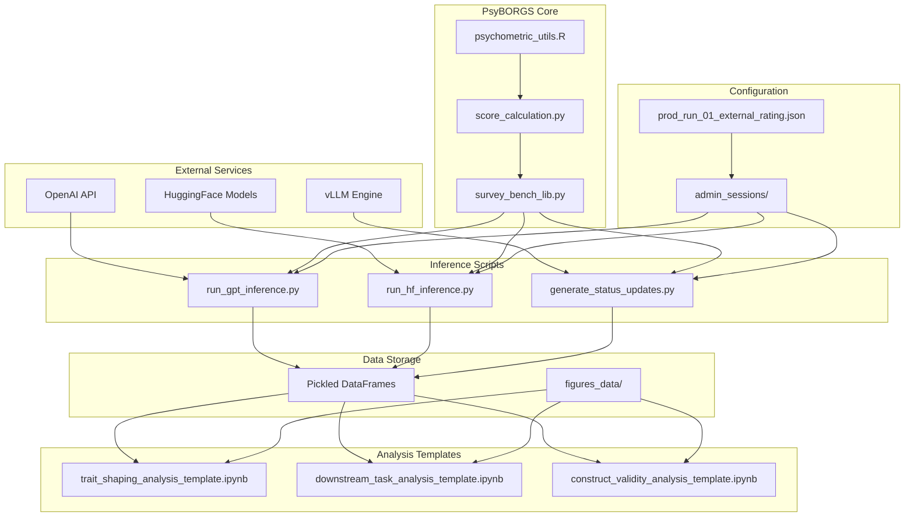
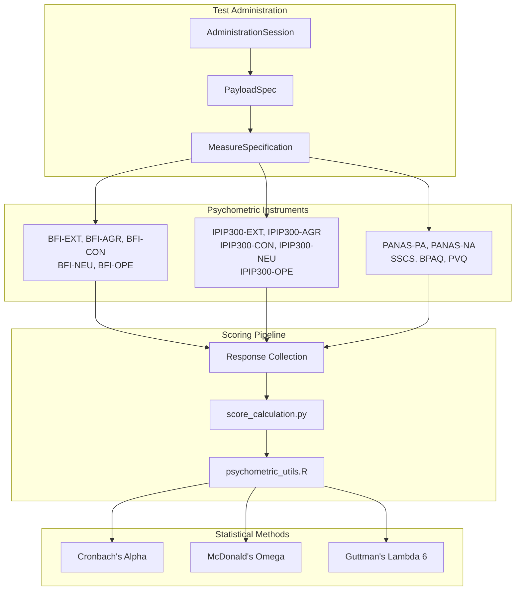

<!-- source: DeepWiki mcp.deepwiki.com · repo google-deepmind/personality_in_llms · page 1 Overview · fetched 2026-10-26 -->

# Overview

Relevant source files

The following files were used as context for generating this wiki page:

- [CITATION.cff](CITATION.cff)
- [LICENSE](LICENSE)
- [README.md](README.md)

## Purpose and Scope

This repository provides a comprehensive research platform for studying personality traits in Large Language Models (LLMs). The system enables researchers to administer psychometric tests to various LLM backends, collect and analyze responses, and validate the reliability of personality measurements in artificial intelligence systems.

The codebase implements the experimental framework described in the research paper "Personality Traits in Large Language Models" and provides all necessary tools to reproduce and extend those results. For specific setup instructions, see [Getting Started](#2). For detailed psychometric framework documentation, see [PsyBORGS Framework](#3).

## Research Context

This work stems from the need to understand whether LLMs exhibit consistent personality-like behaviors that can be measured using established psychological instruments. The repository contains the complete pipeline for:

- Administering standardized personality tests (Big Five Inventory, IPIP-NEO-300, PANAS) to LLMs
- Collecting responses across multiple model backends (OpenAI API, HuggingFace models, vLLM)
- Analyzing psychometric properties including reliability, validity, and consistency
- Generating downstream task content to correlate with personality profiles

**Sources:** [README.md:1-48](), [CITATION.cff:1-17]()

## System Architecture Overview

The system follows a modular architecture with clear separation between inference, analysis, and configuration components:

**Sources:** [README.md:8-35]()

## Core Framework Components

The PsyBORGS framework serves as the foundation for all psychometric operations in the system:

**Sources:** [README.md:17-25]()

## Data Flow Workflow

The complete research workflow follows this sequence:

| Stage | Components | Key Files | Purpose |
|-------|------------|-----------|---------|
| **Configuration** | Admin sessions, test specifications | `admin_sessions/*.json` | Define experimental parameters and test batteries |
| **Inference** | Model backends, response collection | `inference_scripts/*.py` | Generate LLM responses to psychometric items |
| **Scoring** | PsyBORGS framework, statistical analysis | `score_calculation.py`, `psychometric_utils.R` | Convert responses to personality scores |
| **Analysis** | Jupyter notebooks, statistical validation | `analysis/*.ipynb` | Validate reliability and examine correlations |
| **Visualization** | Plotting scripts, publication figures | `figures_data/`, visualization notebooks | Generate research outputs |

The system supports multiple inference backends simultaneously, allowing for comparative studies across different model architectures and providers. Configuration files in `admin_sessions/` define the experimental setup, while analysis templates provide standardized statistical evaluation procedures.

**Sources:** [README.md:28-34]()

## Key Technical Concepts

### AdministrationSession Structure
Each experiment is defined by an `AdministrationSession` containing:
- Test battery specifications (`MeasureSpecification` objects)
- Prompt templates and response formats (`PayloadSpec` objects)  
- Model configuration and inference parameters

### Psychometric Scoring
The `score_calculation.py` module implements standardized scoring algorithms for:
- **Big Five Inventory (BFI)**: 44-item personality assessment
- **IPIP-NEO-300**: Comprehensive 300-item personality inventory
- **PANAS**: Positive and Negative Affect Schedule
- **Additional measures**: SSCS, BPAQ, PVQ scales

### Statistical Validation
The `psychometric_utils.R` component provides reliability analysis using:
- **Cronbach's Alpha**: Internal consistency measurement
- **McDonald's Omega**: Alternative reliability coefficient
- **Guttman's Lambda 6**: Lower-bound reliability estimate

**Sources:** [README.md:17-25]()

## Navigation Guide

This repository is organized into distinct functional areas:

- **[Getting Started](#2)**: Installation, dependencies, and basic usage
- **[PsyBORGS Framework](#3)**: Core psychometric testing infrastructure
- **[Inference System](#4)**: LLM response collection across multiple backends
- **[Analysis System](#5)**: Statistical validation and correlation analysis
- **[Configuration](#6)**: Experimental setup and admin session management
- **[Visualization](#7)**: Research output generation and plotting

For researchers looking to reproduce paper results, start with [Getting Started](#2) then proceed to [Analysis System](#5). For those implementing new experiments, begin with [Configuration](#6) and [Inference System](#4).

**Sources:** [README.md:8-16]()

---

