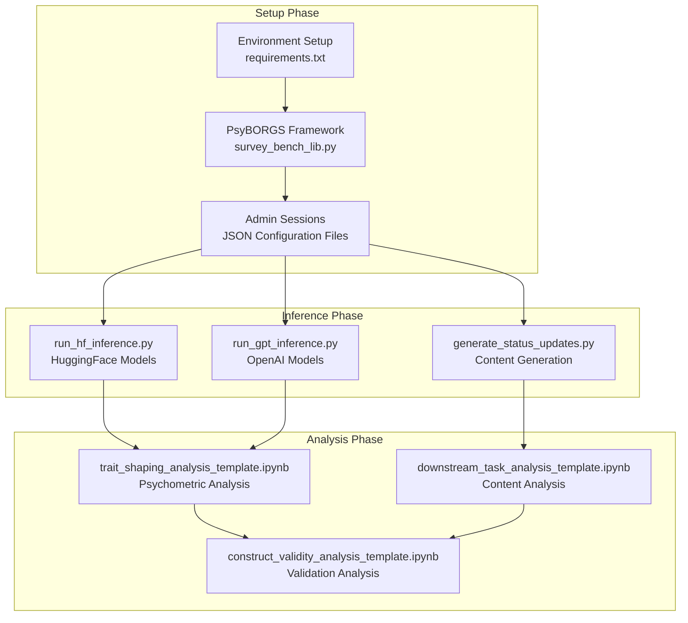
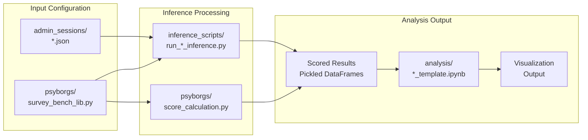

<!-- source: DeepWiki mcp.deepwiki.com · repo google-deepmind/personality_in_llms · page 2 Getting Started · fetched 2026-10-26 -->

# Getting Started

<details>
<summary>Relevant source files</summary>

The following files were used as context for generating this wiki page:

- [.gitignore](.gitignore)
- [README.md](README.md)
- [inference_scripts/requirements.txt](inference_scripts/requirements.txt)

</details>


This document provides a comprehensive guide for setting up and running the Personality Traits in Large Language Models system. It covers initial installation, basic configuration, and your first experiments with the psychometric testing framework.

This page focuses on the fundamental setup and basic usage patterns. For detailed dependency management and environment configuration, see [Dependencies and Environment Setup](#2.1). For advanced configuration of experiments, see [Configuration and Experiment Setup](#6).

## Purpose and Scope

The Getting Started guide walks you through:
- Setting up the development environment
- Understanding the core system components
- Running your first psychometric test with LLMs
- Basic data collection and analysis workflows
- Connecting to the broader analysis pipeline

## System Overview

The personality testing system consists of three main operational layers that work together to collect and analyze personality data from Large Language Models.

### Core System Architecture



Sources: [README.md:8-26](), [inference_scripts/requirements.txt:1-10]()

## Initial Setup

### Environment Installation

The system requires Python with specific dependencies for LLM inference and psychometric analysis. Install the core inference dependencies:

```bash
pip install -r inference_scripts/requirements.txt
```

The main packages include:
- `vllm==0.8.5` for local model inference
- `openai==1.17.1` for OpenAI API access  
- `outlines==0.0.46` for structured generation
- `pandas==2.2.1` for data manipulation
- `numpy==1.26.4` for numerical operations

### PsyBORGS Framework Setup

The system includes its own version of the PsyBORGS psychometric testing framework. The core components are:

| Component | File Path | Purpose |
|-----------|-----------|---------|
| Test Administration | `psyborgs/survey_bench_lib.py` | Core testing framework |
| Score Calculation | `psyborgs/score_calculation.py` | Response scoring algorithms |
| Psychometric Utils | `psyborgs/psychometric_utils.R` | Statistical analysis functions |

Sources: [README.md:18-25](), [inference_scripts/requirements.txt:1-10]()

## Basic Usage Workflow

### Getting Started Flow

```mermaid
flowchart TD
    START["Start Here"]
    
    subgraph "Phase_1" ["Phase 1: Setup"]
        INSTALL["Install Dependencies<br/>pip install -r requirements.txt"]
        VERIFY["Verify PsyBORGS<br/>survey_bench_lib.py"]
        ADMIN["Choose Admin Session<br/>admin_sessions/*.json"]
    end
    
    subgraph "Phase_2" ["Phase 2: Data Collection"] 
        CHOOSE_MODEL["Choose Model Backend"]
        HF_PATH["HuggingFace Local<br/>run_hf_inference.py"]
        OPENAI_PATH["OpenAI API<br/>run_gpt_inference.py"]
        COLLECT_DATA["Collect Responses<br/>Pickled DataFrames"]
    end
    
    subgraph "Phase_3" ["Phase 3: Analysis"]
        LOAD_NOTEBOOK["Load Analysis Template<br/>*.ipynb"]
        RUN_ANALYSIS["Run Statistical Analysis<br/>score_calculation.py"]
        GENERATE_RESULTS["Generate Visualizations<br/>Results Output"]
    end
    
    START --> INSTALL
    INSTALL --> VERIFY
    VERIFY --> ADMIN
    ADMIN --> CHOOSE_MODEL
    
    CHOOSE_MODEL --> HF_PATH
    CHOOSE_MODEL --> OPENAI_PATH
    
    HF_PATH --> COLLECT_DATA
    OPENAI_PATH --> COLLECT_DATA
    
    COLLECT_DATA --> LOAD_NOTEBOOK
    LOAD_NOTEBOOK --> RUN_ANALYSIS
    RUN_ANALYSIS --> GENERATE_RESULTS
```

Sources: [README.md:8-16](), [README.md:28-34]()

### Your First Experiment

1. **Select a Test Configuration**
   
   Choose from pre-configured admin sessions in the `admin_sessions/` directory. These JSON files define the psychometric tests and model configurations.

2. **Run Inference**
   
   For HuggingFace models:
   ```bash
   python inference_scripts/run_hf_inference.py --admin_session admin_sessions/your_config.json
   ```
   
   For OpenAI models:
   ```bash
   python inference_scripts/run_gpt_inference.py --admin_session admin_sessions/your_config.json
   ```

3. **Analyze Results**
   
   Open one of the analysis templates:
   - `analysis/trait_shaping_analysis_template.ipynb` for basic personality analysis
   - `analysis/downstream_task_analysis_template.ipynb` for content generation analysis
   - `analysis/construct_validity_analysis_template.ipynb` for psychometric validation

### Data Flow and Key Components



Sources: [README.md:28-34](), [.gitignore:26-28]()

## Common Usage Patterns

### Personality Assessment Workflow

1. **Configure Test Battery**: Select personality measures (Big Five, IPIP-NEO-300, etc.) via admin session files
2. **Model Selection**: Choose between local HuggingFace models or OpenAI API models
3. **Batch Processing**: Run inference across multiple personality dimensions
4. **Statistical Analysis**: Calculate reliability metrics and trait scores
5. **Validation**: Assess construct validity and measurement consistency

### Content Generation Analysis

1. **Generate Social Media Content**: Use `generate_status_updates.py` for personality-driven content
2. **Correlate with Traits**: Link generated content to personality profiles
3. **Downstream Analysis**: Evaluate how personality shapes language use

Sources: [README.md:10-16]()

## Next Steps

Once you have completed the basic setup:

- **Advanced Configuration**: See [Configuration and Experiment Setup](#6) for creating custom admin sessions
- **Detailed Analysis**: Explore [Analysis System](#5) for comprehensive statistical analysis options
- **Framework Deep Dive**: Review [PsyBORGS Framework](#3) for understanding the psychometric foundation
- **Inference Optimization**: See [Inference System](#4) for performance tuning and batch processing

## Data and Results Storage

The system generates several types of output data:

| Data Type | Location | Description |
|-----------|----------|-------------|
| Raw Results | Generated during inference | Pickled DataFrame files with model responses |
| Scored Results | `analysis/scored_results/` | Processed data with personality scores |
| Admin Sessions | `admin_sessions/` | Test configurations and experimental setups |
| Visualization Data | `figures_data/` | Pre-computed data for paper figures |

Note that `results/` and `analysis/scored_results/` are excluded from version control as specified in [.gitignore:26-28]().

Sources: [README.md:27-34](), [.gitignore:26-28]()

---

