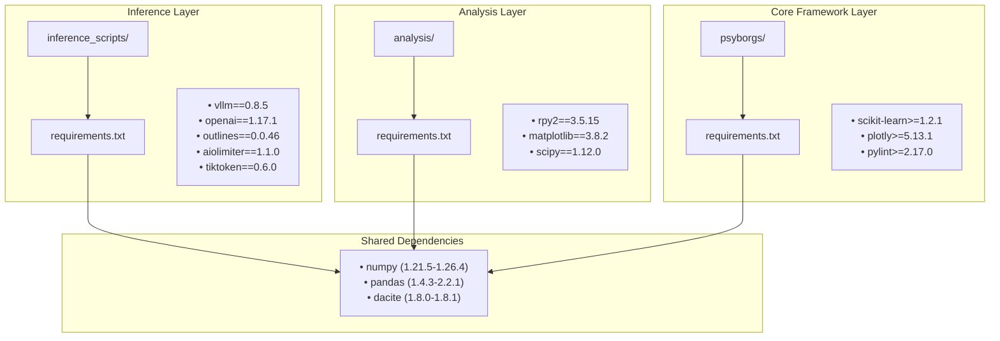
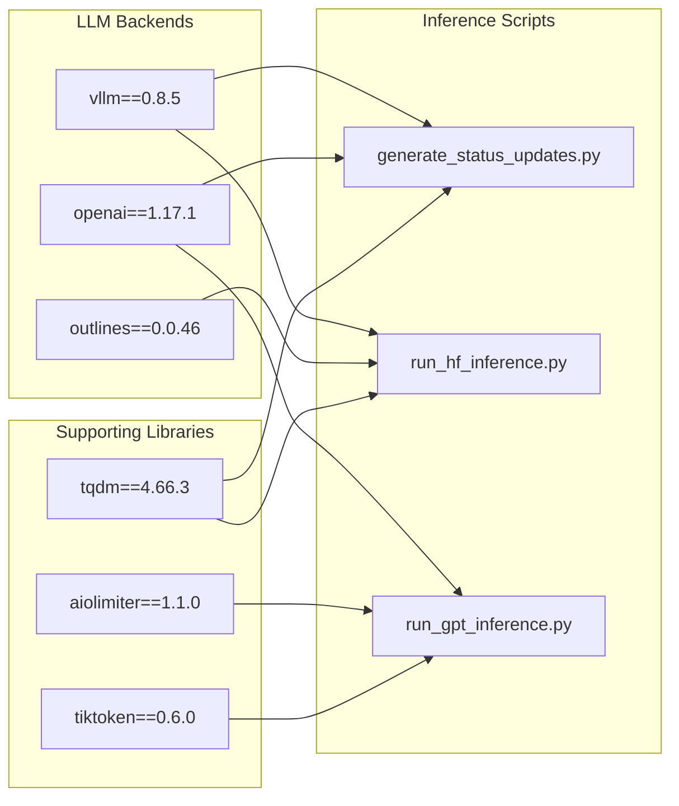
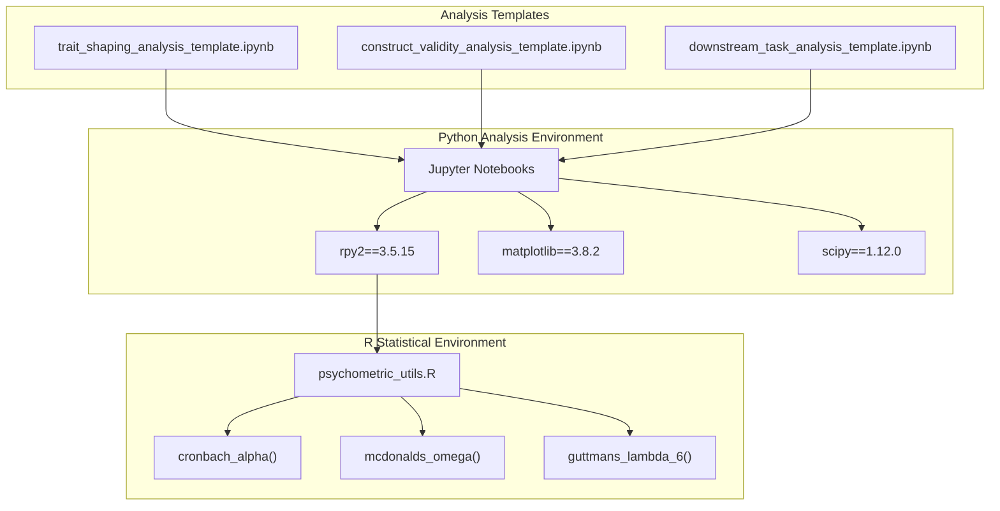
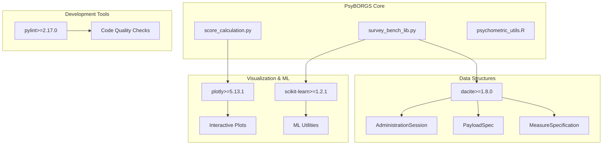
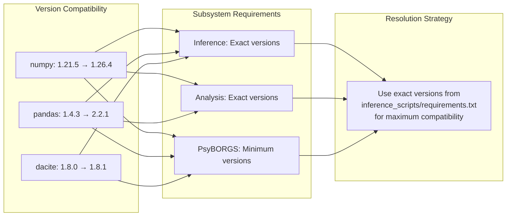

<!-- source: DeepWiki mcp.deepwiki.com · repo google-deepmind/personality_in_llms · page 2.1 Dependencies and Environment Setup · fetched 2026-10-26 -->

# Dependencies and Environment Setup

<details>
<summary>Relevant source files</summary>

The following files were used as context for generating this wiki page:

- [analysis/requirements.txt](analysis/requirements.txt)
- [inference_scripts/requirements.txt](inference_scripts/requirements.txt)
- [psyborgs/requirements.txt](psyborgs/requirements.txt)

</details>


This document provides a comprehensive guide to the dependencies and environment configuration required for the Personality Traits in Large Language Models research system. It covers the three main subsystems and their specific requirements, dependency management strategies, and environment setup procedures.

For information about running specific inference tasks, see [Inference System](#4). For details about analysis workflows, see [Analysis System](#5). For core framework usage, see [PsyBORGS Framework](#3).

## System Architecture and Dependency Layers

The system is structured into three primary dependency layers, each with distinct requirements and purposes:



**Sources:** [inference_scripts/requirements.txt:1-10](), [analysis/requirements.txt:1-6](), [psyborgs/requirements.txt:1-7]()

## Inference System Dependencies

The inference layer supports multiple LLM backends and requires specialized dependencies for each:

| Package | Version | Purpose | Used By |
|---------|---------|---------|---------|
| `vllm` | 0.8.5 | Local GPU inference engine | `generate_status_updates.py`, `run_hf_inference.py` |
| `openai` | 1.17.1 | OpenAI API client | `run_gpt_inference.py` |
| `outlines` | 0.0.46 | Constrained generation | HuggingFace inference workflows |
| `aiolimiter` | 1.1.0 | Async rate limiting | API request management |
| `tiktoken` | 0.6.0 | Tokenization utilities | Token counting and processing |
| `tqdm` | 4.66.3 | Progress tracking | Batch inference monitoring |

### Backend-Specific Dependency Mapping



**Sources:** [inference_scripts/requirements.txt:1-10]()

## Analysis System Dependencies

The analysis layer integrates Python scientific computing with R statistical functions:

| Package | Version | Purpose | Integration Point |
|---------|---------|---------|------------------|
| `rpy2` | 3.5.15 | Python-R bridge | `psychometric_utils.R` functions |
| `matplotlib` | 3.8.2 | Static plotting | Jupyter notebook visualizations |
| `scipy` | 1.12.0 | Statistical computing | Correlation analysis, hypothesis testing |

### R Integration Architecture



**Sources:** [analysis/requirements.txt:1-6]()

## Core Framework Dependencies

The PsyBORGS framework uses flexible version constraints to support broader compatibility:

| Package | Version Constraint | Purpose | Core Components |
|---------|-------------------|---------|-----------------|
| `scikit-learn` | >=1.2.1 | Machine learning utilities | Classification, clustering |
| `plotly` | >=5.13.1 | Interactive visualizations | Web-based plotting |
| `pylint` | >=2.17.0 | Code quality assurance | Development workflow |
| `dacite` | >=1.8.0 | Dataclass utilities | Type-safe data structures |

### Framework Component Dependencies



**Sources:** [psyborgs/requirements.txt:1-7]()

## Shared Dependencies and Version Management

All three subsystems share core scientific computing dependencies with overlapping version requirements:

| Package | Inference | Analysis | PsyBORGS | Version Strategy |
|---------|-----------|----------|----------|------------------|
| `numpy` | 1.26.4 | 1.26.4 | >=1.21.5 | Exact match preferred |
| `pandas` | 2.2.1 | 2.2.1 | >=1.4.3 | Exact match preferred |
| `dacite` | 1.8.1 | - | >=1.8.0 | Compatible versions |

### Dependency Compatibility Matrix



**Sources:** [inference_scripts/requirements.txt:2-7](), [analysis/requirements.txt:2-3](), [psyborgs/requirements.txt:2-4]()

## Environment Setup Procedures

### Installation Sequence

1. **Create isolated environment:**
   ```bash
   python -m venv personality_llm_env
   source personality_llm_env/bin/activate  # Linux/Mac
   # or
   personality_llm_env\Scripts\activate  # Windows
   ```

2. **Install dependencies by subsystem:**
   ```bash
   # Core framework (install first)
   pip install -r psyborgs/requirements.txt
   
   # Inference capabilities
   pip install -r inference_scripts/requirements.txt
   
   # Analysis tools
   pip install -r analysis/requirements.txt
   ```

3. **Verify R integration:**
   ```bash
   python -c "import rpy2.robjects as robjects; print('R integration ready')"
   ```

### System Requirements

- **Python:** 3.8+ (tested with 3.10)
- **R:** Required for psychometric analysis functions
- **GPU:** Optional but recommended for vLLM inference
- **Memory:** Minimum 16GB RAM for local inference

**Sources:** [inference_scripts/requirements.txt:1-10](), [analysis/requirements.txt:1-6](), [psyborgs/requirements.txt:1-7]()

---

