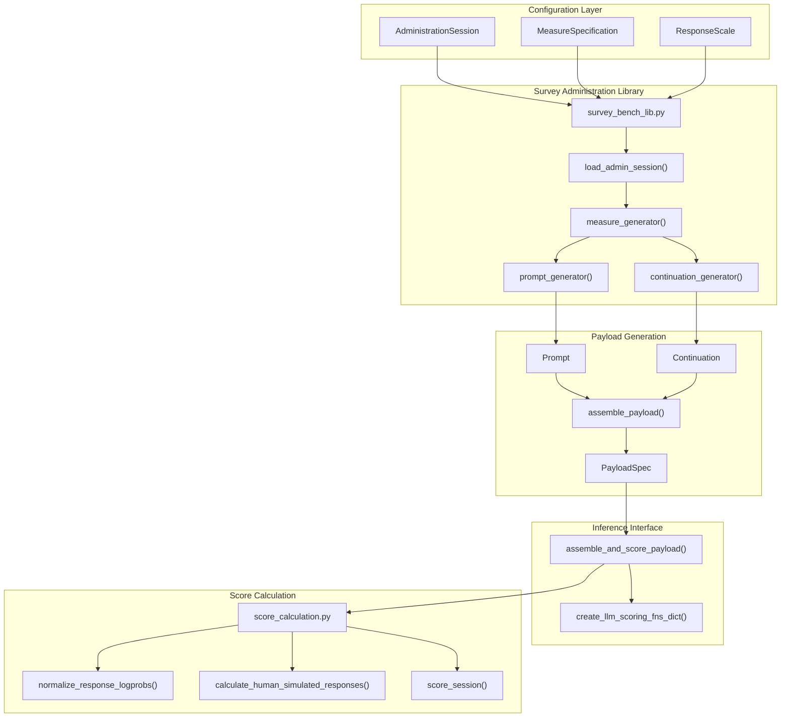
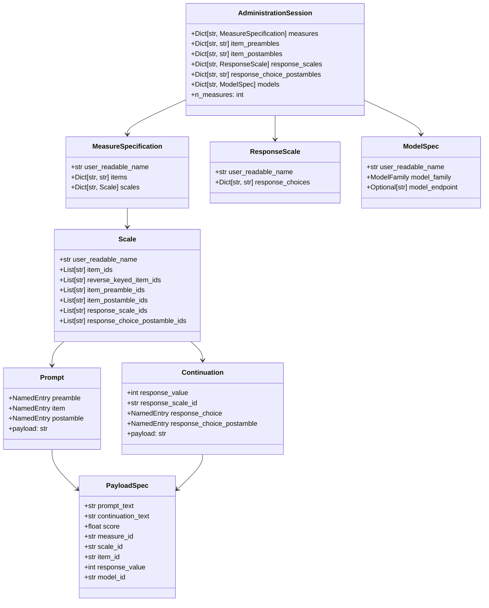
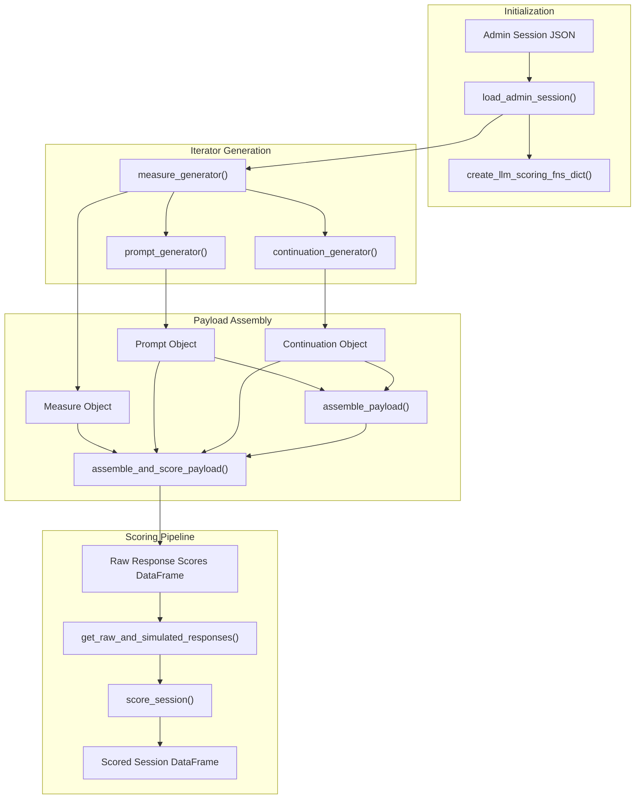
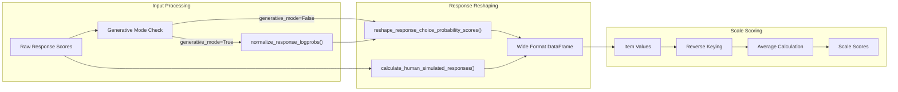

<!-- source: DeepWiki mcp.deepwiki.com · repo google-deepmind/personality_in_llms · page 3 PsyBORGS Framework · fetched 2026-10-26 -->

# PsyBORGS Framework

Relevant source files

The following files were used as context for generating this wiki page:

- [psyborgs/__init__.py](psyborgs/__init__.py)
- [psyborgs/score_calculation.py](psyborgs/score_calculation.py)
- [psyborgs/survey_bench_lib.py](psyborgs/survey_bench_lib.py)

## Purpose and Scope

The PsyBORGS Framework is the core psychometric testing system that enables systematic administration of personality assessments to Large Language Models. This framework provides the foundational data structures, survey administration logic, and scoring mechanisms that underpin the entire personality research pipeline.

This page covers the framework's architecture, core data structures, and administration workflow. For detailed implementation of the survey administration library, see [Survey Administration Library](#3.1). For scoring algorithms and psychometric analysis functions, see [Score Calculation and Psychometric Analysis](#3.2). For testing and validation procedures, see [Testing and Validation](#3.3).

## Framework Architecture

The PsyBORGS Framework operates as the central orchestration layer between survey configuration and LLM inference systems. It transforms human-readable survey specifications into structured prompts and continuations that can be systematically administered to language models.

**Sources:** [psyborgs/survey_bench_lib.py:1-435](), [psyborgs/score_calculation.py:1-251]()

## Core Data Structures

The framework is built around a hierarchy of immutable dataclasses that represent survey configurations, individual test items, and response specifications. These structures ensure reproducible and traceable survey administration.

**Sources:** [psyborgs/survey_bench_lib.py:39-87](), [psyborgs/survey_bench_lib.py:96-151]()

## Survey Administration Workflow

The framework implements a systematic workflow that transforms survey configurations into scored responses through iterative payload generation and LLM scoring. This process ensures comprehensive coverage of all survey items across different framing conditions.

**Sources:** [psyborgs/survey_bench_lib.py:153-168](), [psyborgs/survey_bench_lib.py:352-434](), [psyborgs/score_calculation.py:150-251]()

## Response Processing Pipeline

The framework implements a sophisticated response processing pipeline that converts raw LLM scores into normalized probabilities and human-simulated responses. This enables both fine-grained analysis of response patterns and traditional psychometric scoring.

**Sources:** [psyborgs/score_calculation.py:26-58](), [psyborgs/score_calculation.py:61-96](), [psyborgs/score_calculation.py:98-147](), [psyborgs/score_calculation.py:179-251]()

## Integration Points

The PsyBORGS Framework serves as the central coordination layer that interfaces with multiple system components. It standardizes survey administration while remaining agnostic to specific LLM backends or analysis methods.

| Component | Interface | Purpose |
|-----------|-----------|---------|
| **Inference Systems** | `model_scoring_fn` callbacks | Abstracts LLM scoring implementations |
| **Configuration Files** | `load_admin_session()` | Loads JSON admin session specifications |
| **Analysis Templates** | Scored DataFrames | Provides structured data for downstream analysis |
| **Validation Systems** | PayloadSpec objects | Enables reproducible experiment tracking |

The framework's design ensures that survey configurations remain portable across different LLM backends while maintaining strict control over prompt construction and response interpretation. This separation of concerns enables researchers to focus on psychometric validity without being constrained by implementation details of specific language models.

**Sources:** [psyborgs/survey_bench_lib.py:179-196](), [psyborgs/survey_bench_lib.py:280-304](), [psyborgs/score_calculation.py:179-204]()

---

