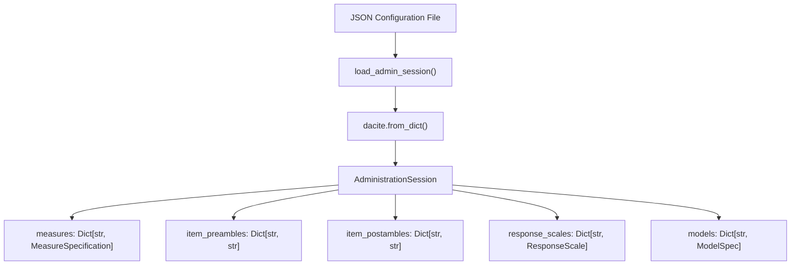
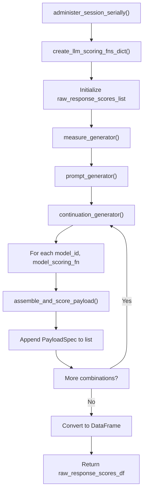
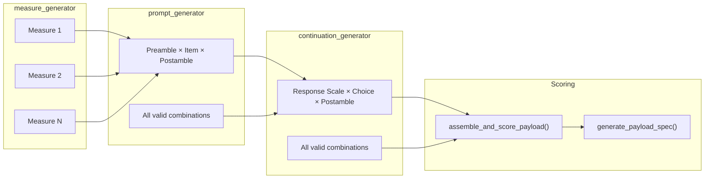
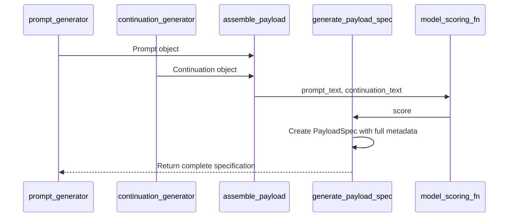
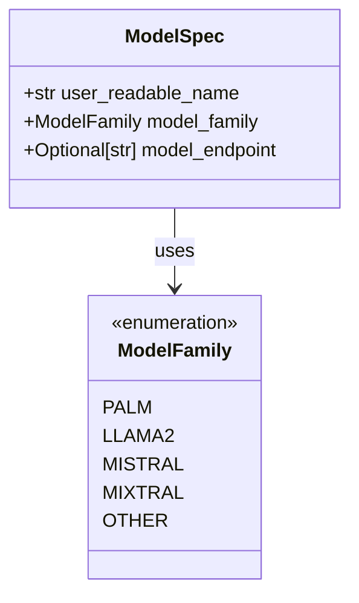

<!-- source: DeepWiki mcp.deepwiki.com · repo google-deepmind/personality_in_llms · page 3.1 Survey Administration Library · fetched 2026-10-26 -->

# Survey Administration Library

<details>
<summary>Relevant source files</summary>

The following files were used as context for generating this wiki page:

- [psyborgs/survey_bench_lib.py](psyborgs/survey_bench_lib.py)
- [psyborgs/tests/test_admin_session.json](psyborgs/tests/test_admin_session.json)

</details>


## Purpose and Scope

The Survey Administration Library (`survey_bench_lib.py`) is the core component of the PsyBORGS framework that handles the systematic administration of psychological survey instruments to Large Language Models. This library provides the foundational data structures, configuration loading, and execution logic needed to present survey items to LLMs in a standardized, reproducible manner.

This page covers the data structures, configuration management, and survey administration workflow. For information about score calculation and psychometric analysis, see [Score Calculation and Psychometric Analysis](#3.2). For details on setting up experiment configurations, see [Admin Session Configuration](#6.1).

## Core Data Structures

The library defines a hierarchical set of data classes that represent all aspects of a psychological survey administration session.

### Administration Session Hierarchy

```mermaid
classDiagram
    class AdministrationSession {
        +Dict measures
        +Dict item_preambles
        +Dict item_postambles  
        +Dict response_scales
        +Dict response_choice_postambles
        +Dict models
        +int n_measures
    }
    
    class MeasureSpecification {
        +str user_readable_name
        +Dict items
        +Dict scales
    }
    
    class Scale {
        +str user_readable_name
        +List item_ids
        +List reverse_keyed_item_ids
        +List item_preamble_ids
        +List item_postamble_ids
        +List response_scale_ids
        +List response_choice_postamble_ids
    }
    
    class ResponseScale {
        +str user_readable_name
        +Dict response_choices
    }
    
    class ModelSpec {
        +str user_readable_name
        +ModelFamily model_family
        +str model_endpoint
    }
    
    AdministrationSession ||--o{ MeasureSpecification : contains
    AdministrationSession ||--o{ ResponseScale : contains
    AdministrationSession ||--o{ ModelSpec : contains
    MeasureSpecification ||--o{ Scale : contains
```

**Sources:** [psyborgs/survey_bench_lib.py:39-94]()

### Payload Construction Data Structures

The library uses specialized data classes for constructing and tracking individual survey items during administration:

```mermaid
classDiagram
    class NamedEntry {
        +str entry_id
        +str text
    }
    
    class Prompt {
        +NamedEntry preamble
        +NamedEntry item
        +NamedEntry postamble
        +str payload
    }
    
    class Continuation {
        +int response_value
        +str response_scale_id
        +NamedEntry response_choice
        +NamedEntry response_choice_postamble
        +str payload
    }
    
    class PayloadSpec {
        +str prompt_text
        +str continuation_text
        +float score
        +str measure_id
        +str measure_name
        +str scale_id
        +str item_preamble_id
        +str item_id
        +str item_postamble_id
        +str response_scale_id
        +int response_value
        +str response_choice
        +str response_choice_postamble_id
        +str model_id
    }
    
    class Measure {
        +str measure_id
        +MeasureSpecification measure
        +str scale_id
        +Scale scale
    }
    
    Prompt ||--o{ NamedEntry : composed_of
    Continuation ||--o{ NamedEntry : composed_of
    PayloadSpec --> Prompt : generated_from
    PayloadSpec --> Continuation : generated_from
```

**Sources:** [psyborgs/survey_bench_lib.py:96-151]()

## Configuration Loading

### JSON Configuration Structure

The `load_admin_session()` function loads survey configurations from JSON files using the `dacite` library for robust data class instantiation:

| Component | Purpose | JSON Key |
|-----------|---------|----------|
| Measures | Psychological instruments and their items | `measures` |
| Item Preambles | Text that precedes survey items | `item_preambles` |
| Item Postambles | Text that follows survey items | `item_postambles` |
| Response Scales | Available response options | `response_scales` |
| Response Choice Postambles | Text after response choices | `response_choice_postambles` |
| Models | LLM specifications for testing | `models` |



**Sources:** [psyborgs/survey_bench_lib.py:153-168](), [psyborgs/tests/test_admin_session.json:1-47]()

## Survey Administration Process

### Main Administration Flow

The `administer_session_serially()` function orchestrates the complete survey administration process:



**Sources:** [psyborgs/survey_bench_lib.py:367-434]()

### Generator Functions Workflow

The library uses three nested generator functions to systematically create all possible survey item combinations:



**Sources:** [psyborgs/survey_bench_lib.py:352-364](), [psyborgs/survey_bench_lib.py:333-349](), [psyborgs/survey_bench_lib.py:306-330]()

## Payload Generation and Scoring

### Prompt and Continuation Assembly

The library constructs survey items by combining text components according to a standardized format:

**Prompt Format:**
```
{item_preamble} + {item} + {item_postamble}
```

**Continuation Format:**  
```
{response_choice} + {response_choice_postamble}
```



**Sources:** [psyborgs/survey_bench_lib.py:198-203](), [psyborgs/survey_bench_lib.py:280-303]()

### PayloadSpec Generation

The `generate_payload_spec()` function creates comprehensive metadata for each scored item, enabling full reproducibility:

| Field | Source | Purpose |
|-------|--------|---------|
| `prompt_text` | Assembled prompt | Full text sent to LLM |
| `continuation_text` | Assembled continuation | Response option text |
| `score` | LLM scoring function | Model's preference score |  
| `measure_id`, `scale_id` | Measure object | Psychometric identifiers |
| `item_id`, `item_preamble_id`, `item_postamble_id` | Prompt object | Item construction details |
| `response_scale_id`, `response_value`, `response_choice_postamble_id` | Continuation object | Response construction details |
| `model_id` | Function parameter | Model identification |

**Sources:** [psyborgs/survey_bench_lib.py:205-256]()

## Model Integration

### ModelSpec and Scoring Functions

The library defines model specifications through the `ModelSpec` data class and `ModelFamily` enum:



The `create_llm_scoring_fns_dict()` function converts model specifications into callable scoring functions for use during survey administration.

**Sources:** [psyborgs/survey_bench_lib.py:63-77](), [psyborgs/survey_bench_lib.py:179-195]()

---

