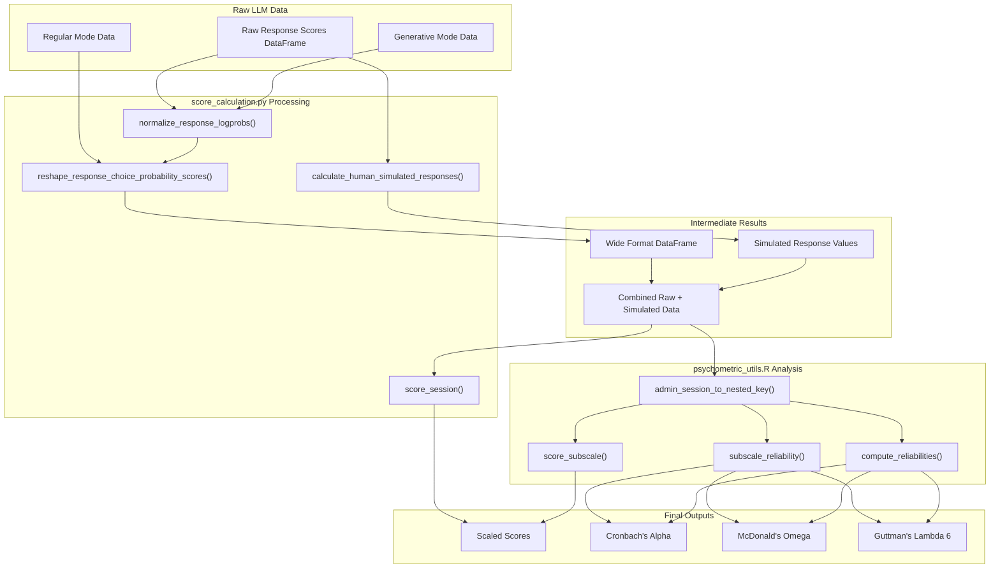
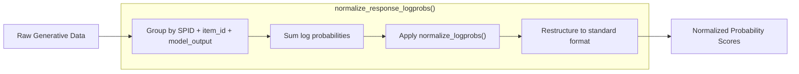
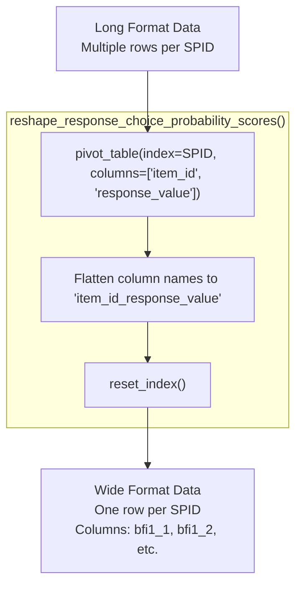
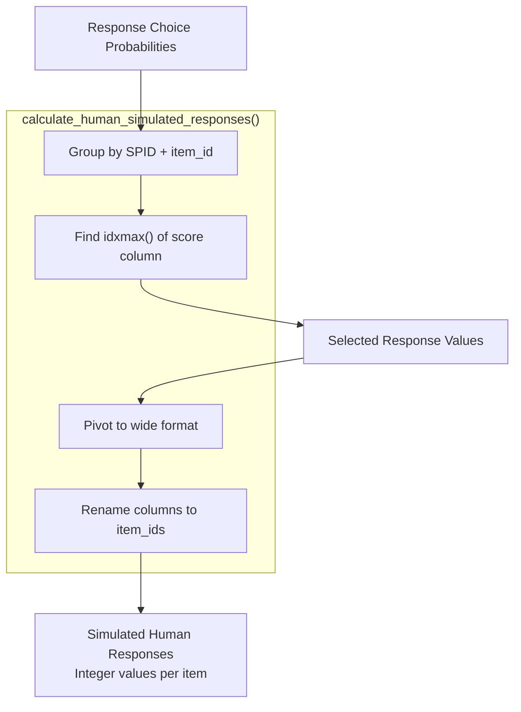
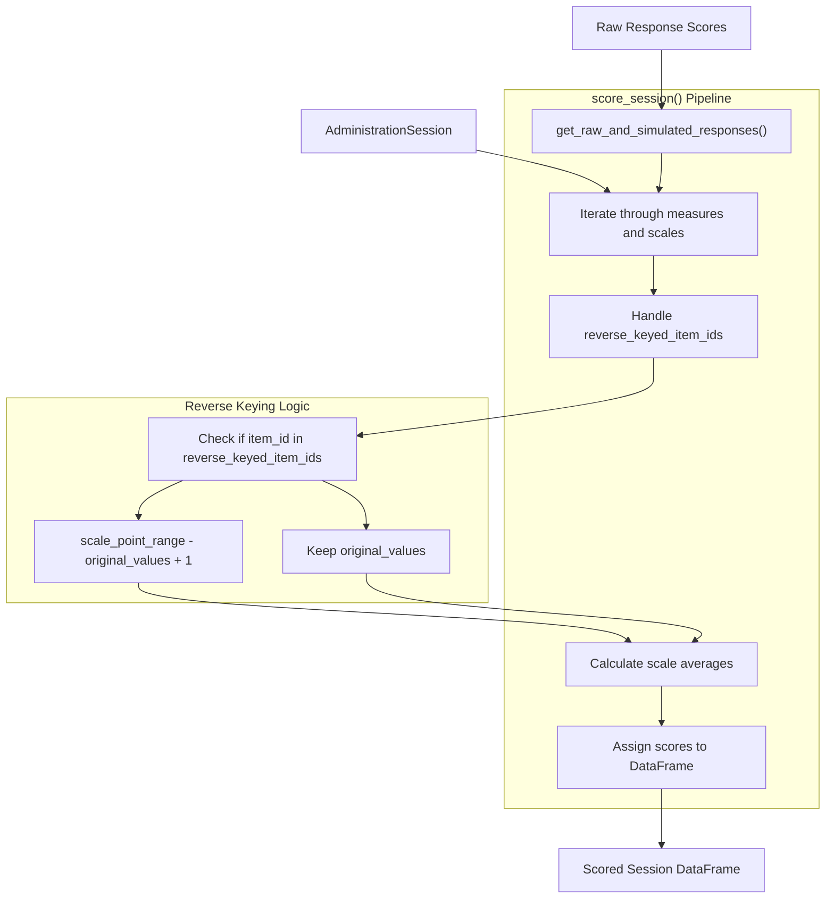
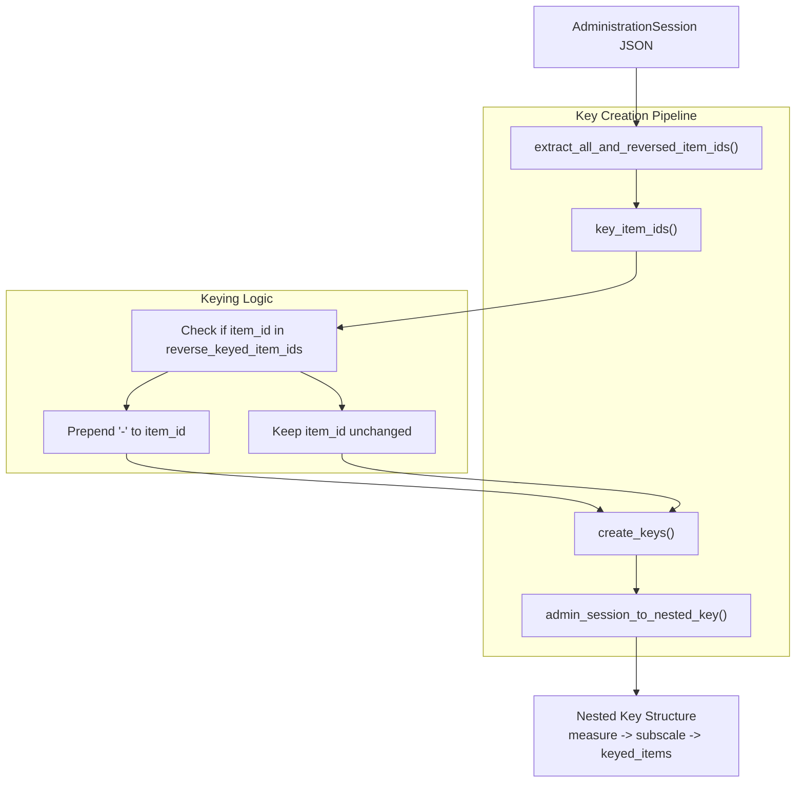
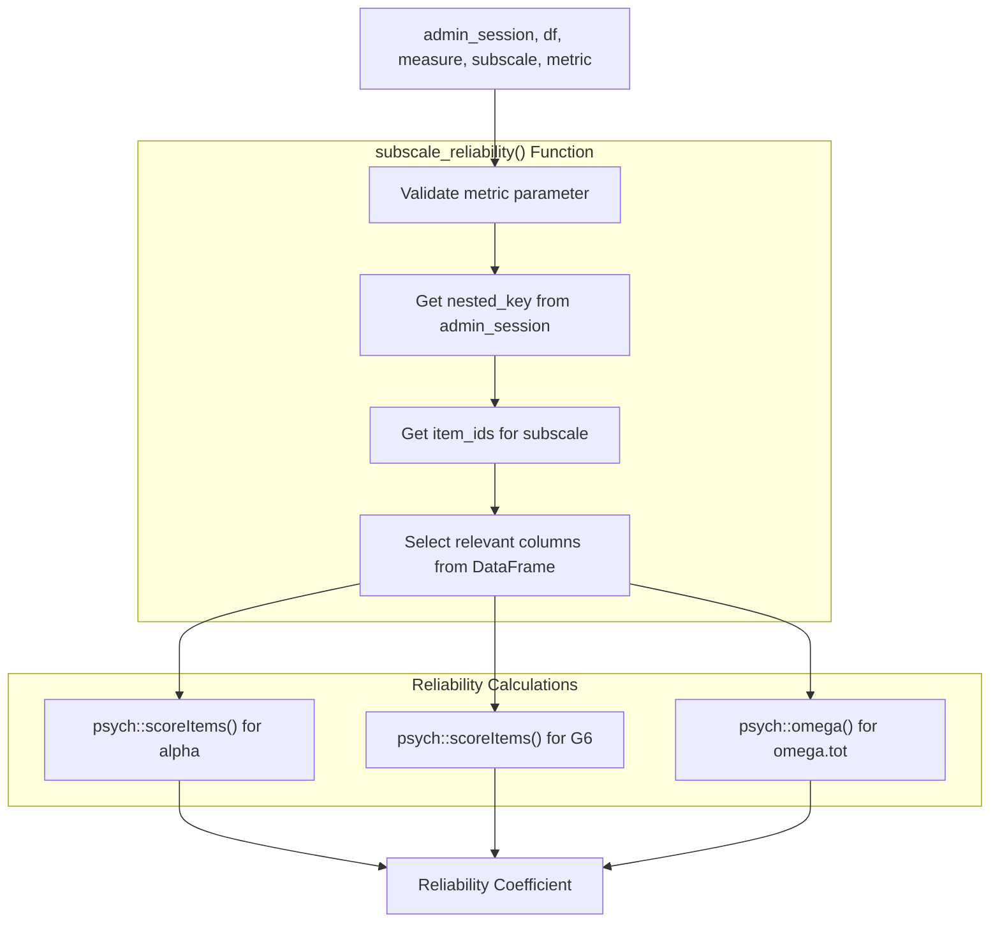

<!-- source: DeepWiki mcp.deepwiki.com · repo google-deepmind/personality_in_llms · page 3.2 Score Calculation and Psychometric Analysis · fetched 2026-10-26 -->

# Score Calculation and Psychometric Analysis

<details>
<summary>Relevant source files</summary>

The following files were used as context for generating this wiki page:

- [psyborgs/psychometric_utils.R](psyborgs/psychometric_utils.R)
- [psyborgs/score_calculation.py](psyborgs/score_calculation.py)
- [psyborgs/tests/score_calculation_test.py](psyborgs/tests/score_calculation_test.py)

</details>


This document covers the core scoring and psychometric analysis functionality of the PsyBORGS framework. It explains how raw LLM response probabilities are converted to human-simulated survey responses and how these responses are transformed into psychometric scale scores with reliability analysis.

For information about survey administration and data collection, see [Survey Administration Library](#3.1). For information about testing and validation procedures, see [Testing and Validation](#3.3).

## Purpose and Scope

The score calculation and psychometric analysis system performs three primary functions:

1. **Response Scoring**: Converts raw LLM log probabilities into normalized response choice probabilities and simulated human responses
2. **Scale Scoring**: Aggregates item-level responses into scale-level scores, handling reverse-keyed items appropriately  
3. **Psychometric Analysis**: Calculates reliability metrics (Cronbach's α, McDonald's ω, Guttman's λ6) and validity statistics

## Core Data Structures and Constants

### Simulated Participant ID (SPID)

The system uses a composite identifier called SPID to uniquely identify each experimental condition:

```python
SPID = ['item_preamble_id',
        'item_postamble_id', 
        'response_scale_id',
        'response_choice_postamble_id',
        'model_id']
```

Each SPID represents a unique combination of prompt configuration and model, treating each as a simulated participant for psychometric analysis.

### Data Flow Architecture



Sources: [psyborgs/score_calculation.py:7-11](), [psyborgs/score_calculation.py:179-251](), [psyborgs/psychometric_utils.R:109-118](), [psyborgs/psychometric_utils.R:261-295]()

## Score Calculation Pipeline

### Log Probability Normalization

For generative mode data, raw log probabilities must be normalized before scoring:



The `normalize_logprobs()` function uses the logsumexp trick for numerical stability:

- `logsumexp(x)`: Computes log(sum(exp(x))) avoiding overflow
- `normalize_logprobs(x)`: Converts log probabilities to normalized probabilities

Sources: [psyborgs/score_calculation.py:14-21](), [psyborgs/score_calculation.py:26-57]()

### Response Choice Probability Reshaping

The `reshape_response_choice_probability_scores()` function converts long-format probability data to wide format:



Sources: [psyborgs/score_calculation.py:61-95]()

### Human-Simulated Response Calculation

The `calculate_human_simulated_responses()` function selects the most probable response choice for each item:



Sources: [psyborgs/score_calculation.py:99-146]()

## Scale Scoring and Reverse Keying

### Session Scoring Process

The `score_session()` function orchestrates the complete scoring pipeline:



The reverse keying formula transforms disagreement items: `new_value = scale_range - original_value + 1`

Sources: [psyborgs/score_calculation.py:179-251](), [psyborgs/score_calculation.py:232-237]()

## Psychometric Analysis Functions (R)

### Key Creation and Item Management

The R utilities handle psychometric key creation for proper item scoring:



Sources: [psyborgs/psychometric_utils.R:44-118](), [psyborgs/psychometric_utils.R:82-96]()

### Reliability Analysis

The system calculates three reliability metrics using the `psych` package:



The `compute_reliabilities()` function calculates all three metrics simultaneously for all scales:

- **Cronbach's α**: Internal consistency reliability
- **McDonald's ω**: Composite reliability accounting for factor loadings  
- **Guttman's λ6**: Lower bound reliability estimate

Sources: [psyborgs/psychometric_utils.R:139-192](), [psyborgs/psychometric_utils.R:261-295]()

## Key Algorithm Details

### Log Probability Normalization Algorithm

The normalization process ensures numerical stability when working with log probabilities:

1. **Group responses** by SPID + item_id + model_output
2. **Sum log probabilities** for each group
3. **Apply logsumexp normalization** within each item_id group
4. **Convert to standard DataFrame format**

### Scale Scoring Algorithm

The scale scoring process handles both regular and reverse-keyed items:

1. **Extract item_ids and reverse_keyed_item_ids** from scale specification
2. **For each item in the scale:**
   - If item_id in reverse_keyed_item_ids: `new_value = scale_range - original_value + 1`
   - Otherwise: `new_value = original_value`
3. **Calculate scale score** as mean of processed item values

### Test Coverage

The system includes comprehensive tests covering:

- `test_reshape_response_choice_probability_scores()`: Validates wide-format conversion
- `test_score_session()`: Validates end-to-end scoring pipeline with test admin session

Sources: [psyborgs/tests/score_calculation_test.py:7-44](), [psyborgs/tests/score_calculation_test.py:47-91]()

---

