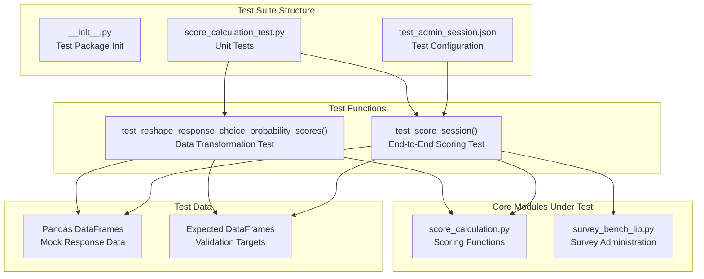
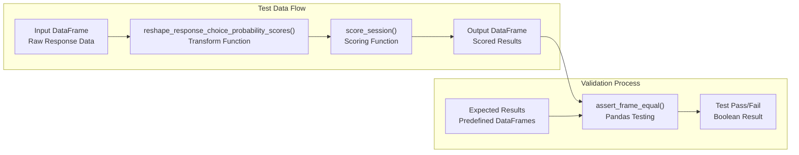
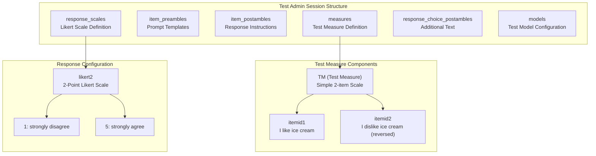
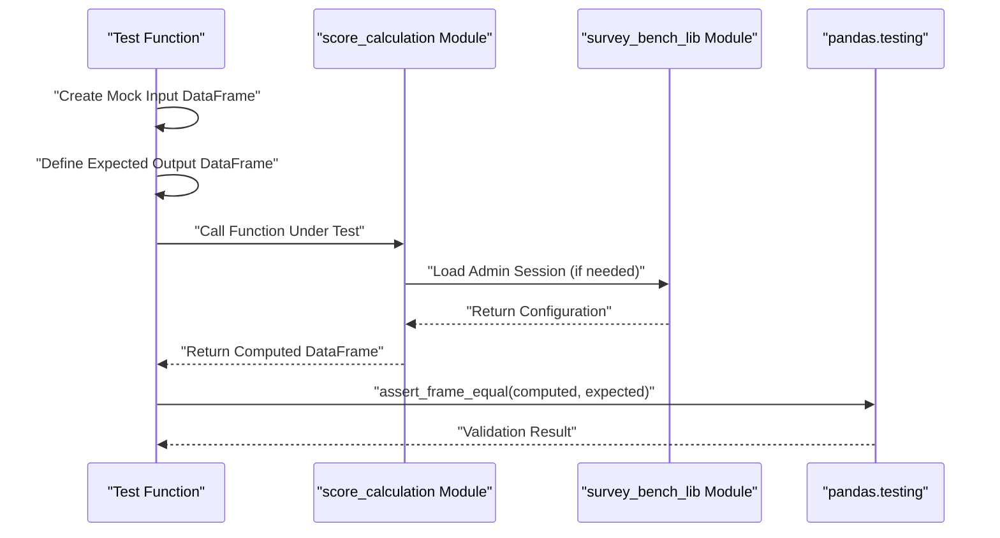

<!-- source: DeepWiki mcp.deepwiki.com · repo google-deepmind/personality_in_llms · page 3.3 Testing and Validation · fetched 2026-10-26 -->

# Testing and Validation

Relevant source files

The following files were used as context for generating this wiki page:

- [psyborgs/tests/__init__.py](psyborgs/tests/__init__.py)
- [psyborgs/tests/score_calculation_test.py](psyborgs/tests/score_calculation_test.py)
- [psyborgs/tests/test_admin_session.json](psyborgs/tests/test_admin_session.json)

This page documents the test suite and validation procedures for the PsyBORGS framework, focusing on unit tests for core scoring functionality and test data structures used to validate the psychometric analysis pipeline. The testing framework ensures correctness of score calculations, data transformations, and psychometric measures.

For information about the core scoring algorithms being tested, see [Score Calculation and Psychometric Analysis](#3.2). For broader framework documentation, see [PsyBORGS Framework](#3).

## Test Suite Overview

The testing system provides unit tests for critical components of the PsyBORGS framework, with particular emphasis on validating score calculation functions and data transformation operations. The test suite is located in the `psyborgs/tests/` directory and follows standard Python testing conventions.

### Test Architecture

**Sources:** [psyborgs/tests/score_calculation_test.py:1-92](), [psyborgs/tests/test_admin_session.json:1-48]()

## Unit Testing Framework

The test suite uses standard Python testing patterns with `pandas.testing` utilities for DataFrame validation. Tests focus on ensuring data integrity through score calculation pipelines.

### Test Functions

| Function | Purpose | Input | Output |
|----------|---------|--------|--------|
| `test_reshape_response_choice_probability_scores()` | Validates response probability reshaping | Mock DataFrame with response scores | Reshaped DataFrame with probability columns |
| `test_score_session()` | End-to-end scoring validation | Mock responses + test admin session | Scored DataFrame with calculated measures |

### Core Test Components

The testing framework validates two primary functions from `score_calculation.py`:

1. **`reshape_response_choice_probability_scores()`** - Tests data transformation logic that converts response choice probabilities from long to wide format
2. **`score_session()`** - Tests complete scoring pipeline including measure calculation and probability score integration

**Sources:** [psyborgs/tests/score_calculation_test.py:7-44](), [psyborgs/tests/score_calculation_test.py:47-91]()

## Test Data Structures

### Mock Response Data

The test suite uses carefully constructed mock DataFrames that simulate the structure of actual LLM response data. Key columns include:

- `prompt_text` - Survey prompt content
- `continuation_text` - LLM response options
- `score` - Response choice probabilities  
- `item_preamble_id`, `item_id`, `item_postamble_id` - Survey item identifiers
- `response_scale_id`, `response_value`, `response_choice` - Response format specifications
- `model_id` - LLM model identifier

### Expected Output Validation

Test validation uses `assert_frame_equal()` from `pandas.testing` to ensure exact matches between computed and expected results. The validation process checks:

- DataFrame structure and column names
- Numerical accuracy of score calculations
- Data type consistency (with `check_dtype=False` for flexibility)

**Sources:** [psyborgs/tests/score_calculation_test.py:10-25](), [psyborgs/tests/score_calculation_test.py:54-69]()

## Test Configuration Files

### Test Admin Session

The `test_admin_session.json` file provides a minimal but complete configuration for testing the scoring pipeline. This configuration includes:

### Configuration Elements

| Element | Purpose | Test Value |
|---------|---------|------------|
| `measures.TM` | Test measure with 2 items | "Test Measure" |
| `item_preambles.a2-r1-g2-cs6` | Survey context prompt | "You are a middle-aged White man..." |
| `response_scales.likert2` | Simplified 2-point scale | Values 1 and 5 only |
| `models.test_model` | Mock model configuration | PaLM family test endpoint |

**Sources:** [psyborgs/tests/test_admin_session.json:1-48]()

## Validation Procedures

### Score Calculation Validation

The test suite validates score calculations through multiple steps:

1. **Data Reshaping Validation** - Ensures response choice probabilities are correctly pivoted from long to wide format
2. **Measure Scoring Validation** - Verifies that scale scores are computed correctly, including reverse-keyed items
3. **Integration Validation** - Confirms that probability scores and calculated measures are properly merged

### Test Execution Pattern

Tests follow a consistent pattern:
1. Define input mock data matching production data structure
2. Define expected output with precise numerical values
3. Execute function under test
4. Use `assert_frame_equal()` for comprehensive validation

**Sources:** [psyborgs/tests/score_calculation_test.py:40-44](), [psyborgs/tests/score_calculation_test.py:87-91]()

## Test Coverage and Scope

The current test suite provides focused coverage of:

- **Data Transformation Logic** - Response probability reshaping functions
- **Core Scoring Algorithms** - Scale calculation with reverse-keyed item handling  
- **Configuration Loading** - Admin session parsing and validation
- **End-to-End Integration** - Complete scoring pipeline from raw responses to final measures

The tests ensure that the fundamental scoring operations produce mathematically correct and structurally consistent results, providing confidence in the reliability of psychometric calculations performed by the PsyBORGS framework.

**Sources:** [psyborgs/tests/score_calculation_test.py:1-92](), [psyborgs/tests/test_admin_session.json:1-48]()

---

