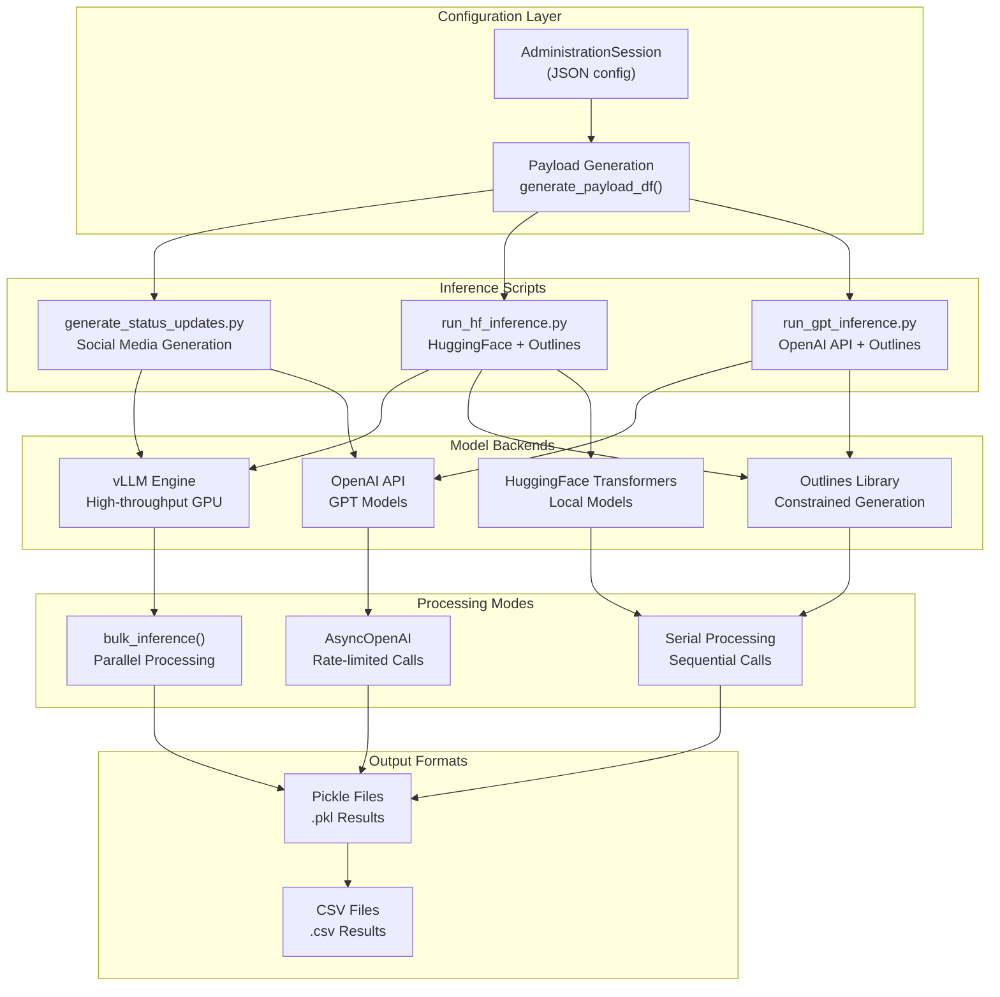
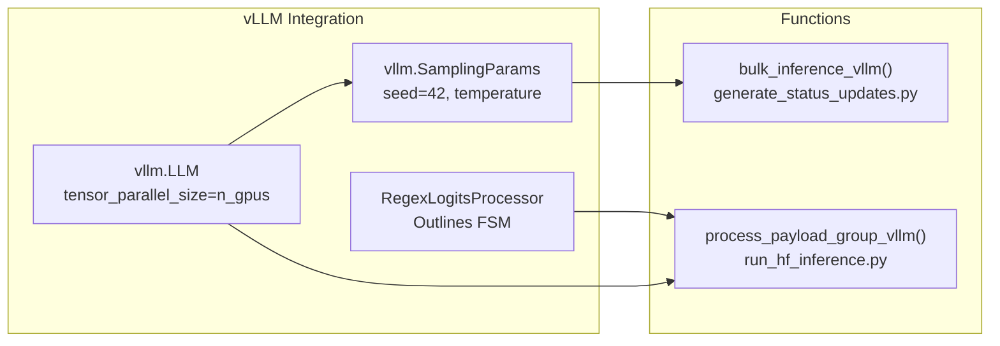
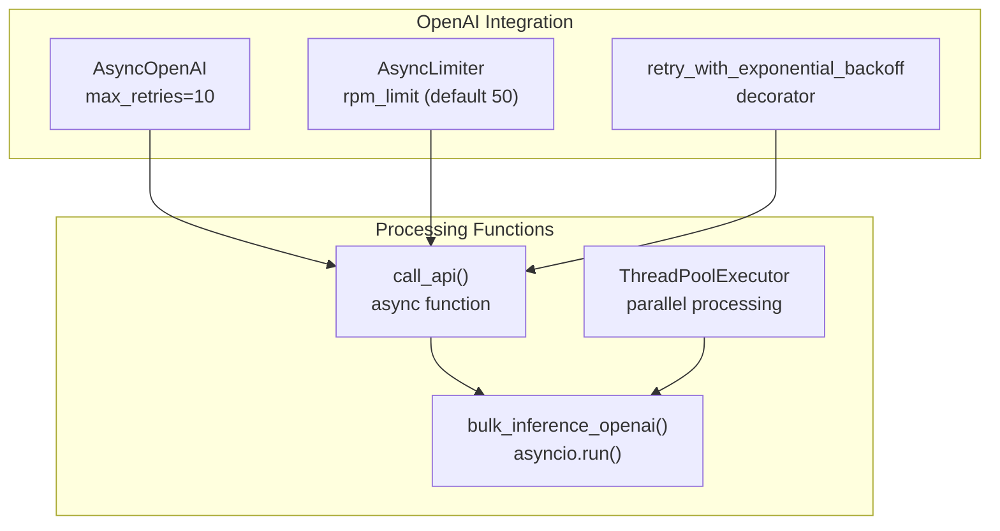
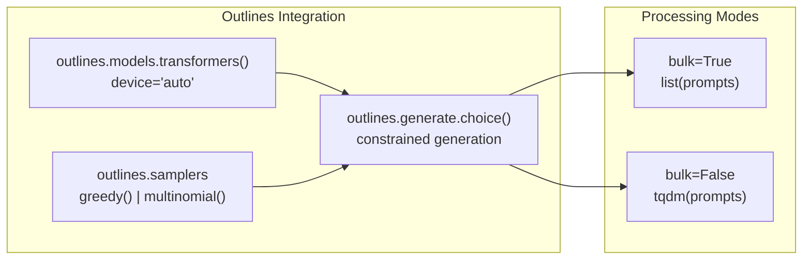
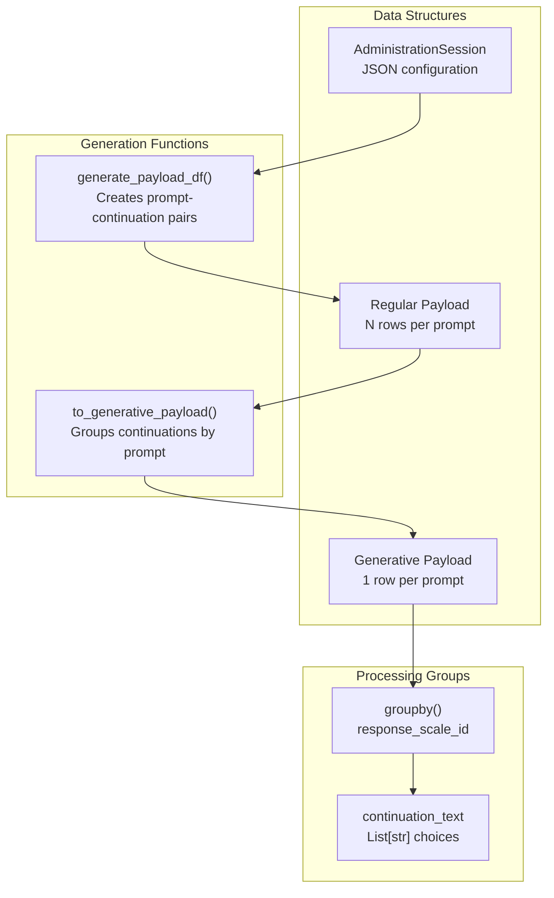
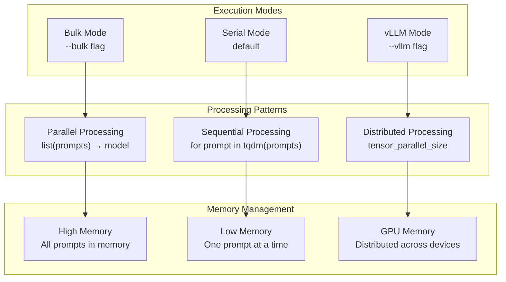
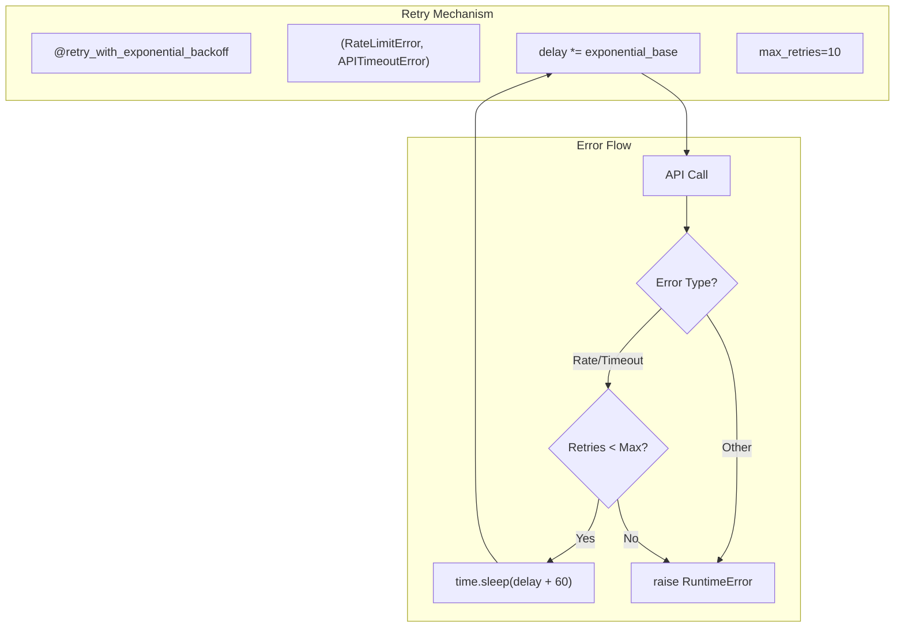

<!-- source: DeepWiki mcp.deepwiki.com · repo google-deepmind/personality_in_llms · page 4 Inference System · fetched 2026-10-26 -->

# Inference System

<details>
<summary>Relevant source files</summary>

The following files were used as context for generating this wiki page:

- [inference_scripts/__init__.py](inference_scripts/__init__.py)
- [inference_scripts/generate_status_updates.py](inference_scripts/generate_status_updates.py)
- [inference_scripts/run_gpt_inference.py](inference_scripts/run_gpt_inference.py)
- [inference_scripts/run_hf_inference.py](inference_scripts/run_hf_inference.py)

</details>


## Purpose and Scope

The Inference System provides a unified interface for running Large Language Model inference across multiple backends to administer PsyBORGS personality tests. This system supports three primary model backends: vLLM for high-throughput local inference, OpenAI API for cloud-based models, and HuggingFace Transformers with Outlines for constrained generation.

This document covers the inference orchestration layer that bridges experiment configurations to model outputs. For detailed information about the underlying psychometric framework, see [PsyBORGS Framework](#3). For analysis of inference results, see [Analysis System](#5).

## System Architecture

The inference system consists of three main scripts that handle different model backends and use cases, all built around the PsyBORGS framework's `AdministrationSession` configuration format.



Sources: [inference_scripts/generate_status_updates.py:1-357](), [inference_scripts/run_hf_inference.py:1-431](), [inference_scripts/run_gpt_inference.py:1-363]()

## Model Backend Integration

### vLLM Backend

The vLLM backend provides high-throughput GPU inference through the `vllm.LLM` class. It supports distributed inference across multiple GPUs using tensor parallelism.



The vLLM integration occurs in two contexts:

- **Status Update Generation**: Uses `bulk_inference_vllm()` for unconstrained text generation with configurable temperature and max_tokens
- **Constrained Survey Responses**: Uses `process_payload_group_vllm()` with Outlines' `RegexLogitsProcessor` to enforce response choice constraints

Sources: [inference_scripts/generate_status_updates.py:144-165](), [inference_scripts/run_hf_inference.py:166-214]()

### OpenAI API Backend

The OpenAI backend uses async processing with rate limiting and exponential backoff retry logic.



The system implements two different async patterns:
- **generate_status_updates.py**: Uses `asyncio` with `AsyncLimiter` for rate-limited bulk inference
- **run_gpt_inference.py**: Uses `ThreadPoolExecutor` with `as_completed()` for parallel request handling

Sources: [inference_scripts/generate_status_updates.py:167-210](), [inference_scripts/run_gpt_inference.py:107-167]()

### HuggingFace + Outlines Backend

The HuggingFace backend uses Outlines for constrained generation, supporting both local inference and GPU acceleration.



The Outlines integration ensures that model responses are constrained to valid survey response choices through finite state machine-based logit biasing.

Sources: [inference_scripts/run_hf_inference.py:124-164](), [inference_scripts/run_gpt_inference.py:107-167]()

## Payload Processing Pipeline

### Payload Generation and Transformation

The inference system processes PsyBORGS `AdministrationSession` configurations through a multi-stage pipeline:



### Payload Grouping Strategy

The system groups payloads by `response_scale_id` to ensure that models choose from the correct set of response options for each psychometric scale:

| Processing Step | Function | Purpose |
|-----------------|----------|---------|
| Initial Generation | `generate_payload_df()` | Creates N×M matrix of prompts × continuations |
| Generative Conversion | `to_generative_payload()` | Collapses to 1 row per prompt with continuation lists |
| Response Grouping | `administer_session_via_outlines()` | Groups by `response_scale_id` for constrained generation |
| Model Processing | `process_payload_group()` | Sends grouped prompts to model backends |

Sources: [inference_scripts/run_hf_inference.py:70-96](), [inference_scripts/run_hf_inference.py:97-123](), [inference_scripts/run_gpt_inference.py:52-104]()

## Inference Execution Modes

### Bulk vs Serial Processing

The system supports different execution modes depending on memory constraints and model backend:



### Error Handling and Retry Logic

The OpenAI backend implements sophisticated error handling with exponential backoff:



Sources: [inference_scripts/generate_status_updates.py:59-107]()

## Configuration and Command Line Interface

### Common Arguments

All inference scripts share a common argument structure for consistency:

| Argument | Type | Purpose | Scripts |
|----------|------|---------|---------|
| `--admin_session` | str | Path to AdministrationSession JSON | All |
| `--model_pointer` | str | Model identifier (HF repo or OpenAI model) | All |
| `--job_name` | str | Experiment name for output files | All |
| `--job_id` | str | Job tracking identifier | All |
| `--sample` | bool | Limit to 1000 prompts for testing | All |
| `--payload` | str | Use pre-generated payload chunks | All |

### Backend-Specific Arguments

Each script provides backend-specific configuration options:

**vLLM Arguments:**
- `--n_gpus`: Number of GPUs for tensor parallelism
- `--temperature`: Sampling temperature
- `--enforce_eager`: Disable CUDA graphs

**OpenAI Arguments:**
- `--api_key`: OpenAI API key (defaults to `OPENAI_API_KEY` env var)
- `--rpm_limit`: Requests per minute limit

**Output Arguments:**
- `--csv`: Also output results in CSV format
- `--results_path`: Custom directory for output files

Sources: [inference_scripts/generate_status_updates.py:212-262](), [inference_scripts/run_hf_inference.py:296-339](), [inference_scripts/run_gpt_inference.py:248-281]()

## Output Format and File Naming

### Standardized Output Structure

All inference scripts generate standardized output files using the pattern:
```
results_{job_name}_{MODEL_ID}_{job_id}{chunk_n}.pkl
```

Where:
- `MODEL_ID`: Extracted from `model_pointer` (text after last `/`)
- `chunk_n`: Optional suffix for payload chunks (e.g., `_chunk_0`)

### Result DataFrame Structure

The output DataFrames contain the original payload metadata plus model outputs:

| Column | Type | Description |
|--------|------|-------------|
| `prompt_text` | str | Generated psychometric prompt |
| `continuation_text` | List[str] | Available response choices |
| `model_output` | str | Selected model response |
| `model_id` | str | Model identifier |
| `measure_id` | str | Psychometric measure identifier |
| `scale_id` | str | Scale within measure |
| `item_id` | str | Specific item identifier |

Sources: [inference_scripts/generate_status_updates.py:351-353](), [inference_scripts/run_hf_inference.py:424-427](), [inference_scripts/run_gpt_inference.py:356-359]()

---

