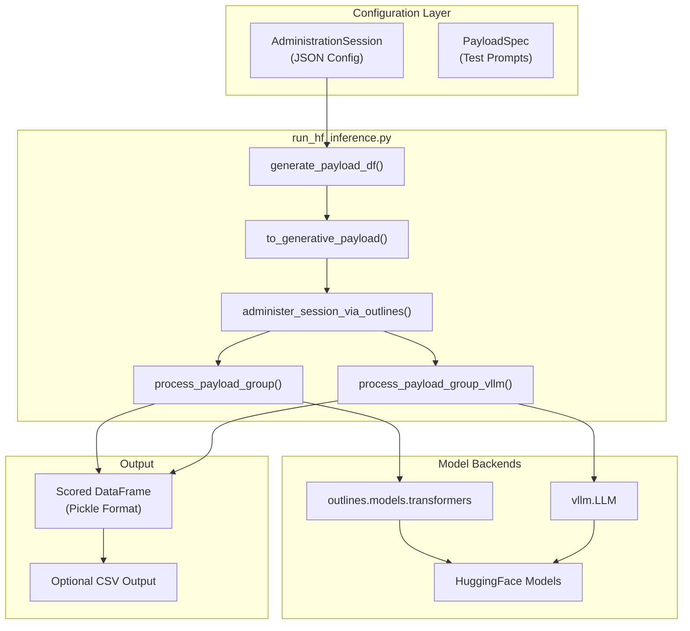
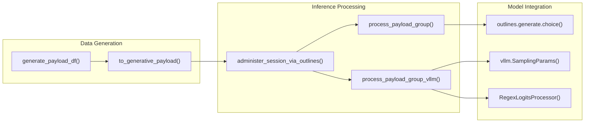
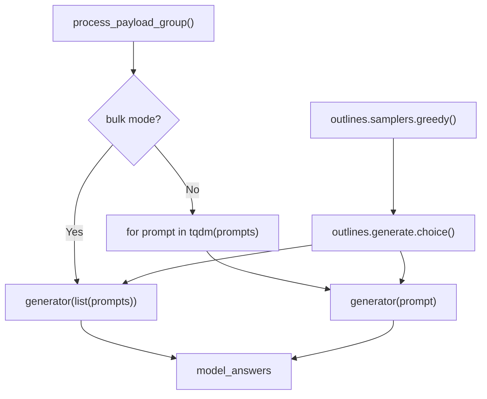
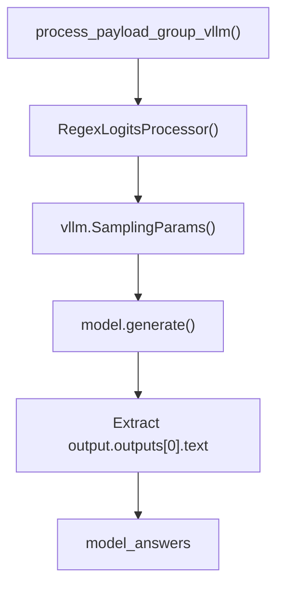
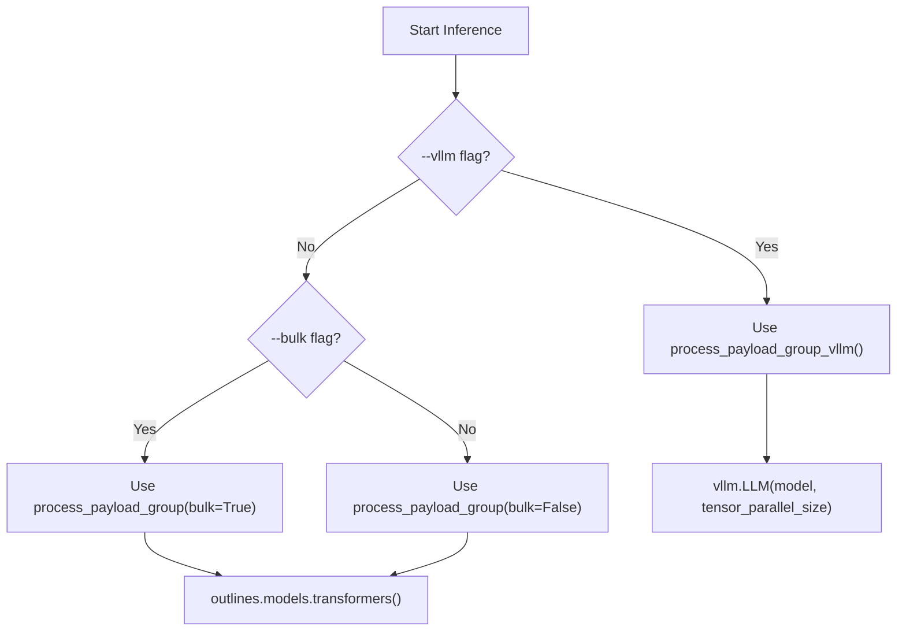
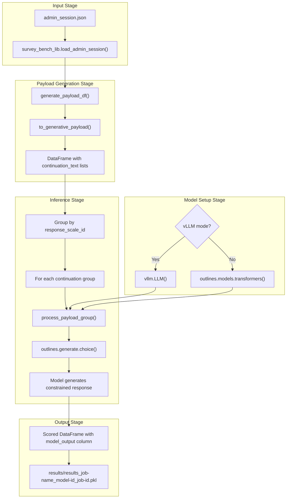
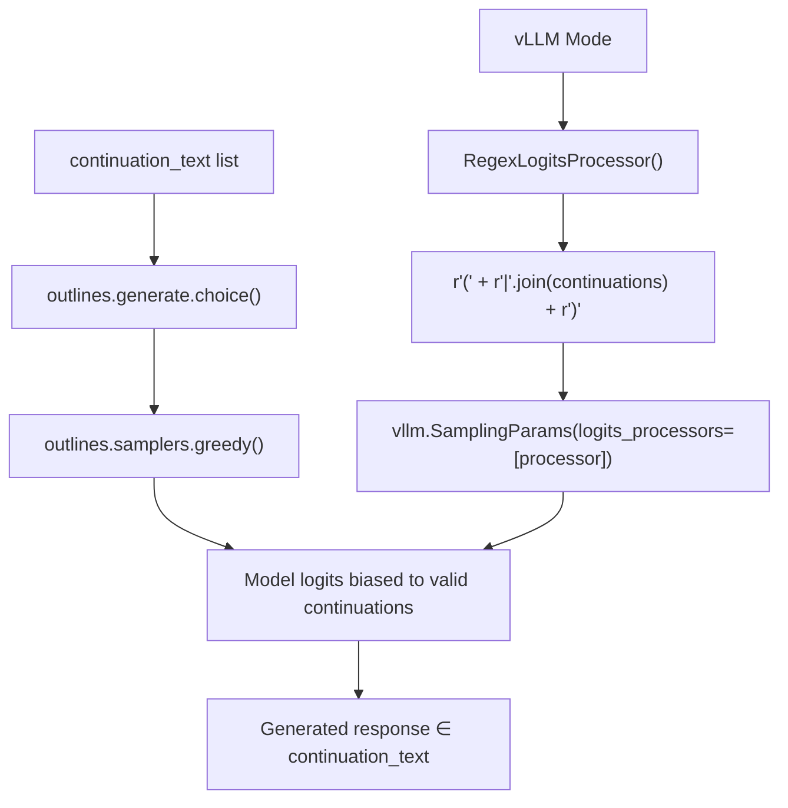

<!-- source: DeepWiki mcp.deepwiki.com · repo google-deepmind/personality_in_llms · page 4.1 HuggingFace Model Inference · fetched 2026-10-26 -->

# HuggingFace Model Inference

<details>
<summary>Relevant source files</summary>

The following files were used as context for generating this wiki page:

- [inference_scripts/requirements.txt](inference_scripts/requirements.txt)
- [inference_scripts/run_hf_inference.py](inference_scripts/run_hf_inference.py)

</details>


This document covers the HuggingFace model inference system implemented in `run_hf_inference.py`, which administers PsyBORGS psychological tests to HuggingFace models using constrained generation via the Outlines library. The system supports both local inference and distributed inference using vLLM for high-throughput scenarios.

For OpenAI API-based inference, see [OpenAI API Inference](#4.2). For social media content generation tasks, see [Status Update Generation](#4.3).

## System Architecture

The HuggingFace inference system operates as a key component in the overall inference layer, transforming admin session configurations into scored psychological test results through constrained language model generation.

### Architecture Overview



Sources: [inference_scripts/run_hf_inference.py:1-431]()

### Core Components

The system consists of several key functions that handle different aspects of the inference pipeline:



Sources: [inference_scripts/run_hf_inference.py:70-214]()

## Core Functions

### Payload Generation

The `generate_payload_df()` function creates the initial test payload by iterating through all combinations of measures, prompts, and continuations defined in the admin session.

| Function | Purpose | Input | Output |
|----------|---------|-------|--------|
| `generate_payload_df()` | Generate test prompts | `AdministrationSession`, `model_id` | `pd.DataFrame` with all prompt-continuation pairs |
| `to_generative_payload()` | Collapse continuations | Regular payload DataFrame | DataFrame with continuation lists per prompt |

The function uses the PsyBORGS generators to systematically create all test combinations:

- `survey_bench_lib.measure_generator()` - iterates through psychological measures
- `survey_bench_lib.prompt_generator()` - iterates through prompt variations  
- `survey_bench_lib.continuation_generator()` - iterates through response options

Sources: [inference_scripts/run_hf_inference.py:70-122]()

### Inference Processing

The system provides two main inference processing functions optimized for different scenarios:

#### Standard Processing with Outlines



#### vLLM Processing



Sources: [inference_scripts/run_hf_inference.py:124-214]()

## Inference Modes

The system supports three distinct inference modes, each optimized for different computational scenarios:

| Mode | Implementation | Use Case | Memory Usage | Speed |
|------|---------------|----------|--------------|-------|
| **Serial** | `bulk=False` | Local development, debugging | Low | Slow |
| **Bulk** | `bulk=True` | Batch processing without vLLM | Medium | Medium |
| **vLLM** | `vllm=True` | High-throughput production | High | Fast |

### Mode Selection Logic



Sources: [inference_scripts/run_hf_inference.py:272-286](), [inference_scripts/run_hf_inference.py:390-408]()

## Command Line Interface

The script provides a comprehensive command-line interface with the following key arguments:

### Required Arguments

| Argument | Type | Description |
|----------|------|-------------|
| `--admin_session` | str | Path to admin session JSON configuration |
| `--model_pointer` | str | HuggingFace model identifier (e.g., `meta-llama/Llama-2-7b-chat-hf`) |

### Execution Control Arguments

| Argument | Type | Default | Description |
|----------|------|---------|-------------|
| `--sample` | flag | False | Process only 1,000 prompts for testing |
| `--bulk` | flag | False | Enable batched inference with Outlines |
| `--vllm` | flag | False | Use vLLM for distributed inference |
| `--n_gpus` | int | 1 | Number of GPUs for tensor-parallel inference |
| `--temperature` | float | 1.0 | Sampling temperature |

### Job Management Arguments

| Argument | Type | Default | Description |
|----------|------|---------|-------------|
| `--job_name` | str | 'hf-run' | Experiment identifier for output files |
| `--job_id` | str | '999' | Job tracking ID for HPC systems |
| `--payload` | str | None | Path to pre-generated payload chunk |

Sources: [inference_scripts/run_hf_inference.py:296-339]()

## Data Flow Pipeline

The complete data transformation pipeline processes admin sessions through multiple stages:



### Payload Transformation

The system transforms data through two key format conversions:

1. **Regular Payload**: N rows per prompt (one for each continuation option)
2. **Generative Payload**: 1 row per prompt (continuations stored as lists)

This transformation is handled by `to_generative_payload()` which groups by the SPID (Simulated Participant ID) columns:

```python
SPID = ['item_preamble_id', 'item_postamble_id', 'response_scale_id', 
        'response_choice_postamble_id', 'model_id']
```

Sources: [inference_scripts/run_hf_inference.py:97-122](), [inference_scripts/run_hf_inference.py:61-65]()

## Constrained Generation

The system uses Outlines to ensure models only generate valid psychological test responses through constrained generation:

### Constraint Mechanism



The constrained generation ensures that:
- Models can only generate responses that exactly match predefined continuation options
- Responses are deterministic when using greedy sampling (`seed=42`)
- Invalid or creative responses are prevented through logit manipulation

Sources: [inference_scripts/run_hf_inference.py:144-149](), [inference_scripts/run_hf_inference.py:184-200]()

## Output Format

The system generates scored DataFrames containing all necessary information for downstream psychological analysis:

### Output Columns

| Column | Source | Description |
|--------|--------|-------------|
| `prompt_text` | PsyBORGS | Complete prompt sent to model |
| `continuation_text` | PsyBORGS | List of valid response options |
| `model_output` | Inference | Model's generated response |
| `measure_id` | PsyBORGS | Psychological measure identifier |
| `scale_id` | PsyBORGS | Specific scale within measure |
| `item_id` | PsyBORGS | Individual test item identifier |
| SPID columns | PsyBORGS | Simulated participant identifiers |

### File Output

Results are saved in pickle format to preserve DataFrame structure and data types:

```
results/results_{job_name}_{model_id}_{job_id}[_chunk_n].pkl
```

The pickle format maintains:
- List data types in `continuation_text` columns
- Proper pandas DataFrame indexing
- All metadata required for psychometric scoring

Sources: [inference_scripts/run_hf_inference.py:420-427](), [inference_scripts/run_hf_inference.py:347-379]()

---

