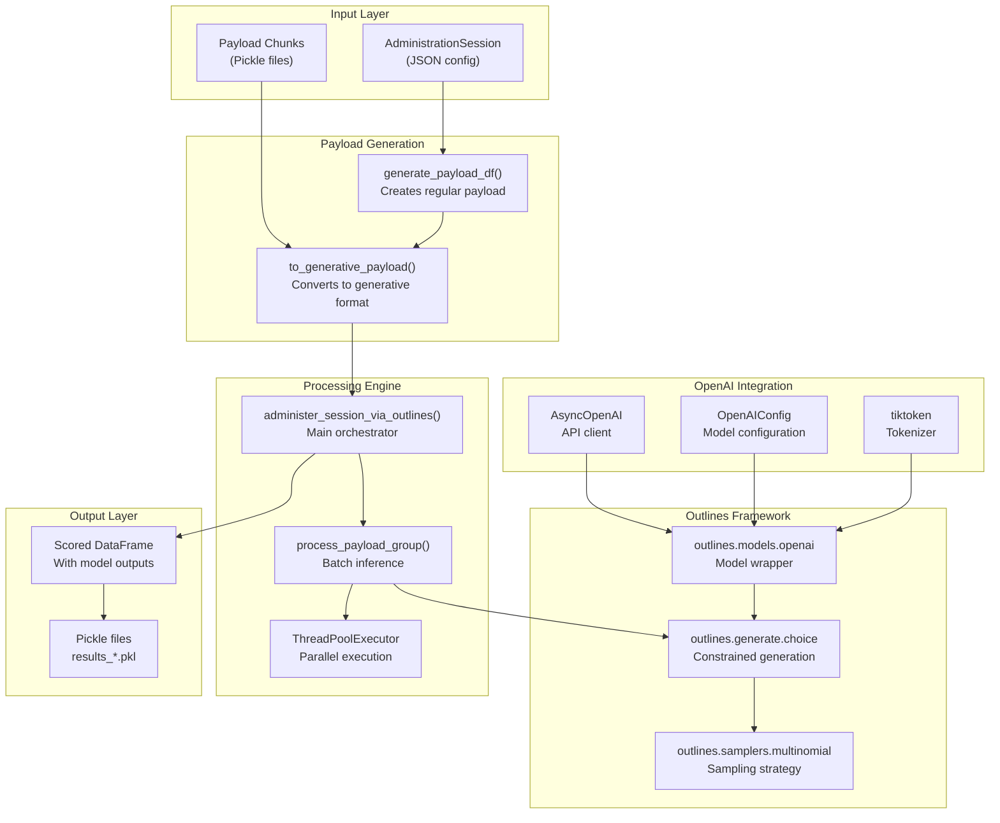
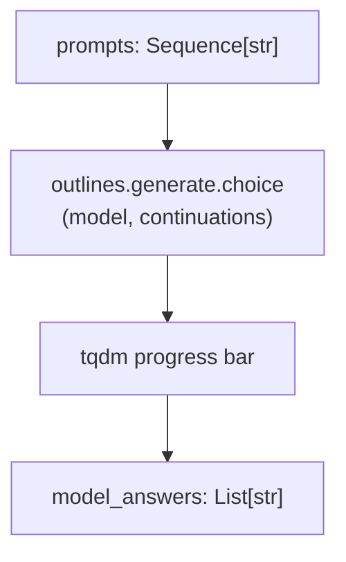
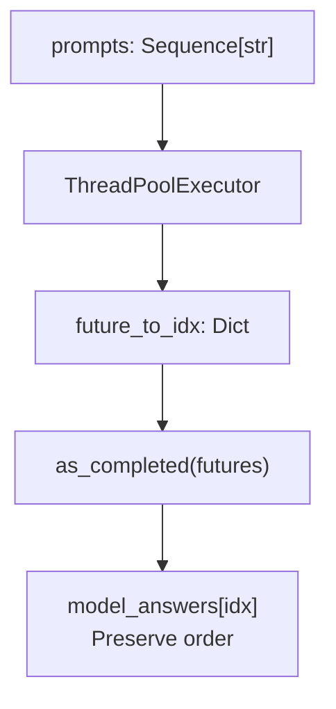
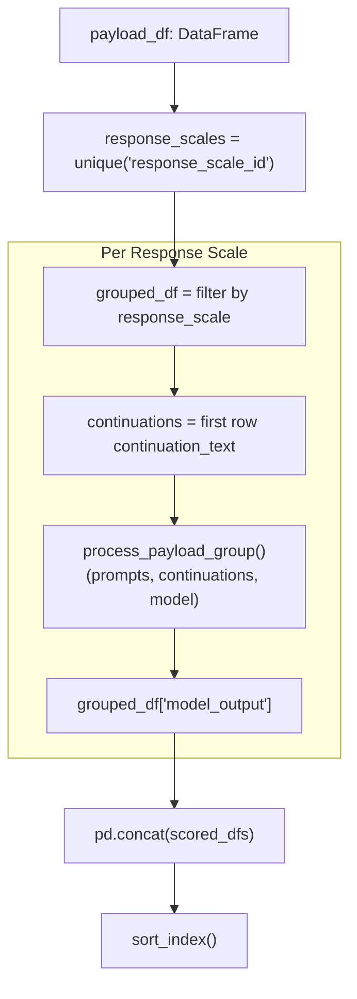
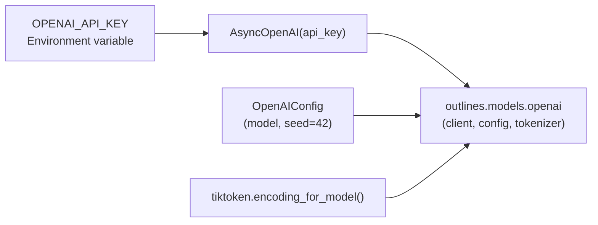
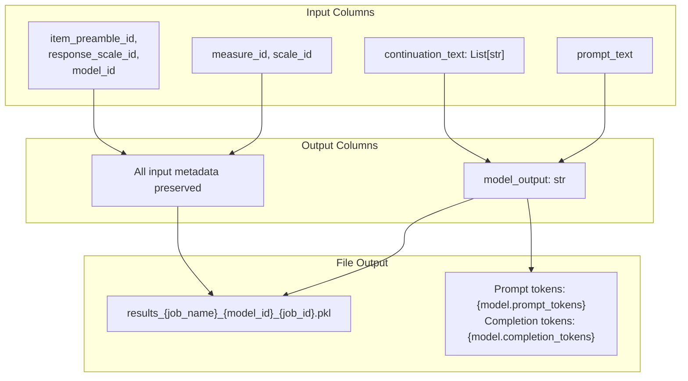
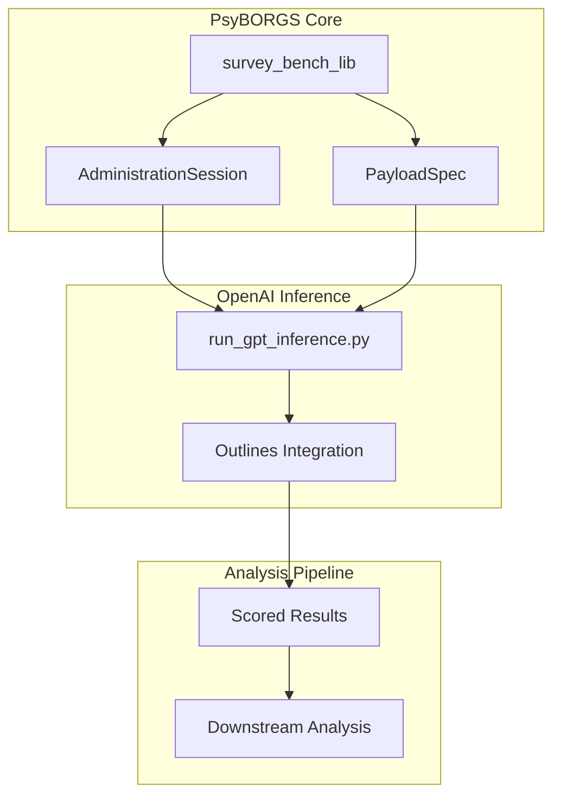

<!-- source: DeepWiki mcp.deepwiki.com · repo google-deepmind/personality_in_llms · page 4.2 OpenAI API Inference · fetched 2026-10-26 -->

# OpenAI API Inference

<details>
<summary>Relevant source files</summary>

The following files were used as context for generating this wiki page:

- [inference_scripts/requirements.txt](inference_scripts/requirements.txt)
- [inference_scripts/run_gpt_inference.py](inference_scripts/run_gpt_inference.py)

</details>


This document covers the OpenAI API inference system implemented in `run_gpt_inference.py`, which administers PsyBORGS psychometric tests to OpenAI models using constrained generation through the Outlines library. The system supports both synchronous and asynchronous inference modes with rate limiting and error handling.

For HuggingFace model inference, see [HuggingFace Model Inference](#4.1). For social media content generation tasks, see [Status Update Generation](#4.3).

## System Architecture

The OpenAI inference system operates as a bridge between the PsyBORGS framework and OpenAI's API, using Outlines for constrained generation to ensure models select from predefined response choices.



Sources: [inference_scripts/run_gpt_inference.py:1-362]()

## Core Components

### Payload Generation Pipeline

The system transforms PsyBORGS administration sessions into inference-ready payloads through a two-stage process:

```mermaid
graph LR
    subgraph "Regular Payload"
        ADMIN["AdministrationSession"]
        MEASURE_GEN["measure_generator()"]
        PROMPT_GEN["prompt_generator()"]
        CONT_GEN["continuation_generator()"]
        PAYLOAD_SPEC["PayloadSpec<br/>(N rows per prompt)"]
    end
    
    subgraph "Generative Payload"
        GROUP_BY["groupby(['prompt_text',<br/>'measure_id', 'scale_id'])"]
        AGG["agg({'continuation_text': list,<br/>'response_value': list})"]
        GEN_PAYLOAD["Generative PayloadSpec<br/>(1 row per prompt)"]
    end
    
    ADMIN --> MEASURE_GEN
    MEASURE_GEN --> PROMPT_GEN
    PROMPT_GEN --> CONT_GEN
    CONT_GEN --> PAYLOAD_SPEC
    
    PAYLOAD_SPEC --> GROUP_BY
    GROUP_BY --> AGG
    AGG --> GEN_PAYLOAD
```



Sources: [inference_scripts/run_gpt_inference.py:52-104]()

### Processing Modes

The system supports two distinct processing modes with different performance characteristics:

| Mode | Function | Parallelization | Memory Usage | Rate Limiting |
|------|----------|----------------|--------------|---------------|
| Serial | `process_payload_group(bulk=False)` | Sequential | Low | Natural |
| Bulk | `process_payload_group(bulk=True)` | ThreadPoolExecutor | High | Manual |

**Serial Processing Flow:**


**Bulk Processing Flow:**


Sources: [inference_scripts/run_gpt_inference.py:107-167]()

### Inference Orchestration

The `administer_session_via_outlines()` function manages the complete inference workflow by grouping payloads by response scale and processing each group:



Sources: [inference_scripts/run_gpt_inference.py:170-243]()

## Configuration and Usage

### Command Line Interface

The script supports comprehensive configuration through command-line arguments:

| Argument | Type | Purpose |
|----------|------|---------|
| `--admin_session` | str | Path to admin session JSON |
| `--model_pointer` | str | OpenAI model identifier |
| `--api_key` | str | OpenAI API key (defaults to env var) |
| `--bulk` | bool | Enable parallel processing |
| `--sample` | bool | Limit to 1000 prompts for testing |
| `--payload` | str | Path to pre-generated payload chunk |

### Authentication and Rate Limiting

The system integrates with OpenAI's API through several key components:



Sources: [inference_scripts/run_gpt_inference.py:248-281](), [inference_scripts/run_gpt_inference.py:330-342]()

### Usage Patterns

**Standard Session Processing:**
```bash
python inference_scripts/run_gpt_inference.py \
    --admin_session='admin_sessions/prod_run_01_external_rating.json' \
    --model_pointer='gpt-3.5-turbo-0125' \
    --bulk
```

**Payload Chunk Processing:**
```bash
python inference_scripts/run_gpt_inference.py \
    --admin_session='admin_sessions/prod_run_01_external_rating.json' \
    --model_pointer='gpt-3.5-turbo-0125' \
    --payload='admin_sessions/prod_run_01_external_rating_payload_0.pkl'
```

Sources: [inference_scripts/run_gpt_inference.py:9-19]()

## Output Format and Integration

### Result Structure

The system outputs scored DataFrames containing both metadata and model responses:



### Integration with PsyBORGS Framework

The system seamlessly integrates with the broader PsyBORGS ecosystem:



Sources: [inference_scripts/run_gpt_inference.py:36-39](), [inference_scripts/run_gpt_inference.py:348-359]()

## Dependencies and Requirements

The system requires specific versions of key packages for optimal compatibility:

| Package | Version | Purpose |
|---------|---------|---------|
| `openai` | 1.17.1 | OpenAI API client |  
| `outlines` | 0.0.46 | Constrained generation |
| `tiktoken` | 0.6.0 | Tokenization |
| `aiolimiter` | 1.1.0 | Rate limiting |
| `pandas` | 2.2.1 | Data manipulation |

Sources: [inference_scripts/requirements.txt:1-9]()

---

