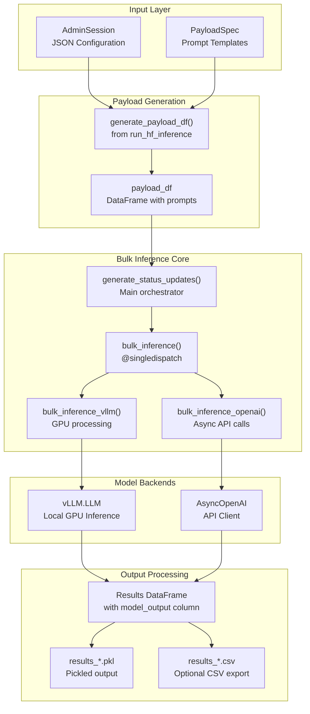
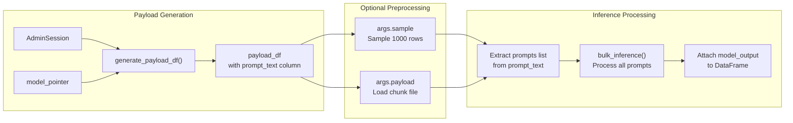
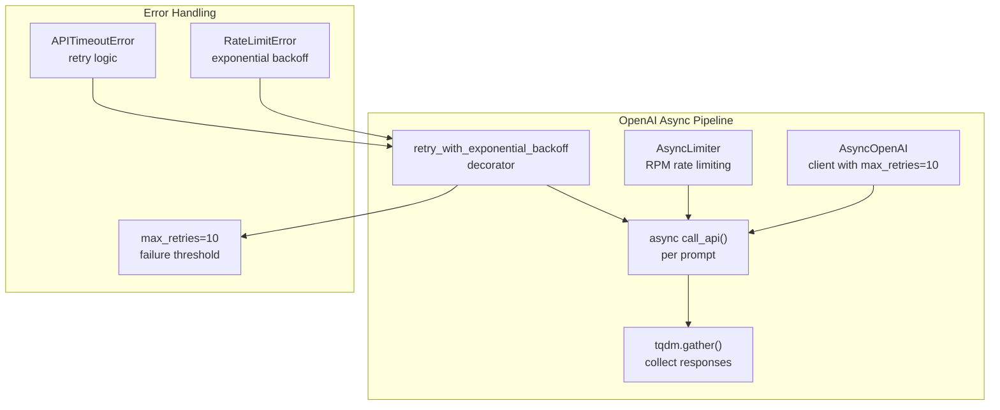
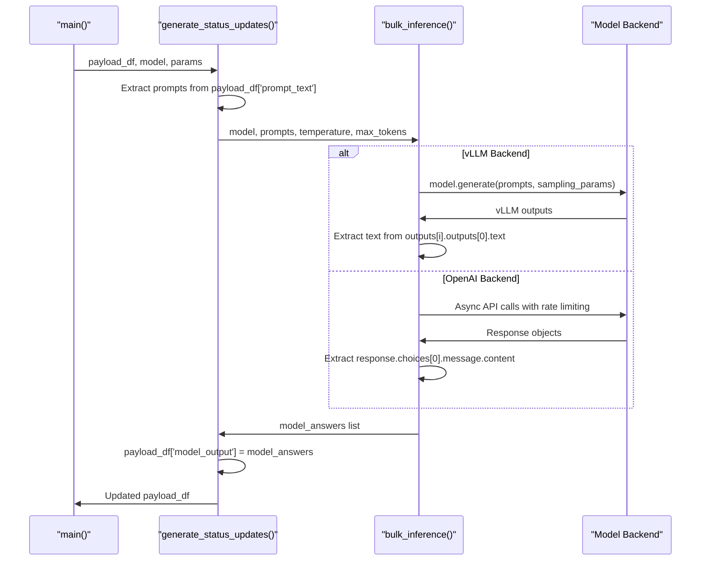
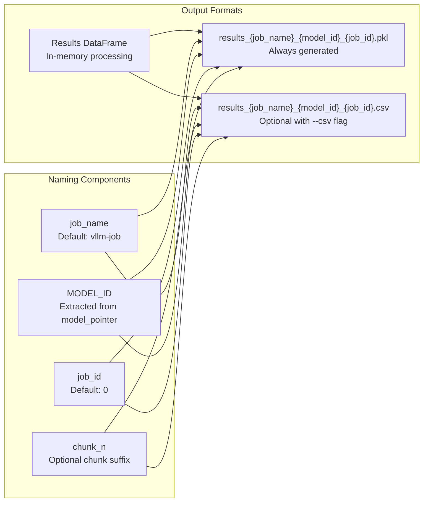

<!-- source: DeepWiki mcp.deepwiki.com · repo google-deepmind/personality_in_llms · page 4.3 Status Update Generation · fetched 2026-10-26 -->

# Status Update Generation

<details>
<summary>Relevant source files</summary>

The following files were used as context for generating this wiki page:

- [inference_scripts/__init__.py](inference_scripts/__init__.py)
- [inference_scripts/generate_status_updates.py](inference_scripts/generate_status_updates.py)
- [inference_scripts/requirements.txt](inference_scripts/requirements.txt)

</details>


## Purpose and Scope

The Status Update Generation system provides a specialized inference pipeline for generating social media content using Large Language Models. This system is designed to produce status updates that reflect specific personality traits as part of downstream task analysis in personality research. The system supports both local GPU-based inference via vLLM and cloud-based inference via the OpenAI API, with built-in rate limiting, error handling, and bulk processing capabilities.

For general model inference workflows, see [HuggingFace Model Inference](#4.1) and [OpenAI API Inference](#4.2). For analyzing the generated content in relation to personality traits, see [Downstream Task Analysis](#5.2).

## System Overview

The Status Update Generation system implements a dual-backend inference architecture that can process large batches of personality-conditioned prompts to generate social media content. The system is built around the `generate_status_updates.py` script, which orchestrates payload generation, model inference, and result compilation.



Sources: [inference_scripts/generate_status_updates.py:1-357]()

## Architecture Components

### Core Functions

The system implements a modular architecture centered around several key functions:

| Function | Purpose | Implementation |
|----------|---------|----------------|
| `generate_status_updates()` | Main orchestrator function | [inference_scripts/generate_status_updates.py:109-131]() |
| `bulk_inference()` | Dispatch function for model backends | [inference_scripts/generate_status_updates.py:133-141]() |
| `bulk_inference_vllm()` | vLLM-specific inference implementation | [inference_scripts/generate_status_updates.py:143-165]() |
| `bulk_inference_openai()` | OpenAI API inference with async processing | [inference_scripts/generate_status_updates.py:167-210]() |
| `retry_with_exponential_backoff()` | Error handling decorator | [inference_scripts/generate_status_updates.py:59-107]() |

### Payload Processing Pipeline



Sources: [inference_scripts/generate_status_updates.py:302-321](), [inference_scripts/generate_status_updates.py:116-130]()

## Model Backend Support

### vLLM Backend Implementation

The vLLM backend provides high-throughput GPU-based inference for HuggingFace models:

```python
# Key configuration from bulk_inference_vllm()
sampling_params = vllm.SamplingParams(
    temperature=temperature,
    max_tokens=max_tokens
)
outputs = model.generate(prompts, sampling_params=sampling_params)
```

The vLLM model is initialized with distributed tensor parallelism support via the `tensor_parallel_size` parameter, allowing multi-GPU inference scaling.

Sources: [inference_scripts/generate_status_updates.py:150-165](), [inference_scripts/generate_status_updates.py:335-338]()

### OpenAI API Backend Implementation

The OpenAI backend implements asynchronous processing with rate limiting and robust error handling:



Sources: [inference_scripts/generate_status_updates.py:174-210](), [inference_scripts/generate_status_updates.py:59-107]()

## Bulk Inference Pipeline

### Singledispatch Implementation

The system uses Python's `@singledispatch` decorator to route inference calls based on model type:

```python
@singledispatch
def bulk_inference(model, prompts, temperature, max_tokens, rpm_limit, api_key):
    raise NotImplementedError(f"Unsupported type for model: {type(model)}")

@bulk_inference.register
def bulk_inference_vllm(model: Callable, ...):
    # vLLM implementation

@bulk_inference.register  
def bulk_inference_openai(model: str, ...):
    # OpenAI implementation
```

This design allows the same interface to handle both callable vLLM model objects and string-based OpenAI model identifiers.

Sources: [inference_scripts/generate_status_updates.py:133-141](), [inference_scripts/generate_status_updates.py:143-149](), [inference_scripts/generate_status_updates.py:167-173]()

### Processing Flow



Sources: [inference_scripts/generate_status_updates.py:115-131](), [inference_scripts/generate_status_updates.py:155-163](), [inference_scripts/generate_status_updates.py:197-202]()

## Error Handling and Rate Limiting

### Exponential Backoff Strategy

The retry mechanism implements exponential backoff with jitter for handling API errors:

| Parameter | Default Value | Purpose |
|-----------|---------------|---------|
| `initial_delay` | 1.0 seconds | Base retry delay |
| `exponential_base` | 2.0 | Backoff multiplier |
| `max_retries` | 10 | Maximum retry attempts |
| `jitter` | True | Randomization to prevent thundering herd |

The system specifically handles `openai.RateLimitError` and `openai.APITimeoutError` with a 60-second additional delay on top of the exponential backoff calculation.

Sources: [inference_scripts/generate_status_updates.py:59-107]()

### Rate Limiting Configuration

OpenAI API calls are rate-limited using `AsyncLimiter`:

```python
# Default rate limiting
rpm_limit = rpm_limit or 50
limiter = AsyncLimiter(rpm_limit)

# Applied per API call
async with limiter:
    response = await client.chat.completions.create(...)
```

Sources: [inference_scripts/generate_status_updates.py:205-208](), [inference_scripts/generate_status_updates.py:188-195]()

## Configuration and Usage

### Command Line Interface

The script supports comprehensive command-line configuration:

| Argument | Type | Purpose | Example |
|----------|------|---------|---------|
| `--admin_session` | str | Configuration file path | `admin_sessions/generate_updates_*.json` |
| `--model_pointer` | str | Model identifier | `meta-llama/Llama-2-7b-chat-hf` or `gpt-4o-mini` |
| `--vllm` | flag | Enable vLLM backend | - |
| `--openai` | flag | Enable OpenAI backend | - |
| `--temperature` | float | Sampling temperature | 0.70 (default) |
| `--sample` | flag | Use 1000-row sample | - |
| `--n_gpus` | int | GPU count for vLLM | 1 (default) |
| `--rpm_limit` | int | OpenAI rate limit | 50 (default) |

Sources: [inference_scripts/generate_status_updates.py:212-262]()

### Backend Selection Logic

The system enforces mutually exclusive backend selection:

```python
# Validation logic
if sum(map(bool, [args.vllm, args.openai])) > 1:
    raise ValueError('Please choose only one flag for inference')

if sum(map(bool, [args.vllm, args.openai])) == 0:
    raise ValueError('Please choose a method for inference')
```

Sources: [inference_scripts/generate_status_updates.py:270-278]()

## Output Format and File Management

### Result Structure

The system produces augmented DataFrames with the following key columns:

| Column | Source | Content |
|--------|--------|---------|
| `prompt_text` | Original payload | Personality-conditioned prompts |
| `model_output` | Generated | LLM-generated status updates |
| `model_id` | Configuration | Model identifier for tracking |

### File Output Options



Sources: [inference_scripts/generate_status_updates.py:351-353](), [inference_scripts/generate_status_updates.py:288-316]()

---

