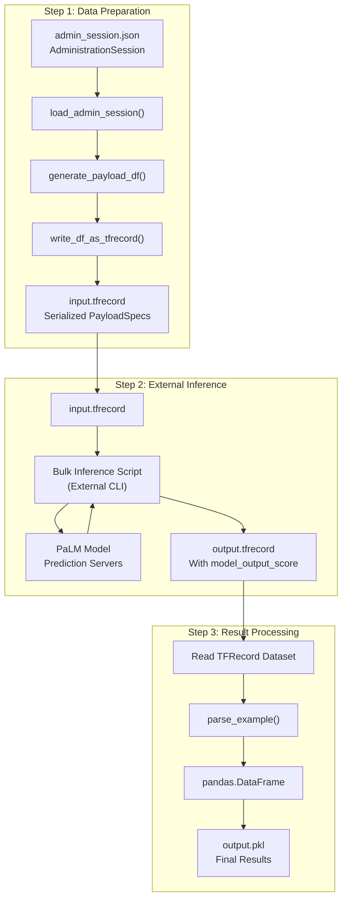
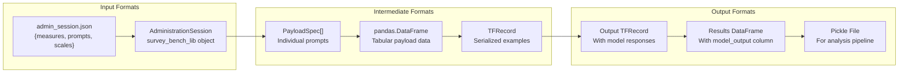
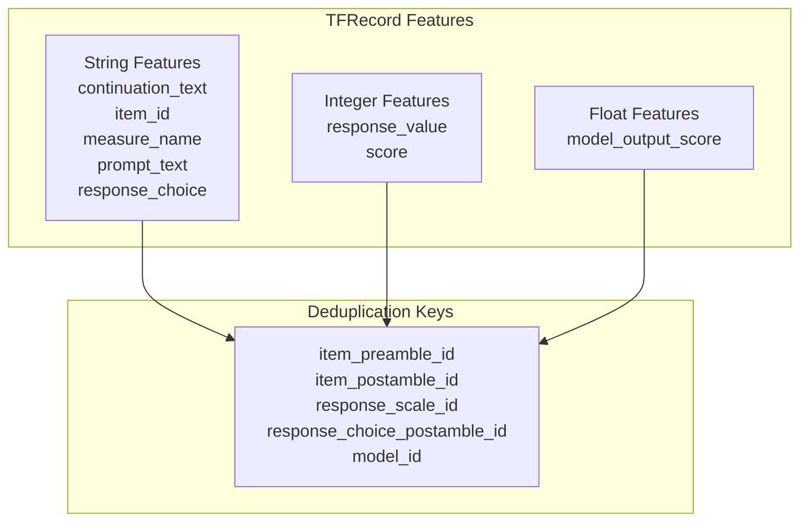
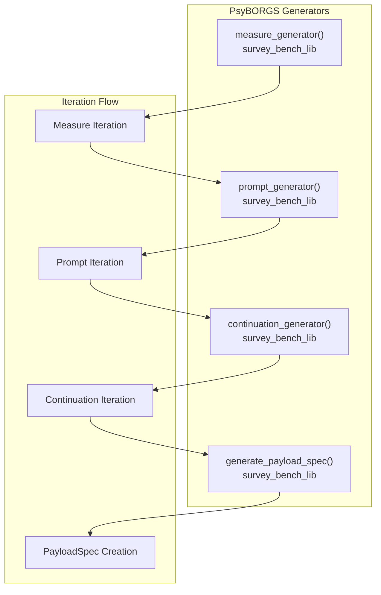
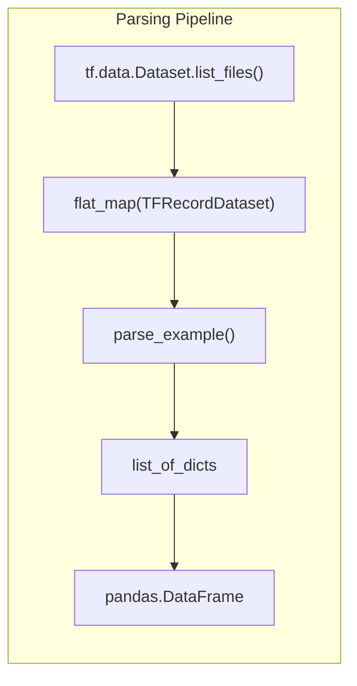

<!-- source: DeepWiki mcp.deepwiki.com · repo google-deepmind/personality_in_llms · page 4.4 Bulk Inference Pipeline · fetched 2026-10-26 -->

# Bulk Inference Pipeline

Relevant source files

The following files were used as context for generating this wiki page:

- [Bulk_Inference_experimentation_pipeline.ipynb](Bulk_Inference_experimentation_pipeline.ipynb)

This document covers the bulk inference pipeline for large-scale experiments using PaLM models and TFRecord format. This pipeline is designed for high-throughput personality assessment experiments that require processing thousands of prompts efficiently.

For individual model inference with HuggingFace models, see [HuggingFace Model Inference](#4.1). For OpenAI API-based inference, see [OpenAI API Inference](#4.2). For social media content generation, see [Status Update Generation](#4.3).

## Overview

The bulk inference pipeline is a three-step process implemented in a Jupyter notebook that converts PsyBORGS admin sessions into TFRecord format, processes them through external bulk inference scripts, and converts the results back to pickle format for analysis. This pipeline is specifically optimized for PaLM model experiments requiring high throughput and memory efficiency.

## Pipeline Architecture

### Three-Step Process Flow

Sources: [Bulk_Inference_experimentation_pipeline.ipynb:13-27]()

### Data Format Transformations

Sources: [Bulk_Inference_experimentation_pipeline.ipynb:137-175](), [Bulk_Inference_experimentation_pipeline.ipynb:196-225]()

## Key Components

### Data Loading and Generation

The pipeline uses several core functions from the PsyBORGS framework to convert admin sessions into processable payloads:

| Function | Purpose | Input | Output |
|----------|---------|-------|--------|
| `load_admin_session()` | Load and parse admin session JSON | JSON file path | `AdministrationSession` object |
| `generate_payload_df()` | Create payload dataframe | `AdministrationSession`, `model_id` | `pandas.DataFrame` |
| `generate_payload_row()` | Memory-efficient payload generator | `AdministrationSession`, `model_id` | Generator of `PayloadSpec` |
| `write_df_as_tfrecord()` | Serialize dataframe to TFRecord | `pandas.DataFrame`, shard index | TFRecord file |

Sources: [Bulk_Inference_experimentation_pipeline.ipynb:137-147](), [Bulk_Inference_experimentation_pipeline.ipynb:149-175]()

### TFRecord Feature Schema

The pipeline uses a standardized feature description for TFRecord serialization:

Sources: [Bulk_Inference_experimentation_pipeline.ipynb:264-290]()

### Processing Modes

The pipeline supports two distinct processing modes:

#### Scoring Mode
Used for personality survey responses where the model output needs to be scored:
- Creates `model_output` column from `continuation_text`
- Maintains one-to-one mapping between prompts and responses
- Suitable for Likert scale responses

#### Generative Mode  
Used for downstream tasks like status update generation:
- Groups multiple responses per prompt using `<SEP>` delimiter
- Deduplicates based on key features
- Suitable for text generation tasks

Sources: [Bulk_Inference_experimentation_pipeline.ipynb:434-447](), [Bulk_Inference_experimentation_pipeline.ipynb:484-489]()

## Configuration Parameters

### File Path Configuration

| Parameter | Purpose | Example Value |
|-----------|---------|---------------|
| `admin_session_file_path` | Input admin session JSON | `'admin_sessions/sample_admin_session.json'` |
| `tfrecord_file_path` | Intermediate TFRecord file | `'sample_file.tfrecord'` |
| `llm_output_tfrecord_file_path` | Output from bulk inference | `'sample_llm_output.tfrecord'` |
| `output_pkl_filepath` | Final pickle output | `'sample_llm_output.pkl'` |

### Sharding Configuration

| Parameter | Purpose | Default Value |
|-----------|---------|---------------|
| `max_num_rows_per_shard` | Maximum payload specs per shard | 4,800,000 |
| `num_shards` | Number of output shards | 1 |
| `model_id` | Model identifier for PsyBORGS | `'PaLM'` |

Sources: [Bulk_Inference_experimentation_pipeline.ipynb:92-112]()

## Integration with PsyBORGS Framework

### Generator Functions Integration

The pipeline leverages the PsyBORGS framework's generator functions for systematic payload creation:

Sources: [Bulk_Inference_experimentation_pipeline.ipynb:155-171]()

### Memory Management

For large-scale experiments, the pipeline implements memory-efficient processing:

- Uses generator-based iteration instead of loading all payloads into memory
- Implements sharding to split large datasets across multiple files
- Processes data in configurable batch sizes via `max_num_rows_per_shard`

Sources: [Bulk_Inference_experimentation_pipeline.ipynb:227-247]()

## Output Processing

### TFRecord Parsing

The pipeline includes specialized parsing functions for reading inference results:

Sources: [Bulk_Inference_experimentation_pipeline.ipynb:400-414](), [Bulk_Inference_experimentation_pipeline.ipynb:424-426]()

### Post-Processing Operations

Depending on the experiment type, the pipeline applies different post-processing steps:

**For Generative Tasks:**
- Decodes byte strings to UTF-8
- Groups responses by deduplication keys
- Concatenates multiple outputs with `<SEP>` delimiter
- Generates string length histograms for quality assessment

**For Scoring Tasks:**
- Copies continuation text to model output column
- Preserves original response structure
- Maintains scoring metadata

Sources: [Bulk_Inference_experimentation_pipeline.ipynb:467-473](), [Bulk_Inference_experimentation_pipeline.ipynb:484-489](), [Bulk_Inference_experimentation_pipeline.ipynb:500-508]()

## System Integration

This bulk inference pipeline integrates with the broader personality assessment system:

- **Input**: Uses admin sessions from the configuration system (see [Admin Session Configuration](#6.1))
- **Framework**: Built on PsyBORGS psychometric framework (see [PsyBORGS Framework](#3))
- **Output**: Produces pickle files compatible with analysis templates (see [Analysis System](#5))
- **Parallel Processing**: Designed for high-throughput experiments complementing other inference methods

The pipeline is specifically optimized for PaLM model experiments requiring maximum throughput and is intended for research scenarios where thousands of personality assessment prompts need to be processed efficiently.

Sources: [Bulk_Inference_experimentation_pipeline.ipynb:10-27]()

---

