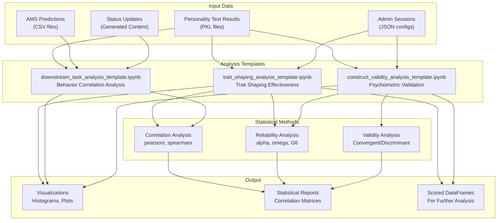
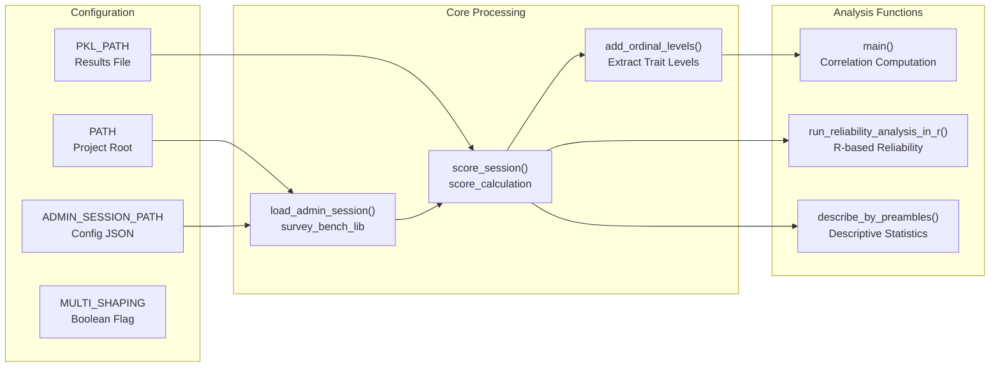
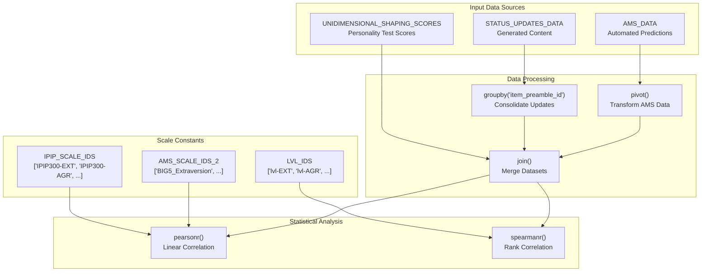
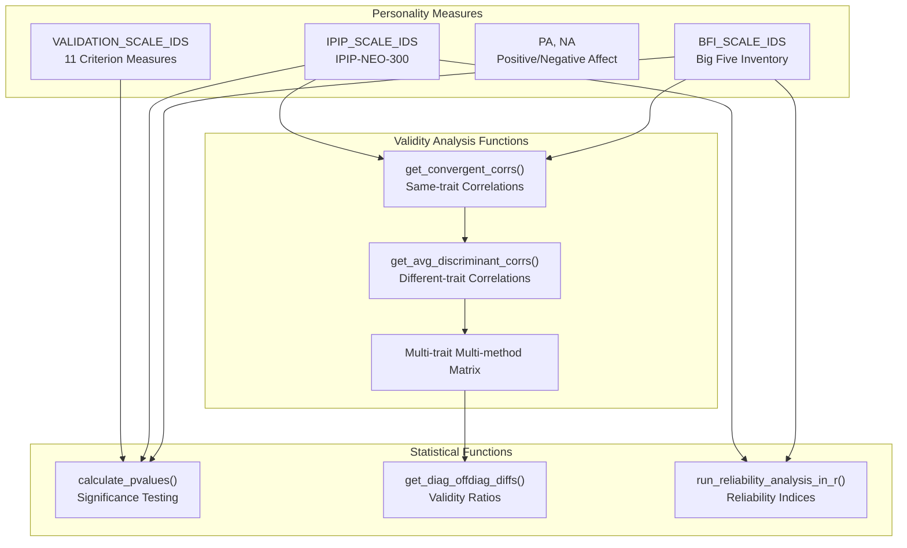
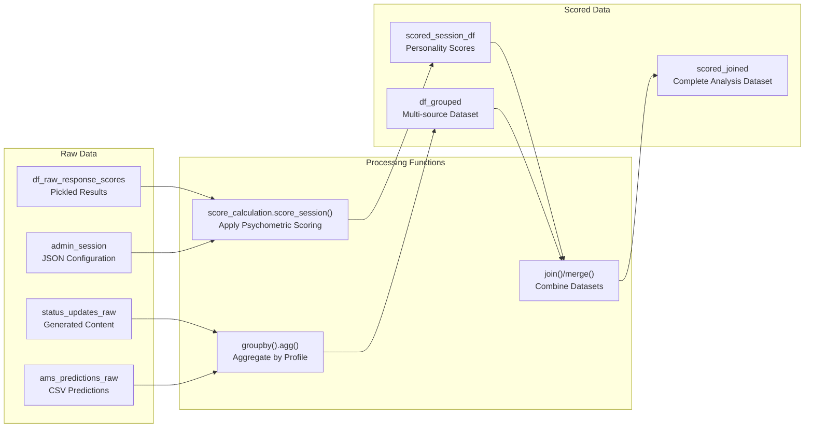
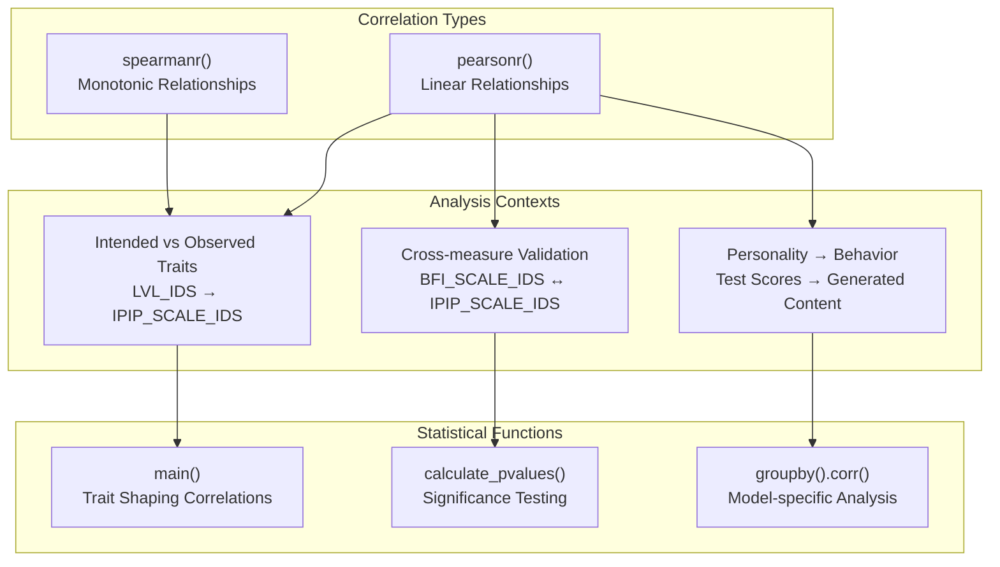
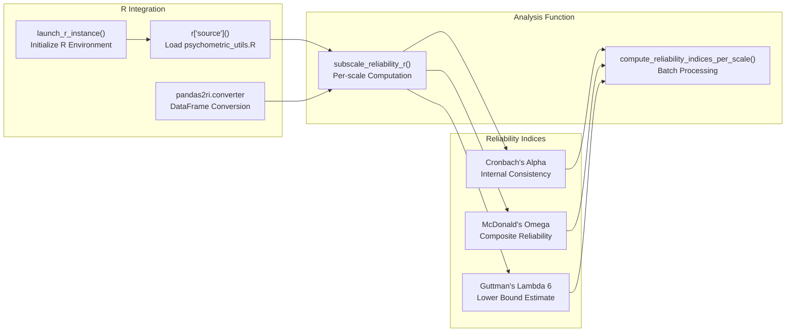

<!-- source: DeepWiki mcp.deepwiki.com · repo google-deepmind/personality_in_llms · page 5 Analysis System · fetched 2026-10-26 -->

# Analysis System

Relevant source files

The following files were used as context for generating this wiki page:

- [analysis/construct_validity_analysis_template.ipynb](analysis/construct_validity_analysis_template.ipynb)
- [analysis/downstream_task_analysis_template.ipynb](analysis/downstream_task_analysis_template.ipynb)
- [analysis/trait_shaping_analysis_template.ipynb](analysis/trait_shaping_analysis_template.ipynb)

The Analysis System provides comprehensive tools for analyzing personality traits in Large Language Models through three specialized Jupyter notebook templates. This system enables researchers to evaluate trait shaping effectiveness, validate personality measures, and correlate psychometric scores with downstream behaviors. For information about the underlying psychometric framework, see [PsyBORGS Framework](#3). For details about data collection through inference, see [Inference System](#4).

## Overview

The Analysis System consists of three primary notebook templates that work together to provide complete personality analysis capabilities:

Sources: [analysis/trait_shaping_analysis_template.ipynb:1-706](), [analysis/downstream_task_analysis_template.ipynb:1-1401](), [analysis/construct_validity_analysis_template.ipynb:1-1298]()

## Analysis Templates

### Trait Shaping Analysis Template

The `trait_shaping_analysis_template.ipynb` evaluates how effectively models can simulate controlled personality traits. This template supports both independent trait shaping (one trait at a time) and multidimensional trait shaping (multiple traits simultaneously).

Key functionality includes:
- Loading and scoring personality test responses using [analysis/trait_shaping_analysis_template.ipynb:154-161]()
- Computing correlations between intended trait levels and observed scores [analysis/trait_shaping_analysis_template.ipynb:578-637]()
- Reliability analysis through R integration [analysis/trait_shaping_analysis_template.ipynb:514-535]()
- Descriptive statistics by personality prompts [analysis/trait_shaping_analysis_template.ipynb:221-275]()

Sources: [analysis/trait_shaping_analysis_template.ipynb:1-706]()

### Downstream Task Analysis Template

The `downstream_task_analysis_template.ipynb` analyzes how personality test scores correlate with generated content in downstream tasks, particularly social media status updates.

The template performs correlation analysis between:
- IPIP-300 personality scores and AMS predicted personality traits [analysis/downstream_task_analysis_template.ipynb:314-330]()
- Prompted personality levels and downstream personality predictions [analysis/downstream_task_analysis_template.ipynb:358-377]()

Sources: [analysis/downstream_task_analysis_template.ipynb:1-1401]()

### Construct Validity Analysis Template

The `construct_validity_analysis_template.ipynb` provides comprehensive psychometric validation of personality measures across different models and conditions.

Key validation analyses include:
- Multitrait-multimethod correlation matrices [analysis/construct_validity_analysis_template.ipynb:760-780]()
- Convergent and discriminant validity assessment [analysis/construct_validity_analysis_template.ipynb:839-921]()
- Cross-measure criterion validity [analysis/construct_validity_analysis_template.ipynb:1019-1138]()

Sources: [analysis/construct_validity_analysis_template.ipynb:1-1298]()

## Data Flow and Integration

The analysis system processes multiple data types through a standardized pipeline:

The system uses standardized identifiers for data integration:
- `item_preamble_id`: Links personality prompts across datasets [analysis/downstream_task_analysis_template.ipynb:476-489]()
- `partial_id`: Extracted identifier for matching across experiments [analysis/downstream_task_analysis_template.ipynb:476-481]()
- `SPID` combinations: Simulated participant identifiers for joining measures [analysis/construct_validity_analysis_template.ipynb:639-704]()

Sources: [analysis/trait_shaping_analysis_template.ipynb:174-196](), [analysis/downstream_task_analysis_template.ipynb:471-490](), [analysis/construct_validity_analysis_template.ipynb:634-720]()

## Statistical Analysis Methods

### Correlation Analysis

The system implements multiple correlation methods to assess relationships between variables:

Sources: [analysis/trait_shaping_analysis_template.ipynb:578-620](), [analysis/downstream_task_analysis_template.ipynb:314-377](), [analysis/construct_validity_analysis_template.ipynb:434-447]()

### Reliability Analysis

Reliability assessment uses R-based psychometric functions:

The reliability analysis function iterates through all measures and scales in an admin session, computing multiple reliability indices with error handling [analysis/trait_shaping_analysis_template.ipynb:476-512]().

Sources: [analysis/trait_shaping_analysis_template.ipynb:451-535](), [analysis/construct_validity_analysis_template.ipynb:1164-1248]()

## Analysis Workflow

### Template Configuration

Each analysis template requires specific configuration parameters:

| Parameter | Trait Shaping | Downstream Task | Construct Validity |
|-----------|---------------|-----------------|-------------------|
| `PATH` | Project root directory | Project root directory | Project root directory |
| `PKL_PATH` | Results pickle file | Shaping scores pickle | Results pickle file |
| `ADMIN_SESSION_PATH` | Admin session JSON | N/A | Admin session JSON |
| `MULTI_SHAPING` | Boolean flag | N/A | N/A |
| `STATUS_UPDATES_DATA` | N/A | Generated content pickle | N/A |
| `AMS_DATA` | N/A | AMS predictions CSV | N/A |
| `MODEL_POINTER` | N/A | N/A | Model identifier string |

### Data Processing Pipeline

The analysis workflow follows a standardized sequence:

1. **Data Loading**: Import pickled results and configuration files [analysis/trait_shaping_analysis_template.ipynb:154-161]()
2. **Scoring**: Apply psychometric scoring using the PsyBORGS framework [analysis/trait_shaping_analysis_template.ipynb:174-196]()
3. **Data Transformation**: Extract levels, create identifiers, and join datasets [analysis/downstream_task_analysis_template.ipynb:476-490]()
4. **Statistical Analysis**: Compute correlations, reliability indices, and validity metrics
5. **Visualization**: Generate histograms, correlation matrices, and summary statistics

### Output Generation

The system produces multiple output types:
- **Scored DataFrames**: Can be saved for further analysis using `SAVE_SCORES_FILENAME` [analysis/trait_shaping_analysis_template.ipynb:205-208]()
- **Statistical Reports**: Correlation coefficients, p-values, and reliability indices
- **Visualizations**: Distribution plots and descriptive statistics tables

Sources: [analysis/trait_shaping_analysis_template.ipynb:1-706](), [analysis/downstream_task_analysis_template.ipynb:1-1401](), [analysis/construct_validity_analysis_template.ipynb:1-1298]()

---

